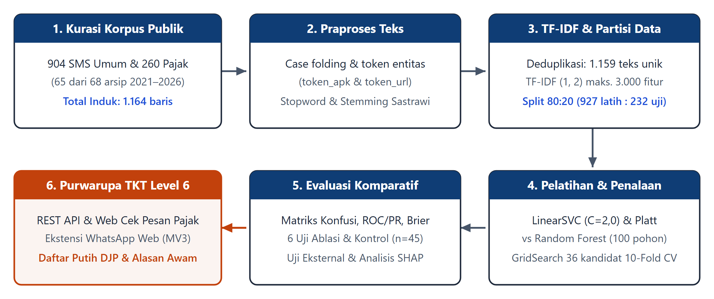

# BAB I PENDAHULUAN

## 1.1 Latar Belakang Masalah

Direktorat Jenderal Pajak (DJP) terus memperluas layanan digital perpajakan melalui sistem *Coretax* yang dilengkapi siaran WhatsApp resmi [1], [2] maupun aplikasi *M-Pajak* [3]. Sayangnya, perluasan kanal elektronik pemerintah tersebut turut dimanfaatkan pelaku penipuan pesan singkat (*smishing*) yang menyamar sebagai petugas pajak [3], [4]. Serangan ini menimbulkan kerugian finansial bagi wajib pajak sekaligus mengancam kepercayaan publik terhadap adopsi layanan perpajakan digital [3].

Studi dokumentasi awal dilakukan terhadap 68 arsip publik periode 2021 sampai 2026 dari pengumuman resmi DJP serta berita kantor pelayanan pajak dan media pemeriksa fakta. Dari arsip yang mayoritas terbit pada tahun 2024 hingga 2026 itu, terpetakan sebanyak 12 modus penipuan pajak melalui WhatsApp. Pelaku kerap menyebar berkas `.apk` berbahaya serta tagihan fiktif [5]. Sebagian pesan palsu juga mencantumkan tautan tiruan seperti `coretax-online`. Selain mencatut nama layanan resmi [2], [5], penipu meniru gaya surat dinas beserta istilah kode *billing* dan EFIN untuk mengecoh wajib pajak awam [1].

Pada sisi penyaringan pesan, riset pembelajaran mesin terdahulu banyak menguji deteksi spam SMS memakai pembobotan frekuensi kata hingga TF-IDF [6], [7], [8], [9], [10]. Studi lain membandingkan *Support Vector Machine* dengan *Random Forest* pada fitur leksikal tautan *phishing* [11], maupun pada teks surel *phishing* serta korpus pesan singkat publik [12], [13]. Kajian tersebut masih terfokus pada struktur alamat web atau korpus berbahasa Inggris. Akibatnya, ragam percakapan layanan publik di Indonesia belum terwakili.

Untuk kanal WhatsApp berbahasa Indonesia, pendekatan sebelumnya bertumpu pada logika *fuzzy* berbasis aturan [14] atau memakai `HashingVectorizer` [15]. Pemakaian `HashingVectorizer` justru menghilangkan keterlacakan bobot kata pemicu saat sistem perlu menjelaskan alasan peringatan [15]. Beberapa riset teks juga menghapus URL serta tanda baca pada tahap pembersihan sehingga penanda tautan dan ekstensi berkas ikut terbuang [6], [13]. Di sisi lain, studi yang sudah menyandikan token tautan ternyata belum mencakup berkas `.apk` ataupun domain perpajakan [16]. Padahal, riset itu membuktikan bahwa kemiripan kosakata pesan promosi resmi mudah mengecoh penyaring kata kunci sederhana [16].

Kajian empiris mengenai *phishing* yang mencatut otoritas pajak di Indonesia sejauh ini masih berfokus pada aspek hukum tanpa detektor teks otomatis [3]. Untuk menjawab celah itu, penelitian ini menyusun 260 pesan pajak berimbang bersama 904 SMS umum dengan penyandian `token_apk` dan `token_url`. Model terbaik dipilih lewat komparasi terkalibrasi antara `LinearSVC` dengan *Random Forest*. Model terpilih itu lalu dilengkapi penjelas kata pemicu [17], [18] serta verifikasi domain resmi `pajak.go.id` [5].

Dari sudut pandang pemanfaatan sistem informasi, pemeriksaan pesan lewat situs web terpisah kurang praktis karena menuntut penyalinan teks secara manual. Hambatan alur kerja tersebut mendorong perancangan purwarupa Tingkat Kesiapan Teknologi (TKT) Level 6 yang menyatukan layanan REST API FastAPI bersama web *Cek Pesan Pajak* ke ekstensi peramban *WhatsApp Web* [19], [20]. Penyematan langsung di jendela obrolan memudahkan warga memeriksa skor risiko beserta alasan peringatan sebelum mengeklik tautan atau memasang berkas.

## 1.2 Rumusan Masalah

Berdasarkan kesenjangan literatur serta hambatan verifikasi layanan perpajakan di lapangan, penelitian ini berhadapan dengan tingginya kemiripan diksi pesan penipuan terhadap pengumuman resmi instansi. Situasi tersebut melemahkan pemeriksaan manual oleh wajib pajak maupun keandalan penyaring spam konvensional yang belum terkalibrasi. Masalah utama itu kemudian dirumuskan ke dalam tiga pernyataan sebab-akibat berikut:

a) Peniruan gaya surat dinas dan istilah perpajakan pada pesan *phishing* menyulitkan wajib pajak memverifikasi keaslian informasi secara manual. Kekeliruan penilaian tersebut mendorong korban memasang berkas `.apk` berbahaya yang mengancam keamanan kredensial akun dan dana pribadi.

b) Penyaring spam konvensional yang hanya dilatih memakai korpus SMS umum mudah mengalami bias bobot kata ketika menerima diksi kedinasan pajak. Ketimpangan data latih ini memicu salah blokir pada pengumuman resmi DJP (*false positive*) sekaligus meloloskan pesan *phishing* baru (*false negative*).

c) Ketiadaan tolok ukur komparatif yang terkalibrasi antara klasifier linear dan ansambel pohon pada korpus pajak Indonesia menyulitkan pemilihan model peringatan dini yang andal. Keterbatasan itu diperparah oleh absennya alat verifikasi langsung di *WhatsApp Web*, sehingga masyarakat tetap mengandalkan pengecekan manual tanpa petunjuk risiko.

## 1.3 Batasan Masalah

Ruang lingkup pengerjaan Tugas Akhir *Prototype* ini dibatasi melalui enam ketentuan teknis berikut:

a) Klasifikasi berfokus secara biner pada teks pesan instan berbahasa Indonesia tanpa analisis gambar maupun audio. Kelas `1` menandai indikasi penipuan, sedangkan kelas `0` menandai pesan aman atau resmi.

b) Bahan data sepenuhnya berasal dari sumber terbuka tanpa dokumen rahasia instansi mana pun. Dataset induk berjumlah 1.164 baris yang memadukan 904 SMS umum sesudah menyisihkan 239 promo dari rilis CSV Rahmi dan Wibisono [6], bersama 260 teks pajak dari 65 di antara 68 sumber publik periode 2021 sampai 2026 [2], [5].

c) Tahap praproses mencakup pengecilan huruf serta penyandian pola `.apk` menjadi `token_apk` dan tautan menjadi `token_url`. Teks selanjutnya dibersihkan dari simbol nonalfanumerik, disaring kata umumnya (*stopword removal*), diubah ke kata dasar lewat Sastrawi, dan dipetakan ke vektor TF-IDF maksimal 3.000 fitur unigram-bigram.

d) Eksperimen hanya membandingkan `LinearSVC` dengan `RandomForestClassifier` sesudah deduplikasi 5 teks Sastrawi identik. Sebanyak 1.159 teks unik tersebut dibagi secara terstratifikasi 80:20 menjadi 927 data latih dan 232 data uji.

e) Kinerja klasifikasi diukur memakai *Confusion Matrix* yang meliputi metrik *Accuracy*, *Precision*, *Recall*, dan *F1-Score*. Evaluasi juga dilengkapi validasi silang sepuluh lipatan, *ROC-AUC*, *PR-AUC*, serta kalibrasi probabilitas (*Brier Score* dan *Log Loss*).

f) Luaran akhir berwujud purwarupa TKT Level 6 berbahasa Python berupa layanan FastAPI dan antarmuka web *Cek Pesan Pajak* beserta ekstensi *WhatsApp Web* (*Manifest V3*). Perangkat lunak ini dilengkapi fitur penjelas kata pemicu maupun pemindai `.apk` dan verifikasi domain `pajak.go.id`.

## 1.4 Tujuan Penelitian

Selaras dengan rumusan masalah di atas, penelitian ini menetapkan tiga tujuan terukur berikut:

a) Menyusun korpus teks perpajakan berbahasa Indonesia yang berimbang antara pesan *phishing* dengan pengumuman resmi. Data tersebut lalu diproses melalui penyandian `token_apk` dan `token_url` bersama *stemming* Sastrawi serta pembobotan TF-IDF.

b) Menguji dan membandingkan kinerja klasifikasi serta kalibrasi probabilitas antara `LinearSVC` berkalibrasi *Platt scaling* dengan *Random Forest*. Tahap ini turut menjalankan uji kontrol tanpa korpus pajak guna memverifikasi penurunan salah blokir pesan resmi.

c) Merancang, membangun, dan menguji purwarupa sistem deteksi terpadu berbasis REST API FastAPI bersama antarmuka web *Cek Pesan Pajak* serta ekstensi *WhatsApp Web*. Sistem tersebut menyajikan tingkat risiko beserta penjelasan indikator pemicu berbahasa awam.

## 1.5 Manfaat Penelitian

Pengembangan model klasifikasi berimbang serta purwarupa deteksi pesan instan ini diharapkan memberi kontribusi nyata bagi ranah akademik maupun tata kelola layanan informasi publik. Selain menunjang materi pembelajaran komputasi teks, sistem yang dirancang juga ditujukan untuk mendukung perlindungan digital bagi masyarakat luas. Manfaat penelitian dibagi ke dalam tiga aspek berikut:

a) Manfaat Akademik dan Universitas Siber Asia (UNSIA): Memberikan bukti empiris perbandingan kinerja `LinearSVC` dan *Random Forest* beserta mitigasi *keyword bias*. Korpus pajak terbuka dan modul purwarupa ini juga bermanfaat sebagai bahan praktikum NLP pada Program Studi PJJ Sistem Informasi.

b) Manfaat bagi Institusi Publik: Menyediakan pemetaan 12 modus penipuan pajak serta rujukan rancangan mekanisme verifikasi kanal resmi dan peringatan dini berbasis data lapangan. Temuan pola leksikal penipu ini dapat menunjang materi edukasi perlindungan wajib pajak.

c) Manfaat bagi Masyarakat: Menghadirkan alat verifikasi praktis lewat web *Cek Pesan Pajak* dan ekstensi *WhatsApp Web*. Wajib pajak dapat membaca indikasi risiko secara jelas sebelum mengeklik tautan atau memasang berkas `.apk`.

## 1.6 Metode Penelitian

Penelitian ini memadukan metode eksperimen kuantitatif dengan alur *Research and Development* (R&D) sesuai pedoman Tugas Akhir *Prototype* UNSIA [20], [21]. Pengumpulan teks memakai studi dokumentasi [22] atas 68 arsip publik periode 2021 sampai 2026, termasuk pengumuman resmi DJP [2], [5]. Sebanyak 65 sumber unik di antaranya lalu dikurasi menjadi 260 pesan pajak berimbang yang terdiri atas 130 pesan penipuan dari 12 modus dan 130 pesan aman pada 10 kategori siaran resmi maupun percakapan administrasi perpajakan. Penggabungannya dengan 904 SMS umum [6] membentuk dataset induk 1.164 baris. Rincian komposisinya tersaji pada Tabel 1.1.

Tabel 1.1 Komposisi Korpus Dataset Penelitian

| Sumber Korpus | Asal Pengumpulan | Kategori Phishing | Kategori Aman | Jumlah Total |
| :--- | :--- | :---: | :---: | :---: |
| Kumpulan SMS Publik Indonesia | Repositori Akademik UPI (Rahmi & Wibisono) [6] | 335 | 569 | 904 |
| Kumpulan Teks Khusus Perpajakan | Kurasi 65 dari 68 sumber publik 2021–2026 [2], [5] | 130 | 130 | 260 |
| Himpunan Data Gabungan Induk | Integrasi Korpus SMS Umum serta Teks Pajak | 465 | 699 | 1.164 |

Sumber: Olahan Data Penelitian (2026).

Seluruh teks melewati pembakuan kata dasar bahasa Indonesia memakai pustaka Sastrawi mengikuti pendekatan riset lokal [15], selaras dengan penerapan *stemming* bahasa Indonesia pada SMS [9]. Tahap ini dilengkapi penyandian token entitas `.apk` dan URL guna mengembangkan teknik pelestarian tautan [16] sebelum ekstraksi fitur TF-IDF [10], [13]. Pembobotan tersebut dibatasi maksimal 3.000 fitur unigram-bigram, lalu dilanjutkan validasi silang sepuluh lipatan beserta penyetelan hiperparameter dan kalibrasi probabilitas. Model terbaik yang mendukung keterjelasan bobot pemicu [17] selanjutnya ditanamkan ke purwarupa TKT Level 6 pada Gambar 1.1 [19], [20].

Gambar 1.1 Tahapan Metode Penelitian.

Karena matriks TF-IDF berdimensi tinggi bersifat jarang (*sparse*), hipotesis kerja [23], [24] memperkirakan `LinearSVC` menghasilkan konsistensi validasi silang serta kalibrasi peluang lebih baik daripada *Random Forest*. Dugaan itu selaras dengan temuan mengenai keunggulan klasifier linear pada representasi teks pendek [13], [17]. Pengujiannya mencakup evaluasi *10-Fold CV* beserta *holdout* dan perbandingan *Brier Score* maupun *Log Loss*. Langkah tersebut ditutup dengan uji kontrol tanpa korpus pajak guna mengukur penurunan salah blokir terhadap pesan resmi.
