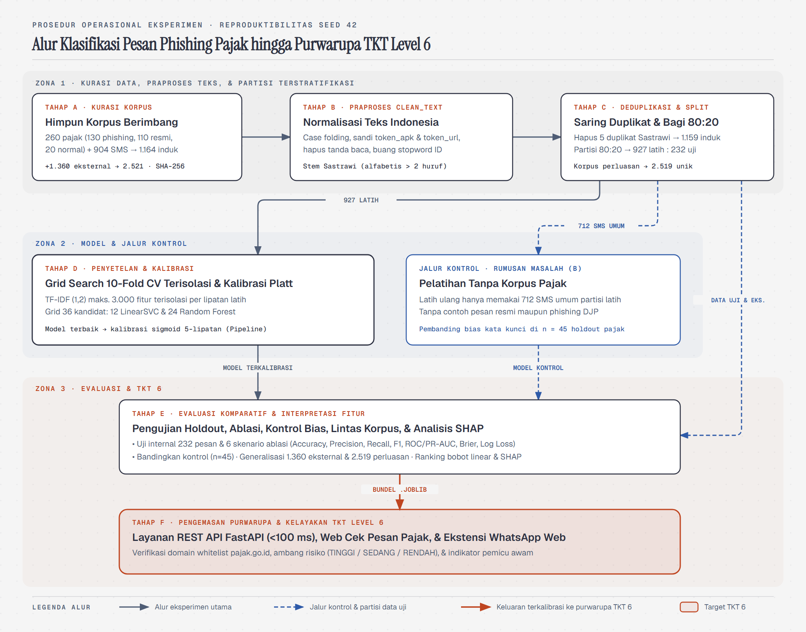

# BAB II LANDASAN METODE

## 2.1 Penelitian Terdahulu dan Matriks Komparasi

Perluasan layanan Direktorat Jenderal Pajak melalui siaran *WhatsApp Blast* *Coretax* kerap dicatut pelaku *smishing* untuk menyebarkan berkas `.apk` berbahaya [2] maupun tautan palsu kepada wajib pajak [1], [3], [4], [5]. Di Indonesia, Rahmi dan Wibisono [6] merintis korpus SMS publik untuk *Multinomial Naïve Bayes* dengan akurasi 94,12% dan 94,56%. Selanjutnya, Theodorus dkk. [7] menguji 4.125 SMS tiga kelas dan mencatat akurasi *Random Forest* sebesar 94,62% berbanding 94,38% pada SVM.

Pada kajian SMS lain, Irawan dkk. [8] mengolah 5.571 SMS Inggris dari korpus UCI (4.824 *ham* dan 747 *spam*) tanpa pemenggalan kata dasar. Skor kinerja SVM tertinggal di angka 86,5%, di bawah *Bagging* (97,4%), *Random Forest* (96,8%), serta *Naïve Bayes* (96,4%). Sebaliknya, Al Ghofany dkk. [9] menguji 500 SMS berbahasa Indonesia memakai *stemming* Nazief-Adriani dan 10-*fold* CV. Pada skema TF-IDF, SVM Linear meraih 99,52% dan SVM *Sigmoid* 99,60%, sedangkan dengan TF-RF, SVM Linear mencapai 100% dan SVM *Sigmoid* 99,96%.

Sebagai pembanding lintas korpus, Astuti dkk. [10] dan Ningtias dkk. [13] mengevaluasi TF-IDF pada data SMS berbahasa Inggris. Di ranah tautan web, Tampinongkol dkk. [11] mengolah 59.899 URL sah dan *phishing* memakai sembilan fitur leksikal tanpa TF-IDF maupun BERT. Hasilnya menempatkan *Random Forest* (84,95%) di atas SVM standar (77,43%). Pada korpus surel berbahasa Inggris, Al Tawil dkk. [12] membandingkan lima model tanpa SVM. Riset itu mendapati *Random Forest* berbasis TF-IDF terlatih dalam 40,39 detik, jauh lebih singkat daripada BERT (1.012,66 detik).

Pada penelitian pesan instan lokal, Efendi dkk. [14] membangun *bot* *WhatsApp* memakai logika *fuzzy*. Saputra dkk. [15] mengaplikasikan Sastrawi pada SVM berfitur `HashingVectorizer` dengan akurasi 95,45%, tetapi cara ini mengorbankan keterjelasan fitur. Sembiring dkk. [16] menyandikan token entitas uang maupun URL pada tiga kelas pesan penipuan dengan *Recall* kelas *fraud* SVM mencapai 98,59%, tetapi belum menyandikan berkas `.apk`. Studi terbaru kemudian merancang kerangka `LinearSVC` terjelaskan [17] dan memadukan komparasi model bersama interpretasi SHAP [18]. Pendekatan ekstensi peramban *real-time* juga telah diuji untuk mendeteksi tautan *phishing* [19].

Matriks lengkap 15 studi terdahulu tersebut tersaji pada Lampiran (Tabel L.1). Pemetaan pustaka menemukan empat celah, yakni ketiadaan korpus pajak berimbang dan hilangnya penanda `.apk` atau URL saat praproses. Penelitian sebelumnya juga belum menguji kontrol *keyword bias* maupun ekstensi peramban berkalibrasi Platt. Pedoman TA UNSIA serta kriteria TKT Level 6 pada Permenristekdikti Nomor 42 Tahun 2016 [20], [25] pun menjadi acuan perancangan alat deteksi yang terukur.

## 2.2 Landasan Teori dan Metode Khusus

### 2.2.1 Algoritma Support Vector Machine, LinearSVC, dan Kalibrasi Platt

*Support Vector Machine* (*soft-margin* SVM) mencari *hyperplane* pemisah dengan *margin* maksimal di ruang fitur berdimensi tinggi [26]. Untuk matriks TF-IDF yang jarang (*sparse*), `LinearSVC` pada `scikit-learn 1.9.1` memanggil solver LIBLINEAR guna meminimalkan Persamaan (2.1) [27], [28]. Formulasi *L2-regularized L2-loss* ini memuat bobot $\mathbf{w}$, bias $b$, fitur $\mathbf{x}_i$, label $y_i\in\{-1,+1\}$, dan penalti $C>0$ ($i=1,\dots,n$). LIBLINEAR mengaugmentasi $b$ ke suku regularisasi L2 [27], sedangkan parameter `fit_intercept` dan penyeimbang $C$ tersedia di `scikit-learn`.

**Persamaan (2.1)** Fungsi Objektif *LinearSVC*.

$$\min_{\mathbf{w},b}\frac{1}{2}\left(\|\mathbf{w}\|_2^2+b^2\right)+C\sum_{i=1}^{n}\max\left(0,1-y_i(\mathbf{w}^\top\mathbf{x}_i+b)\right)^2\qquad(2.1)$$

Nilai keputusan $f(\mathbf{x}) = \mathbf{w}^\top\mathbf{x} + b$ mengukur jarak bertanda yang sebanding dengan margin pemisah antarkelas $2/\|\mathbf{w}\|_2$ [26]. Di samping itu, komponen bobot $w_j$ mengukur kontribusi langsung tiap token. Untuk mengubah skor menjadi peluang, metode Platt [29] dan Lin dkk. [30] memakai target probabilitas teratur $t_i=(N_++1)/(N_++2)$ bagi kelas positif serta $1/(N_-+2)$ bagi kelas negatif. Parameter $(A,B)$ lalu ditaksir via optimasi Newton pada Persamaan (2.2).

**Persamaan (2.2)** Kalibrasi Probabilitas *Platt Scaling*.

$$P(y=1\mid f(\mathbf{x}))=\frac{1}{1+\exp(Af(\mathbf{x})+B)}\qquad(2.2)$$

Dalam modul kalibrasi `CalibratedClassifierCV` lima lipatan pada `scikit-learn 1.9.1` berbasis arsitektur pustaka inti [28], partisi kalibrasi dibagi menjadi lima bagian terstratifikasi secara seimbang. Peluang akhir suatu pesan dihitung dari rata-rata probabilitas kelima submodel `TF-IDF`, `LinearSVC`, dan kurva *sigmoid*. Karena keputusan akhir memakai perataan ensembel lima lipatan tersebut, hasil prediksi terkalibrasi dapat bergeser tipis dibandingkan satu model tunggal.

### 2.2.2 Algoritma Random Forest

*Random Forest* membentuk sekumpulan pohon keputusan melalui *bagging* serta pencuplikan acak sebagian fitur pada tiap simpul [31]. Pada implementasi modern `scikit-learn 1.9.1` yang bertumpu pada antarmuka estimator [28], setiap cabang CART meminimalkan impuritas Gini kedua simpul anak lewat $\mathrm{Gini}(t)$ bagi $K$ kelas pada Persamaan (2.3). Berbeda dari pemungutan suara mayoritas Breiman [31], `predict_proba` merata-ratakan peluang daun $P_m(y=1\mid\mathbf{x})=p(1\mid t_m(\mathbf{x}))$ atas $T$ pohon ($m=1,\dots,T$) pada Persamaan (2.4). Pada teks pendek, pemecahan satu kata per simpul sering menahan peluang di zona ragu.

**Persamaan (2.3)** Impuritas Gini.

$$\mathrm{Gini}(t)=1-\sum_{k=1}^{K}p(k\mid t)^2\qquad(2.3)$$

**Persamaan (2.4)** Prediksi Probabilitas *Random Forest*.

$$P(y=1\mid\mathbf{x})=\frac{1}{T}\sum_{m=1}^{T}P_m(y=1\mid\mathbf{x})\qquad(2.4)$$

### 2.2.3 Praproses Teks Bahasa Indonesia dan Pembobotan Fitur TF-IDF

Tahap praproses `clean_text` diawali *case folding* untuk menyeragamkan huruf menjadi kecil. Pola `.apk` disandikan menjadi `token_apk`, sedangkan pola tautan diubah ke `token_url` sebelum ekspresi reguler `[^a-z0-9\s_]` menghapus simbol. Sesudah penyaringan kata umum (*stopword*), *stemming* Sastrawi [32] hanya dijalankan pada token alfabetis di atas dua huruf (`len > 2`). Token numerik beserta kata pendek (`wa`, `hp`, `no`, `rp`) diloloskan dari pemenggalan, sedangkan `TfidfVectorizer` standar `scikit-learn 1.9.1` menyaring token satu karakter.

Teks bersih kemudian diekstrak menjadi fitur *unigram* dan *bigram* memakai skema TF-IDF [33] varian halus `scikit-learn 1.9.1` [28] sesuai Persamaan (2.5). Komponen mentah $v_t(d)=\mathrm{tf}(t,d)\cdot(\ln((1+N_{\text{dok}})/(1+\mathrm{df}(t)))+1)$ menghimpun frekuensi token $\mathrm{tf}(t,d)$, jumlah dokumen latih $N_{\text{dok}}$, dan $\mathrm{df}(t)$ dalam vektor $\mathbf{v}(d)$. Normalisasi *Euclidean* L2 membagi tiap elemen dengan $\|\mathbf{v}(d)\|_2$ agar variasi panjang pesan tidak mendistorsi skor, sedangkan vektor bernorma nol ($\|\mathbf{v}(d)\|_2=0$) diberi bobot nol.

**Persamaan (2.5)** Pembobotan TF-IDF Ternormalisasi L2.

$$w(t,d)=\frac{\mathrm{tf}(t,d)\cdot\left(\ln\left(\frac{1+N_{\text{dok}}}{1+\mathrm{df}(t)}\right)+1\right)}{\|\mathbf{v}(d)\|_2}\qquad(2.5)$$

### 2.2.4 Validasi Silang Terstratifikasi, Metrik Evaluasi, dan Kalibrasi Probabilitas

Validasi silang terstratifikasi 10 lipatan mempertahankan rasio kelas secara seimbang pada setiap partisi latih dan validasi [34]. Kinerja klasifikasi biner dihitung dari matriks konfusi (*TP*, *TN*, *FP*, *FN*) menjadi metrik *Accuracy* dan *Precision* pada Persamaan (2.6) bersama *Recall* dan *F1-Score* pada Persamaan (2.7) melalui `scikit-learn` [28], [35]. Pengukuran gabungan ini menjaga ketepatan deteksi penipuan tetap seimbang terhadap risiko salah blokir pesan resmi wajib pajak agar penilaian model tidak berat sebelah.

**Persamaan (2.6)** *Accuracy* dan *Precision*.

$$\mathrm{Accuracy}=\frac{TP+TN}{TP+TN+FP+FN},\quad\mathrm{Precision}=\frac{TP}{TP+FP}\qquad(2.6)$$

**Persamaan (2.7)** *Recall* dan *F1-Score*.

$$\mathrm{Recall}=\frac{TP}{TP+FN},\quad F_1=\frac{2\cdot\mathrm{Precision}\cdot\mathrm{Recall}}{\mathrm{Precision}+\mathrm{Recall}}\qquad(2.7)$$

Evaluasi penelitian ini memisahkan metrik diskriminasi lintas ambang batas dari metrik kalibrasi probabilitas. Kemampuan pemeringkatan kelas diukur melalui *ROC-AUC* dan *PR-AUC* [35], sedangkan ketepatan peluang dinilai lewat *Brier Score* dan *Log Loss* pada Persamaan (2.8) [35]. Dalam perumusan tersebut, $N_{\text{uji}}$ menyatakan cacah sampel uji berlabel biner $y_i\in\{0,1\}$, sedangkan keluaran peluang $0\le p_i\le 1$ dipotong eksplisit pada rentang $\epsilon=10^{-15}$ hingga $1-\epsilon$ di skrip evaluasi sebelum memanggil `log_loss` agar nilai logaritma natural tetap terdefinisi.

**Persamaan (2.8)** *Brier Score* dan *Log Loss*.

$$\mathrm{BS}=\frac{1}{N_{\text{uji}}}\sum_{i=1}^{N_{\text{uji}}}(p_i-y_i)^2,\quad\mathrm{LL}=-\frac{1}{N_{\text{uji}}}\sum_{i=1}^{N_{\text{uji}}}\left[y_i\ln(p_i)+(1-y_i)\ln(1-p_i)\right]\qquad(2.8)$$

### 2.2.5 Indikator Kelayakan Purwarupa dan Kesiapterapan Teknologi (TKT Level 6)

Dari sudut pandang Sistem Informasi, keandalan model pembelajaran mesin perlu hadir sebagai layanan verifikasi praktis bagi wajib pajak awam. Mengacu pada Pedoman TA UNSIA [20] dan Permenristekdikti Nomor 42 Tahun 2016 [25], target TKT Level 6 menuntut pembuktian purwarupa di lingkungan simulasi yang representatif terhadap kondisi operasional. Rancangan purwarupa ini memadukan bundel model `.joblib`, layanan REST API FastAPI, aplikasi web *Cek Pesan Pajak*, dan ekstensi *WhatsApp Web* agar seluruh komponen terintegrasi dapat diuji secara menyeluruh.

Agar nyaman dipakai saat percakapan *real-time*, sistem menargetkan latensi di bawah 100 ms [19]. Hasil klasifikasi dipetakan ke tiga kategori risiko, yakni TINGGI (berkas `.apk` atau $p \ge 0,75$), SEDANG ($0,50 \le p < 0,75$ atau tautan non-daftar putih), dan RENDAH. Daftar putih berfokus pada domain `pajak.go.id` beserta subdomainnya [2], [5], sedangkan tautan singkat `t.kemenkeu.go.id` dicatat sebagai kandidat lanjutan. Selain itu, bobot fitur linear dan SHAP [17], [18] diterjemahkan ke indikator pemicu awam.

## 2.3 Prosedur Operasional dan Bagan Alir Penelitian

Prosedur penelitian memadukan eksperimen kuantitatif dan alur *Research and Development* (R&D) dari kurasi teks hingga uji antarmuka pengguna [20], [21]. Seluruh pelatihan mengunci pengacak `random_state=42` agar eksperimen dapat diulang secara konsisten [28]. Sistem memproses vektor TF-IDF teks tanpa mengurai gambar maupun berkas `.apk` melalui enam tahap berurutan berikut:

a) Kurasi 260 pesan pajak berimbang (130 *phishing* lintas 12 modus, 110 siaran DJP, 20 pesan normal) dari 65 arsip publik, lalu dipadukan dengan 904 SMS umum menjadi korpus induk 1.164 baris dan korpus perluasan 2.521 baris ber-SHA-256 [2], [5], [6], [7], [36].

b) Praproses `clean_text` menyeragamkan huruf kecil, menyandikan `token_apk` dan `token_url`, serta menghapus simbol via `[^a-z0-9\s_]`. Tahap berikutnya menyaring *stopword*, menjalankan *stemming* Sastrawi atas token `len > 2`, dan mempertahankan token minimal dua huruf [28], [32].

c) Deduplikasi 5 teks Sastrawi identik pada korpus induk menyisakan 1.159 baris unik (dibagi terstratifikasi 80:20 menjadi 927 latih dan 232 uji), sedangkan penyusutan 2 baris pendek pada korpus perluasan menyisakan 2.519 baris unik [28], [34].

d) Ekstraksi TF-IDF maksimal 3.000 fitur terisolasi pada tiap lipatan latih mengawali pencarian *grid* 10-*Fold* CV untuk 36 kandidat (12 `LinearSVC`, 24 *Random Forest*), lalu model terbaik dikalibrasi memakai *Platt scaling* lima lipatan [27], [28], [29], [30], [33], [34].

e) Evaluasi lanjutan menjalankan enam skenario ablatif, uji kontrol tanpa korpus pajak terhadap korpus seimbang ($n = 45$), uji eksternal 1.360 pesan, korpus perluasan 2.519 baris, serta pemeringkatan bobot linear dan SHAP [17], [18], [35].

f) Pengemasan bundel `.joblib` memadukan REST API FastAPI, web *Cek Pesan Pajak*, dan ekstensi *WhatsApp Web* berdaftar putih `pajak.go.id`, tiga tingkat risiko, serta penjelasan awam guna memenuhi TKT Level 6 [19], [25].

Keterkaitan keenam tahapan prosedur operasional eksperimen tersebut diperlihatkan pada Gambar 2.1.

Gambar 2.1 Bagan Alir Prosedur Eksperimen.

## 2.4 Waktu dan Lokasi Penelitian

Penelitian dilaksanakan selama empat bulan, dari Agustus hingga November 2026, mengikuti jadwal rencana studi pada Program Studi PJJ Sistem Informasi UNSIA. Penyusunan korpus, pelatihan model, dan uji purwarupa berlangsung luring di Jakarta Selatan. Untuk menjaga kepatuhan privasi, seluruh bahan uji dihimpun dari arsip publik tanpa mengakses sistem produksi maupun data internal otoritas perpajakan [2], [5]. Rincian jadwal tercantum di Tabel L.2.

## 2.5 Alat dan Bahan Penelitian

Komputasi eksperimen serta pengujian purwarupa memakai laptop berprosesor Intel Core i5-12450H, RAM 16 GB, dan sistem Windows 11 Pro 64-bit. Lingkungan perangkat lunak memakai Python 3.14.7 bersama Scikit-learn 1.9.1 [28] dan Sastrawi 1.0.1 [32]. Pustaka pendukung meliputi Pandas 3.1.1, NumPy 2.5.4, Matplotlib 3.11.2, serta Seaborn 0.13.2. Perangkat SHAP 0.54.1, Joblib 1.6.0, FastAPI 0.163.1, Uvicorn 0.54.0, dan Pytest 9.2.0 menunjang penjelasan hingga uji API di Lampiran (Tabel L.3).

## 2.6 Cara Pengumpulan dan Analisis Data

Pengumpulan bahan perpajakan menerapkan studi dokumentasi [22] atas 68 arsip publik periode 2021 hingga 2026 yang mayoritas terbit antara 2024 dan 2026. Tiga artikel sekunder (`SRC-046`, `SRC-049`, dan `SRC-061` dari DDTC News dan Ortax) disisihkan karena merangkum pengumuman primer `pajak.go.id`. Sesudah menyisihkan 239 SMS promosi Rahmi dan Wibisono, ke-65 arsip terpilih menghasilkan 130 *phishing* lintas 12 modus dan 130 pesan aman (110 siaran resmi DJP dan 20 pesan pajak normal) dalam korpus induk 1.164 baris [2], [5], [6].

Dalam pelaksanaan 10-*Fold* CV [34], vektorizer TF-IDF selalu dibangun ulang di tiap lipatan latih melalui `scikit-learn` [28] untuk mencegah kebocoran data validasi. Guna menjawab Rumusan Masalah (b), model turut dilatih khusus memakai 712 SMS umum partisi latih lalu diuji pada 45 pesan pajak *holdout* dan dibandingkan terhadap model korpus berimbang. Uji lintas korpus turut dijalankan atas 1.360 pesan unik Theodorus dkk. [7] dan Saragih [36] guna mengukur generalisasi eksternal.

## 2.7 Definisi Operasional Variabel dan Parameter

Operasionalisasi penelitian merumuskan variabel bebas, variabel terikat, perlakuan eksperimen, dan parameter pengukuran sesuai kaidah pengujian kuantitatif [22], [23], [24]. Variabel bebas berskala vektor numerik berupa teks hasil `clean_text` yang dipetakan menjadi bobot TF-IDF unigram dan bigram hingga 3.000 fitur. Variabel terikatnya berskala nominal biner yang mencakup kelas 1 (*phishing*) serta kelas 0 (aman atau resmi), disertai perlakuan kontrol 712 SMS terhadap 927 pesan seimbang.

Penyetelan parameter mencakup konstanta `C` pada `LinearSVC`, ukuran serta kedalaman pohon *Random Forest*, dan kalibrasi Platt [27], [28], [30], [31]. Sementara itu, ukuran kinerja memakai metrik klasifikasi dan kalibrasi probabilitas pada skala rasio dari 0 hingga 1 bersama tiga kategori risiko antarmuka. Seluruh matriks definisi operasional beserta indikator kelayakan TKT Level 6 [25], [35] tersusun lengkap pada Lampiran (Tabel L.4).
