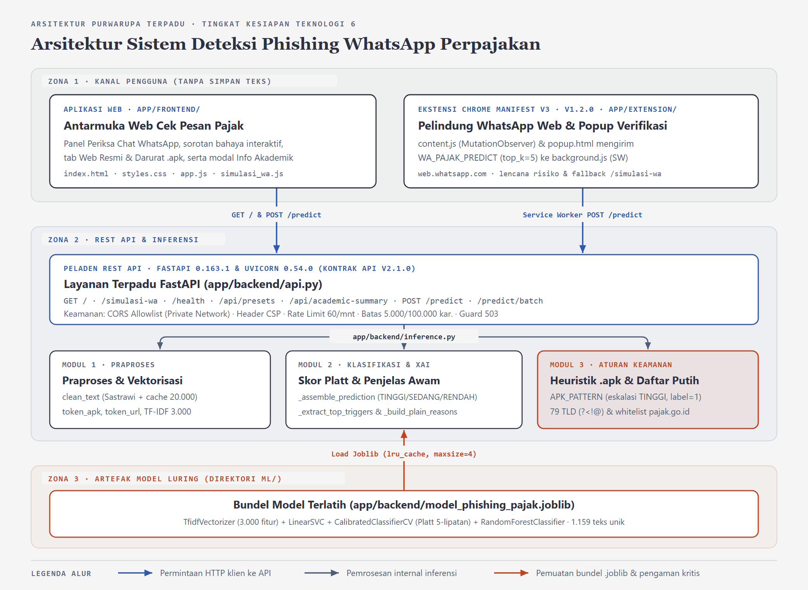

# BAB III IMPLEMENTASI METODE USULAN

## 3.1 Arsitektur Implementasi Metode Usulan

Implementasi metode usulan mewujudkan enam tahap prosedur operasional Bab II ke dalam sistem perangkat lunak Python 3.14.7 [28]. Arsitektur sistem memisahkan alur pelatihan luring (*offline*) pada direktori `ml/` dari layanan verifikasi daring (*online*) pada `app/backend/`. Pada alur luring, kumpulan teks diubah menjadi vektor TF-IDF berdimensi 3.000 untuk melatih `LinearSVC` terkalibrasi serta `RandomForestClassifier`, lalu dikemas ke `app/backend/model_phishing_pajak.joblib` [27], [28], [31], [33]. Selanjutnya, alur daring memuat bundel tersebut ke peladen FastAPI guna melayani aplikasi web dan ekstensi peramban [19], sebagaimana ditunjukkan pada Gambar 3.1.

Gambar 3.1 Arsitektur Sistem Terpadu Deteksi *Phishing* WhatsApp Perpajakan.

Dari sudut pandang Sistem Informasi, setiap pesan yang dikirim wajib pajak melewati satu mesin keputusan terpusat di `app/backend/inference.py` agar vonis maupun indikator bahayanya seragam di semua kanal akses. Modul pusat itu menangani klasifikasi probabilistik, pengecekan aturan keamanan perpajakan, penyusunan alasan awam, serta penandaan sorotan pada teks asli. Demi menjaga privasi pengguna, peladen memproses isi pesan secara sementara di memori tanpa menyimpannya ke basis data. Pemetaan sepuluh modul kode sumber terhadap tahapan metodologi tercantum pada Tabel L.5 di Lampiran.

## 3.2 Implementasi Kurasi Korpus dan Praproses Teks

Tahap penyusunan data menghimpun 68 arsip publik terbitan 2021 hingga 2026 melalui `ml/korpus_pajak.py` dan `ml/kurasi_dataset.py` [2], [5]. Skrip `strip_djp_boilerplate` mula-mula menanggalkan *header* dan *footer* halaman web. Berikutnya, kurasi manual memilih 65 sumber unik yang mencakup 45 publikasi resmi domain `pajak.go.id` serta 20 laporan berita dan cek fakta. Tiga artikel sekunder yang merangkum rilis primer DJP (`SRC-046`, `SRC-049`, `SRC-061`) disisihkan agar sumber tidak tumpang tindih. Hasilnya membentuk 260 pesan pajak berimbang, yaitu 130 pesan *phishing* lintas 12 modus dan 130 pesan aman (110 siaran resmi DJP serta 20 percakapan administrasi pajak normal).

Penggabungan 260 teks pajak bersama 904 SMS umum Rahmi dan Wibisono [6] (sesudah menyisihkan 239 iklan promo) membentuk *dataset* induk 1.164 baris yang dikunci oleh 10 *checksum* SHA-256. Untuk uji lintas korpus, himpunan induk dipadukan pula dengan 2.743 SMS biner Theodorus dkk. [7] dan 348 SMS biner Saragih [36]. Fungsi `clean_text` kurasi empat langkah pada `ml/kurasi_dataset.py` (tanpa *stopword* maupun Sastrawi) memangkas 4.255 baris mentah menjadi 2.521 baris pada korpus diperluas.

Setelah melewati penyaringan Sastrawi penuh, korpus diperluas 2.521 baris menyusut dua baris label aman asal Theodorus dkk. menjadi 2.519 baris. Pesan sangat pendek `'anda'` dan `'Ok'` luruh ke *string* kosong sehingga bertumbukan saat deduplikasi dan menyisakan satu baris kosong. Sementara itu, satu baris lain gugur karena penghapusan kata umum `'akan'` menyamakan dua pesan tarif seluler. Sebaliknya, korpus induk 1.159 baris dan korpus pajak 260 baris tetap bersih tanpa satu pun baris kosong.

Sebelum vektorisasi TF-IDF dijalankan pada pelatihan maupun layanan daring, fungsi `clean_text` enam langkah pada `ml/eksperimen_baseline.py` mengonversi kamus kata dasar Sastrawi menjadi struktur himpunan (`set`) berpenyangga `lru_cache` 20.000 entri. Struktur tersebut mempercepat pencarian morfologi menjadi waktu konstan $O(1)$ saat memproses teks pelatihan maupun permintaan pengguna [32]. Setiap pesan masukan melewati enam langkah praproses berurutan berikut:

a) Pengecilan seluruh huruf via metode `lower()` agar variasi kapitalisasi seragam.

b) Konversi pola `.apk` (`r"\.apk\b"`) menjadi `token_apk` sebelum pemindaian URL supaya nama berkas tidak terbaca sebagai alamat web.

c) Pengubahan tautan `http`, `https`, `www`, `bit.ly`, serta sembilan akhiran domain (`.go.id`, `.co.id`, `.my.id`, `.com`, `.net`, `.org`, `.xyz`, `.id`, dan `.cc`) melalui `URL_PATTERN` menjadi `token_url`.

d) Penghapusan simbol nonalfanumerik selain spasi dan garis bawah memakai pola `r"[^a-z0-9\s_]"`.

e) Penyaringan daftar kata umum (*stopword*) Sastrawi dengan tetap melestarikan `token_apk` dan `token_url`.

f) Pengembalian kata alfabetis yang panjangnya melebihi dua huruf (`tok.isalpha() and len(tok) > 2`) ke bentuk kata dasar lewat Sastrawi 1.0.1 [32].

Untuk mengukur kontribusi tiap keputusan praproses secara terkendali pada `ml/eksperimen_komparasi.py`, dua kolom pembanding disimpan mendampingi `teks_sastrawi`. Kolom `clean_text` buatan `ml/kurasi_dataset.py` mempertahankan `token_apk` dan `token_url` tanpa penghapusan daftar kata umum maupun *stemming* bagi skenario ablatif `2_Tanpa_Sastrawi`. Sebaliknya, `clean_text_without_entity_tokens` membentuk kolom `teks_tanpa_token_entitas` bagi skenario `1_Tanpa_Token_Entitas` dengan membuang pola URL, `.apk`, angka, dan garis bawah (`[^a-z\s]`), lalu men-*stem* seluruh token tersisa.

## 3.3 Implementasi Pelatihan Model, Penyetelan Hiperparameter, dan Kalibrasi

Pelatihan model pada `ml/eksperimen_komparasi.py` mengunci nilai `RANDOM_STATE=42` untuk seluruh pemisahan data dan penaksiran model agar eksperimen dapat diulang [28]. Pada korpus induk 1.164 baris, deduplikasi `teks_sastrawi` menyisihkan lima baris identik asal korpus SMS umum sehingga tersisa 1.159 teks unik (697 aman dan 462 penipuan). Himpunan bersih itu dipisah terstratifikasi 80:20 menjadi 927 data latih dan 232 data uji beririsan nol. Selanjutnya, `_precompute_tfidf_folds` membangun `TfidfVectorizer(ngram_range=(1, 2), max_features=3000)` pada `scikit-learn 1.9.1` (token minimal dua huruf `(?u)\b\w\w+\b`) secara terpisah di tiap lipatan *Stratified 10-Fold CV* [34] untuk pembobotan TF-IDF [28], [33] tanpa kebocoran kosakata.

Di atas sepuluh lipatan TF-IDF terisolasi tersebut, fungsi `_run_grid_over_folds` menguji 36 kandidat kombinasi parameter secara sistematis. Ruang pencarian itu mencakup 12 konfigurasi `LinearSVC` dan 24 konfigurasi `RandomForestClassifier` yang diurutkan menurut rata-rata *F1-Score* sepuluh lipatan dengan pemecah seri rata-rata akurasi serta *ROC-AUC*. Rincian rentang kandidat hiperparameter tercantum pada Tabel 3.1, sedangkan konfigurasi pemenang dilaporkan pada Bab IV agar pemisahan metode dan hasil terjaga.

Tabel 3.1 Konfigurasi Ruang Pencarian Hiperparameter pada Penyetelan 10-Fold CV

| Algoritma Klasifikasi | Ruang Pencarian Parameter (`_run_grid_over_folds`) | Jumlah Kandidat |
| :--- | :--- | :---: |
| `LinearSVC` | `C`: `0.1, 0.25, 0.5, 1.0, 2.0, 5.0`; `class_weight`: `None, balanced`; `max_iter=5000`; `random_state=42` | 12 |
| `RandomForestClassifier` | `n_estimators`: `100, 200, 300`; `max_depth`: `None, 30`; `min_samples_split`: `2, 5`; `class_weight`: `None, balanced`; `random_state=42` | 24 |

Sumber: Implementasi Penyetelan Hiperparameter pada `ml/eksperimen_komparasi.py` (2026).

Keluaran mentah `LinearSVC` berupa jarak *hyperplane* perlu dikonversi ke skala probabilitas supaya wajib pajak memahami tingkat keyakinan peringatan secara intuitif [27], [29], [30]. Oleh karena itu, `_make_calibrated_svm_pipeline` membungkus vektorizer TF-IDF bersama `LinearSVC` dalam satu `Pipeline`, lalu menerapkan `CalibratedClassifierCV(method="sigmoid", cv=5)`. Pendekatan ini melatih lima submodel terkalibrasi secara terisolasi dan merata-ratakan peluang akhirnya tanpa membocorkan informasi antarlipatan [28].

Untuk menguji daya generalisasi sekaligus ketahanan terhadap bias kata kunci pajak, `_run_stage4_domain_and_cross_corpus` menjalankan tiga evaluasi lanjutan. Pengujian `Stage 4A` membandingkan model latih 712 SMS umum terhadap model korpus seimbang pada 45 pesan pajak *holdout* tanpa irisan (24 *phishing* dan 21 resmi), disertai 10-*Fold* CV 260 pesan pajak. Evaluasi berlanjut ke 1.360 pesan eksternal unik (`Stage 4B`) serta korpus diperluas 2.519 baris pasca-Sastrawi (`Stage 4C`) [7], [36], sebelum mengekspor `.joblib` dan menghitung nilai SHAP pada 232 data uji [17], [18].

## 3.4 Implementasi Purwarupa Sistem Terpadu Tingkat Kesiapan Teknologi 6

Guna memenuhi kriteria purwarupa TKT Level 6 [25], alur layanan daring dibuat langsung dapat dipakai wajib pajak tanpa langkah teknis rumit. Setiap pesan masuk diproses di `app/backend/inference.py` yang memuat `app/backend/model_phishing_pajak.joblib` lewat `@functools.lru_cache(maxsize=4)` lalu menormalisasi teks memakai `clean_text`. Selain menghitung peluang terkalibrasi `svm_probability`, `_assemble_prediction` menggabungkan hasil model dengan pemeriksaan heuristik `analyze_urls_and_apk`. Pola `APK_PATTERN` (`r"\b[a-z0-9_.-]+\.apk\b"` dengan `re.IGNORECASE`) memindai lampiran `.apk` dan langsung mengeskalasi risiko ke `TINGGI` beserta `label = 1`, sebab DJP tidak pernah mengirim aplikasi melalui WhatsApp.

Pemeriksaan tautan memakai `URL_PATTERN` berdaftar 79 akhiran domain alfabetis (`_BARE_TLD_LIST`), *lookbehind* `(?<!@)`, dan `re.IGNORECASE`. Pola ini menjaga format jam (`17.00`) maupun nominal uang (`Rp1.500.000`) aman dari peringatan palsu. Daftar putih `is_official_djp_domain` hanya meloloskan host `pajak.go.id` atau subdomain `.pajak.go.id`, sedangkan tautan singkat `t.kemenkeu.go.id` dicatat sebagai kandidat pengembangan lanjutan sesuai Bab II.

Penetapan kategori risiko pada `_assemble_prediction` memetakan skor ke tiga tingkat yang mudah dipahami pengguna. Tingkat `TINGGI` berlaku bagi temuan `.apk` atau peluang $p \ge 0{,}75$, sedangkan tingkat `SEDANG` berlaku untuk $0{,}50 \le p < 0{,}75$ maupun adanya domain mencurigakan di luar daftar putih (berstatus `Perlu Verifikasi / Waspada` walau $p < 0{,}50$), dan pesan tanpa indikator bahaya masuk tingkat `RENDAH`. Selanjutnya, `_extract_top_triggers` menghitung perkalian bobot TF-IDF dan `coef_` sebagai `top_triggers`, lalu `_build_plain_reasons` bersama `_extract_highlights_and_triggers` menyusun alasan awam beserta sorotan teks [17].

Layanan antarmuka pemrograman pada `app/backend/api.py` berjalan di atas FastAPI 0.163.1 dan Uvicorn 0.54.0 dengan versi kontrak API `2.1.0` sesuai Tabel L.6. Peladen menerapkan daftar izin CORS (`allow_private_network=True`), *security headers* termasuk *Content-Security-Policy* (CSP), pembatas laju berbobot `RATE_LIMIT_PER_MIN=60` per menit, serta pengaman HTTP 503 jika bundel model absen. Batas panjang masukan dijaga hingga 5.000 karakter per pesan tunggal dan 100.000 karakter per *batch* berisi maksimal 200 pesan.

Di sisi antarmuka pengguna, aplikasi web `app/frontend/` menyediakan tiga tab utama (**Cek Pesan**, **Web Resmi & Ciri Scam**, dan **Darurat .apk**) beserta panel **Periksa Chat WhatsApp** yang dilengkapi tombol **Tempel & Periksa**, tombol **Periksa Pesan** (`Ctrl + Enter`), serta tiga contoh cepat. Sesudah pemeriksaan tuntas, halaman menampilkan kartu vonis, sorotan interaktif, **Alasan Deteksi**, **Langkah Aman**, serta tombol **Info Akademik (`TA UNSIA`)** di *footer*. Rancangan antarmuka web dan ekstensi tersaji pada Gambar L.1.

Untuk pemakaian langsung di *WhatsApp Web*, ekstensi *Chrome Manifest V3* versi `1.2.0` (`app/extension/`) memantau obrolan secara lokal [19]. Skrip `content.js` mengamati DOM lewat `MutationObserver` (*debounce* 150 ms, ulang 1.500 ms), lalu menyematkan tombol **Cek Pesan Pajak** pada pesan masuk minimal 8 karakter atau bermuatan `.apk`/URL serta pesan keluar bertanda `.apk`, URL, atau kata kunci pajak (`TAX_SELF_TEST_RE`). Saat ditekan atau `popup.html` dipakai, ekstensi mengirim `WA_PAJAK_PREDICT` (`top_k = 5`) via `chrome.runtime.sendMessage` ke `background.js` menuju `POST /predict` (atau *fallback* `fetch` langsung menuju peladen lokal, sementara demo terpisah tersedia di `/simulasi-wa`). Hasilnya tampil sebagai lencana risiko di bawah pesan.

## 3.5 Skenario Pengujian Sistem dan Kesiapan Evaluasi

Kesiapan operasional seluruh komponen diuji otomatis memakai Pytest 9.2.0 terhadap 29 fungsi uji pada empat berkas di direktori `tests/`. Kelompok pertama mencakup 13 pengujian data dan eksperimen (`tests/test_integritas_dataset.py` 6 fungsi, `tests/test_eksperimen_baseline.py` 2 fungsi, dan `tests/test_eksperimen_komparasi.py` 5 fungsi). Pengujian ini mengunci kecocokan 10 *checksum* SHA-256, konsistensi deduplikasi Sastrawi bebas kebocoran data, isolasi kalibrasi Platt pada `Pipeline`, arah kontribusi SHAP, keutuhan bundel `.joblib`, serta penurunan kesalahan pada uji kontrol domain pajak (`UJI-10` pada Tabel L.7).

Kelompok kedua mencakup 16 fungsi uji *black-box* pada `tests/test_prototipe_api.py` yang dipetakan satu-ke-satu ke kode `UJI-01` hingga `UJI-09a`, `UJI-09b`, serta `UJI-11` hingga `UJI-16` pada Tabel L.7. Skenario ini memeriksa kesiapan layanan (`/health`, `/`, `/simulasi-wa`), deteksi lampiran `.apk` maupun URL berakhiran `.apk`, penangkalan domain tiruan `pajak.go.id.evil.com`, serta kekebalan atas jam dan nominal uang. Di samping itu, pengujian memastikan penolakan teks kosong (HTTP 422), kesamaan probabilitas `POST /predict/batch`, aktivasi pembatas laju berbobot (HTTP 429 dengan `Retry-After`), kepatuhan CSP dan CORS, galat 503 tanpa kebocoran jalur peladen, hingga kelengkapan data latensi pada `/api/academic-summary`.
