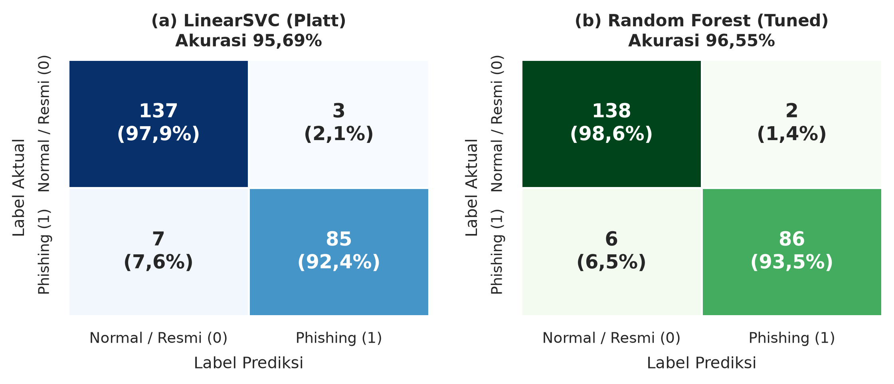
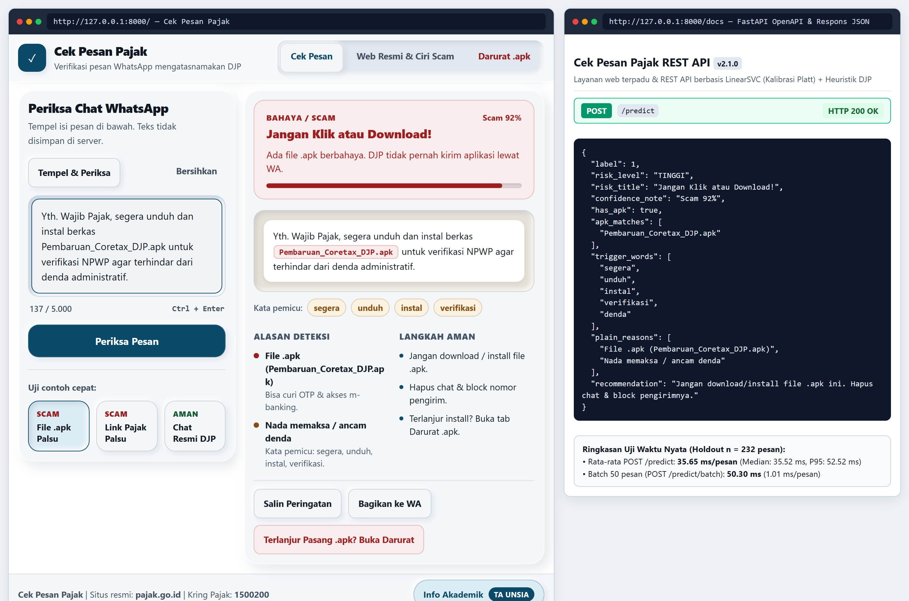

# BAB IV HASIL DAN ANALISA

## 4.1 Hasil Eksperimen Komparasi Klasifikasi dan Penyetelan Hiperparameter

Eksperimen komparatif dijalankan melalui `ml/eksperimen_komparasi.py` memakai `random_state=42` selama 305,86 detik. Deduplikasi Sastrawi menyisakan 1.159 teks unik dari 1.164 baris induk, terbagi menjadi 927 latih dan 232 uji. Pada *baseline* *holdout* (`n = 232`), `LinearSVC` bawaan meraih *Accuracy* 96,12% dan *F1-Score* 94,97% (`TN=138`, `FP=2`, `FN=7`, `TP=85`). Capaian ini sejajar dengan *Random Forest* (`n_estimators=200`) pada akurasi 96,12% dan *F1-Score* 95,03% (`TN=137`, `FP=3`, `FN=6`, `TP=86`) [13], [31].

Pengujian berlanjut memakai *Stratified 10-Fold Cross-Validation* terisolasi TF-IDF pada 927 data latih [34]. Sebelum penyetelan, `LinearSVC` mencatat *F1-Score* 97,04% (± 2,71%) dan akurasi 97,63% (± 2,20%) dalam 0,0026 detik per lipatan. *Random Forest* meraih 93,68% (± 3,20%) dan akurasi 94,93% dalam 0,5357 detik (202,57 kali lebih lambat). Pencarian *grid* 36 kandidat [28] mengunggulkan `LinearSVC` (`C=2.0`, `class_weight=None`) dengan *F1-Score* 97,16% (± 2,41%) dalam 0,0039 detik [27]. Sebaliknya, *Random Forest* optimal (`n_estimators=100`, `max_depth=None`, `min_samples_split=2`, `class_weight=None`) bertahan di 94,07% (± 2,92%) dan 0,3096 detik (79,36 kali lebih lambat) [31].

Pada himpunan uji tetap (`n = 232`), kalibrasi *Platt scaling* menggeser akurasi `LinearSVC` ke 95,69% (*bootstrap* 95% CI 93,10% hingga 98,28%; `FP=3`, `FN=7`) melawan *Random Forest* 96,55% (`FP=2`, `FN=6`), sedangkan uji McNemar menunjukkan selisih tidak bermakna (p = 0,7266) [29], [30]. Di lapangan, pelatihan 79,36 kali lebih cepat membuat `LinearSVC` sigap diperbarui saat skrip *phishing* Coretax berganti modus. Sementara itu, `FN=7` berarti risiko pemasangan `.apk` lolos dan `FP=3` menghambat siaran sah DJP.

Tabel 4.1 Hasil Komparasi Kinerja Klasifikasi pada Berbagai Tahap Evaluasi

| Tahap Evaluasi | Model | Akurasi (%) | Presisi (%) | Recall (%) | F1 (%) | ROC-AUC |
| :--- | :--- | :---: | :---: | :---: | :---: | :---: |
| *Baseline Holdout* (n = 232) | `LinearSVC` | 96,12 | 97,70 | 92,39 | 94,97 | 0,9955 |
| | *Random Forest* | 96,12 | 96,63 | 93,48 | 95,03 | 0,9939 |
| 10-*Fold* CV *Default* (n = 927) | `LinearSVC` | 97,63 | 97,37 | 96,76 | 97,04 | 0,9956 |
| | *Random Forest* | 94,93 | 93,69 | 93,78 | 93,68 | 0,9905 |
| 10-*Fold* CV *Tuned* (n = 927) | `LinearSVC` (`C=2.0`) | **97,74** | **97,61** | **96,76** | **97,16** | **0,9956** |
| | *Random Forest* | 95,25 | 94,46 | 93,78 | 94,07 | 0,9901 |
| *Holdout* Final (n = 232) | `LinearSVC` Platt | 95,69 | 96,59 | 92,39 | 94,44 | **0,9957** |
| | *Random Forest* | **96,55** | **97,73** | **93,48** | **95,56** | 0,9936 |
| Kontrol Tanpa Pajak (n = 45) | `LinearSVC` Platt | 42,22 | 45,00 | 37,50 | 40,91 | 0,3571 |
| | *Random Forest* | 33,33 | 31,25 | 20,83 | 25,00 | 0,3502 |
| Subset Pajak Seimbang (n = 45) | `LinearSVC` Platt | 95,56 | 95,83 | 95,83 | 95,83 | **0,9960** |
| | *Random Forest* | 95,56 | 95,83 | 95,83 | 95,83 | 0,9752 |
| 10-*Fold* CV Pajak (n = 260) | `LinearSVC` (`C=2.0`) | **98,08** | **96,52** | **100,00** | **98,17** | **0,9947** |
| | *Random Forest* | 93,46 | 92,99 | 94,62 | 93,57 | 0,9905 |
| *Zero-Shot* Eksternal (n = 1.360) | `LinearSVC` Platt | **64,19** | **40,99** | **80,28** | **54,27** | **0,7875** |
| | *Random Forest* | 62,35 | 36,99 | 60,00 | 45,76 | 0,6978 |
| *Holdout* Diperluas (n = 504) | `LinearSVC` Platt | **96,03** | **96,75** | **90,85** | **93,71** | **0,9883** |
| | *Random Forest* | 92,46 | 92,00 | 84,15 | 87,90 | 0,9771 |
| 10-*Fold* CV Diperluas (n = 2.519) | `LinearSVC` (`C=2.0`) | **94,72** | 92,96 | **90,76** | **91,81** | **0,9832** |
| | *Random Forest* | 94,32 | **93,09** | 89,30 | 91,11 | 0,9799 |

Sumber: Pengolahan hasil eksperimen `05-hasil-evaluasi/csv/tabel_komparasi_utama.csv` (2026).

Sebaran *Confusion Matrix* pada `n = 232` tersaji di Gambar 4.1, sedangkan Gambar L.2 mencatat *ROC-AUC* 0,9957 terhadap 0,9936 dan *PR-AUC* 0,9943 terhadap 0,9909 [35]. Pergeseran satu sampel `LinearSVC` Platt muncul pada `idx=1082` (`p=0,5506`) akibat perataan lima submodel `CalibratedClassifierCV` (0,43% uji; sebelum kalibrasi, `LinearSVC` `C=2.0` meraih akurasi 96,12% dan *F1* 94,97%). Di lapangan, selisih satu pesan resmi menegaskan bahwa pemeringkatan peluang dan daftar putih domain lebih menentukan daripada akurasi *holdout* tunggal.

Gambar 4.1 Perbandingan *Confusion Matrix* Uji *Holdout*.

## 4.2 Analisis Kalibrasi Probabilitas dan Studi Ablatif Fitur

Penyajian skor keyakinan di antarmuka menuntut keluaran peluang yang selaras dengan kejadian aktual [29], [30]. Pada *holdout* `n = 232`, `LinearSVC` Platt mencatat *Brier Score* 0,02542 dan *Log Loss* 0,09186. Capaian itu 39,68% dan 42,12% lebih rendah daripada *Random Forest* (*Brier* 0,04214; *Log Loss* 0,15870). Pada Gambar 4.2, peluang `LinearSVC` mengelompok tegas di ujung nol dan satu sehingga hanya 22 pesan (9,48%) berada di zona ragu 0,2 hingga 0,8. Sebaliknya, sebaran *Random Forest* mencakup 59 pesan (25,43%) sehingga berisiko memicu *alert fatigue* di WhatsApp.

Gambar 4.2 Evaluasi Kalibrasi Probabilitas Model.

Untuk memvalidasi praproses, enam skenario ablatif dijalankan pada `05-hasil-evaluasi/csv/studi_ablatif_fitur.csv` dalam Tabel L.8 [32], [33]. Setelan utama (`teks_sastrawi`, *bigram* `(1, 2)`, 3.000 fitur) meraih *F1-Score* CV `LinearSVC` tertinggi sebesar 97,16%. Peniadaan `token_apk` dan `token_url` menurunkannya ke 95,81% (RF 92,42%) [16], *unigram* saja ke 95,94%, sedangkan Sastrawi hanya berselisih 0,0006% pada `LinearSVC` (RF 94,55% tanpa Sastrawi) [9], [32]. Lonjakan *holdout* `1_Tanpa_Token_Entitas` (97,84%) dipicu penyamaran `pajak.go.id` dan tautan penipu menjadi satu `token_url`. Kondisi itu mewajibkan daftar putih domain saat inferensi.

## 4.3 Analisis Ketahanan Bias Kata Kunci Pajak dan Generalisasi Lintas Korpus

Pengujian Tahap 4A menjawab Rumusan Masalah (b) pada 45 pesan pajak *holdout* (21 aman: 19 siaran DJP dan 2 normal; serta 24 *phishing*). Ketika `LinearSVC` Platt hanya dilatih 712 SMS umum, akurasinya anjlok ke 42,22% (*F1* 40,91%; *ROC-AUC* 0,3571) dengan 11 pesan aman terblokir (`FP=11`; spesifisitas 47,62%) dan 15 penipuan lolos (`FN=15`), sementara *Random Forest* merosot ke 33,33% (`FP=11`, `FN=19`). Kondisi tersebut mencerminkan nasib penyaring spam konvensional yang salah memblokir istilah *pajak*, *npwp*, dan tautan instansi.

Masuknya korpus pajak seimbang ke data latih mengangkat kedua model ke akurasi 95,56% dan *F1* 95,83% (`FP=1`, `FN=1`; 20 dari 21 pesan aman lolos) [2], [5]. Evaluasi 10-*Fold* CV 260 baris pajak juga mengukuhkan `LinearSVC` (*F1* 98,17%; *Recall* 100,00%) di atas *Random Forest* (93,57%). Pada uji *zero-shot* Tahap 4B (1.360 pesan unik Theodorus dkk. [7] dan Saragih [36]), `LinearSVC` menjaga *Recall* 80,28% (*F1* 54,27%) di atas *Random Forest* (60,00%; 45,76%). Namun, presisinya turun ke 40,99% (`FP=416`; spesifisitas 58,40%) akibat pergeseran gaya 2016 ke 2021–2024 dan rasio 90:4 Saragih.

Setelah korpus diperluas menjadi 2.519 baris pada Tahap 4C (Gambar L.4), akurasi *holdout* (`n = 504`) `LinearSVC` pulih ke 96,03% berbanding 92,46% pada *Random Forest*, sedangkan 10-*Fold* CV mencatat 91,81% melawan 91,11%. Pemulihan nyata ini menegaskan bahwa sistem deteksi di lapangan menuntut pembaruan korpus berkala.

## 4.4 Analisis Interpretabilitas Fitur dan Kesalahan Prediksi

Transparansi model dikaji lewat koefisien `LinearSVC` (Gambar L.3 dan Tabel L.9) serta SHAP pada `n = 232` memakai `LinearExplainer` dan `TreeExplainer` di Gambar L.5 [17], [18]. Token pemicu *phishing* terkuat `LinearSVC` meliputi `no` (+2,2405), `sms` (+1,6940), `rekening` (+1,5083), `info` (+1,4054), `segera` (+1,3778), `pin` (+1,3729), `token_apk` (+1,3582), dan `token_url` (+1,3550). Penahan negatif terkuat mencakup `resmi` (-1,0706; *mean* `|SHAP|` 0,0341), `laman`, `kp2kp`, dan `pratama`, sementara artefak Rahmi [6] (`nama1` -1,2720; `2016` -0,6664) disaring dari antarmuka awam.

Penelusuran 13 galat gabungan pada Tabel L.10 (`LinearSVC` Platt 10, *Random Forest* 8, irisan 5) memperlihatkan kontras kedua algoritma dalam kasus lapangan. Pada pemutakhiran NIK dan buku tabungan `idx=1003` (`form-wajibpajak-djp.com`), `LinearSVC` memberi skor tinggi (`p=0,787`), sedangkan *Random Forest* meloloskannya (`p=0,340`) hingga wajib pajak rentan pencurian identitas. Sebaliknya, pada surat dinas `idx=960` (`MPajak_Aktivasi_KSWP.apk`), `LinearSVC` tertahan (`p=0,424`) karena nihil kata spam klasik, lalu aturan `has_apk` di `app/backend/inference.py` langsung menaikkan vonis ke `TINGGI`.

Pada imbauan pemadanan NIK resmi `idx=1082` (`www.pajak.go.id`), kedua model murni terseret `token_url` dan `login` (`p=0,551` vs `0,600`). Lapisan `is_official_djp_domain` melindungi host resmi sambil menahannya di `WASPADA`, sedangkan bundel produksi 1.159 baris menurunkan skornya ke 0,109. Dua penipuan transfer tanpa tautan maupun `.apk` (`idx=314` `p=0,033`; `idx=102` `p=0,392`) sama-sama luput akibat bobot negatif `mandiri` (-0,7612), menandai batas leksikal terhadap pesan akrab di dunia nyata.

## 4.5 Hasil Pengujian Purwarupa Sistem Terpadu dan Evaluasi Kesiapterapan Teknologi

Pengujian Pytest 9.2.0 dan `ml/benchmark_purwarupa.py` meluluskan 29 fungsi uji (`UJI-01` hingga `UJI-16`) dalam 7,88 detik pada Tabel L.11. Pemuatan `.joblib` memakan 129,578 ms, diikuti rerata `predict_message` (`n = 232`) 14,542 ms (*P95* 16,971 ms), `POST /predict` pada `TestClient` 35,651 ms (*median* 35,518 ms; *P95* 52,524 ms; maks. 62,120 ms), serta *batch* 50 pesan 50,295 ms. Pada Gambar 4.3 dan Gambar L.6, `Pembaruan_Coretax_DJP.apk` memicu `BAHAYA / SCAM` (`Scam 92%` di web; `84%` di `popup.html`), sementara `djponline.pajak.go.id` (`0,1023`) dan angka `17.00` lolos aman.

Gambar 4.3 Tangkapan Layar Antarmuka Web *Cek Pesan Pajak* dan Respons API.

Evaluasi perbandingan terhadap kondisi nyata operasional serta batasan TKT Level 6 [25] sebelum melangkah ke uji lapangan penuh (TKT Level 7) dirangkum pada Tabel 4.2. Sementara itu, sintesis komparasi terhadap sepuluh studi terdahulu [6], [7], [9], [10], [11], [13], [15], [16], [17], [19] tercantum pada Tabel L.12.

Tabel 4.2 Perbandingan Hasil Pengujian Penelitian terhadap Kondisi Nyata Operasional

| Aspek Perbandingan | Hasil Pengujian Penelitian | Kondisi Nyata & Implikasi |
| :--- | :--- | :--- |
| Model & Kalibrasi | `LinearSVC` unggul CV (*F1* 97,16% vs 94,07%), latih 79,36× lebih cepat, *Brier* 0,02542, zona ragu 9,48% vs 25,43%. | Zona ragu lebar memicu *alert fatigue* di WhatsApp; latih cepat memudahkan pembaruan saat modus *Coretax* berganti. |
| Korpus & *Domain Shift* | Uji kontrol 712 SMS turun ke 42,22% (`FP=11/21`), korpus seimbang naik ke 95,56%; *zero-shot* pulih ke 96,03%. | Penyaring umum memblokir siaran resmi DJP; perubahan gaya bahasa lintas tahun menuntut kurasi aduan berkala. |
| Kasus Nyata & Hibrida | Tautan palsu pajak tertangkap SVM (`0,787` vs `0,340`), berkas `.apk` ditangkal aturan keamanan, dan `pajak.go.id` dijaga daftar putih. | Modus surat dinas halus, transfer akrab, foto surat palsu, dan pesan suara memerlukan analisis di luar teks TF-IDF. |
| Infrastruktur & TKT 6 | 29 uji Pytest lulus (7,88 detik), `POST /predict` *P95* 52,52 ms (uji lokal), serta ekstensi teruji di `/simulasi-wa`. | Pemakaian di `web.whatsapp.com` dipengaruhi latensi jaringan/TLS, perubahan DOM, beban paralel, serta butuh UAT wajib pajak. |

Sumber: Sintesis Evaluasi Eksperimen dan Pengujian Purwarupa (2026).
