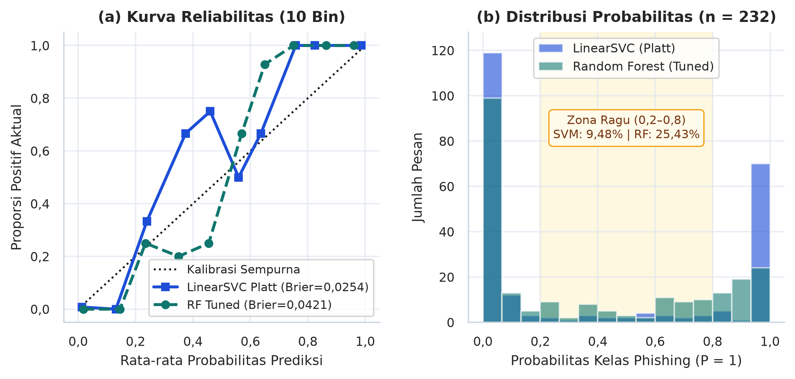
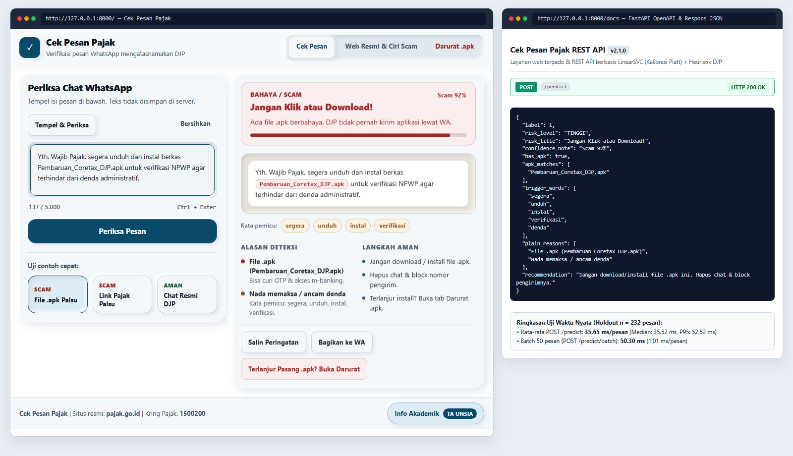

# BAB IV HASIL DAN ANALISA

## 4.1 Hasil Eksperimen Komparasi Klasifikasi dan Penyetelan Hiperparameter

Eksperimen komparatif dijalankan melalui `ml/eksperimen_komparasi.py` memakai pengacak tetap `random_state=42` selama 305,86 detik. Penyaringan duplikat Sastrawi menyisakan 1.159 teks unik dari 1.164 baris induk. Data bersih ini terbagi menjadi 927 latih dan 232 uji. Pada *baseline* *holdout* (n = 232), `LinearSVC` bawaan meraih *Accuracy* 96,12% dan *F1-Score* 94,97% (`TN=138`, `FP=2`, `FN=7`, `TP=85`), dengan *Precision* 97,70% serta *Recall* 92,39%. *Random Forest* (`n_estimators=200`) mencatat akurasi 96,12% dan *F1-Score* 95,03% (`TN=137`, `FP=3`, `FN=6`, `TP=86`) [13], [31].

Pengujian berlanjut memakai *Stratified 10-Fold Cross-Validation* terisolasi TF-IDF pada 927 data latih [34]. Skema ini mencegah kosakata validasi bocor ke proses latih. Sebelum penyetelan hiperparameter, `LinearSVC` mencatat *F1-Score* 97,04% (± 2,71%) dan akurasi 97,63% (± 2,20%), dengan *ROC-AUC* 0,9956 dalam rerata 0,0026 detik per lipatan. *Random Forest* standar meraih *F1-Score* 93,68% (± 3,20%) serta akurasi 94,93% (± 2,59%) dengan *ROC-AUC* 0,9905 selama 0,5357 detik per lipatan. Model linear melaju 202,57 kali lebih cepat.

Pencarian *grid* 10-*Fold* CV terisolasi (`_run_grid_over_folds`) menguji 36 kombinasi kandidat hiperparameter [28]. Konfigurasi terbaik `LinearSVC` (`C=2.0`, `class_weight=None`) meraih *F1-Score* 97,16% (± 2,41%) dan akurasi 97,74% (± 1,93%) dengan *ROC-AUC* 0,9956 dalam 0,0039 detik per lipatan [27]. Di pihak lain, *Random Forest* optimal (`n_estimators=100`, `max_depth=None`, `min_samples_split=2`, `class_weight=None`) meraih *F1-Score* 94,07% (± 2,92%) dan *ROC-AUC* 0,9901 (akurasi 95,25% ± 2,39%) dalam 0,3096 detik [31]. Latihan `LinearSVC` tetap 79,36 kali lebih cepat.

Pada himpunan uji tetap (n = 232), kalibrasi *Platt scaling* menggeser akurasi `LinearSVC` terpasang dari 96,12% menjadi 95,69% (`FP=3`, `FN=7`), sedangkan *Random Forest* mencatat 96,55% (`FP=2`, `FN=6`) [29], [30]. Uji eksak McNemar dua sisi menghasilkan p = 0,7266, menandakan selisih dua sampel itu tidak bermakna secara statistik. Interval kepercayaan *bootstrap* 95% akurasi `LinearSVC` Platt membentang dari 93,10% hingga 98,28%. Pemilihan model unggulan bertumpu pada kestabilan CV, efisiensi komputasi, serta kalibrasi peluang *in-domain*. Ringkasan seluruh tahap evaluasi utama tercantum pada Tabel 4.1.

Tabel 4.1 Hasil Komparasi Kinerja Klasifikasi pada Berbagai Tahap Evaluasi

| Tahap Evaluasi dan Himpunan Uji | Model Klasifikasi | *Accuracy* | *Precision* | *Recall* | *F1-Score* | *ROC-AUC* |
| :--- | :--- | :---: | :---: | :---: | :---: | :---: |
| *Baseline Holdout* (n = 232) | `LinearSVC` / RF (*Default*) | 96,12% / 96,12% | 97,70% / 96,63% | 92,39% / 93,48% | 94,97% / 95,03% | 0,9955 / 0,9939 |
| 10-*Fold* CV *Default* (n = 927) | `LinearSVC` / RF (*Default*) | 97,63% / 94,93% | 97,37% / 93,69% | 96,76% / 93,78% | 97,04% / 93,68% | 0,9956 / 0,9905 |
| 10-*Fold* CV *Tuned* (n = 927) | `LinearSVC` (`C=2.0`) / RF *Tuned* | 97,74% / 95,25% | 97,61% / 94,46% | 96,76% / 93,78% | 97,16% / 94,07% | 0,9956 / 0,9901 |
| *Holdout Tuned* Non-Platt (n = 232) | `LinearSVC` (`C=2.0`) | 96,12% | 97,70% | 92,39% | 94,97% | 0,9950 |
| *Holdout* Final (n = 232) | `LinearSVC` Platt / RF *Tuned* | 95,69% / 96,55% | 96,59% / 97,73% | 92,39% / 93,48% | 94,44% / 95,56% | 0,9957 / 0,9936 |
| Kontrol Tanpa Korpus Pajak (n = 45) | `LinearSVC` Platt / RF *Tuned* | 42,22% / 33,33% | 45,00% / 31,25% | 37,50% / 20,83% | 40,91% / 25,00% | 0,3571 / 0,3502 |
| Subset Pajak Seimbang (n = 45) | `LinearSVC` Platt / RF *Tuned* | 95,56% / 95,56% | 95,83% / 95,83% | 95,83% / 95,83% | 95,83% / 95,83% | 0,9960 / 0,9752 |
| 10-*Fold* CV Korpus Pajak (n = 260) | `LinearSVC` (`C=2.0`) / RF *Tuned* | 98,08% / 93,46% | 96,52% / 92,99% | 100,00% / 94,62% | 98,17% / 93,57% | 0,9947 / 0,9905 |
| *Zero-Shot* Eksternal (n = 1.360) | `LinearSVC` Platt / RF *Tuned* | 64,19% / 62,35% | 40,99% / 36,99% | 80,28% / 60,00% | 54,27% / 45,76% | 0,7875 / 0,6978 |
| *Holdout* Korpus Diperluas (n = 504) | `LinearSVC` Platt / RF *Tuned* | 96,03% / 92,46% | 96,75% / 92,00% | 90,85% / 84,15% | 93,71% / 87,90% | 0,9883 / 0,9771 |
| 10-*Fold* CV Diperluas (n = 2.519) | `LinearSVC` (`C=2.0`) / RF *Tuned* | 94,72% / 94,32% | 92,96% / 93,09% | 90,76% / 89,30% | 91,81% / 91,11% | 0,9832 / 0,9799 |

Sumber: Pengolahan Hasil Eksperimen `05-hasil-evaluasi/csv/tabel_komparasi_utama.csv` (2026).

Sebaran empat kuadran *Confusion Matrix* pada himpunan uji `n = 232` tersaji pada Gambar 4.1, sedangkan kurva ROC dan *Precision-Recall* pada Gambar L.2 mencatat *ROC-AUC* 0,9957 terhadap 0,9936 serta *PR-AUC* 0,9943 terhadap 0,9909 [35]. Pergeseran satu sampel `LinearSVC` Platt terjadi di `idx=1082` (`p=0,5506`) akibat perataan lima submodel `CalibratedClassifierCV` (0,43% ukuran uji). Bagi layanan wajib pajak, tujuh *False Negative* meloloskan penipuan, sementara tiga *False Positive* berpotensi memblokir pesan sah.

Gambar 4.1 Perbandingan *Confusion Matrix* Uji *Holdout*.

## 4.2 Analisis Kalibrasi Probabilitas dan Studi Ablatif Fitur

Penyajian skor keyakinan di antarmuka menuntut keluaran peluang yang selaras dengan kejadian aktual [29], [30]. Pada uji *holdout* `n = 232`, `LinearSVC` Platt mencatat *Brier Score* 0,02542 dan *Log Loss* 0,09186, jauh lebih rendah dibandingkan *Random Forest* (*Brier Score* 0,04214; *Log Loss* 0,15870). Selisih tersebut setara *Brier Score* 39,68% dan *Log Loss* 42,12% lebih rendah daripada *Random Forest*.

Sebaran skor pada Gambar 4.2 memperkuat keunggulan kalibrasi model linear. Peluang `LinearSVC` mengelompok tegas mendekati nol dan satu sehingga hanya 22 dari 232 pesan (9,48%) berada di zona keraguan 0,2 hingga 0,8, sedangkan skor *Random Forest* menyebar lebih luas pada rentang tengah sebanyak 59 pesan (25,43%). Sebaran lebar berisiko membanjiri layar dengan peringatan abu-abu yang membingungkan wajib pajak.

Gambar 4.2 Evaluasi Kalibrasi Probabilitas Model.

Untuk memvalidasi praproses, enam skenario ablatif dijalankan pada `05-hasil-evaluasi/csv/studi_ablatif_fitur.csv` dalam Tabel L.8 [32], [33]. Setelan utama (`teks_sastrawi`, *bigram* `(1, 2)`, 3.000 fitur) meraih *F1-Score* CV `LinearSVC` tertinggi (97,16%). Peniadaan `token_apk` dan `token_url` memangkasnya 1,35 poin menjadi 95,81% serta menjatuhkan *Random Forest* ke 92,42% [16], sedangkan *unigram* saja menurunkannya 1,22 poin menjadi 95,94%.

Peniadaan Sastrawi hanya menimbulkan selisih skor CV `LinearSVC` sebesar 0,0006% (97,1596% terhadap 97,1589%), sedangkan pada *Random Forest* skor CV justru sedikit lebih tinggi di 94,55% dibanding 94,07% [9], [32]. Sementara itu, lonjakan akurasi *holdout* `1_Tanpa_Token_Entitas` ke 97,84% dipicu penyamarataan tautan resmi `pajak.go.id` dan tautan penipu menjadi `token_url` pada uji tunggal bernilai 0,43% per sampel. Daftar putih domain wajib berjalan saat inferensi.

## 4.3 Analisis Ketahanan Bias Kata Kunci Pajak dan Generalisasi Lintas Korpus

Pengujian Tahap 4A menjawab Rumusan Masalah (b) pada 45 pesan pajak *holdout* (21 pesan aman: 19 siaran resmi DJP dan 2 percakapan normal, serta 24 *phishing*). Ketika `LinearSVC` Platt hanya dilatih memakai 712 SMS umum, akurasinya anjlok ke 42,22% (*F1-Score* 40,91%; *ROC-AUC* 0,3571). Sebanyak 11 pesan aman terblokir (`FP=11`; spesifisitas 47,62%) dan 15 penipuan lolos (`FN=15`), sedangkan *Random Forest* kontrol merosot ke akurasi 33,33% dan *F1-Score* 25,00% (`FP=11`, `FN=19`).

Masuknya korpus pajak seimbang ke data latih (1.159 baris) mengangkat kedua model ke *Accuracy* 95,56% dan *F1-Score* 95,83% (`FP=1`, `FN=1`), meloloskan 20 dari 21 pesan aman tersebut [2], [5]. `LinearSVC` Platt meraih *ROC-AUC* 0,9960 (*Brier Score* 0,03289), melampaui *Random Forest* (*ROC-AUC* 0,9752; *Brier* 0,10914). Evaluasi 10-*Fold* CV pada 260 baris pajak turut mengukuhkan `LinearSVC` (*F1-Score* 98,17% ± 2,56%; *Recall* 100,00%) jauh di atas *Random Forest* (93,57% ± 3,03%).

Uji *zero-shot* lintas korpus Tahap 4B mengevaluasi 1.360 pesan unik asal himpunan Theodorus dkk. [7] dan Saragih [36]. Pada uji gabungan itu, `LinearSVC` mempertahankan *Recall* 80,28% (*F1-Score* 54,27%) di atas *Random Forest* (*Recall* 60,00%; *F1-Score* 45,76%), meski presisi turun ke 40,99% (`FP=416`) dan spesifisitas 58,40%. Khusus pada 1.266 pesan Theodorus dkk., presisi tercatat 34,71% dan spesifisitas 58,63% (`FP=412`) akibat pergeseran gaya pesan 2016 ke 2021, sementara 94 baris Saragih bertipologi timpang 90:4 (`FP=4`).

Ketika korpus diperluas ke 2.519 baris pada Tahap 4C, akurasi *holdout* (`n = 504`) `LinearSVC` pulih ke 96,03% berbanding 92,46% pada *Random Forest*. Evaluasi 10-*Fold* CV mencatat 91,81% (± 2,19%) terhadap 91,11% (± 2,58%). Pola pada Gambar L.4 tersebut menegaskan perlunya pembaruan korpus secara berkala mengikuti perubahan diksi layanan pajak.

## 4.4 Analisis Interpretabilitas Fitur dan Kesalahan Prediksi

Transparansi model dikaji lewat koefisien `LinearSVC` pada Gambar L.3 dan Tabel L.9, disertai kontribusi fitur aktif pada `n = 232` memakai `LinearExplainer` serta `TreeExplainer` SHAP pada Gambar L.5 [17], [18]. Token pemicu *phishing* terkuat `LinearSVC` mencakup `no` (+2,2405), `sms` (+1,6940), `rekening` (+1,5083), `info` (+1,4054), `segera` (+1,3778), `pin` (+1,3729), `token_apk` (+1,3582), serta `token_url` (+1,3550). Sebaliknya, bobot penahan negatif terkuat berasal dari `resmi` (-1,0706; *mean* `|SHAP|` 0,0341), `laman`, `kp2kp`, dan `pratama`.

Sinyal percakapan wajar turut diperkuat oleh token `nama1` (-1,2720; `|SHAP|` 0,0395), `yg` (-0,8942; `|SHAP|` 0,0388), dan `aku` (-1,2206; `|SHAP|` 0,0575). Karena `nama1` dan `2016` (-0,6664) merupakan artefak anonimisasi korpus Rahmi [6], keduanya disaring dari antarmuka awam. Sepuluh fitur SHAP teratas *Random Forest* justru didominasi kata pemicu *phishing* seperti `info` (0,0323) dan `no` (0,0323).

Penelusuran galat pada 232 data uji menemukan 13 sampel keliru gabungan pada Tabel L.10 (`LinearSVC` Platt 10, *Random Forest* 8, irisan 5) menggunakan indeks himpunan unik 1.159 baris pasca-deduplikasi. Pada *phishing* `idx=960` (`MPajak_Aktivasi_KSWP.apk`, `p=0,424`), klasifier teks luput, tetapi aturan `has_apk` di `app/backend/inference.py` menaikkan vonis ke `TINGGI`. Pada imbauan resmi `idx=1082` (`www.pajak.go.id`, `p=0,551`), `is_official_djp_domain` melindungi domain, namun tidak menimpa label di rentang 0,50 hingga 0,74 sehingga tertahan `WASPADA` (bundel produksi 1.159 turun ke 0,109). Dua penipuan transfer tanpa tautan (`idx=314`, `idx=102`) terbawa bobot `mandiri` (-0,7612), menandai batas leksikal.

## 4.5 Hasil Pengujian Purwarupa Sistem Terpadu dan Evaluasi Kesiapterapan Teknologi

Pengujian otomatis Pytest 9.2.0 dan `ml/benchmark_purwarupa.py` meluluskan seluruh 29 fungsi uji dalam 7,88 detik. Pengujian itu mencakup 16 skenario API (`UJI-01` hingga `UJI-09a`, `UJI-09b`, serta `UJI-11` hingga `UJI-16`) dan 13 uji integritas `UJI-10` pada Tabel L.11. Pemuatan bundel `.joblib` ke `lru_cache` memerlukan 129,578 ms. Selanjutnya, `inference.py::predict_message` (`n = 232`) mencatat rata-rata 14,542 ms (*median* 14,303 ms; *P95* 16,971 ms; *P99* 18,680 ms). Pada `TestClient` FastAPI, `POST /predict` membukukan rata-rata 35,651 ms (*median* 35,518 ms; *P95* 52,524 ms; *P99* 56,838 ms; maks. 62,120 ms), sedangkan *batch* 50 pesan tuntas dalam 50,295 ms (1,006 ms/pesan).

Tampilan web *Cek Pesan Pajak* dan respons JSON API v2.1.0 diperlihatkan pada Gambar 4.3. Prasetel `Pembaruan_Coretax_DJP.apk` memunculkan lencana `BAHAYA / SCAM` (`Scam 92%`; log JSON `svm_probability=0,9249`), menyorot berkas `.apk`, serta menampilkan empat *chip* pemicu dan ringkasan uji waktu nyata. Pada simulasi ekstensi *Manifest V3* di Gambar L.6, lencana menandai `Pembaruan_Coretax_DJP.apk` serta `djp-coretax-verifikasi.xyz` sebagai `Jangan Klik atau Download!` (`Scam 84%` di `popup.html`), sedangkan `djponline.pajak.go.id` lolos (`Pola Chat Resmi / Normal`; log `svm_probability=0,1023`) dan angka `17.00` aman.

Gambar 4.3 Tangkapan Layar Antarmuka Web *Cek Pesan Pajak* dan Respons API.

Purwarupa memadukan bundel terkalibrasi bersama peladen FastAPI berpagar CORS/CSP dan *rate limiting* yang melayani antarmuka web serta ekstensi pada simulasi dengan latensi *P95* 52,524 ms dan maksimum 62,120 ms di `TestClient` *in-process*. Capaian integrasi tersebut memenuhi indikator **TKT Level 6** menurut Permenristekdikti Nomor 42 Tahun 2016 [25] sebatas demonstrasi simulasi lokal (`/simulasi-wa` dan `TestClient` sekuensial), tanpa mencakup pengukuran jaringan/TLS, DOM `web.whatsapp.com` nyata, uji beban konkuren, maupun *User Acceptance Testing* wajib pajak. Sintesis perbandingan terhadap sepuluh studi terdahulu [6], [7], [9], [10], [11], [13], [15], [16], [17], [19] tercantum pada Tabel L.12.
