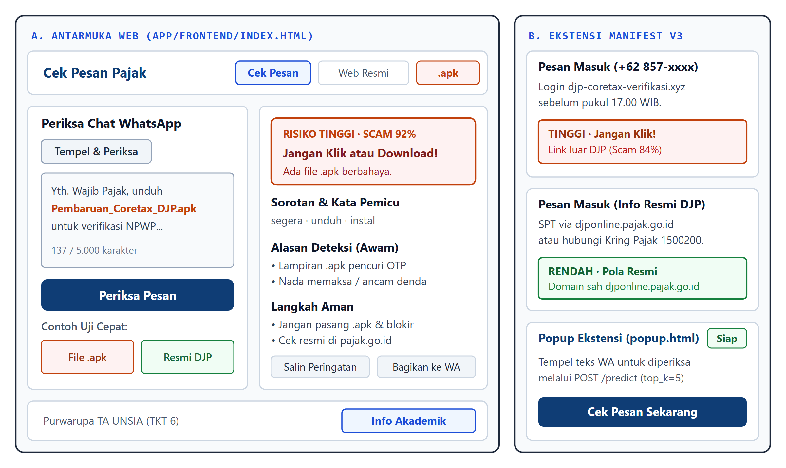
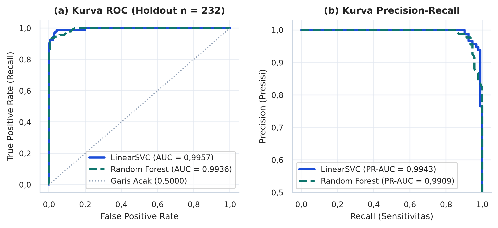
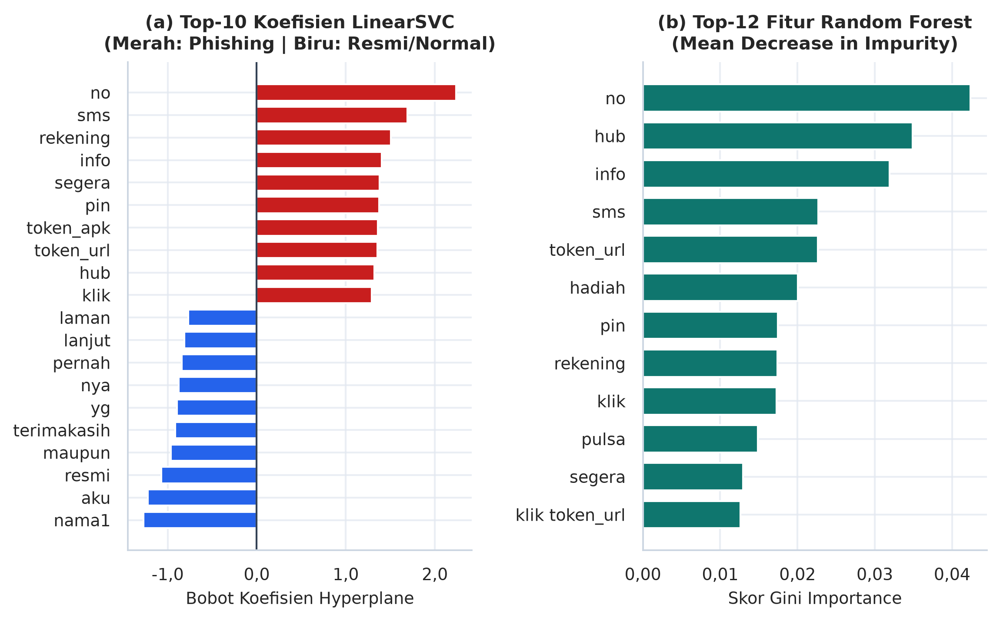
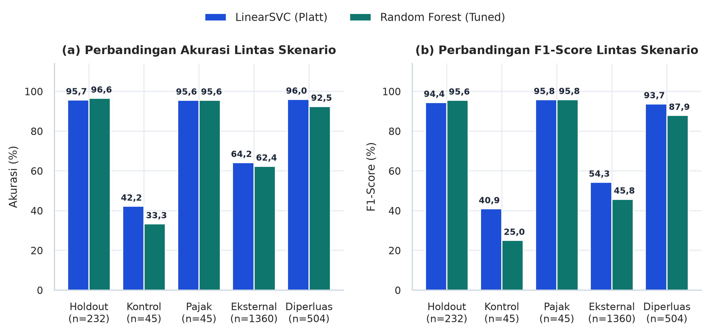
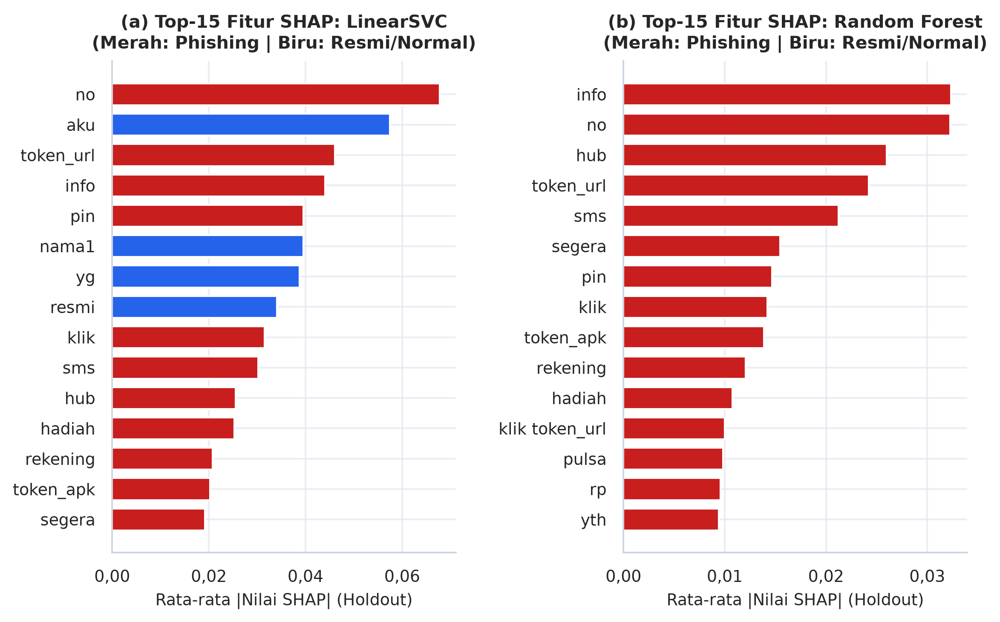
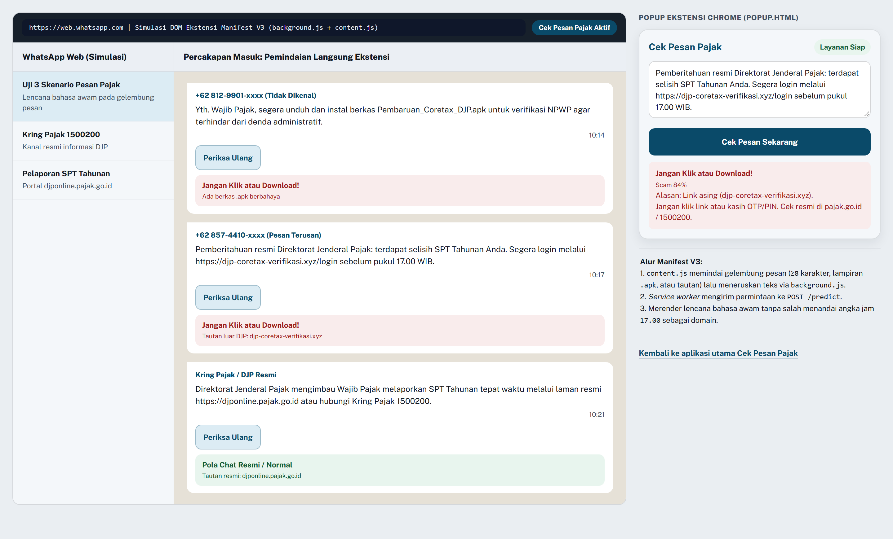

# DAFTAR PUSTAKA

[1] Waluyo and N. A. Wijayanti, *Perpajakan Indonesia*, ed. ke-13. Jakarta: Salemba Empat, 2026, ISBN 978-623-181-149-3.

[2] Direktorat Jenderal Pajak, “Penyebarluasan Informasi Mengenai Coretax (Pengumuman Nomor PENG-32/PJ.09/2024),” *Portal Resmi Direktorat Jenderal Pajak Kementerian Keuangan Republik Indonesia*, Nov. 2024. [Online]. Available: https://pajak.go.id/id/pengumuman/penyebarluasan-informasi-mengenai-coretax

[3] N. B. Prakoso, H. Ayu, and H. Zakaria, “Misuse of taxpayer data for phising scams,” *Journal of International Islamic Law, Human Rights, and Public Policy*, vol. 4, no. 3, pp. 1560-1569, Jul. 2026, doi: 10.5281/zenodo.21853029.

[4] R. Alabdan, “Phishing attacks survey: Types, vectors, and technical approaches,” *Future Internet*, vol. 12, no. 10, p. 168, pp. 1-39, Sep. 2020, doi: 10.3390/fi12100168.

[5] Direktorat Jenderal Pajak, “Himpunan pengumuman kewaspadaan penipuan mengatasnamakan Direktorat Jenderal Pajak (PENG-31/PJ.09/2024, PENG-4/PJ.09/2025 yang turut merujuk PENG-1/PJ.09/2025, PENG-29/PJ.09/2025, PENG-50/PJ.09/2025, dan PENG-18/PJ.09/2026),” *Portal Resmi Direktorat Jenderal Pajak Kementerian Keuangan Republik Indonesia*, 2024–2026. [Online]. Available: https://www.pajak.go.id/id/pengumuman

[6] F. Rahmi (dibimbing Y. Wibisono dan R. Megasari), “Aplikasi SMS spam filtering pada Android menggunakan algoritma Naïve Bayes,” Skripsi, Dept. Pendidikan Ilmu Komputer, Universitas Pendidikan Indonesia, Bandung, 2016. [Online]. Available: https://repository.upi.edu/26936/

[7] A. Theodorus, T. K. Prasetyo, R. Hartono, and D. Suhartono, “Short Message Service (SMS) spam filtering using machine learning in Bahasa Indonesia,” in *Proc. 3rd East Indonesia Conf. Comput. Inf. Technol. (EIConCIT)*, Apr. 2021, pp. 199-203, doi: 10.1109/EIConCIT50028.2021.9431859.

[8] D. Irawan, Hamidah, E. B. Perkasa, Yurindra, D. Wahyuningsih, and E. Helmud, “Perbandingan klassifikasi SMS berbasis Support Vector Machine, Naive Bayes Classifier, Random Forest dan Bagging Classifier,” *Jurnal Sisfokom (Sistem Informasi dan Komputer)*, vol. 10, no. 3, pp. 432-437, Dec. 2021, doi: 10.32736/sisfokom.v10i3.1302.

[9] M. S. Al Ghofany, R. Dwiyansaputra, F. Bimantoro, and Khairunnas, “Indonesian SMS spam detection using TF-RF feature weighting method and Support Vector Machine classifier,” in *Proc. First Mandalika Int. Multi-Conf. Sci. Eng. (MIMSE-I-C)*, 2022, pp. 117-129, doi: 10.2991/978-94-6463-084-8_12.

[10] E. Z. Astuti, C. A. Sari, E. H. Rachmawanto, and R. R. Ali, “Comparative study of machine learning algorithms for performing ham or spam classification in SMS,” *Scientific Journal of Informatics*, vol. 11, no. 1, pp. 177-186, Feb. 2024, doi: 10.15294/sji.v11i1.47364.

[11] F. F. Tampinongkol, A. R. Kamila, A. C. Wardhana, A. W. C. Kusuma, and D. Revaldo, “Implementation of Random Forest classification and Support Vector Machine algorithms for phishing link detection,” *Journal of Informatics, Information System, Software Engineering and Applications (INISTA)*, vol. 7, no. 1, pp. 127-137, Nov. 2024, doi: 10.20895/inista.v7i1.1588.

[12] A. Al Tawil, L. Almazaydeh, D. Qawasmeh, B. Qawasmeh, M. Alshinwan, and K. Elleithy, “Comparative analysis of machine learning algorithms for email phishing detection using TF-IDF, Word2Vec, and BERT,” *Computers, Materials & Continua*, vol. 81, no. 2, pp. 3395-3412, Nov. 2024, doi: 10.32604/cmc.2024.057279.

[13] A. A. Ningtias, N. Anwar, A. Ichwani, and R. T. Iswahyudi, “Komparasi kinerja Support Vector Machine dan Random Forest untuk deteksi spam email berbasis TF-IDF teks,” *IKRA-ITH Informatika: Jurnal Komputer dan Informatika*, vol. 10, no. 3, pp. 45-51, Nov. 2026, doi (edisi): 10.37817/ikraith-informatika.v10i3. [Online]. Available: https://journals.upi-yai.ac.id/index.php/ikraith-informatika/article/view/7618

[14] F. M. Efendi, A. K. Adisusilo, and S. Budiprayitno, “Pengembangan sistem deteksi phishing pada WhatsApp berbasis AI dengan integrasi bahasa lokal Surabaya,” *Melek IT Information Technology Journal*, vol. 11, no. 1, pp. 101-112, Jun. 2025, doi: 10.30742/melekitjournal.v11i1.417.

[15] R. B. Saputra, M. Azwar, L. Widyawati, Husain, and K. A. Latif, “Implementasi algoritma SVM pada bot WhatsApp untuk deteksi pesan spam,” *Jurnal Manajemen Informatika dan Sistem Informasi*, vol. 9, no. 1, pp. 39-51, Jan. 2026, doi: 10.36595/misi.v9i1.1803.

[16] M. A. Sembiring, M. F. L. Sibuea, and Anjani, “Optimasi model klasifikasi pesan penipuan digital berbahasa Indonesia menggunakan XGBoost dengan Bayesian Optimization dan SMOTE,” *Journal of Science and Social Research*, vol. 9, no. 3, pp. 5329-5336, Jun. 2026. [Online]. Available: https://jurnal.goretanpena.com/index.php/JSSR/article/view/7212

[17] P. Mishra and A. Yadav, “An explainable and reproducible lightweight machine learning framework for SMS spam detection using TF-IDF and Linear Support Vector Classification,” *International Journal of Advanced Science and Computer Applications*, vol. 5, no. 2, Sep. 2026, doi: 10.47679/ijasca.v5i2.269.

[18] J. Ismail, R. A. Nasution, and M. N. Gea, “Explainable phishing website detection using comparative machine learning and SHAP,” *IDEALIS: Indonesia Journal Information System*, vol. 9, no. 2, pp. 268-277, Jul. 2026, doi: 10.36080/idealis.v9i2.3810.

[19] Suwarno, V. Capricornness, and Y. Christian, “Implementasi machine learning berbasis browser extension untuk deteksi URL phishing menggunakan Logistic Regression classification,” *Komputa: Jurnal Ilmiah Komputer dan Informatika*, vol. 15, no. 1, pp. 23-34, Apr. 2026, doi: 10.34010/komputa.v15i1.18882.

[20] U. Darusalam, M. Ikhwani, C. R. Hassolthine, W. P. Santoso, F. A. S. N. Haq, Y. Aisanafi, and M. N. Ichsan, *Pedoman Teknis Penulisan Tugas Akhir* (Buku Pedoman Penulisan Tugas Akhir SK Rektor Nomor 01 Tahun 2024). Jakarta: Universitas Siber Asia, Apr. 2024.

[21] Sugiyono, *Metode Penelitian Kuantitatif, Kualitatif, dan R&D*, ed. ke-2. Bandung: Alfabeta, 2023.

[22] M. Darwin *et al.*, *Metode Penelitian Pendekatan Kuantitatif*, T. S. Tambunan, Ed. Bandung: CV. Media Sains Indonesia, 2021.

[23] Sugiyono, *Statistika untuk Penelitian*, cet. ke-12, ed. rev. Bandung: Alfabeta, 2007, ISBN 978-979-8433-10-8.

[24] L. P. Sinambela, *Metodologi Penelitian Kuantitatif; Untuk Bidang Ilmu Administrasi, Kebijakan Public, Ekonomi, Sosiologi, Komunikasi dan Ilmu Sosial Lainnya*. Yogyakarta: Graha Ilmu, 2014.

[25] Menteri Riset, Teknologi, dan Pendidikan Tinggi Republik Indonesia, *Peraturan Menteri Riset, Teknologi, dan Pendidikan Tinggi Nomor 42 Tahun 2016 tentang Pengukuran dan Penetapan Tingkat Kesiapterapan Teknologi* (Berita Negara Republik Indonesia Tahun 2016 Nomor 1010). Jakarta: Kementerian Ristekdikti, Jul. 2016.

[26] C. Cortes and V. Vapnik, “Support-vector networks,” *Machine Learning*, vol. 20, no. 3, pp. 273-297, Sep. 1995, doi: 10.1007/BF00994018.

[27] R.-E. Fan, K.-W. Chang, C.-J. Hsieh, X.-R. Wang, and C.-J. Lin, “LIBLINEAR: A library for large linear classification,” *Journal of Machine Learning Research*, vol. 9, pp. 1871-1874, Aug. 2008. [Online]. Available: https://jmlr.org/papers/v9/fan08a.html

[28] F. Pedregosa *et al.*, “Scikit-learn: Machine learning in Python,” *Journal of Machine Learning Research*, vol. 12, pp. 2825-2830, Oct. 2011. [Online]. Available: https://jmlr.org/papers/v12/pedregosa11a.html

[29] J. C. Platt, “Probabilistic outputs for support vector machines and comparisons to regularized likelihood methods,” in *Advances in Large Margin Classifiers*, A. J. Smola, P. Bartlett, B. Schölkopf, and D. Schuurmans, Eds. Cambridge, MA, USA: MIT Press, 2000, pp. 61-74.

[30] H.-T. Lin, C.-J. Lin, and R. C. Weng, “A note on Platt's probabilistic outputs for support vector machines,” *Machine Learning*, vol. 68, no. 3, pp. 267-276, Oct. 2007, doi: 10.1007/s10994-007-5018-6.

[31] L. Breiman, “Random forests,” *Machine Learning*, vol. 45, no. 1, pp. 5-32, Oct. 2001, doi: 10.1023/A:1010933404324.

[32] M. Adriani, J. Asian, B. A. A. Nazief, S. M. M. Tahaghoghi, and H. E. Williams, “Stemming Indonesian: A confix-stripping approach,” *ACM Transactions on Asian Language Information Processing*, vol. 6, no. 4, pp. 1-33, Dec. 2007, doi: 10.1145/1316457.1316459.

[33] G. Salton and C. Buckley, “Term-weighting approaches in automatic text retrieval,” *Information Processing & Management*, vol. 24, no. 5, pp. 513-523, 1988, doi: 10.1016/0306-4573(88)90021-0.

[34] R. Kohavi, “A study of cross-validation and bootstrap for accuracy estimation and model selection,” in *Proc. 14th Int. Joint Conf. Artif. Intell. (IJCAI)*, Montreal, QC, Canada, Aug. 1995, vol. 2, pp. 1137-1143. [Online]. Available: https://www.ijcai.org/Proceedings/95-2/Papers/016.pdf

[35] M. Sokolova and G. Lapalme, “A systematic analysis of performance measures for classification tasks,” *Information Processing & Management*, vol. 45, no. 4, pp. 427-437, Jul. 2009, doi: 10.1016/j.ipm.2009.03.002.

[36] S. C. Saragih, “Indonesian SMS Spam Classifier Dataset,” *GitHub Repository*, 2024. [Online]. Available: https://github.com/Sctian514/Indonesian-sms-spam-classifier (Lisensi MIT).

---

# LAMPIRAN

## Lampiran 1. Matriks Penelitian Terdahulu

Tabel L.1 Matriks Penelitian Terdahulu

| Peneliti (Tahun) | Objek & Fitur | Algoritma & Hasil Utama | Fokus & Keterbatasan |
| :--- | :--- | :--- | :--- |
| Prakoso dkk. (2026) [3] | Kajian yuridis penipuan *Coretax*, NIK, NPWP, dan M-Pajak | Analisis kualitatif normatif tanpa klasifikasi otomatis | Memetakan modus pajak, tanpa model detektor teks |
| Rahmi (2016) [6] | 1.140 SMS Indonesia (*Term Frequency*, 10-CV) | MNB: *Acc* 94,12% (*spam*) & 94,56% (*fraud* vs promo) | Merintis korpus Indonesia, tanpa URL/`.apk` & pajak |
| Theodorus dkk. (2021) [7] | 4.125 SMS Indonesia 3 kelas (*Bag of Words* 1.500) | RF (94,62%), *LogReg* (94,57%), XGBoost (94,52%), SVM (94,38%) | Korpus Indonesia luas, belum menyasar *phishing* pajak |
| Irawan dkk. (2021) [8] | 5.571 SMS Inggris UCI (4.824 *ham*, 747 *spam*) | *Bagging* (97,4%), RF (96,8%), NB (96,4%), SVM (86,5%) | Berbahasa Inggris; SVM diuji tanpa penyetelan parameter |
| Al Ghofany dkk. (2022) [9] | 500 SMS Indonesia (Nazief-Adriani, TF-IDF & TF-RF) | TF-IDF: SVM *Sigmoid* (99,60%), Linear (99,52%); TF-RF (100%) | Menguji *stemming* lokal, belum menguji *Random Forest* |
| Astuti dkk. (2024) [10] | 5.572 SMS Inggris UCI memakai TF-IDF | SVC *Sigmoid* (97,93%; *F1* 95%) vs RF (97,28%; *F1* 94%) | Tanpa praproses Indonesia; selisih cacah uji 1.839 baris |
| Tampinongkol dkk. (2024) [11] | 59.899 URL (9 fitur leksikal tautan, *split* 80:20) | *Random Forest* (84,95%) vs SVM *default* (77,43%) | Fokus struktur URL, belum menganalisis isi pesan teks |
| Al Tawil dkk. (2024) [12] | 18.650 surel Inggris (TF-IDF, *Word2Vec*, BERT) | RF TF-IDF (*F1* 0,98; 40,39 dtk) vs BERT (*F1* 0,99; 1.012,66 dtk) | Mengukur efisiensi TF-IDF, tidak membandingkan SVM |
| Ningtias dkk. (2026) [13] | 5.572 SMS Inggris (TF-IDF + `GridSearchCV`) | Linear SVM (98,39%; *F1* 0,9371) vs RF (95,96%; *F1* 0,8421) | Menunjukkan keunggulan Linear SVM, namun membuang URL |
| Efendi dkk. (2025) [14] | *Bot* WhatsApp dialek Indonesia & Jawa (3 fitur, 5 uji) | *Fuzzy* Mamdani & TSK (skor 0,55–0,83 vs 0,18–0,35) | Mendukung dialek WhatsApp, tanpa pembelajaran terawasi |
| Saputra dkk. (2026) [15] | 1.320 pesan WA & SMS Indonesia (Sastrawi + `Hashing`) | Linear SVM (*Acc* 95,45%; *Macro F1* 0,95 pada 80:20) | Memakai Sastrawi, tetapi *hashing* menghilangkan XAI |
| Sembiring dkk. (2026) [16] | 2.320 pesan Indonesia (token entitas + TF-IDF) | MNB (97,41%; *F1* 0,9693) & SVM (*Rec* 98,59%; *Acc* 96,98%) | Melestarikan token URL/uang, tanpa `.apk` & ekstensi WA |
| Mishra & Yadav (2026) [17] | 5.572 SMS Inggris (TF-IDF + analisis SHAP) | `LinearSVC` XAI (*Acc* 98,57%; *F1* 94,44%) | Kerangka `LinearSVC` terjelaskan, belum menyasar pajak WA |
| Ismail dkk. (2026) [18] | 11.430 URL (87 fitur leksikal, DOM, reputasi) | XGBoost (96,50%), RF (*F1* 96,39%), SVM (*F1* 95,39%) + SHAP | Memadukan komparasi & SHAP, bergantung reputasi eksternal |
| Suwarno dkk. (2026) [19] | 235.370 URL (13 fitur URL & DOM, ekstensi Chrome) | *Logistic Regression* (99,53%; 1,40 ms; SUS 81%) | Ekstensi *real-time* cepat, khusus URL bukan teks chat |
| **Penelitian Ini (2026)** | **1.159 induk & 2.519 diperluas; TF-IDF + `.apk`/URL** | **`LinearSVC` Platt (CV 97,74%; *F1* pajak 98,17%) vs RF** | **Kontrol bias pajak, kalibrasi Platt, SHAP, & purwarupa TKT 6** |

Sumber: Hasil Kajian Pustaka (2026).

## Lampiran 2. Jadwal, Alat, Bahan, dan Definisi Operasional

Tabel L.2 Jadwal Pelaksanaan Penelitian

| Tahap Kegiatan | Agt 2026 | Sep 2026 | Okt 2026 | Nov 2026 |
| :--- | :---: | :---: | :---: | :---: |
| Studi literatur, cek kebaruan, dan perumusan proposal | ✓ | ✓ | | |
| Pengumpulan sumber DJP dan kurasi *dataset* terverifikasi | | ✓ | ✓ | |
| Implementasi praproses, TF-IDF, dan eksperimen model | | | ✓ | ✓ |
| Penyetelan *grid* 10-*Fold* CV, kalibrasi Platt, dan uji ablatif | | | ✓ | ✓ |
| Perancangan arsitektur purwarupa TKT 6 dan pengujian sistem | | | ✓ | ✓ |
| Penyusunan naskah lengkap Bab I hingga Bab V dan Lampiran | | | ✓ | ✓ |

Sumber: Rencana Kerja Penelitian (2026).

Tabel L.3 Spesifikasi Alat dan Bahan Penelitian

| Kategori | Komponen / Berkas | Spesifikasi & Peran |
| :--- | :--- | :--- |
| Perangkat Keras | Laptop Komputasi | Intel Core i5-12450H, RAM 16 GB, Windows 11 Pro 64-bit |
| Pustaka ML & Teks | Python, Scikit-learn, Sastrawi | Python 3.14.7, Scikit-learn 1.9.1 (`LinearSVC`, RF, Platt), Sastrawi 1.0.1 [28], [32] |
| Pustaka Analisis | Pandas, NumPy, Matplotlib, SHAP | Pandas 3.1.1, NumPy 2.5.4, Matplotlib 3.11.2, Seaborn 0.13.2, SHAP 0.54.1, Pytest 9.2.0 |
| Rancangan Purwarupa | FastAPI, Web, Ekstensi Chrome | FastAPI 0.163.1, Uvicorn 0.54.0, web *Cek Pesan Pajak*, ekstensi *Manifest V3* [19], [25] |
| Korpus SMS Publik | `Rahmi 2016 Korpus SMS Spam Utama v1.csv` | 904 SMS Indonesia (335 *phishing*, 569 aman); 239 promo disisihkan [6] |
| Korpus Khusus Pajak | `Dataset Pajak Terkurasi 260 Baris.csv` | 260 teks pajak seimbang (130 *phishing*, 110 resmi DJP, 20 normal) [2], [5] |
| Korpus Gabungan Induk | `Dataset Gabungan Utama Biner 1164 Baris.csv` | 1.164 baris (1.159 unik pasca-Sastrawi) terverifikasi SHA-256 [2], [5], [6] |
| Korpus Diperluas | `Dataset Gabungan Diperluas Biner 2521 Baris.csv` | 2.521 baris (2.519 unik), termasuk 1.360 pesan eksternal [7], [36] |

Sumber: Dokumentasi Lingkungan Penelitian (2026).

Tabel L.4 Definisi Operasional Variabel dan Parameter Penelitian

| Variabel / Parameter | Jenis | Definisi Operasional & Nilai Acuan |
| :--- | :--- | :--- |
| Teks Pesan Instan | Variabel Bebas | Teks melalui *case folding*, `token_apk`, `token_url`, penghapusan simbol, *stopword*, dan Sastrawi (`len > 2`) [28], [32] |
| Label Klasifikasi (`label`) | Variabel Terikat | Biner: `1` untuk indikasi *phishing* dan `0` untuk pesan aman/resmi |
| Perlakuan Uji Kontrol | Perlakuan | Pelatihan 712 SMS umum tanpa korpus pajak vs 927 pesan seimbang pada uji pajak ($n = 45$) |
| Ekstraksi TF-IDF | Fitur | TF-IDF halus normalisasi L2 *n-gram* `(1, 2)`, maks. 3.000 fitur (ablatif 1.500 & 5.000) [28], [33] |
| Parameter `LinearSVC` | *Hyperparameter* | 12 kandidat: `C` {0,1; 0,25; 0,5; 1,0; 2,0; 5,0}, `class_weight` {None, balanced}, `max_iter=5000` [27], [28] |
| Parameter *Random Forest* | *Hyperparameter* | 24 kandidat: `n_estimators` {100, 200, 300}, `max_depth` {None, 30}, `min_samples_split` {2, 5}, `class_weight` [28], [31] |
| Kalibrasi *Platt* | Kalibrasi | `CalibratedClassifierCV` (`method="sigmoid"`, `cv=5`) merata-ratakan lima submodel [28], [29], [30] |
| Metrik Kinerja | Skala Rasio (0–1) | *Accuracy*, *Precision*, *Recall*, *F1*, *ROC-AUC*, *PR-AUC*, *Brier Score*, dan *Log Loss* ($\epsilon = 10^{-15}$) [35] |
| Kelayakan TKT Level 6 | Indikator Sistem | Latensi <100 ms; daftar putih `pajak.go.id`; risiko TINGGI (`.apk` / $p \ge 0,75$), SEDANG, RENDAH [19], [25] |

Sumber: Sintesis Metodologi Penelitian (2026).

## Lampiran 3. Pemetaan Modul Kode, Kontrak API, Matriks Skenario Uji, dan Rancangan Antarmuka

Tabel L.5 Pemetaan Modul Kode Sumber terhadap Tahapan Metodologi Penelitian

| Modul / Direktori | Tahap Metodologi | Peran Teknis |
| :--- | :--- | :--- |
| `ml/korpus_pajak.py` | Kurasi Sumber Pajak | Menyimpan metadata 68 arsip publik, 31 katalog IOC/kanal resmi DJP, dan 260 teks pajak |
| `ml/kurasi_dataset.py` | Konstruksi & Provenans | Membersihkan *boilerplate* DJP, menyusun korpus 1.164 dan 2.521 baris, serta SHA-256 |
| `ml/eksperimen_baseline.py` | Praproses & *Baseline* | Menjalankan `clean_text` Sastrawi (`lru_cache` 20.000) dan uji *baseline* 80:20 |
| `ml/eksperimen_komparasi.py` | Penyetelan & Evaluasi | Menjalankan 10-*Fold* CV, *grid search*, Platt, ablatif, kontrol, SHAP, dan ekspor `.joblib` |
| `ml/benchmark_purwarupa.py` | Benchmark & Cuplikan | Menjalankan Pytest otomatis, benchmark latensi API, serta merender gambar dan CSV/JSON |
| `app/backend/inference.py` | Mesin Inferensi | Memuat `.joblib`, mengecek `.apk`/79 TLD/`pajak.go.id`, menyusun skor risiko dan alasan awam |
| `app/backend/api.py` | Layanan REST API | Peladen FastAPI (`v2.1.0`) beserta skrip peluncur untuk antarmuka web dan ekstensi |
| `app/frontend/` | Antarmuka Web | Halaman responsif *Cek Pesan Pajak* dan modal evaluasi TA untuk demo sidang |
| `app/extension/` | Ekstensi *WhatsApp Web* | Ekstensi Chrome *Manifest V3* (`v1.2.0`) untuk pemindaian dan lencana risiko langsung |
| `tests/` | Verifikasi Otomatis | Menjalankan 29 fungsi uji `pytest` atas data, model, keamanan, dan kontrak API |

Sumber: Dokumentasi Rekayasa Perangkat Lunak Penelitian (2026).

Tabel L.6 Spesifikasi Titik Akhir Layanan Web dan REST API FastAPI

| Metode & Jalur | Masukan | Keluaran Utama | Peran |
| :--- | :--- | :--- | :--- |
| `GET /` | Tanpa badan | Halaman HTML aplikasi web *Cek Pesan Pajak* | Antarmuka web utama |
| `GET /simulasi-wa` | Tanpa badan | Halaman simulasi *WhatsApp Web* interaktif | Demo ekstensi *Manifest V3* |
| `GET /health` | Tanpa badan | Status `ok`, status model, & metadata (503 jika absen) | Cek kesiapan layanan |
| `GET /api/presets` & `/api/academic-summary` | Tanpa badan | Tiga prasetel uji, identitas TA, benchmark, & metrik | Pengisi contoh cepat & modal TA |
| `POST /predict` | JSON `text` (1–5.000 kar.) & `top_k` (bawaan 8) | Label, level risiko, probabilitas, alasan awam, sorotan, & latensi | Inferensi pesan tunggal |
| `POST /predict/batch` | JSON `texts` (1–200 pesan, maks. 100.000 kar.) | Daftar hasil per indeks (422 validasi; 429 batas laju; 503 absen) | Inferensi massal terbatasi |

Sumber: Implementasi Layanan API pada `app/backend/api.py` (2026).

Tabel L.7 Matriks Skenario Pengujian Otomatis Purwarupa dan Integritas Sistem

| Kode | Komponen / Endpoint | Skenario Uji | Hasil yang Diharapkan |
| :--- | :--- | :--- | :--- |
| `UJI-01` | `GET /health` | Pemeriksaan kesiapan peladen API | HTTP 200 dengan model `LinearSVC` Platt aktif |
| `UJI-02` | `POST /predict` | Pesan lampiran `Coretax_DJP_Update.apk` | Label `1`, `has_apk=True`, risiko `TINGGI` |
| `UJI-03` | `POST /predict` | Tautan palsu `pajak-djp-verifikasi.xyz` & jam `17.00` | Label `1`, domain palsu ditandai tanpa jam `17.00` |
| `UJI-04` | `POST /predict` | Pengumuman resmi `djponline.pajak.go.id` | Label `0`, risiko `RENDAH`, domain resmi terdeteksi |
| `UJI-05` | Validasi Domain | Uji pengecoh `pajak.go.id.evil.com` vs domain sah | Tiruan bernilai `False`; domain sah `True` |
| `UJI-06` | `POST /predict` | Masukan spasi kosong | Ditolak dengan status HTTP 422 |
| `UJI-07` | `POST /predict/batch` | 3 masukan campuran + teks melebihi 5.000 karakter | HTTP 200 `total=3` dan HTTP 422 teks berlebih |
| `UJI-08` | Penjaga Angka | Pesan resmi berisi jam `16.00` dan `Rp1.500.000` | Tidak ditandai sebagai domain; risiko `RENDAH` |
| `UJI-09a` | Endpoint Web & Info | Uji `/`, `/simulasi-wa`, prasetel, & ringkasan TA | HTTP 200 beserta *header* keamanan valid |
| `UJI-09b` | Pembatas Laju | Uji batas permintaan per IP vs pengecualian lokal | Permintaan ke-3 pada batas 2 ditolak; lokal lolos |
| `UJI-10` | Integritas Data & Model | Uji 5 korpus, SHA-256, Sastrawi, Platt, & kontrol (13 uji) | Seluruh 13 pengujian integritas data & model lulus |
| `UJI-11` | `POST /predict` | Tautan web berakhiran `.apk` | `has_apk=True`, domain ditandai, risiko `TINGGI` |
| `UJI-12` | *Header* CSP | Pemeriksaan direktif `Content-Security-Policy` | `default-src 'self'`, `script-src 'self'`, `object-src 'none'` |
| `UJI-13` | Kebijakan CORS | *Preflight* dari origin sah (`web.whatsapp.com`) vs asing | Origin sah mendapat izin *private network*; asing ditolak |
| `UJI-14` | Batas *Batch* & Kuota | *Batch* >100.000 kar., *rate limit* 429, & paritas skor | HTTP 422, HTTP 429 + `Retry-After`, skor sama |
| `UJI-15` | *Guard* Model Absen | Akses layanan ketika berkas `.joblib` tidak tersedia | HTTP 503 tanpa membocorkan jalur direktori peladen |
| `UJI-16` | `/api/academic-summary` | Kelengkapan metadata, tabel evaluasi, & data latensi | HTTP 200 memuat seluruh metrik p50 dan rata-rata |

Sumber: Implementasi Pengujian Otomatis `pytest` pada Direktori `tests/` (2026).

Gambar L.1 Rancangan Antarmuka Web *Cek Pesan Pajak* dan Ekstensi *WhatsApp Web*.

## Lampiran 4. Evaluasi ROC-PR, Studi Ablatif, Bobot Fitur, Analisis Kesalahan, dan Hasil Uji Purwarupa

Gambar L.2 Evaluasi Diskriminatif Kurva ROC dan *Precision-Recall*.

Tabel L.8 Hasil Studi Ablatif Praproses dan Representasi Fitur TF-IDF

| Skenario Ablatif | Model | CV Acc (%) | CV F1 (%) | Uji Acc (%) | Uji F1 (%) |
| :--- | :--- | :---: | :---: | :---: | :---: |
| Tanpa Token Entitas | `LinearSVC` | 96,66 | 95,81 | 97,84 | 97,27 |
| | *Random Forest* | 93,96 | 92,42 | 95,26 | 93,99 |
| Tanpa *Stemming* Sastrawi | `LinearSVC` | 97,74 | 97,16 | 96,12 | 95,08 |
| | *Random Forest* | 95,69 | 94,55 | 96,55 | 95,60 |
| *Unigram* Saja (1, 1) | `LinearSVC` | 96,77 | 95,94 | 96,12 | 95,08 |
| | *Random Forest* | 95,68 | 94,59 | 96,12 | 95,03 |
| Utama (1.500 Fitur) | `LinearSVC` | 97,30 | 96,61 | 96,12 | 95,03 |
| | *Random Forest* | 95,58 | 94,52 | 96,55 | 95,56 |
| Utama (3.000 Fitur) | `LinearSVC` | **97,74** | **97,16** | 96,12 | 94,97 |
| | *Random Forest* | 95,25 | 94,07 | 96,55 | 95,56 |
| Utama (5.000 Fitur) | `LinearSVC` | 97,41 | 96,79 | 96,98 | 96,13 |
| | *Random Forest* | 94,72 | 93,34 | 96,55 | 95,60 |

Sumber: Hasil Studi Ablatif `05-hasil-evaluasi/csv/studi_ablatif_fitur.csv` (2026).

Gambar L.3 Analisis Interpretabilitas Fitur TF-IDF Terbaik.

Tabel L.9 Perbandingan Fitur Teratas `LinearSVC` dan *Random Forest*

| No. | Pemicu *Phishing* (SVM) | Bobot (+) | Penahan Aman (SVM) | Bobot (-) | Fitur Utama (RF) | Skor Gini |
| :---: | :--- | :---: | :--- | :---: | :--- | :---: |
| 1 | `no` | +2,2405 | `nama1` | -1,2720 | `no` | 0,0424 |
| 2 | `sms` | +1,6940 | `aku` | -1,2206 | `hub` | 0,0349 |
| 3 | `rekening` | +1,5083 | `resmi` | -1,0706 | `info` | 0,0319 |
| 4 | `info` | +1,4054 | `maupun` | -0,9633 | `sms` | 0,0227 |
| 5 | `segera` | +1,3778 | `terimakasih` | -0,9134 | `token_url` | 0,0226 |
| 6 | `pin` | +1,3729 | `yg` | -0,8942 | `hadiah` | 0,0200 |
| 7 | `token_apk` | +1,3582 | `nya` | -0,8738 | `pin` | 0,0175 |
| 8 | `token_url` | +1,3550 | `pernah` | -0,8417 | `rekening` | 0,0174 |

Sumber: Ekstraksi Bobot Model `05-hasil-evaluasi/csv/fitur_teratas_svm_vs_rf.csv` (2026).

Tabel L.10 Ringkasan Analisis Kesalahan Prediksi pada Himpunan Uji *Holdout*

| Idx | Sumber & Kategori | Aktual | P(SVM) | P(RF) | Galat | Ringkasan Kasus & Penyebab |
| :---: | :--- | :---: | :---: | :---: | :---: | :--- |
| 118 | Rahmi (Penipuan) | 1 | 0,566 | 0,420 | RF (FN) | Modus jual rumah tanpa kata pemicu `hadiah` |
| 50 | Rahmi (Penipuan) | 1 | 0,218 | 0,750 | SVM (FN) | Tawaran kuota gratis berisi banyak angka satuan |
| 491 | Rahmi (Normal) | 0 | 0,543 | 0,170 | SVM (FP) | Teks sangat pendek *"Dimulai dari angka 0"* |
| 898 | Rahmi (Normal) | 0 | 0,608 | 0,640 | Keduanya (FP) | Pertanyaan *"No bri atas nama kamu mana"* mengandung `no` |
| 960 | Pajak (APK M-Pajak) | 1 | 0,424 | 0,730 | SVM (FN) | Surat DJP mengirim berkas `.apk` M-Pajak tanpa kata spam |
| 293 | Rahmi (Penipuan) | 1 | 0,347 | 0,250 | Keduanya (FN) | Notifikasi isi pulsa palsu mirip struk transaksi resmi |
| 1003 | Pajak (Tautan NIK) | 1 | 0,787 | 0,340 | RF (FN) | Tautan `form-wajibpajak-djp.com` luput di RF, tertangkap SVM |
| 52 | Rahmi (Penipuan) | 1 | 0,819 | 0,350 | RF (FN) | Iming-iming bonus internet 5MB bergaya informal |
| 228 | Rahmi (Penipuan) | 1 | 0,494 | 0,610 | SVM (FN) | Undian *event* bergaya santai mendekati ambang 0,5 |
| 314 | Rahmi (Penipuan) | 1 | 0,033 | 0,230 | Keduanya (FN) | Instruksi transfer rekening Mandiri tanpa tautan maupun ancaman |
| 102 | Rahmi (Penipuan) | 1 | 0,392 | 0,470 | Keduanya (FN) | Permintaan transfer Mandiri singkat mirip pesan keluarga |
| 1082 | Pajak (NIK Resmi) | 0 | 0,551 | 0,600 | Keduanya (FP) | Imbauan ke `www.pajak.go.id` terseret bobot `token_url` & `login` |
| 165 | Rahmi (Penipuan) | 1 | 0,493 | 0,550 | SVM (FN) | Tagihan jatuh tempo mengarah ke nomor ponsel (`p = 0,493`) |

Sumber: `05-hasil-evaluasi/csv/analisis_kesalahan_prediksi.csv` (2026); kolom Idx merujuk indeks baris himpunan unik (1.159 baris).

Tabel L.11 Hasil Pengujian Fungsional Otomatis dan Latensi Inferensi Purwarupa

| Kode | Subjek & Kondisi Uji | Sampel | Hasil Terukur | Status |
| :--- | :--- | :---: | :--- | :---: |
| `UJI-01` | `GET /health` kesiapan peladen | 1 | HTTP 200, model aktif (230 ms) | Lulus |
| `UJI-02` | `POST /predict` berkas `.apk` | 1 | Label 1, `has_apk=True`, TINGGI (190 ms) | Lulus |
| `UJI-03` | `POST /predict` domain tiruan & jam `17.00` | 1 | Label 1, jam `17.00` tidak ditandai (10 ms) | Lulus |
| `UJI-04` | `POST /predict` pengumuman `djponline.pajak.go.id` | 1 | Label 0, domain resmi terdeteksi (20 ms) | Lulus |
| `UJI-05` | Uji domain pengecoh `pajak.go.id.evil.com` | 1 | Mengembalikan `False` untuk tiruan (<1 ms) | Lulus |
| `UJI-06` | `POST /predict` masukan spasi kosong | 1 | Ditolak dengan status HTTP 422 (<1 ms) | Lulus |
| `UJI-07` | `POST /predict/batch` 3 pesan & batas 5.000 kar. | 1 | HTTP 200 `total=3` dan HTTP 422 (30 ms) | Lulus |
| `UJI-08` | Penjaga angka jam `16.00` dan `Rp1.500.000` | 1 | Domain mencurigakan kosong, RENDAH (30 ms) | Lulus |
| `UJI-09a` | Endpoint `/`, `/simulasi-wa`, prasetel, & ringkasan | 1 | HTTP 200 beserta *header* keamanan (150 ms) | Lulus |
| `UJI-09b` | Pembatas laju per IP vs pengecualian lokal | 1 | Tolak permintaan ke-3 pada batas 2 (<1 ms) | Lulus |
| `UJI-10` | Suite integritas 5 korpus, SHA-256, & Platt | 13 | Seluruh 13 kasus uji lulus (1.870 ms) | Lulus |
| `UJI-11` | `POST /predict` tautan berakhiran `.apk` | 1 | `has_apk=True`, domain ditandai (30 ms) | Lulus |
| `UJI-12` | *Header* `Content-Security-Policy` & izin | 1 | Direktif CSP ketat dan izin aktif (40 ms) | Lulus |
| `UJI-13` | CORS *allowlist* & akses jaringan privat | 1 | Origin sah lolos *preflight*; asing ditolak (30 ms) | Lulus |
| `UJI-14` | Batas *batch* 100.000 kar., *rate limit* 429, & paritas | 1 | HTTP 422, HTTP 429, skor identik (230 ms) | Lulus |
| `UJI-15` | Ketahanan HTTP 503 saat model `.joblib` absen | 1 | HTTP 503 tanpa bocor jalur peladen (20 ms) | Lulus |
| `UJI-16` | Kelengkapan metrik pada `/api/academic-summary` | 1 | HTTP 200 memuat p50 hingga rata-rata (10 ms) | Lulus |
| `LAT-01` | Latensi inferensi lokal (rata-rata) | 232 | 14,542 ms/pesan | Memenuhi |
| `LAT-02` | Latensi inferensi lokal (persentil) | 232 | Median 14,303 \| P95 16,971 \| P99 18,680 ms | Memenuhi |
| `LAT-03` | Latensi REST API `POST /predict` (rata-rata) | 232 | 35,651 ms/pesan | Memenuhi |
| `LAT-04` | Latensi REST API `POST /predict` (persentil) | 232 | Median 35,518 \| P95 52,524 \| P99 56,838 ms | Memenuhi |
| `LAT-05` | Latensi massal `POST /predict/batch` (50 pesan) | 50 | 50,295 ms total (1,006 ms/pesan) | Memenuhi |

Sumber: `ml/benchmark_purwarupa.py` dan `05-hasil-evaluasi/csv/tabel_pengujian_purwarupa.csv` (2026).

Gambar L.4 Komparasi Generalisasi Lintas Korpus dan Subset Pajak.

Gambar L.5 Analisis Interpretabilitas Model Berbasis SHAP.

Gambar L.6 Tangkapan Layar Ekstensi Chrome pada Simulasi *WhatsApp Web*.

Tabel L.12 Komparasi Hasil Penelitian terhadap Studi Terdahulu

| Rujukan Studi | Korpus & Fitur | Hasil Utama | Kebaruan Penelitian Ini |
| :--- | :--- | :--- | :--- |
| Rahmi (2016) [6]; Theodorus dkk. (2021) [7] | 1.140 SMS (TF) & 4.125 SMS (*BoW*) | MNB (94,12% & 94,56%); RF (94,62% vs SVM 94,38%) | Menambah korpus pajak seimbang, pelestarian `.apk`/URL, & uji bias |
| Al Ghofany dkk. (2022) [9]; Astuti dkk. (2024) [10] | 500 SMS Indo & 5.572 SMS UCI (TF-IDF) | SVM *Sigmoid* (99,60%); SVC (97,93%) > RF (97,28%) | Menguji Sastrawi pada korpus pajak disertai kalibrasi Platt + SHAP |
| Tampinongkol dkk. (2024) [11]; Ningtias dkk. (2026) [13] | 59.899 URL & 5.572 SMS UCI (TF-IDF) | RF (84,95%) > SVM; Linear SVM (98,39%) > RF | Menangani teks rekayasa sosial WA pajak sambil menjaga sinyal `.apk`/URL |
| Saputra dkk. (2026) [15]; Sembiring dkk. (2026) [16] | 1.320 WA/SMS (`Hashing`) & 2.320 pesan | SVM (95,45%); MNB (97,41%) & SVM (*Rec* 98,59%) | Menghindari *hashing* agar XAI terbaca, menyandikan `.apk`, & ekstensi |
| Mishra & Yadav (2026) [17]; Suwarno dkk. (2026) [19] | 5.572 SMS (TF-IDF) & 235.370 URL/DOM | `LinearSVC` XAI (98,57%); *LogReg* (99,53%; SUS 81%) | Memadukan XAI, penjaga `pajak.go.id`, web, & ekstensi WA TKT 6 |
| **Penelitian Ini (2026)** | **1.159 induk & 2.519 diperluas (TF-IDF)** | **`LinearSVC` (CV 97,74%; *F1* pajak 98,17%; *Brier* 0,02542)** | **Kontrol bias 42,22% ke 95,56%, SHAP, penjaga `.apk`/domain, TKT 6** |

Sumber: Sintesis Perbandingan Eksperimen dan Literatur (2026).

## Lampiran 5. Daftar Riwayat Hidup Penulis

| Atribut Biodata             | Keterangan Mahasiswa                                                                                                                                  |
| :-------------------------- | :---------------------------------------------------------------------------------------------------------------------------------------------------- |
| Nama Lengkap                | Wan Mirza Dhani                                                                                                                                       |
| Nomor Induk Mahasiswa (NIM) | 240101020194                                                                                                                                          |
| Program Studi               | PJJ Sistem Informasi                                                                                                                                  |
| Fakultas / Universitas      | Universitas Siber Asia (UNSIA)                                                                                                                        |
| Tempat, Tanggal Lahir       | Medan, 22 Maret 1996                                                                                                                                  |
| Domisili                    | Medan, Sumatera Utara                                                                                                                                 |
| Surel Akademik              | wm.dhani@gmail.com                                                                                                                                    |
| Riwayat Pendidikan          | SD Wahidin, SMP Wahidin, SMA Shafiyyatul Amaliyyah, D1 Perpajakan STAN, D3 Perpajakan Universitas Terbuka, S1 Sistem Informasi Universitas Siber Asia |
| Bidang Minat                | Rekayasa Perangkat Lunak, Keamanan Informasi, dan *Natural Language Processing*                                                                       |
