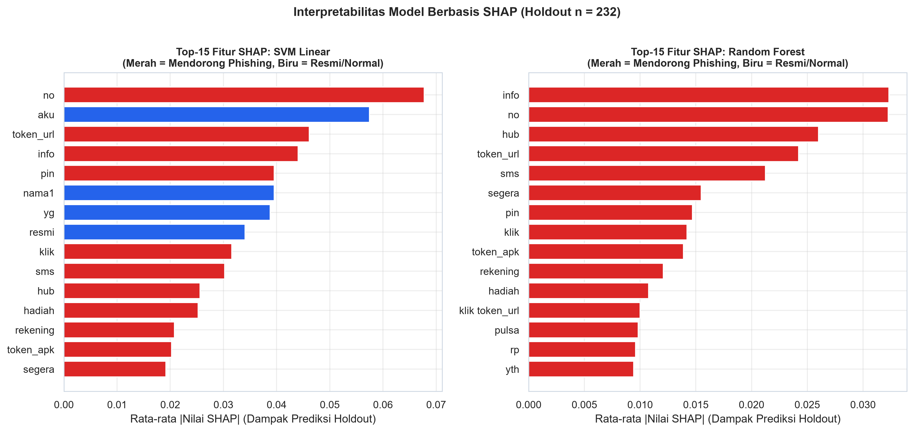
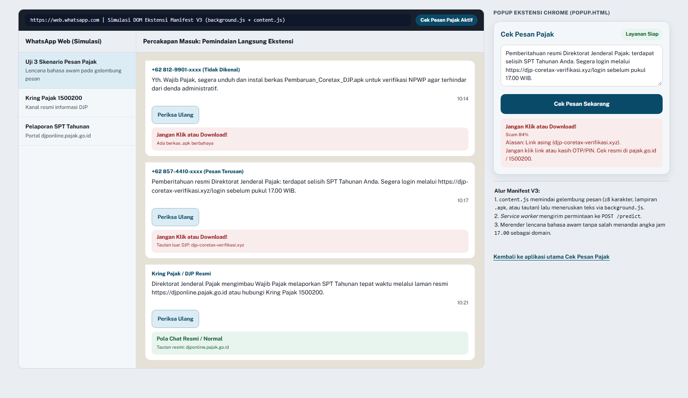

# DAFTAR PUSTAKA

[1] Waluyo and N. A. Wijayanti, *Perpajakan Indonesia*, ed. ke-13. Jakarta: Salemba Empat, 2026, ISBN 978-623-181-149-3.

[2] Direktorat Jenderal Pajak, “Penyebarluasan Informasi Mengenai Coretax (Pengumuman Nomor PENG-32/PJ.09/2024),” *Portal Resmi Direktorat Jenderal Pajak Kementerian Keuangan Republik Indonesia*, Nov. 2024. [Online]. Available: https://pajak.go.id/id/pengumuman/penyebarluasan-informasi-mengenai-coretax

[3] N. B. Prakoso, H. Ayu, and H. Zakaria, “Misuse of taxpayer data for phising scams,” *Journal of International Islamic Law, Human Rights, and Public Policy*, vol. 4, no. 3, pp. 1560-1569, Jul. 2026, doi: 10.5281/zenodo.21853029.

[4] R. Alabdan, “Phishing attacks survey: Types, vectors, and technical approaches,” *Future Internet*, vol. 12, no. 10, p. 168, pp. 1-39, Sep. 2020, doi: 10.3390/fi12100168.

[5] Direktorat Jenderal Pajak, “Himpunan pengumuman kewaspadaan penipuan mengatasnamakan Direktorat Jenderal Pajak (PENG-31/PJ.09/2024, PENG-4/PJ.09/2025 yang turut merujuk PENG-1/PJ.09/2025, PENG-29/PJ.09/2025, PENG-50/PJ.09/2025, dan PENG-18/PJ.09/2026),” *Portal Resmi Direktorat Jenderal Pajak Kementerian Keuangan Republik Indonesia*, 2024–2026. [Online]. Available: https://www.pajak.go.id/id/pengumuman

[6] F. Rahmi (dibimbing Y. Wibisono dan R. Megasari), “Aplikasi SMS spam filtering pada Android menggunakan algoritma Naïve Bayes,” Skripsi, Dept. Pendidikan Ilmu Komputer, Universitas Pendidikan Indonesia, Bandung, 2016. [Online]. Available: https://repository.upi.edu/26936/

[7] A. Theodorus, T. K. Prasetyo, R. Hartono, and D. Suhartono, “Short Message Service (SMS) spam filtering using machine learning in Bahasa Indonesia,” in *Proc. 3rd East Indonesia Conf. Comput. Inf. Technol. (EIConCIT)*, Apr. 2021, pp. 199-203, doi: 10.1109/EIConCIT50028.2021.9431859.

[8] D. Irawan, Hamidah, E. B. Perkasa, Yurindra, D. Wahyuningsih, and E. Helmud, “Perbandingan klassifikasi SMS berbasis Support Vector Machine, Naive Bayes Classifier, Random Forest dan Bagging Classifier,” *Jurnal Sisfokom (Sistem Informasi dan Komputer)*, vol. 10, no. 3, pp. 432-437, Dec. 2021, doi: 10.32736/sisfokom.v10i3.1302.

[9] M. S. Al Ghofany, R. Dwiyansaputra, F. Bimantoro, and Khairunnas, “Indonesian SMS spam detection using TF-RF feature weighting method and Support Vector Machine classifier,” in *Proc. First Mandalika Int. Multi-Conf. Sci. Eng. (MIMSE-I-C)*, 2022, pp. 117-129, doi: 10.2991/978-94-6463-084-8_12.

[10] E. Z. Astuti, C. A. Sari, E. H. Rachmawanto, and R. R. Ali, “Comparative study of machine learning algorithms for performing ham or spam classification in SMS,” *Scientific Journal of Informatics*, vol. 11, no. 1, pp. 177-186, Feb. 2024, doi: 10.15294/sji.v11i1.47364.

[11] F. F. Tampinongkol, A. R. Kamila, A. C. Wardhana, A. W. C. Kusuma, and D. Revaldo, “Implementation of Random Forest classification and Support Vector Machine algorithms for phishing link detection,” *Journal of Informatics, Information System, Software Engineering and Applications (INISTA)*, vol. 7, no. 1, pp. 127-137, Nov. 2024, doi: 10.20895/inista.v7i1.1588.

[12] A. Al Tawil, L. Almazaydeh, D. Qawasmeh, B. Qawasmeh, M. Alshinwan, and K. Elleithy, “Comparative analysis of machine learning algorithms for email phishing detection using TF-IDF, Word2Vec, and BERT,” *Computers, Materials & Continua*, vol. 81, no. 2, pp. 3395-3412, Nov. 2024, doi: 10.32604/cmc.2024.057279.

[13] A. A. Ningtias, N. Anwar, A. Ichwani, and R. T. Iswahyudi, “Komparasi kinerja Support Vector Machine dan Random Forest untuk deteksi spam email berbasis TF-IDF teks,” *IKRA-ITH Informatika: Jurnal Komputer dan Informatika*, vol. 10, no. 3, pp. 45-51, Nov. 2026, doi (edisi): 10.37817/ikraith-informatika.v10i3. [Online]. Available: https://journals.upi-yai.ac.id/index.php/ikraith-informatika/article/view/7618

[14] F. M. Efendi, A. K. Adisusilo, and S. Budiprayitno, “Pengembangan sistem deteksi phishing pada WhatsApp berbasis AI dengan integrasi bahasa lokal Surabaya,” *Melek IT Information Technology Journal*, vol. 11, no. 1, pp. 101-112, Jun. 2025, doi: 10.30742/melekitjournal.v11i1.417.

[15] R. B. Saputra, M. Azwar, L. Widyawati, Husain, and K. A. Latif, “Implementasi algoritma SVM pada bot WhatsApp untuk deteksi pesan spam,” *Jurnal Manajemen Informatika dan Sistem Informasi*, vol. 9, no. 1, pp. 39-51, Jan. 2026, doi: 10.36595/misi.v9i1.1803.

[16] M. A. Sembiring, M. F. L. Sibuea, and Anjani, “Optimasi model klasifikasi pesan penipuan digital berbahasa Indonesia menggunakan XGBoost dengan Bayesian Optimization dan SMOTE,” *Journal of Science and Social Research*, vol. 9, no. 3, pp. 5329-5336, Jun. 2026. [Online]. Available: https://jurnal.goretanpena.com/index.php/JSSR/article/view/7212

[17] P. Mishra and A. Yadav, “An explainable and reproducible lightweight machine learning framework for SMS spam detection using TF-IDF and Linear Support Vector Classification,” *International Journal of Advanced Science and Computer Applications*, vol. 5, no. 2, Sep. 2026, doi: 10.47679/ijasca.v5i2.269.

[18] J. Ismail, R. A. Nasution, and M. N. Gea, “Explainable phishing website detection using comparative machine learning and SHAP,” *IDEALIS: Indonesia Journal Information System*, vol. 9, no. 2, pp. 268-277, Jul. 2026, doi: 10.36080/idealis.v9i2.3810.

[19] Suwarno, V. Capricornness, and Y. Christian, “Implementasi machine learning berbasis browser extension untuk deteksi URL phishing menggunakan Logistic Regression classification,” *Komputa: Jurnal Ilmiah Komputer dan Informatika*, vol. 15, no. 1, pp. 23-34, Apr. 2026, doi: 10.34010/komputa.v15i1.18882.

[20] U. Darusalam, M. Ikhwani, C. R. Hassolthine, W. P. Santoso, F. A. S. N. Haq, Y. Aisanafi, and M. N. Ichsan, *Pedoman Teknis Penulisan Tugas Akhir* (Buku Pedoman Penulisan Tugas Akhir SK Rektor Nomor 01 Tahun 2024). Jakarta: Universitas Siber Asia, Apr. 2024.

[21] Sugiyono, *Metode Penelitian Kuantitatif, Kualitatif, dan R&D*, ed. ke-2. Bandung: Alfabeta, 2023.

[22] M. Darwin *et al.*, *Metode Penelitian Pendekatan Kuantitatif*, T. S. Tambunan, Ed. Bandung: CV. Media Sains Indonesia, 2021.

[23] Sugiyono, *Statistika untuk Penelitian*, cet. ke-12, ed. rev. Bandung: Alfabeta, 2007, ISBN 978-979-8433-10-8.

[24] L. P. Sinambela, *Metodologi Penelitian Kuantitatif; Untuk Bidang Ilmu Administrasi, Kebijakan Public, Ekonomi, Sosiologi, Komunikasi dan Ilmu Sosial Lainnya*. Yogyakarta: Graha Ilmu, 2014.

[25] Menteri Riset, Teknologi, dan Pendidikan Tinggi Republik Indonesia, *Peraturan Menteri Riset, Teknologi, dan Pendidikan Tinggi Nomor 42 Tahun 2016 tentang Pengukuran dan Penetapan Tingkat Kesiapterapan Teknologi* (Berita Negara Republik Indonesia Tahun 2016 Nomor 1010). Jakarta: Kementerian Ristekdikti, Jul. 2016.

[26] C. Cortes and V. Vapnik, “Support-vector networks,” *Machine Learning*, vol. 20, no. 3, pp. 273-297, Sep. 1995, doi: 10.1007/BF00994018.

[27] R.-E. Fan, K.-W. Chang, C.-J. Hsieh, X.-R. Wang, and C.-J. Lin, “LIBLINEAR: A library for large linear classification,” *Journal of Machine Learning Research*, vol. 9, pp. 1871-1874, Aug. 2008. [Online]. Available: https://jmlr.org/papers/v9/fan08a.html

[28] F. Pedregosa *et al.*, “Scikit-learn: Machine learning in Python,” *Journal of Machine Learning Research*, vol. 12, pp. 2825-2830, Oct. 2011. [Online]. Available: https://jmlr.org/papers/v12/pedregosa11a.html

[29] J. C. Platt, “Probabilistic outputs for support vector machines and comparisons to regularized likelihood methods,” in *Advances in Large Margin Classifiers*, A. J. Smola, P. Bartlett, B. Schölkopf, and D. Schuurmans, Eds. Cambridge, MA, USA: MIT Press, 2000, pp. 61-74.

[30] H.-T. Lin, C.-J. Lin, and R. C. Weng, “A note on Platt's probabilistic outputs for support vector machines,” *Machine Learning*, vol. 68, no. 3, pp. 267-276, Oct. 2007, doi: 10.1007/s10994-007-5018-6.

[31] L. Breiman, “Random forests,” *Machine Learning*, vol. 45, no. 1, pp. 5-32, Oct. 2001, doi: 10.1023/A:1010933404324.

[32] M. Adriani, J. Asian, B. A. A. Nazief, S. M. M. Tahaghoghi, and H. E. Williams, “Stemming Indonesian: A confix-stripping approach,” *ACM Transactions on Asian Language Information Processing*, vol. 6, no. 4, pp. 1-33, Dec. 2007, doi: 10.1145/1316457.1316459.

[33] G. Salton and C. Buckley, “Term-weighting approaches in automatic text retrieval,” *Information Processing & Management*, vol. 24, no. 5, pp. 513-523, 1988, doi: 10.1016/0306-4573(88)90021-0.

[34] R. Kohavi, “A study of cross-validation and bootstrap for accuracy estimation and model selection,” in *Proc. 14th Int. Joint Conf. Artif. Intell. (IJCAI)*, Montreal, QC, Canada, Aug. 1995, vol. 2, pp. 1137-1143. [Online]. Available: https://www.ijcai.org/Proceedings/95-2/Papers/016.pdf

[35] M. Sokolova and G. Lapalme, “A systematic analysis of performance measures for classification tasks,” *Information Processing & Management*, vol. 45, no. 4, pp. 427-437, Jul. 2009, doi: 10.1016/j.ipm.2009.03.002.

[36] S. C. Saragih, “Indonesian SMS Spam Classifier Dataset,” *GitHub Repository*, 2024. [Online]. Available: https://github.com/Sctian514/Indonesian-sms-spam-classifier (Lisensi MIT).

---

# LAMPIRAN

## Lampiran 1. Matriks Penelitian Terdahulu

Tabel L.1 Matriks Penelitian Terdahulu

| Peneliti dan Tahun            | Objek dan Fitur                                                                                       | Algoritma dan Kinerja                                                                                                                               | Keunggulan serta Kelemahan                                                                                      |
| :---------------------------- | :---------------------------------------------------------------------------------------------------- | :-------------------------------------------------------------------------------------------------------------------------------------------------- | :-------------------------------------------------------------------------------------------------------------- |
| Prakoso dkk. (2026) [3]       | Kajian yuridis-empiris penipuan data wajib pajak *Coretax*, NIK, NPWP, DJP Online, M-Pajak, dan SPT di Indonesia | Analisis kualitatif normatif tanpa eksperimen model klasifikasi ataupun metrik uji kuantitatif                                                      | Memetakan eksploitasi data pajak, tetapi belum membangun detektor teks otomatis                                 |
| Rahmi (2016) [6]               | Korpus SMS Indonesia (1.140 naskah; 1.143 CSV) memakai *Term Frequency* (10-CV)                       | *Multinomial Naïve Bayes* meraih *Accuracy* 94,12% (*spam* vs normal) dan 94,56% (*fraud* vs *promo*)                                               | Merintis korpus publik Indonesia, namun menghapus URL/`.apk` dan tanpa domain pajak                             |
| Theodorus dkk. (2021) [7]     | Korpus 4.125 SMS Indonesia tiga kelas memakai *Bag of Words* 1.500 kata                               | *Random Forest* (*Acc* 94,62%), *LogReg* (94,57%), XGBoost (94,52%), SVM (94,38%)                                                                   | Memperluas korpus pesan Indonesia tanpa fokus *phishing* perpajakan                                             |
| Irawan dkk. (2021) [8]        | 5.571 SMS berbahasa Inggris dari korpus UCI (4.824 *ham*, 747 *spam*) tanpa pemenggalan kata dasar    | *Bagging* (*Performance Score* 97,4%), *Random Forest* (96,8%), *Naïve Bayes* (96,4%), SVM (86,5%)                                                  | Membandingkan empat algoritma pada SMS publik, namun berbahasa Inggris dan SVM tanpa penyetelan                 |
| Al Ghofany dkk. (2022) [9]    | 500 SMS privat Indonesia (325 non-*spam*, 175 *spam*) memakai *stemming* Nazief-Adriani pada TF-IDF & TF-RF (10-*fold* CV × 15 iterasi) | Pada TF-IDF ber-*stemming*: SVM *Sigmoid* (*Acc* 99,60%) dan SVM Linear (99,52%); pada TF-RF: SVM Linear (100%) dan SVM *Sigmoid* (99,96%)         | Membandingkan pembobotan TF-IDF dan TF-RF, namun pada TF-IDF skor *Sigmoid* tanpa *stemming* (99,62%) sedikit lebih tinggi dan belum menguji RF |
| Astuti dkk. (2024) [10]       | 5.572 SMS Inggris korpus UCI (4.825 *ham*, 747 *spam*; tertulis 5.574 di naskah) memakai TF-IDF       | SVC *Sigmoid* (*Acc* 97,93%; *Avg F1-Score* 95%) vs *Random Forest* (*Acc* 97,28%; *Avg F1-Score* 94%)                                              | Menyajikan komparasi metrik pada *dataset* UCI (terdapat selisih cacah uji *support* 1.839 terhadap klaim rasio 70:30), tanpa praproses Indonesia |
| Tampinongkol dkk. (2024) [11] | 59.899 URL (31.544 sah, 28.355 *phishing*) dengan 9 fitur leksikal tautan (pembagian 80:20)           | *Random Forest* (*Acc* 84,95%) vs SVM *default* (77,43%)                                                                                            | Membandingkan RF dan SVM pada tautan, bukan isi rekayasa sosial                                                 |
| Al Tawil dkk. (2024) [12]     | 18.650 surel *phishing* Inggris membandingkan TF-IDF, *Word2Vec*, dan BERT                            | RF TF-IDF (*F1* 0,98; latih 40,39 detik) vs BERT (*F1* 0,99; latih 1.012,66 detik)                                                                  | Mengukur efisiensi waktu TF-IDF, namun tidak menguji SVM                                                        |
| Ningtias dkk. (2026) [13]     | 5.572 pesan SMS Inggris memakai TF-IDF dan optimasi `GridSearchCV`                                    | Linear SVM (*Acc* 98,39%; *F1* 0,9371) vs *Random Forest* (95,96%; *F1* 0,8421)                                                                     | Membuktikan keunggulan Linear SVM pascapenyetelan, tetapi menghapus URL                                         |
| Efendi dkk. (2025) [14]       | *Bot* *WhatsApp* bahasa Indonesia, Jawa, & Surabaya berbasis 3 fitur heuristik (uji 5 pesan)          | Logika *fuzzy* Mamdani dan TSK (skor 0,55–0,83 pada 3 pesan *phishing*; 0,18–0,35 pada 2 pesan aman)                                                | Mendukung dialek daerah *WhatsApp*, namun tanpa pembelajaran terawasi terukur                                   |
| Saputra dkk. (2026) [15]      | 1.320 pesan *WhatsApp* dan SMS Indonesia memakai Sastrawi dan `HashingVectorizer` 5.000 fitur         | Linear SVM (*Acc* 95,45%; *Macro F1* 0,95 pada *split* 80:20)                                                                                       | Menerapkan Sastrawi pada *WhatsApp*, tetapi *hashing* menghilangkan fitur XAI                                   |
| Sembiring dkk. (2026) [16]    | 2.320 pesan penipuan Indonesia dengan token entitas dan TF-IDF kata/karakter                          | MNB (*F1-macro* 0,9693; *Acc* 97,41%), Linear SVM (*Recall* kelas *fraud* 0,9859; *Acc* 96,98%; *F1-macro* 0,9634), dan XGBoost+SMOTE+TPE (*Acc* 96,34%; *F1-macro* 0,9555) | Melestarikan URL/nominal, namun belum menyandikan `.apk` dan ekstensi *WhatsApp*                                |
| Mishra dan Yadav (2026) [17]  | 5.572 SMS berbahasa Inggris memakai pembobotan TF-IDF dan analisis SHAP                               | `LinearSVC` (*Acc* 98,57%; *F1-Score* 94,44%) berbasis kerangka ringan terjelaskan                                                                  | Menghadirkan kerangka `LinearSVC` ringan terjelaskan, namun belum menyasar pesan *WhatsApp* perpajakan          |
| Ismail dkk. (2026) [18]       | 11.430 URL (5.715 *phishing*, 5.715 sah) dengan 87 fitur (leksikal URL, konten halaman, reputasi; *split* 80:20) | XGBoost (*Acc* 96,50%; *F1* 96,51%; *AUC* 0,9943), *Random Forest* (*F1* 96,39%), SVM (*F1* 95,39%) + SHAP                                | Memadukan komparasi enam algoritma dan interpretasi SHAP, tetapi bergantung pada fitur reputasi eksternal       |
| Suwarno dkk. (2026) [19]      | 235.795 URL mentah (235.370 pascapembersihan: 134.850 sah, 100.520 *phishing*) dengan 13 fitur URL & DOM (*split* 80:20) | *Logistic Regression* pada ekstensi *Chrome* (*Acc* 99,53%; *ROC-AUC* 0,9792; latensi 1,40 ms; SUS 81%)                                   | Membuktikan ekstensi peramban *real-time* ramah pengguna (<100 ms), namun berfokus pada URL halaman web         |
| Penelitian Ini (2026)         | *Dataset* induk 1.164 (1.159 unik) & korpus diperluas 2.519 baris unik                                | `LinearSVC` Platt vs *Random Forest* pada TF-IDF (1, 2) + `token_apk`/`token_url`                                                                   | Menguji kendali *keyword bias* domain pajak, interpretasi SHAP, kalibrasi Platt, dan purwarupa ekstensi TKT 6   |

Sumber: Hasil Kajian Pustaka (2026).

## Lampiran 2. Jadwal, Alat, Bahan, dan Definisi Operasional

Tabel L.2 Jadwal Pelaksanaan Penelitian

| Tahap Kegiatan Penelitian                                                                             | Agustus 2026 | September 2026 | Oktober 2026 | November 2026 |
| :---------------------------------------------------------------------------------------------------- | :----------: | :------------: | :----------: | :-----------: |
| Studi literatur, cek kebaruan, dan perumusan proposal                                                 |   Berjalan   |    Selesai     |              |               |
| Pengumpulan sumber DJP serta kurasi *dataset* terverifikasi                                           |              |    Berjalan    |   Selesai    |               |
| Implementasi skrip praproses, TF-IDF, dan eksperimen model                                            |              |                |   Berjalan   |    Selesai    |
| Penyetelan hiperparameter pencarian *grid* 10-*Fold* CV terisolasi, kalibrasi Platt, dan uji ablatif |              |                |   Berjalan   |    Selesai    |
| Perancangan arsitektur purwarupa TKT 6 dan pengujian sistem                                           |              |                |   Berjalan   |    Selesai    |
| Penyusunan laporan lengkap Bab I hingga Bab V dan Lampiran                                            |              |                |   Berjalan   |    Selesai    |

Sumber: Rencana Kerja Penelitian (2026).

Tabel L.3 Spesifikasi Alat dan Bahan Penelitian

| Kategori Komponen               | Nama Komponen / Berkas                            | Spesifikasi dan Peran dalam Penelitian                                                                                         |
| :------------------------------ | :------------------------------------------------ | :----------------------------------------------------------------------------------------------------------------------------- |
| Perangkat Keras                 | Komputer Jinjing Komputasi                        | Prosesor Intel Core i5-12450H, RAM 16 GB, Windows 11 Pro 64-bit                                                                |
| Perangkat Lunak Inti            | Python, Scikit-learn, Sastrawi                    | Python 3.14.7, Scikit-learn 1.9.1 (`LinearSVC`, `RandomForestClassifier`, `CalibratedClassifierCV`), Sastrawi 1.0.1 [28], [32] |
| Perangkat Lunak Pendukung       | Pandas, NumPy, Matplotlib, Seaborn, SHAP, Joblib, Pytest | Pandas 3.1.1, NumPy 2.5.4, Matplotlib 3.11.2, Seaborn 0.13.2, SHAP 0.54.1, Joblib 1.6.0, Pytest 9.2.0                         |
| Rancangan Purwarupa             | FastAPI, Uvicorn, Web Kustom, Ekstensi *Manifest V3* | FastAPI 0.163.1, Uvicorn 0.54.0 (`app/backend/api.py`), Web *Cek Pesan Pajak* (`app/frontend/`), dan Ekstensi *WhatsApp Web* (`app/extension/`) TKT 6 [19], [25] |
| Bahan Korpus SMS Publik         | `Rahmi 2016 Korpus SMS Spam Utama v1.csv`         | 904 SMS Indonesia (335 penipuan, 569 normal); 239 promo disisihkan [6]                                                         |
| Bahan Korpus Pajak              | `Dataset Pajak Terkurasi 260 Baris.csv`           | 260 teks pajak seimbang (130 *phishing*, 110 siaran resmi DJP, 20 normal pajak) dari 65/68 sumber publik 2021–2026 [2], [5]    |
| Bahan Gabungan Induk            | `Dataset Gabungan Utama Biner 1164 Baris.csv`     | Gabungan 904 SMS + 260 teks pajak (1.159 baris unik pasca-Sastrawi), verifikasi SHA-256 [2], [5], [6]                          |
| Bahan Diperluas & Uji Eksternal | `Dataset Gabungan Diperluas Biner 2521 Baris.csv` | Total 2.521 baris (2.519 unik pasca-Sastrawi), terdiri atas 1.159 induk ditambah 1.360 pesan eksternal unik Theodorus dkk. [7] dan Saragih [36] |

Sumber: Dokumentasi Lingkungan Penelitian (2026).

Tabel L.4 Definisi Operasional Variabel dan Parameter Penelitian

| Nama Variabel / Parameter                    | Jenis / Kategori                        | Definisi Operasional, Skala Pengukuran, dan Nilai dalam Eksperimen                                                                                              |
| :------------------------------------------- | :-------------------------------------- | :-------------------------------------------------------------------------------------------------------------------------------------------------------------- |
| Teks Pesan Instan (`Teks` / `teks_sastrawi`) | Variabel Bebas (Vektor Numerik)         | *String* pesan bahasa Indonesia melalui *case folding*, `token_apk`, `token_url`, ekspresi reguler `[^a-z0-9\s_]`, *stopword removal*, dan Sastrawi token alfabetis `len > 2` [32]; `TfidfVectorizer` mempertahankan token minimal dua huruf [28] |
| Label Klasifikasi (`label`)                  | Variabel Terikat (Nominal Biner)        | Kategori nominal biner 1 untuk indikasi *phishing* dan 0 untuk pesan aman/resmi                                                                                 |
| Perlakuan Uji Kontrol Domain Pajak           | Variabel Perlakuan (Nominal Biner)      | Perbandingan pelatihan model tanpa korpus pajak (hanya 712 SMS umum partisi latih) melawan korpus seimbang (927 pesan latih) pada uji kontrol $n = 45$ pesan pajak *holdout* |
| Parameter Ekstraksi TF-IDF                   | Parameter Representasi Fitur            | Pembobotan TF-IDF halus normalisasi *Euclidean* L2 rentang *n-gram* (1, 2) dengan batas fitur 3.000 (skenario ablatif 1.500 dan 5.000) [28], [33]               |
| Parameter `LinearSVC`                        | *Hyperparameter* SVM Linear             | 12 kombinasi pencarian *grid* 10-*Fold* CV terisolasi: `C` {0,1; 0,25; 0,5; 1,0; 2,0; 5,0}, `class_weight` {None, "balanced"}, `max_iter=5000`, `random_state=42` [27], [28] |
| Parameter *Random Forest*                    | *Hyperparameter* Ansambel               | 24 kombinasi pencarian *grid* 10-*Fold* CV terisolasi (total 36 kandidat): `n_estimators` {100, 200, 300}, `max_depth` {None, 30}, `min_samples_split` {2, 5}, `class_weight` {None, "balanced"}, `random_state=42` [28], [31] |
| Parameter Kalibrasi *Platt*                  | Parameter Kalibrasi Probabilitas        | `CalibratedClassifierCV` dengan `method="sigmoid"`, `cv=5` berbasis `Pipeline` yang merata-ratakan peluang lima submodel [28], [29], [30]                      |
| Metrik Evaluasi & Probabilitas               | Variabel Kinerja (Skala Rasio 0 hingga 1) | Diskriminasi dan klasifikasi (*Accuracy*, *Precision*, *Recall*, *F1-Score*, *ROC-AUC*, *PR-AUC*) serta kalibrasi (*Brier Score*, *Log Loss* dengan kliping $\epsilon = 10^{-15}$ eksplisit di `ml/eksperimen_komparasi.py`) [35] |
| Indikator Kesiapan Teknologi & Risiko        | Variabel Kelayakan TKT Level 6          | Integrasi `.joblib` di REST API, web *Cek Pesan Pajak*, dan ekstensi *WhatsApp Web*; latensi <100 ms; daftar putih `pajak.go.id` (kandidat lanjutan `t.kemenkeu.go.id`); kategori risiko TINGGI (`.apk` atau $p \ge 0,75$), SEDANG ($0,50 \le p < 0,75$ atau tautan non-daftar putih), RENDAH, beserta indikator awam [19], [25] |

Sumber: Sintesis Metodologi Penelitian (2026).

## Lampiran 3. Pemetaan Modul Kode, Kontrak API, Matriks Skenario Uji, dan Rancangan Antarmuka

Tabel L.5 Pemetaan Modul Kode Sumber terhadap Tahapan Metodologi Penelitian

| Berkas / Direktori Modul                     | Tahapan Metodologi                 | Peran Teknis dalam Sistem                                                                                             |
| :------------------------------------------- | :--------------------------------- | :-------------------------------------------------------------------------------------------------------------------- |
| `ml/korpus_pajak.py`                         | Kurasi Sumber Perpajakan           | Menyimpan metadata 68 sumber publik, 31 butir katalog IOC/kanal resmi DJP (5 daftar), dan 260 teks pajak             |
| `ml/kurasi_dataset.py`                       | Konstruksi & Provenans             | Membersihkan *boilerplate* DJP, membangun dataset induk 1.164, korpus diperluas 2.521, dan katalog SHA-256            |
| `ml/eksperimen_baseline.py`                  | Praproses & *Baseline*             | Menyediakan `clean_text` Sastrawi enam langkah (`lru_cache` 20.000) dan uji *baseline* 80:20                          |
| `ml/eksperimen_komparasi.py`                 | Penyetelan, Kalibrasi, Evaluasi    | Menjalankan 10-Fold CV, pencarian *grid* terisolasi (`_run_grid_over_folds`), Platt, ablatif, kontrol, SHAP, `.joblib` |
| `ml/benchmark_purwarupa.py`                  | Uji Latensi & Tangkapan Layar      | Menjalankan Pytest otomatis, benchmark latensi `TestClient`, dan merender tangkapan layar serta CSV/JSON hasil         |
| `app/backend/inference.py`                   | Mesin Inferensi Terpadu            | Memuat `.joblib` (`maxsize=4`), menjalankan heuristik `.apk`/79 TLD/`pajak.go.id`, risiko 3 tingkat, dan alasan awam  |
| `app/backend/api.py` & `app/backend/jalankan-server.bat` | Layanan Backend & Web              | Menyajikan web (`/`), simulasi (`/simulasi-wa`), `/health`, `/api/*`, `/predict`, dan `/predict/batch` (API `2.1.0`)  |
| `app/frontend/`                              | Antarmuka Web Pengguna             | Halaman web responsif (`index.html`, `styles.css`, `app.js`, `simulasi_wa.js`) dan modal evaluasi TA                  |
| `app/extension/`                             | Ekstensi *WhatsApp Web*            | Ekstensi *Manifest V3* (`v1.2.0`: `content.js`, `background.js`, `popup.html`) untuk lencana risiko langsung          |
| `tests/`                                     | Verifikasi Otomatis Sistem         | Menjalankan 29 fungsi uji `pytest` atas integritas data, eksperimen model, kontrak API, dan keamanan                  |

Sumber: Dokumentasi Rekayasa Perangkat Lunak Penelitian (2026).

Tabel L.6 Spesifikasi Titik Akhir Layanan Web dan REST API FastAPI (`app/backend/api.py`)

| Metode & Jalur                               | Skema Masukan                                                    | Struktur Keluaran Utama                                                                                                       | Peran dalam Arsitektur                               |
| :------------------------------------------- | :--------------------------------------------------------------- | :---------------------------------------------------------------------------------------------------------------------------- | :--------------------------------------------------- |
| `GET /`                                      | Tanpa badan permintaan                                           | Berkas HTML aplikasi web *Cek Pesan Pajak* (`app/frontend/index.html`)                                                        | Menyajikan aplikasi web utama                        |
| `GET /simulasi-wa`                           | Tanpa badan permintaan                                           | Berkas HTML simulasi *WhatsApp Web* (`app/extension/simulasi_whatsapp_web.html`)                                              | Demo interaktif ekstensi *Manifest V3*               |
| `GET /health`                                | Tanpa badan permintaan                                           | Status `ok`, `models_loaded`, dan `metadata` (HTTP `503` jika bundel absen)                                                   | Pemeriksaan kesiapan layanan web/ekstensi            |
| `GET /api/presets` & `/api/academic-summary` | Tanpa badan permintaan                                           | Tiga prasetel uji, identitas TA, metadata model, benchmark latensi, dan baris `tabel_komparasi_utama.csv`                     | Mengisi tombol contoh cepat dan modal sidang         |
| `POST /predict`                              | JSON `text` (1–5.000 karakter) & `top_k` (1–20; bawaan `8`)      | `label`, `risk_level`, `svm_probability`, `rf_probability`, `plain_reasons`, `highlights`, `trigger_words`, `action_steps`, `inference_ms` (`422`/`429`/`503`) | Inferensi tunggal web dan ekstensi                   |
| `POST /predict/batch`                        | JSON daftar `texts` (1–200 pesan, maks. 100.000 kar.) & `top_k` (bawaan `5`) | Total baris dan hasil per indeks (`422` validasi, `429` batas laju berbobot + `Retry-After`, `503` model absen)               | Pemrosesan pesan massal terbatasi                    |

Sumber: Implementasi Layanan API pada `app/backend/api.py` (2026).

Tabel L.7 Matriks Skenario Pengujian Otomatis Purwarupa dan Integritas Sistem

| Kode Uji  | Berkas / Subjek Pengujian                          | Skenario Masukan & Kondisi Uji                                                  | Keluaran yang Diharapkan                                                |
| :-------- | :------------------------------------------------- | :------------------------------------------------------------------------------ | :---------------------------------------------------------------------- |
| `UJI-01`  | `test_prototipe_api.py` (`GET /health`)            | Permintaan kesiapan peladen API                                                 | HTTP 200 dengan `LinearSVC+Platt` aktif                                 |
| `UJI-02`  | `test_prototipe_api.py` (`POST /predict`)          | Pesan berkas `Coretax_DJP_Update.apk`                                           | Label `1`, `has_apk=True`, risiko `TINGGI`                              |
| `UJI-03`  | `test_prototipe_api.py` (`POST /predict`)          | Tautan palsu `pajak-djp-verifikasi.xyz` beserta jam `17.00`                     | Label `1`, `suspicious_domains` tanpa jam `17.00`                       |
| `UJI-04`  | `test_prototipe_api.py` (`POST /predict`)          | Pengumuman resmi `djponline.pajak.go.id`                                        | Label `0`, risiko `RENDAH`, `official_domains` terisi                   |
| `UJI-05`  | `test_prototipe_api.py` (`is_official_djp_domain`) | Uji pengecoh `pajak.go.id.evil.com` vs domain sah                               | Mengembalikan `False` tiruan, `True` domain sah                         |
| `UJI-06`  | `test_prototipe_api.py` (`POST /predict`)          | Teks spasi kosong                                                               | Ditolak dengan status HTTP 422                                          |
| `UJI-07`  | `test_prototipe_api.py` (`POST /predict/batch`)    | Tiga masukan campuran (`.apk`, spasi, resmi) + teks `5.001` karakter            | HTTP 200 `total=3` (`results[1]` error) & HTTP 422 teks berlebih        |
| `UJI-08`  | `test_prototipe_api.py` (penjaga angka)            | Pesan resmi memuat jam `16.00` dan `Rp1.500.000`                                | `suspicious_domains` kosong, status `RENDAH`                            |
| `UJI-09a` | `test_prototipe_api.py` (`GET /` & pendukung)      | Permintaan web, `/simulasi-wa`, prasetel, ringkasan akademik, & *preflight*     | HTTP 200 beserta *header* keamanan dan identitas TA valid               |
| `UJI-09b` | `test_prototipe_api.py` (*helper* pembatas laju)   | Uji fungsi `_is_rate_limited` pada IP uji vs pengecualian `testclient`          | Membatasi permintaan ke-3 pada batas `2`; `testclient` lolos            |
| `UJI-10`  | `test_integritas_dataset.py` & eksperimen          | Validasi 5 korpus, SHA-256, deduplikasi Sastrawi, Platt, & kontrol (13 fungsi)  | Seluruh 13 pengujian data dan model lulus                               |
| `UJI-11`  | `test_prototipe_api.py` (URL berakhiran `.apk`)    | Tautan `https://.../Coretax_Update.apk`                                         | `has_apk=True`, `suspicious_domains` terisi, risiko `TINGGI`            |
| `UJI-12`  | `test_prototipe_api.py` (*header* CSP)             | Pemeriksaan kebijakan `Content-Security-Policy`                                 | `default-src 'self'`, `script-src 'self'`, `object-src 'none'` aktif    |
| `UJI-13`  | `test_prototipe_api.py` (CORS & *private network*) | *Preflight* dari origin sah (`web.whatsapp.com`, `chrome-extension://`) vs asing| Origin sah mendapat `Access-Control-Allow-Private-Network: true`; asing ditolak |
| `UJI-14`  | `test_prototipe_api.py` (*batch* & paritas)        | *Batch* >100.000 karakter, kuota laju berbobot, serta paritas probabilitas      | HTTP 422 karakter berlebih, HTTP 429 + `Retry-After`, probabilitas sama |
| `UJI-15`  | `test_prototipe_api.py` (ketahanan model absen)    | Permintaan `/health`, `/predict`, `/predict/batch` saat `.joblib` hilang        | HTTP 503 tanpa membocorkan jalur direktori peladen                      |
| `UJI-16`  | `test_prototipe_api.py` (`/api/academic-summary`)  | Verifikasi kelengkapan metadata, tabel evaluasi, dan benchmark latensi          | HTTP 200 dengan metrik benchmark p50 dan rata-rata lengkap              |

Sumber: Implementasi Pengujian Otomatis `pytest` pada Direktori `tests/` (2026).

Gambar L.1 Rancangan Antarmuka Web *Cek Pesan Pajak* dan Ekstensi *WhatsApp Web*.

## Lampiran 4. Evaluasi ROC-PR, Studi Ablatif, Bobot Fitur, Analisis Kesalahan, dan Hasil Uji Purwarupa

Gambar L.2 Evaluasi Diskriminatif Kurva ROC dan *Precision-Recall*.

Tabel L.8 Hasil Studi Ablatif Praproses dan Representasi Fitur TF-IDF

| Skenario Konfigurasi | Model | CV10 *Accuracy* | CV10 *F1-Score* | *Holdout Accuracy* | *Holdout F1-Score* |
| :--- | :--- | :---: | :---: | :---: | :---: |
| `1_Tanpa_Token_Entitas` | `LinearSVC` / RF | 96,66% / 93,96% | 95,81% / 92,42% | 97,84% / 95,26% | 97,27% / 93,99% |
| `2_Tanpa_Sastrawi` | `LinearSVC` / RF | 97,74% / 95,69% | 97,16% / 94,55% | 96,12% / 96,55% | 95,08% / 95,60% |
| `3_Unigram_Saja` | `LinearSVC` / RF | 96,77% / 95,68% | 95,94% / 94,59% | 96,12% / 96,12% | 95,08% / 95,03% |
| `4_Utama_MaxFeatures_1500` | `LinearSVC` / RF | 97,30% / 95,58% | 96,61% / 94,52% | 96,12% / 96,55% | 95,03% / 95,56% |
| `5_Konfigurasi_Utama_3000` | `LinearSVC` / RF | 97,74% / 95,25% | 97,16% / 94,07% | 96,12% / 96,55% | 94,97% / 95,56% |
| `6_Utama_MaxFeatures_5000` | `LinearSVC` / RF | 97,41% / 94,72% | 96,79% / 93,34% | 96,98% / 96,55% | 96,13% / 95,60% |

Sumber: Hasil Studi Ablatif `05-hasil-evaluasi/csv/studi_ablatif_fitur.csv` (2026).

Gambar L.3 Analisis Interpretabilitas Fitur TF-IDF Terbaik.

Tabel L.9 Perbandingan Fitur Teratas `LinearSVC` dan *Random Forest*

| Peringkat | Fitur Positif (`LinearSVC`) | Bobot *w* (+) | Fitur Penahan Resmi/Normal (`LinearSVC`) | Bobot *w* (-) | Fitur Terpenting *Random Forest* | Skor Gini |
| :---: | :--- | :---: | :--- | :---: | :--- | :---: |
| 1 | `no` | +2,2405 | `nama1` | -1,2720 | `no` | 0,0424 |
| 2 | `sms` | +1,6940 | `aku` | -1,2206 | `hub` | 0,0349 |
| 3 | `rekening` | +1,5083 | `resmi` | -1,0706 | `info` | 0,0319 |
| 4 | `info` | +1,4054 | `maupun` | -0,9633 | `sms` | 0,0227 |
| 5 | `segera` | +1,3778 | `terimakasih` | -0,9134 | `token_url` | 0,0226 |
| 6 | `pin` | +1,3729 | `yg` | -0,8942 | `hadiah` | 0,0200 |
| 7 | `token_apk` | +1,3582 | `nya` | -0,8738 | `pin` | 0,0175 |
| 8 | `token_url` | +1,3550 | `pernah` | -0,8417 | `rekening` | 0,0174 |

Sumber: Ekstraksi Bobot Model `05-hasil-evaluasi/csv/fitur_teratas_svm_vs_rf.csv` (2026).

Tabel L.10 Ringkasan Analisis Kesalahan Prediksi pada Himpunan Uji *Holdout*

| Indeks | Sumber dan Kategori | Aktual | Prob. SVM | Prob. RF | Lokasi Galat | Ringkasan Konten dan Penyebab Leksikal |
| :---: | :--- | :---: | :---: | :---: | :--- | :--- |
| 118 | Rahmi (Penipuan) | 1 | 0,566 | 0,420 | RF Saja (FN) | Modus jual rumah mengajak hubungi nomor seluler tanpa kata `hadiah` |
| 50 | Rahmi (Penipuan) | 1 | 0,218 | 0,750 | SVM *Baseline* & Platt (FN) | Tawaran gratis kuota operator dengan banyak angka satuan |
| 491 | Rahmi (Normal) | 0 | 0,543 | 0,170 | SVM *Baseline* & Platt (FP) | Teks amat pendek "Dimulai dari angka 0" tanpa konteks normal |
| 898 | Rahmi (Normal) | 0 | 0,608 | 0,640 | Keduanya (FP) | Pertanyaan singkat "No bri atas nama kamu mana" bermuatan kata `no` |
| 960 | Pajak (`Phishing_APK_MPajak`) | 1 | 0,424 | 0,730 | SVM *Baseline* & Platt (FN) | Gaya surat DJP mengirim `MPajak_Aktivasi_KSWP.apk` tanpa kata spam umum |
| 293 | Rahmi (Penipuan) | 1 | 0,347 | 0,250 | Keduanya (FN) | Notifikasi isi ulang pulsa palsu mirip struk transaksi resmi |
| 1003 | Pajak (`Phishing_Link_NIK_NPWP`) | 1 | 0,787 | 0,340 | RF Saja (FN) | Tautan palsu `form-wajibpajak-djp.com` lolos di RF tetapi tertangkap SVM |
| 52 | Rahmi (Penipuan) | 1 | 0,819 | 0,350 | RF Saja (FN) | Iming-iming bonus internet 5MB bergaya informal |
| 228 | Rahmi (Penipuan) | 1 | 0,494 | 0,610 | SVM *Baseline* & Platt (FN) | Undian *event* bergaya percakapan santai mendekati ambang 0,5 |
| 314 | Rahmi (Penipuan) | 1 | 0,033 | 0,230 | Keduanya (FN) | Instruksi singkat transfer rekening Mandiri tanpa tautan maupun ancaman |
| 102 | Rahmi (Penipuan) | 1 | 0,392 | 0,470 | Keduanya (FN) | Permintaan transfer Mandiri pendek menyerupai pesan keluarga |
| 1082 | Pajak (Pemadanan NIK Resmi) | 0 | 0,551 | 0,600 | Keduanya (FP) | Imbauan resmi ke `www.pajak.go.id` terseret bobot `token_url` dan `login` |
| 165 | Rahmi (Penipuan) | 1 | 0,493 | 0,550 | SVM *Baseline* & Platt (FN) | Tagihan jatuh tempo mengarahkan ke nomor ponsel (p = 0,493) |

Sumber: Analisis Kesalahan `05-hasil-evaluasi/csv/analisis_kesalahan_prediksi.csv` (2026); kolom Indeks mengacu pada indeks baris himpunan unik pasca-deduplikasi Sastrawi (1.159 baris).

Tabel L.11 Hasil Pengujian Fungsional Otomatis dan Latensi Inferensi Purwarupa

| Kode / Metrik | Subjek dan Kondisi Uji | Jumlah Uji / Sampel | Hasil / Waktu Terukur | Status |
| :--- | :--- | :---: | :--- | :---: |
| `UJI-01` | `GET /health` kesiapan FastAPI dan model | 1 | HTTP 200 (`LinearSVC+Platt`) | Lulus (230 ms) |
| `UJI-02` | `POST /predict` berkas `Coretax_DJP_Update.apk` | 1 | Label 1, `has_apk=True`, TINGGI | Lulus (190 ms) |
| `UJI-03` | `POST /predict` domain `pajak-djp-verifikasi.xyz` | 1 | Label 1, tanpa angka 17.00 | Lulus (10 ms) |
| `UJI-04` | `POST /predict` pengumuman `djponline.pajak.go.id` | 1 | Label 0, `official_domains` terisi | Lulus (20 ms) |
| `UJI-05` | `is_official_djp_domain` atas `pajak.go.id.evil.com` | 1 | `False` untuk tiruan | Lulus (<1 ms) |
| `UJI-06` | `POST /predict` masukan spasi kosong | 1 | Ditolak status HTTP 422 | Lulus (<1 ms) |
| `UJI-07` | `POST /predict/batch` 3 masukan & batas 5.000 kar. | 1 | HTTP 200 `total=3` (`results[1]` *error*) & 422 | Lulus (30 ms) |
| `UJI-08` | Penjaga angka pukul 16.00 dan nominal Rp1.500.000 | 1 | `suspicious_domains` kosong, RENDAH | Lulus (30 ms) |
| `UJI-09a` | `GET /`, `/simulasi-wa`, `/api/presets`, `/api/academic-summary` | 1 | HTTP 200 beserta *header* keamanan | Lulus (150 ms) |
| `UJI-09b` | Uji *helper* pembatas laju `_is_rate_limited` vs `testclient` | 1 | Tolak ke-3 pada batas 2; `testclient` lolos | Lulus (<1 ms) |
| `UJI-10` | Suite integritas 5 korpus, SHA-256, Platt, dan `.joblib` | 13 | Seluruh 13 pengujian lulus | Lulus (1.870 ms) |
| `UJI-11` | `POST /predict` tautan berakhiran `.apk` | 1 | `has_apk=True`, `suspicious_domains` terisi | Lulus (30 ms) |
| `UJI-12` | Pemeriksaan *header* `Content-Security-Policy` & izin | 1 | Direktif ketat CSP & `Permissions-Policy` aktif | Lulus (40 ms) |
| `UJI-13` | CORS *allowlist* dan `Access-Control-Allow-Private-Network` | 1 | Origin sah lolos *preflight*; origin asing ditolak | Lulus (30 ms) |
| `UJI-14` | Batas 100.000 kar. *batch*, *rate limit* 429, & paritas | 1 | HTTP 422, HTTP 429 + `Retry-After`, skor sama | Lulus (230 ms) |
| `UJI-15` | Ketahanan HTTP 503 saat bundel `.joblib` absen | 1 | HTTP 503 tanpa membocorkan jalur peladen | Lulus (20 ms) |
| `UJI-16` | Kelengkapan data latensi pada `/api/academic-summary` | 1 | HTTP 200 dengan `direct_p50_ms` hingga `batch_avg_ms` | Lulus (10 ms) |
| `LAT-01` | Latensi lokal `inference.py::predict_message` (*Mean*) | 232 | 14,542 ms/pesan | Memenuhi (<100 ms) |
| `LAT-02` | Latensi lokal `inference.py::predict_message` (*P50/P95/P99*) | 232 | *Median*=14,303 \| *P95*=16,971 \| *P99*=18,680 ms | Memenuhi (<100 ms) |
| `LAT-03` | Latensi REST API `FastAPI POST /predict` (*Mean*) | 232 | 35,651 ms/pesan | Memenuhi (<100 ms) |
| `LAT-04` | Latensi REST API `FastAPI POST /predict` (*P50/P95/P99*) | 232 | *Median*=35,518 \| *P95*=52,524 \| *P99*=56,838 ms | Memenuhi (<100 ms) |
| `LAT-05` | Latensi massal `FastAPI POST /predict/batch` (50 pesan) | 50 | 50,295 ms total (1,006 ms/pesan) | Memenuhi (<100 ms) |

Sumber: Eksekusi `ml/benchmark_purwarupa.py` dan `05-hasil-evaluasi/csv/tabel_pengujian_purwarupa.csv` (2026).

Gambar L.4 Komparasi Generalisasi Lintas Korpus dan Subset Pajak.

Gambar L.5 Analisis Interpretabilitas Model Berbasis SHAP.

Gambar L.6 Tangkapan Layar Ekstensi Chrome pada Simulasi *WhatsApp Web*.

Tabel L.12 Komparasi Hasil Penelitian terhadap Studi Terdahulu

| Peneliti (Tahun) | Korpus dan Fitur | Model Terbaik dan Kinerja | Kebaruan pada Penelitian Ini |
| :--- | :--- | :--- | :--- |
| Rahmi (2016) [6]; Theodorus dkk. (2021) [7] | 1.140 SMS (TF) & 4.125 SMS Indo (*BoW*) | MNB (*Acc* 94,12% *spam* & 94,56% *fraud*) [6]; RF (94,62% vs SVM 94,38%) [7] | Menambahkan korpus pajak berimbang, pelestarian `.apk`/URL, & uji bias |
| Al Ghofany dkk. (2022) [9]; Astuti dkk. (2024) [10] | 500 SMS Indo & 5.572 SMS Inggris UCI (TF-IDF) | SVM *Sigmoid* (99,60%); SVC *Sigmoid* (97,93%) > RF (97,28%) | Menguji Sastrawi pada korpus pajak publik bersama kalibrasi Platt + SHAP |
| Tampinongkol dkk. (2024) [11]; Ningtias dkk. (2026) [13] | 59.899 URL (9 fitur leksikal) & 5.572 SMS Inggris (TF-IDF) | RF (84,95%) > SVM (77,43%); *Linear* SVM (98,39%) > RF (95,96%) | Memproses teks rekayasa sosial WA pajak sambil menjaga sinyal `.apk`/URL |
| Saputra dkk. (2026) [15]; Sembiring dkk. (2026) [16] | 1.320 pesan WA & SMS (`Hashing`) & 2.320 pesan Indo (TF-IDF) | SVM (*Acc* 95,45%); MNB (*Acc* 97,41%; *F1* 0,9693) & SVM (*Rec* 98,59%) | Menghindari *hashing* agar XAI terbaca, menyandikan `.apk`, & membangun ekstensi |
| Mishra & Yadav (2026) [17]; Suwarno dkk. (2026) [19] | 5.572 SMS Inggris (TF-IDF) [17]; 235.370 URL & DOM [19] | `LinearSVC` XAI (98,57%; *F1* 94,44%) [17]; *LogReg* (99,53%; SUS 81%) [19] | Memadukan XAI, penjaga `pajak.go.id`, web, serta ekstensi WA pajak TKT 6 |
| **Penelitian Ini (2026)** | **1.159 unik (induk) & 2.519 diperluas, TF-IDF `(1, 2)` + Sastrawi** | **`LinearSVC` (CV *Acc* 97,74%, *F1* pajak 98,17%, *Brier* Platt 0,02542)** | **Kontrol bias 42,22% ke 95,56%, SHAP, penjaga `.apk`/domain sah, TKT 6 simulasi (35,65 ms)** |

Sumber: Sintesis Perbandingan Eksperimen dan Literatur (2026).

## Lampiran 5. Daftar Riwayat Hidup Penulis

| Atribut Biodata             | Keterangan Mahasiswa                                                                                                                                  |
| :-------------------------- | :---------------------------------------------------------------------------------------------------------------------------------------------------- |
| Nama Lengkap                | Wan Mirza Dhani                                                                                                                                       |
| Nomor Induk Mahasiswa (NIM) | 240101020194                                                                                                                                          |
| Program Studi               | PJJ Sistem Informasi                                                                                                                                  |
| Fakultas / Universitas      | Universitas Siber Asia (UNSIA)                                                                                                                        |
| Tempat, Tanggal Lahir       | Medan, 22 Maret 1996                                                                                                                                  |
| Domisili                    | Medan, Sumatera Utara                                                                                                                                 |
| Surel Akademik              | wm.dhani@gmail.com                                                                                                                                    |
| Riwayat Pendidikan          | SD Wahidin, SMP Wahidin, SMA Shafiyyatul Amaliyyah, D1 Perpajakan STAN, D3 Perpajakan Universitas Terbuka, S1 Sistem Informasi Universitas Siber Asia |
| Bidang Minat                | Rekayasa Perangkat Lunak, Keamanan Informasi, dan *Natural Language Processing*                                                                       |
