# TUGAS AKHIR

## KOMPARASI ALGORITMA SUPPORT VECTOR MACHINE DAN RANDOM FOREST DALAM DETEKSI PESAN PHISHING WHATSAPP MENGATASNAMAKAN OTORITAS PERPAJAKAN

## Sebagai Salah Satu Syarat untuk Memperoleh Gelar Sarjana Komputer pada Program Studi PJJ Sistem Informasi

## Oleh :

## 240101020194, Wan Mirza Dhani

## PROGRAM STUDI PJJ SISTEM INFORMASI

## UNIVERSITAS SIBER ASIA

## NOVEMBER 2026

---

# HALAMAN PERNYATAAN ORISINALITAS

Saya yang bertanda tangan di bawah ini:

| Atribut Identitas | Keterangan Mahasiswa |
| :--- | :--- |
| Nama | Wan Mirza Dhani |
| NIM | 240101020194 |
| Judul Tugas Akhir | Komparasi Algoritma Support Vector Machine dan Random Forest dalam Deteksi Pesan Phishing WhatsApp Mengatasnamakan Otoritas Perpajakan |

Menyatakan dengan sesungguhnya bahwa Tugas Akhir ini merupakan hasil penelitian, pemikiran, dan pemaparan asli saya sendiri. Saya tidak mencantumkan tanpa pengakuan bahan-bahan yang telah dipublikasikan sebelumnya atau ditulis oleh orang lain, atau sebagai bahan yang pernah diajukan untuk gelar atau ijazah pada Universitas Siber Asia atau Perguruan Tinggi lainnya.

Apabila di kemudian hari terdapat penyimpangan dan ketidakbenaran dalam pernyataan ini, maka saya bersedia menerima sanksi akademik sesuai dengan peraturan yang berlaku di Universitas Siber Asia.

Demikian pernyataan ini saya buat.

| Tempat dan Tanggal | Tanda Tangan di Atas Meterai Rp10.000 | Nama Lengkap Mahasiswa |
| :--- | :---: | :--- |
| Jakarta, ...... / ................ / 2026 | (meterai Rp10.000) | (Wan Mirza Dhani) |

---

# HALAMAN PENGESAHAN

Tugas Akhir ini diajukan oleh :

| Atribut Pengajuan | Keterangan Mahasiswa |
| :--- | :--- |
| Nama | Wan Mirza Dhani |
| NIM | 240101020194 |
| Program Studi | PJJ Sistem Informasi |
| Judul Tugas Akhir | Komparasi Algoritma Support Vector Machine dan Random Forest dalam Deteksi Pesan Phishing WhatsApp Mengatasnamakan Otoritas Perpajakan |

Telah berhasil dipertahankan di hadapan Dewan Penguji dan diterima sebagai bagian persyaratan yang diperlukan untuk memperoleh gelar Sarjana Komputer pada Program Studi PJJ Sistem Informasi Universitas Siber Asia.

| Jabatan Dewan Sidang | Nama Lengkap dan Gelar Akademik | Tanda Tangan |
| :--- | :--- | :--- |
| Ketua Sidang / Dosen Penguji I | (..........................................) | .......................... |
| Dosen Penguji II | (..........................................) | .......................... |
| Dosen Pembimbing I | (Novi Dian Nathasia, S.Kom., M.M.S.I.) | .......................... |
| Dosen Pembimbing II | (..........................................) | .......................... |
| Ketua Program Studi | (Vika Febri Muliati, S.Kom., M.Kom.) | .......................... |
| Ditetapkan di | Jakarta | |
| Tanggal | ...... / ................ / 2026 | |

---

# ABSTRAK

Pelaku *phishing* di WhatsApp yang mengaku sebagai Direktorat Jenderal Pajak kerap mengirim berkas `.apk` berbahaya atau tautan *Coretax* palsu. Penelitian ini membandingkan *Support Vector Machine* (`LinearSVC`) dan *Random Forest* memakai pembobotan *Term Frequency-Inverse Document Frequency* (TF-IDF), lalu menanamkan model terbaik ke purwarupa web *Cek Pesan Pajak* serta ekstensi *WhatsApp Web*. Dataset induk kurasi berjumlah 1.164 teks (904 pesan singkat umum publik dan 260 pesan pajak berimbang), menghasilkan 1.159 teks unik pascapembersihan kata umum, *stemming* Sastrawi, serta deduplikasi. Pada validasi silang sepuluh lipatan dengan TF-IDF unigram-bigram, `LinearSVC` meraih *F1-Score* 97,16% (*Accuracy* 97,74%) mengungguli *Random Forest* 94,07% (*Accuracy* 95,25%), serta mencapai *F1-Score* 98,17% pada korpus pajak 260 baris. Uji kontrol membuktikan pelatihan pesan umum saja hanya meraih akurasi 42,22% pada subset pajak, sedangkan korpus berimbang mengangkatnya ke 95,56%. Setelah kalibrasi *Platt scaling*, akurasi *holdout* `LinearSVC` (95,69%) berbeda tidak bermakna terhadap *Random Forest* (96,55%; McNemar p = 0,7266), tetapi jauh lebih terkalibrasi (*Brier Score* 0,02542 berbanding 0,04214; *ROC-AUC* 0,9957) dan unggul pada korpus diperluas 2.519 baris (96,03% berbanding 92,46%). Integrasi model bersama penjaga `.apk` dan `pajak.go.id` ke FastAPI serta ekstensi memfasilitasi verifikasi instan dalam uji simulasi lokal.

Kata Kunci: Deteksi Phishing, Otoritas Perpajakan, Random Forest, Support Vector Machine, TF-IDF.

# ABSTRACT

Scammers impersonating Indonesia's Directorate General of Taxes on WhatsApp frequently send malicious `.apk` files or fake *Coretax* links. This study compares *Support Vector Machine* (`LinearSVC`) and *Random Forest* classifiers using *Term Frequency-Inverse Document Frequency* (TF-IDF) features, embedding the calibrated winner into the *Cek Pesan Pajak* web prototype and a *WhatsApp Web* extension. The curated primary dataset comprises 1,164 Indonesian texts (904 public short messages and 260 balanced tax messages), yielding 1,159 unique texts after stopword removal, Sastrawi stemming, and deduplication. Under ten-fold cross-validation on unigram-bigram TF-IDF, `LinearSVC` achieved a 97.16% *F1-Score* (97.74% accuracy) over *Random Forest* at 94.07% (95.25% accuracy), while reaching 98.17% on the 260-row tax corpus. Training on general messages alone reached 42.22% accuracy on the tax subset, whereas balanced curation lifted it to 95.56%. Following Platt scaling, `LinearSVC` holdout accuracy (95.69%) did not differ significantly from *Random Forest* (96.55%; McNemar p = 0.7266), yet proved better calibrated (*Brier Score* 0.02542 versus 0.04214; *ROC-AUC* 0.9957) and led on the 2,519-row corpus (96.03% versus 92.46%). Integrating the model with `.apk` and `pajak.go.id` guards into FastAPI and the extension supports instant verification in local simulation tests.

Keywords: Phishing Detection, Random Forest, Support Vector Machine, Tax Authority, TF-IDF.

---

# KATA PENGANTAR

Puji syukur penulis panjatkan ke hadirat Tuhan Yang Maha Esa. Atas rahmat-Nya, penulis dapat menyelesaikan Tugas Akhir berjudul *"Komparasi Algoritma Support Vector Machine dan Random Forest dalam Deteksi Pesan Phishing WhatsApp Mengatasnamakan Otoritas Perpajakan"*. Tugas Akhir skema *Prototype* ini disusun sebagai syarat memperoleh gelar Sarjana Komputer pada Program Studi PJJ Sistem Informasi Universitas Siber Asia.

Topik ini dipilih karena penipuan lewat WhatsApp yang mencatut otoritas perpajakan makin sering terjadi dan merugikan masyarakat. Penyusunan laporan serta perancangan purwarupa ini tidak mungkin terlaksana tanpa bimbingan, dukungan, dan bantuan banyak pihak sejak masa perkuliahan berlangsung. Oleh karena itu, penulis menyampaikan ucapan terima kasih yang tulus kepada:

a) Bapak Jang Youn Cho, Ph.D., CPA, selaku Rektor Universitas Siber Asia. Beliau memimpin penyelenggaraan pendidikan tinggi daring sehingga proses studi penulis berjalan baik.

b) Bapak Dr. Ucuk Darusalam, S.T., M.T., selaku Wakil Rektor Bidang Akademik, Penelitian, dan Pengabdian Kepada Masyarakat Universitas Siber Asia. Dukungan beliau membantu tersedianya fasilitas belajar dan penelitian mahasiswa.

c) Ibu Vika Febri Muliati, S.Kom., M.Kom., selaku Ketua Program Studi PJJ Sistem Informasi Universitas Siber Asia. Beliau senantiasa memberikan arahan akademik selama penulis menempuh studi.

d) Bapak Novi Dian Nathasia, S.Kom., M.M.S.I., selaku Dosen Pembimbing Tugas Akhir. Beliau meluangkan waktu dan pikiran untuk membimbing penulis hingga penelitian ini selesai.

e) Seluruh dosen pengajar Program Studi PJJ Sistem Informasi Universitas Siber Asia. Ilmu sistem informasi yang dibagikan sangat bermanfaat bagi penyusunan penelitian ini.

f) Orang tua dan keluarga penulis yang selalu mendoakan penulis. Dukungan moral serta materi dari keluarga menjadi kekuatan utama selama masa studi.

g) Rekan-rekan mahasiswa Program Studi PJJ Sistem Informasi serta seluruh pihak yang membantu penulis. Diskusi selama penyusunan karya ilmiah ini amat menolong penyelesaian purwarupa sistem.

Penulis menyadari laporan Tugas Akhir ini masih memiliki sejumlah keterbatasan yang perlu disempurnakan di masa mendatang. Oleh sebab itu, kritik dan saran yang membangun sangat penulis harapkan demi perbaikan sistem deteksi ini bagi masyarakat. Akhir kata, semoga Tuhan Yang Maha Esa membalas kebaikan seluruh pihak yang membantu dan karya ilmiah ini membawa manfaat.

| Tempat dan Waktu Penyusunan | Identitas Penyusun |
| :--- | :---: |
| Jakarta, November 2026 | **Penulis** |

---

# DAFTAR ISI

| Bagian / Bab / Subbab | Halaman |
| :--- | :---: |
| Halaman Judul | i |
| Halaman Pernyataan Orisinalitas | ii |
| Halaman Pengesahan | iii |
| Halaman Abstrak dan *Abstract* | iv |
| Kata Pengantar | v |
| Daftar Isi | vii |
| Daftar Gambar | x |
| Daftar Tabel | xi |
| Bab I Pendahuluan | 1 |
| 1.1 Latar Belakang Masalah | 1 |
| 1.2 Rumusan Masalah | 2 |
| 1.3 Batasan Masalah | 3 |
| 1.4 Tujuan Penelitian | 4 |
| 1.5 Manfaat Penelitian | 4 |
| 1.6 Metode Penelitian | 5 |
| Bab II Landasan Metode | 7 |
| 2.1 Penelitian Terdahulu dan Matriks Komparasi | 7 |
| 2.2 Landasan Teori dan Metode Khusus | 8 |
| 2.2.1 Algoritma *Support Vector Machine*, *LinearSVC*, dan Kalibrasi Platt | 8 |
| 2.2.2 Algoritma *Random Forest* | 9 |
| 2.2.3 Praproses Teks Bahasa Indonesia dan Pembobotan Fitur TF-IDF | 9 |
| 2.2.4 Validasi Silang Terstratifikasi, Metrik Evaluasi, dan Kalibrasi Probabilitas | 10 |
| 2.2.5 Indikator Kelayakan Purwarupa dan Kesiapterapan Teknologi (TKT Level 6) | 11 |
| 2.3 Prosedur Operasional dan Bagan Alir Penelitian | 12 |
| 2.4 Waktu dan Lokasi Penelitian | 13 |
| 2.5 Alat dan Bahan Penelitian | 13 |
| 2.6 Cara Pengumpulan dan Analisis Data | 14 |
| 2.7 Definisi Operasional Variabel dan Parameter | 14 |
| Bab III Implementasi Metode Usulan | 15 |
| 3.1 Arsitektur Implementasi Metode Usulan | 15 |
| 3.2 Implementasi Kurasi Korpus dan Praproses Teks | 16 |
| 3.3 Implementasi Pelatihan Model, Penyetelan Hiperparameter, dan Kalibrasi | 18 |
| 3.4 Implementasi Purwarupa Sistem Terpadu Tingkat Kesiapan Teknologi 6 | 19 |
| 3.5 Skenario Pengujian Sistem dan Kesiapan Evaluasi | 21 |
| Bab IV Hasil dan Analisa | 22 |
| 4.1 Hasil Eksperimen Komparasi Klasifikasi dan Penyetelan Hiperparameter | 22 |
| 4.2 Analisis Kalibrasi Probabilitas dan Studi Ablatif Fitur | 24 |
| 4.3 Analisis Ketahanan Bias Kata Kunci Pajak dan Generalisasi Lintas Korpus | 25 |
| 4.4 Analisis Interpretabilitas Fitur dan Kesalahan Prediksi | 26 |
| 4.5 Hasil Pengujian Purwarupa Sistem Terpadu dan Evaluasi Kesiapterapan Teknologi | 27 |
| Bab V Kesimpulan | 29 |
| 5.1 Kesimpulan | 29 |
| 5.2 Saran | 30 |
| Daftar Pustaka | 31 |
| Lampiran | 36 |
| Lampiran 1. Matriks Penelitian Terdahulu | 36 |
| Lampiran 2. Jadwal, Alat, Bahan, dan Definisi Operasional | 38 |
| Lampiran 3. Pemetaan Modul Kode, Kontrak API, Matriks Skenario Uji, dan Rancangan Antarmuka | 41 |
| Lampiran 4. Evaluasi ROC-PR, Studi Ablatif, Bobot Fitur, Analisis Kesalahan, dan Hasil Uji Purwarupa | 44 |
| Lampiran 5. Daftar Riwayat Hidup Penulis | 50 |

---

# DAFTAR GAMBAR

| Nomor Gambar | Judul Gambar | Halaman |
| :--- | :--- | :---: |
| Gambar 1.1 | Tahapan Metode Penelitian | 6 |
| Gambar 2.1 | Bagan Alir Prosedur Eksperimen | 13 |
| Gambar 3.1 | Arsitektur Sistem Terpadu Deteksi *Phishing* WhatsApp Perpajakan | 15 |
| Gambar 4.1 | Perbandingan *Confusion Matrix* Uji *Holdout* | 24 |
| Gambar 4.2 | Evaluasi Kalibrasi Probabilitas Model | 25 |
| Gambar 4.3 | Tangkapan Layar Antarmuka Web *Cek Pesan Pajak* dan Respons API | 28 |
| Gambar L.1 | Rancangan Antarmuka Web *Cek Pesan Pajak* dan Ekstensi *WhatsApp Web* | 44 |
| Gambar L.2 | Evaluasi Diskriminatif Kurva ROC dan *Precision-Recall* | 44 |
| Gambar L.3 | Analisis Interpretabilitas Fitur TF-IDF Terbaik | 45 |
| Gambar L.4 | Komparasi Generalisasi Lintas Korpus dan Subset Pajak | 48 |
| Gambar L.5 | Analisis Interpretabilitas Model Berbasis SHAP | 49 |
| Gambar L.6 | Tangkapan Layar Ekstensi Chrome pada Simulasi *WhatsApp Web* | 49 |

---

# DAFTAR TABEL

| Nomor Tabel | Judul Tabel | Halaman |
| :--- | :--- | :---: |
| Tabel 1.1 | Komposisi Korpus Dataset Penelitian | 5 |
| Tabel 3.1 | Konfigurasi Ruang Pencarian Hiperparameter pada Penyetelan 10-Fold CV | 18 |
| Tabel 4.1 | Hasil Komparasi Kinerja Klasifikasi pada Berbagai Tahap Evaluasi | 23 |
| Tabel L.1 | Matriks Penelitian Terdahulu | 36 |
| Tabel L.2 | Jadwal Pelaksanaan Penelitian | 38 |
| Tabel L.3 | Spesifikasi Alat dan Bahan Penelitian | 38 |
| Tabel L.4 | Definisi Operasional Variabel dan Parameter Penelitian | 39 |
| Tabel L.5 | Pemetaan Modul Kode Sumber terhadap Tahapan Metodologi Penelitian | 41 |
| Tabel L.6 | Spesifikasi Titik Akhir Layanan Web dan REST API FastAPI (`app/backend/api.py`) | 42 |
| Tabel L.7 | Matriks Skenario Pengujian Otomatis Purwarupa dan Integritas Sistem | 42 |
| Tabel L.8 | Hasil Studi Ablatif Praproses dan Representasi Fitur TF-IDF | 44 |
| Tabel L.9 | Perbandingan Fitur Teratas `LinearSVC` dan *Random Forest* | 45 |
| Tabel L.10 | Ringkasan Analisis Kesalahan Prediksi pada Himpunan Uji *Holdout* | 45 |
| Tabel L.11 | Hasil Pengujian Fungsional Otomatis dan Latensi Inferensi Purwarupa | 47 |
| Tabel L.12 | Komparasi Hasil Penelitian terhadap Studi Terdahulu | 49 |

---

# BAB I PENDAHULUAN

## 1.1 Latar Belakang Masalah

Direktorat Jenderal Pajak (DJP) terus memperluas layanan digital perpajakan melalui sistem *Coretax* yang dilengkapi siaran WhatsApp resmi [1], [2] maupun aplikasi *M-Pajak* [3]. Sayangnya, perluasan kanal elektronik pemerintah tersebut turut dimanfaatkan pelaku penipuan pesan singkat (*smishing*) yang menyamar sebagai petugas pajak [3], [4]. Serangan ini menimbulkan kerugian finansial bagi wajib pajak sekaligus mengancam kepercayaan publik terhadap adopsi layanan perpajakan digital [3].

Studi dokumentasi awal dilakukan terhadap 68 arsip publik periode 2021 sampai 2026 dari pengumuman resmi DJP serta berita kantor pelayanan pajak dan media pemeriksa fakta. Dari arsip yang mayoritas terbit pada tahun 2024 hingga 2026 itu, terpetakan sebanyak 12 modus penipuan pajak melalui WhatsApp. Pelaku kerap menyebar berkas `.apk` berbahaya serta tagihan fiktif [5]. Sebagian pesan palsu juga mencantumkan tautan tiruan seperti `coretax-online`. Selain mencatut nama layanan resmi [2], [5], penipu meniru gaya surat dinas beserta istilah kode *billing* dan EFIN untuk mengecoh wajib pajak awam [1].

Pada sisi penyaringan pesan, riset pembelajaran mesin terdahulu banyak menguji deteksi spam SMS memakai pembobotan frekuensi kata hingga TF-IDF [6], [7], [8], [9], [10]. Studi lain membandingkan *Support Vector Machine* dengan *Random Forest* pada fitur leksikal tautan *phishing* [11], maupun pada teks surel *phishing* serta korpus pesan singkat publik [12], [13]. Kajian tersebut masih terfokus pada struktur alamat web atau korpus berbahasa Inggris. Akibatnya, ragam percakapan layanan publik di Indonesia belum terwakili.

Untuk kanal WhatsApp berbahasa Indonesia, pendekatan sebelumnya bertumpu pada logika *fuzzy* berbasis aturan [14] atau memakai `HashingVectorizer` [15]. Pemakaian `HashingVectorizer` justru menghilangkan keterlacakan bobot kata pemicu saat sistem perlu menjelaskan alasan peringatan [15]. Beberapa riset teks juga menghapus URL serta tanda baca pada tahap pembersihan sehingga penanda tautan dan ekstensi berkas ikut terbuang [6], [13]. Di sisi lain, studi yang sudah menyandikan token tautan ternyata belum mencakup berkas `.apk` ataupun domain perpajakan [16]. Padahal, riset itu membuktikan bahwa kemiripan kosakata pesan promosi resmi mudah mengecoh penyaring kata kunci sederhana [16].

Kajian empiris mengenai *phishing* yang mencatut otoritas pajak di Indonesia sejauh ini masih berfokus pada aspek hukum tanpa detektor teks otomatis [3]. Untuk menjawab celah itu, penelitian ini menyusun 260 pesan pajak berimbang bersama 904 SMS umum dengan penyandian `token_apk` dan `token_url`. Model terbaik dipilih lewat komparasi terkalibrasi antara `LinearSVC` dengan *Random Forest*. Model terpilih itu lalu dilengkapi penjelas kata pemicu [17], [18] serta verifikasi domain resmi `pajak.go.id` [5].

Dari sudut pandang pemanfaatan sistem informasi, pemeriksaan pesan lewat situs web terpisah kurang praktis karena menuntut penyalinan teks secara manual. Hambatan alur kerja tersebut mendorong perancangan purwarupa Tingkat Kesiapan Teknologi (TKT) Level 6 yang menyatukan layanan REST API FastAPI bersama web *Cek Pesan Pajak* ke ekstensi peramban *WhatsApp Web* [19], [20]. Penyematan langsung di jendela obrolan memudahkan warga memeriksa skor risiko beserta alasan peringatan sebelum mengeklik tautan atau memasang berkas.

## 1.2 Rumusan Masalah

Berdasarkan kesenjangan literatur serta hambatan verifikasi layanan perpajakan di lapangan, penelitian ini berhadapan dengan tingginya kemiripan diksi pesan penipuan terhadap pengumuman resmi instansi. Situasi tersebut melemahkan pemeriksaan manual oleh wajib pajak maupun keandalan penyaring spam konvensional yang belum terkalibrasi. Masalah utama itu kemudian dirumuskan ke dalam tiga pernyataan sebab-akibat berikut:

a) Peniruan gaya surat dinas dan istilah perpajakan pada pesan *phishing* menyulitkan wajib pajak memverifikasi keaslian informasi secara manual. Kekeliruan penilaian tersebut mendorong korban memasang berkas `.apk` berbahaya yang mengancam keamanan kredensial akun dan dana pribadi.

b) Penyaring spam konvensional yang hanya dilatih memakai korpus SMS umum mudah mengalami bias bobot kata ketika menerima diksi kedinasan pajak. Ketimpangan data latih ini memicu salah blokir pada pengumuman resmi DJP (*false positive*) sekaligus meloloskan pesan *phishing* baru (*false negative*).

c) Ketiadaan tolok ukur komparatif yang terkalibrasi antara klasifier linear dan ansambel pohon pada korpus pajak Indonesia menyulitkan pemilihan model peringatan dini yang andal. Keterbatasan itu diperparah oleh absennya alat verifikasi langsung di *WhatsApp Web*, sehingga masyarakat tetap mengandalkan pengecekan manual tanpa petunjuk risiko.

## 1.3 Batasan Masalah

Ruang lingkup pengerjaan Tugas Akhir *Prototype* ini dibatasi melalui enam ketentuan teknis berikut:

a) Klasifikasi berfokus secara biner pada teks pesan instan berbahasa Indonesia tanpa analisis gambar maupun audio. Kelas `1` menandai indikasi penipuan, sedangkan kelas `0` menandai pesan aman atau resmi.

b) Bahan data sepenuhnya berasal dari sumber terbuka tanpa dokumen rahasia instansi mana pun. Dataset induk berjumlah 1.164 baris yang memadukan 904 SMS umum sesudah menyisihkan 239 promo dari rilis CSV Rahmi dan Wibisono [6], bersama 260 teks pajak dari 65 di antara 68 sumber publik periode 2021 sampai 2026 [2], [5].

c) Tahap praproses mencakup pengecilan huruf serta penyandian pola `.apk` menjadi `token_apk` dan tautan menjadi `token_url`. Teks selanjutnya dibersihkan dari simbol nonalfanumerik, disaring kata umumnya (*stopword removal*), diubah ke kata dasar lewat Sastrawi, dan dipetakan ke vektor TF-IDF maksimal 3.000 fitur unigram-bigram.

d) Eksperimen hanya membandingkan `LinearSVC` dengan `RandomForestClassifier` sesudah deduplikasi 5 teks Sastrawi identik. Sebanyak 1.159 teks unik tersebut dibagi secara terstratifikasi 80:20 menjadi 927 data latih dan 232 data uji.

e) Kinerja klasifikasi diukur memakai *Confusion Matrix* yang meliputi metrik *Accuracy*, *Precision*, *Recall*, dan *F1-Score*. Evaluasi juga dilengkapi validasi silang sepuluh lipatan, *ROC-AUC*, *PR-AUC*, serta kalibrasi probabilitas (*Brier Score* dan *Log Loss*).

f) Luaran akhir berwujud purwarupa TKT Level 6 berbahasa Python berupa layanan FastAPI dan antarmuka web *Cek Pesan Pajak* beserta ekstensi *WhatsApp Web* (*Manifest V3*). Perangkat lunak ini dilengkapi fitur penjelas kata pemicu maupun pemindai `.apk` dan verifikasi domain `pajak.go.id`.

## 1.4 Tujuan Penelitian

Selaras dengan rumusan masalah di atas, penelitian ini menetapkan tiga tujuan terukur berikut:

a) Menyusun korpus teks perpajakan berbahasa Indonesia yang berimbang antara pesan *phishing* dengan pengumuman resmi. Data tersebut lalu diproses melalui penyandian `token_apk` dan `token_url` bersama *stemming* Sastrawi serta pembobotan TF-IDF.

b) Menguji dan membandingkan kinerja klasifikasi serta kalibrasi probabilitas antara `LinearSVC` berkalibrasi *Platt scaling* dengan *Random Forest*. Tahap ini turut menjalankan uji kontrol tanpa korpus pajak guna memverifikasi penurunan salah blokir pesan resmi.

c) Merancang, membangun, dan menguji purwarupa sistem deteksi terpadu berbasis REST API FastAPI bersama antarmuka web *Cek Pesan Pajak* serta ekstensi *WhatsApp Web*. Sistem tersebut menyajikan tingkat risiko beserta penjelasan indikator pemicu berbahasa awam.

## 1.5 Manfaat Penelitian

Pengembangan model klasifikasi berimbang serta purwarupa deteksi pesan instan ini diharapkan memberi kontribusi nyata bagi ranah akademik maupun tata kelola layanan informasi publik. Selain menunjang materi pembelajaran komputasi teks, sistem yang dirancang juga ditujukan untuk mendukung perlindungan digital bagi masyarakat luas. Manfaat penelitian dibagi ke dalam tiga aspek berikut:

a) Manfaat Akademik dan Universitas Siber Asia (UNSIA): Memberikan bukti empiris perbandingan kinerja `LinearSVC` dan *Random Forest* beserta mitigasi *keyword bias*. Korpus pajak terbuka dan modul purwarupa ini juga bermanfaat sebagai bahan praktikum NLP pada Program Studi PJJ Sistem Informasi.

b) Manfaat bagi Institusi Publik: Menyediakan pemetaan 12 modus penipuan pajak serta rujukan rancangan mekanisme verifikasi kanal resmi dan peringatan dini berbasis data lapangan. Temuan pola leksikal penipu ini dapat menunjang materi edukasi perlindungan wajib pajak.

c) Manfaat bagi Masyarakat: Menghadirkan alat verifikasi praktis lewat web *Cek Pesan Pajak* dan ekstensi *WhatsApp Web*. Wajib pajak dapat membaca indikasi risiko secara jelas sebelum mengeklik tautan atau memasang berkas `.apk`.

## 1.6 Metode Penelitian

Penelitian ini memadukan metode eksperimen kuantitatif dengan alur *Research and Development* (R&D) sesuai pedoman Tugas Akhir *Prototype* UNSIA [20], [21]. Pengumpulan teks memakai studi dokumentasi [22] atas 68 arsip publik periode 2021 sampai 2026, termasuk pengumuman resmi DJP [2], [5]. Sebanyak 65 sumber unik di antaranya lalu dikurasi menjadi 260 pesan pajak berimbang yang terdiri atas 130 pesan penipuan dari 12 modus dan 130 pesan aman pada 10 kategori siaran resmi maupun percakapan administrasi perpajakan. Penggabungannya dengan 904 SMS umum [6] membentuk dataset induk 1.164 baris. Rincian komposisinya tersaji pada Tabel 1.1.

Tabel 1.1 Komposisi Korpus Dataset Penelitian

| Sumber Korpus | Asal Pengumpulan | Kategori Phishing | Kategori Aman | Jumlah Total |
| :--- | :--- | :---: | :---: | :---: |
| Kumpulan SMS Publik Indonesia | Repositori Akademik UPI (Rahmi & Wibisono) [6] | 335 | 569 | 904 |
| Kumpulan Teks Khusus Perpajakan | Kurasi 65 dari 68 sumber publik 2021–2026 [2], [5] | 130 | 130 | 260 |
| Himpunan Data Gabungan Induk | Integrasi Korpus SMS Umum serta Teks Pajak | 465 | 699 | 1.164 |

Sumber: Olahan Data Penelitian (2026).

Seluruh teks melewati pembakuan kata dasar bahasa Indonesia memakai pustaka Sastrawi mengikuti pendekatan riset lokal [15], selaras dengan penerapan *stemming* bahasa Indonesia pada SMS [9]. Tahap ini dilengkapi penyandian token entitas `.apk` dan URL guna mengembangkan teknik pelestarian tautan [16] sebelum ekstraksi fitur TF-IDF [10], [13]. Pembobotan tersebut dibatasi maksimal 3.000 fitur unigram-bigram, lalu dilanjutkan validasi silang sepuluh lipatan beserta penyetelan hiperparameter dan kalibrasi probabilitas. Model terbaik yang mendukung keterjelasan bobot pemicu [17] selanjutnya ditanamkan ke purwarupa TKT Level 6 pada Gambar 1.1 [19], [20].

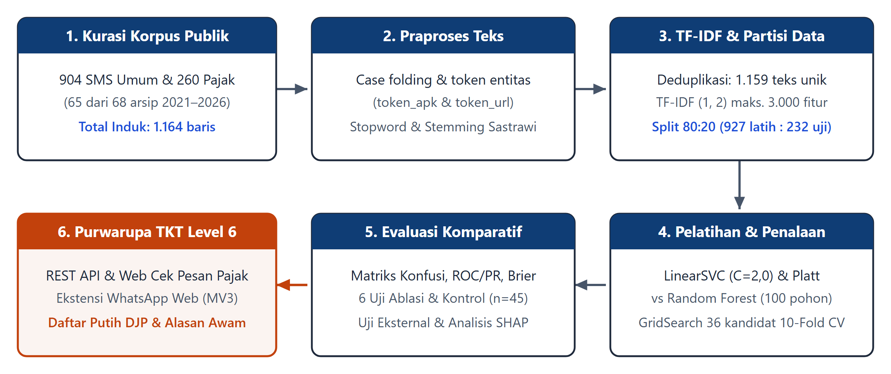

Gambar 1.1 Tahapan Metode Penelitian.

Karena matriks TF-IDF berdimensi tinggi bersifat jarang (*sparse*), hipotesis kerja [23], [24] memperkirakan `LinearSVC` menghasilkan konsistensi validasi silang serta kalibrasi peluang lebih baik daripada *Random Forest*. Dugaan itu selaras dengan temuan mengenai keunggulan klasifier linear pada representasi teks pendek [13], [17]. Pengujiannya mencakup evaluasi *10-Fold CV* beserta *holdout* dan perbandingan *Brier Score* maupun *Log Loss*. Langkah tersebut ditutup dengan uji kontrol tanpa korpus pajak guna mengukur penurunan salah blokir terhadap pesan resmi.

# BAB II LANDASAN METODE

## 2.1 Penelitian Terdahulu dan Matriks Komparasi

Perluasan layanan Direktorat Jenderal Pajak melalui siaran *WhatsApp Blast* *Coretax* kerap dicatut pelaku *smishing* untuk menyebarkan berkas `.apk` berbahaya [2] maupun tautan palsu kepada wajib pajak [1], [3], [4], [5]. Di Indonesia, Rahmi dan Wibisono [6] merintis korpus SMS publik untuk *Multinomial Naïve Bayes* dengan akurasi 94,12% dan 94,56%. Selanjutnya, Theodorus dkk. [7] menguji 4.125 SMS tiga kelas dan mencatat akurasi *Random Forest* sebesar 94,62% berbanding 94,38% pada SVM.

Pada kajian SMS lain, Irawan dkk. [8] mengolah 5.571 SMS Inggris dari korpus UCI (4.824 *ham* dan 747 *spam*) tanpa pemenggalan kata dasar. Skor kinerja SVM tertinggal di angka 86,5%, di bawah *Bagging* (97,4%), *Random Forest* (96,8%), serta *Naïve Bayes* (96,4%). Sebaliknya, Al Ghofany dkk. [9] menguji 500 SMS berbahasa Indonesia memakai *stemming* Nazief-Adriani dan 10-*fold* CV. Pada skema TF-IDF, SVM Linear meraih 99,52% dan SVM *Sigmoid* 99,60%, sedangkan dengan TF-RF, SVM Linear mencapai 100% dan SVM *Sigmoid* 99,96%.

Sebagai pembanding lintas korpus, Astuti dkk. [10] dan Ningtias dkk. [13] mengevaluasi TF-IDF pada data SMS berbahasa Inggris. Di ranah tautan web, Tampinongkol dkk. [11] mengolah 59.899 URL sah dan *phishing* memakai sembilan fitur leksikal tanpa TF-IDF maupun BERT. Hasilnya menempatkan *Random Forest* (84,95%) di atas SVM standar (77,43%). Pada korpus surel berbahasa Inggris, Al Tawil dkk. [12] membandingkan lima model tanpa SVM. Riset itu mendapati *Random Forest* berbasis TF-IDF terlatih dalam 40,39 detik, jauh lebih singkat daripada BERT (1.012,66 detik).

Pada penelitian pesan instan lokal, Efendi dkk. [14] membangun *bot* *WhatsApp* memakai logika *fuzzy*. Saputra dkk. [15] mengaplikasikan Sastrawi pada SVM berfitur `HashingVectorizer` dengan akurasi 95,45%, tetapi cara ini mengorbankan keterjelasan fitur. Sembiring dkk. [16] menyandikan token entitas uang maupun URL pada tiga kelas pesan penipuan dengan *Recall* kelas *fraud* SVM mencapai 98,59%, tetapi belum menyandikan berkas `.apk`. Studi terbaru kemudian merancang kerangka `LinearSVC` terjelaskan [17] dan memadukan komparasi model bersama interpretasi SHAP [18]. Pendekatan ekstensi peramban *real-time* juga telah diuji untuk mendeteksi tautan *phishing* [19].

Matriks lengkap 15 studi terdahulu tersebut tersaji pada Lampiran (Tabel L.1). Pemetaan pustaka menemukan empat celah, yakni ketiadaan korpus pajak berimbang dan hilangnya penanda `.apk` atau URL saat praproses. Penelitian sebelumnya juga belum menguji kontrol *keyword bias* maupun ekstensi peramban berkalibrasi Platt. Pedoman TA UNSIA serta kriteria TKT Level 6 pada Permenristekdikti Nomor 42 Tahun 2016 [20], [25] pun menjadi acuan perancangan alat deteksi yang terukur.

## 2.2 Landasan Teori dan Metode Khusus

### 2.2.1 Algoritma Support Vector Machine, LinearSVC, dan Kalibrasi Platt

*Support Vector Machine* (*soft-margin* SVM) mencari *hyperplane* pemisah dengan *margin* maksimal di ruang fitur berdimensi tinggi [26]. Untuk matriks TF-IDF yang jarang (*sparse*), `LinearSVC` pada `scikit-learn 1.9.1` memanggil solver LIBLINEAR guna meminimalkan Persamaan (2.1) [27], [28]. Formulasi *L2-regularized L2-loss* ini memuat bobot $\mathbf{w}$, bias $b$, fitur $\mathbf{x}_i$, label $y_i\in\{-1,+1\}$, dan penalti $C>0$ ($i=1,\dots,n$). LIBLINEAR mengaugmentasi $b$ ke suku regularisasi L2 [27], sedangkan parameter `fit_intercept` dan penyeimbang $C$ tersedia di `scikit-learn`.

**Persamaan (2.1)** Fungsi Objektif *LinearSVC*.

$$\min_{\mathbf{w},b}\frac{1}{2}\left(\|\mathbf{w}\|_2^2+b^2\right)+C\sum_{i=1}^{n}\max\left(0,1-y_i(\mathbf{w}^\top\mathbf{x}_i+b)\right)^2\qquad(2.1)$$

Nilai keputusan $f(\mathbf{x}) = \mathbf{w}^\top\mathbf{x} + b$ mengukur jarak bertanda yang sebanding dengan margin pemisah antarkelas $2/\|\mathbf{w}\|_2$ [26]. Di samping itu, komponen bobot $w_j$ mengukur kontribusi langsung tiap token. Untuk mengubah skor menjadi peluang, metode Platt [29] dan Lin dkk. [30] memakai target probabilitas teratur $t_i=(N_++1)/(N_++2)$ bagi kelas positif serta $1/(N_-+2)$ bagi kelas negatif. Parameter $(A,B)$ lalu ditaksir via optimasi Newton pada Persamaan (2.2).

**Persamaan (2.2)** Kalibrasi Probabilitas *Platt Scaling*.

$$P(y=1\mid f(\mathbf{x}))=\frac{1}{1+\exp(Af(\mathbf{x})+B)}\qquad(2.2)$$

Dalam modul kalibrasi `CalibratedClassifierCV` lima lipatan pada `scikit-learn 1.9.1` berbasis arsitektur pustaka inti [28], partisi kalibrasi dibagi menjadi lima bagian terstratifikasi secara seimbang. Peluang akhir suatu pesan dihitung dari rata-rata probabilitas kelima submodel `TF-IDF`, `LinearSVC`, dan kurva *sigmoid*. Karena keputusan akhir memakai perataan ensembel lima lipatan tersebut, hasil prediksi terkalibrasi dapat bergeser tipis dibandingkan satu model tunggal.

### 2.2.2 Algoritma Random Forest

*Random Forest* membentuk sekumpulan pohon keputusan melalui *bagging* serta pencuplikan acak sebagian fitur pada tiap simpul [31]. Pada implementasi modern `scikit-learn 1.9.1` yang bertumpu pada antarmuka estimator [28], setiap cabang CART meminimalkan impuritas Gini kedua simpul anak lewat $\mathrm{Gini}(t)$ bagi $K$ kelas pada Persamaan (2.3). Berbeda dari pemungutan suara mayoritas Breiman [31], `predict_proba` merata-ratakan peluang daun $P_m(y=1\mid\mathbf{x})=p(1\mid t_m(\mathbf{x}))$ atas $T$ pohon ($m=1,\dots,T$) pada Persamaan (2.4). Pada teks pendek, pemecahan satu kata per simpul sering menahan peluang di zona ragu.

**Persamaan (2.3)** Impuritas Gini.

$$\mathrm{Gini}(t)=1-\sum_{k=1}^{K}p(k\mid t)^2\qquad(2.3)$$

**Persamaan (2.4)** Prediksi Probabilitas *Random Forest*.

$$P(y=1\mid\mathbf{x})=\frac{1}{T}\sum_{m=1}^{T}P_m(y=1\mid\mathbf{x})\qquad(2.4)$$

### 2.2.3 Praproses Teks Bahasa Indonesia dan Pembobotan Fitur TF-IDF

Tahap praproses `clean_text` diawali *case folding* untuk menyeragamkan huruf menjadi kecil. Pola `.apk` disandikan menjadi `token_apk`, sedangkan pola tautan diubah ke `token_url` sebelum ekspresi reguler `[^a-z0-9\s_]` menghapus simbol. Sesudah penyaringan kata umum (*stopword*), *stemming* Sastrawi [32] hanya dijalankan pada token alfabetis di atas dua huruf (`len > 2`). Token numerik beserta kata pendek (`wa`, `hp`, `no`, `rp`) diloloskan dari pemenggalan, sedangkan `TfidfVectorizer` standar `scikit-learn 1.9.1` menyaring token satu karakter.

Teks bersih kemudian diekstrak menjadi fitur *unigram* dan *bigram* memakai skema TF-IDF [33] varian halus `scikit-learn 1.9.1` [28] sesuai Persamaan (2.5). Komponen mentah $v_t(d)=\mathrm{tf}(t,d)\cdot(\ln((1+N_{\text{dok}})/(1+\mathrm{df}(t)))+1)$ menghimpun frekuensi token $\mathrm{tf}(t,d)$, jumlah dokumen latih $N_{\text{dok}}$, dan $\mathrm{df}(t)$ dalam vektor $\mathbf{v}(d)$. Normalisasi *Euclidean* L2 membagi tiap elemen dengan $\|\mathbf{v}(d)\|_2$ agar variasi panjang pesan tidak mendistorsi skor, sedangkan vektor bernorma nol ($\|\mathbf{v}(d)\|_2=0$) diberi bobot nol.

**Persamaan (2.5)** Pembobotan TF-IDF Ternormalisasi L2.

$$w(t,d)=\frac{\mathrm{tf}(t,d)\cdot\left(\ln\left(\frac{1+N_{\text{dok}}}{1+\mathrm{df}(t)}\right)+1\right)}{\|\mathbf{v}(d)\|_2}\qquad(2.5)$$

### 2.2.4 Validasi Silang Terstratifikasi, Metrik Evaluasi, dan Kalibrasi Probabilitas

Validasi silang terstratifikasi 10 lipatan mempertahankan rasio kelas secara seimbang pada setiap partisi latih dan validasi [34]. Kinerja klasifikasi biner dihitung dari matriks konfusi (*TP*, *TN*, *FP*, *FN*) menjadi metrik *Accuracy* dan *Precision* pada Persamaan (2.6) bersama *Recall* dan *F1-Score* pada Persamaan (2.7) melalui `scikit-learn` [28], [35]. Pengukuran gabungan ini menjaga ketepatan deteksi penipuan tetap seimbang terhadap risiko salah blokir pesan resmi wajib pajak agar penilaian model tidak berat sebelah.

**Persamaan (2.6)** *Accuracy* dan *Precision*.

$$\mathrm{Accuracy}=\frac{TP+TN}{TP+TN+FP+FN},\quad\mathrm{Precision}=\frac{TP}{TP+FP}\qquad(2.6)$$

**Persamaan (2.7)** *Recall* dan *F1-Score*.

$$\mathrm{Recall}=\frac{TP}{TP+FN},\quad F_1=\frac{2\cdot\mathrm{Precision}\cdot\mathrm{Recall}}{\mathrm{Precision}+\mathrm{Recall}}\qquad(2.7)$$

Evaluasi penelitian ini memisahkan metrik diskriminasi lintas ambang batas dari metrik kalibrasi probabilitas. Kemampuan pemeringkatan kelas diukur melalui *ROC-AUC* dan *PR-AUC* [35], sedangkan ketepatan peluang dinilai lewat *Brier Score* dan *Log Loss* pada Persamaan (2.8) [35]. Dalam perumusan tersebut, $N_{\text{uji}}$ menyatakan cacah sampel uji berlabel biner $y_i\in\{0,1\}$, sedangkan keluaran peluang $0\le p_i\le 1$ dipotong eksplisit pada rentang $\epsilon=10^{-15}$ hingga $1-\epsilon$ di skrip evaluasi sebelum memanggil `log_loss` agar nilai logaritma natural tetap terdefinisi.

**Persamaan (2.8)** *Brier Score* dan *Log Loss*.

$$\mathrm{BS}=\frac{1}{N_{\text{uji}}}\sum_{i=1}^{N_{\text{uji}}}(p_i-y_i)^2,\quad\mathrm{LL}=-\frac{1}{N_{\text{uji}}}\sum_{i=1}^{N_{\text{uji}}}\left[y_i\ln(p_i)+(1-y_i)\ln(1-p_i)\right]\qquad(2.8)$$

### 2.2.5 Indikator Kelayakan Purwarupa dan Kesiapterapan Teknologi (TKT Level 6)

Dari sudut pandang Sistem Informasi, keandalan model pembelajaran mesin perlu hadir sebagai layanan verifikasi praktis bagi wajib pajak awam. Mengacu pada Pedoman TA UNSIA [20] dan Permenristekdikti Nomor 42 Tahun 2016 [25], target TKT Level 6 menuntut pembuktian purwarupa di lingkungan simulasi yang representatif terhadap kondisi operasional. Rancangan purwarupa ini memadukan bundel model `.joblib`, layanan REST API FastAPI, aplikasi web *Cek Pesan Pajak*, dan ekstensi *WhatsApp Web* agar seluruh komponen terintegrasi dapat diuji secara menyeluruh.

Agar nyaman dipakai saat percakapan *real-time*, sistem menargetkan latensi di bawah 100 ms [19]. Hasil klasifikasi dipetakan ke tiga kategori risiko, yakni TINGGI (berkas `.apk` atau $p \ge 0,75$), SEDANG ($0,50 \le p < 0,75$ atau tautan non-daftar putih), dan RENDAH. Daftar putih berfokus pada domain `pajak.go.id` beserta subdomainnya [2], [5], sedangkan tautan singkat `t.kemenkeu.go.id` dicatat sebagai kandidat lanjutan. Selain itu, bobot fitur linear dan SHAP [17], [18] diterjemahkan ke indikator pemicu awam.

## 2.3 Prosedur Operasional dan Bagan Alir Penelitian

Prosedur penelitian memadukan eksperimen kuantitatif dan alur *Research and Development* (R&D) dari kurasi teks hingga uji antarmuka pengguna [20], [21]. Seluruh pelatihan mengunci pengacak `random_state=42` agar eksperimen dapat diulang secara konsisten [28]. Sistem memproses vektor TF-IDF teks tanpa mengurai gambar maupun berkas `.apk` melalui enam tahap berurutan berikut:

a) Kurasi 260 pesan pajak berimbang (130 *phishing* lintas 12 modus, 110 siaran DJP, 20 pesan normal) dari 65 arsip publik, lalu dipadukan dengan 904 SMS umum menjadi korpus induk 1.164 baris dan korpus perluasan 2.521 baris ber-SHA-256 [2], [5], [6], [7], [36].

b) Praproses `clean_text` menyeragamkan huruf kecil, menyandikan `token_apk` dan `token_url`, serta menghapus simbol via `[^a-z0-9\s_]`. Tahap berikutnya menyaring *stopword*, menjalankan *stemming* Sastrawi atas token `len > 2`, dan mempertahankan token minimal dua huruf [28], [32].

c) Deduplikasi 5 teks Sastrawi identik pada korpus induk menyisakan 1.159 baris unik (dibagi terstratifikasi 80:20 menjadi 927 latih dan 232 uji), sedangkan penyusutan 2 baris pendek pada korpus perluasan menyisakan 2.519 baris unik [28], [34].

d) Ekstraksi TF-IDF maksimal 3.000 fitur terisolasi pada tiap lipatan latih mengawali pencarian *grid* 10-*Fold* CV untuk 36 kandidat (12 `LinearSVC`, 24 *Random Forest*), lalu model terbaik dikalibrasi memakai *Platt scaling* lima lipatan [27], [28], [29], [30], [33], [34].

e) Evaluasi lanjutan menjalankan enam skenario ablatif, uji kontrol tanpa korpus pajak terhadap korpus seimbang ($n = 45$), uji eksternal 1.360 pesan, korpus perluasan 2.519 baris, serta pemeringkatan bobot linear dan SHAP [17], [18], [35].

f) Pengemasan bundel `.joblib` memadukan REST API FastAPI, web *Cek Pesan Pajak*, dan ekstensi *WhatsApp Web* berdaftar putih `pajak.go.id`, tiga tingkat risiko, serta penjelasan awam guna memenuhi TKT Level 6 [19], [25].

Keterkaitan keenam tahapan prosedur operasional eksperimen tersebut diperlihatkan pada Gambar 2.1.

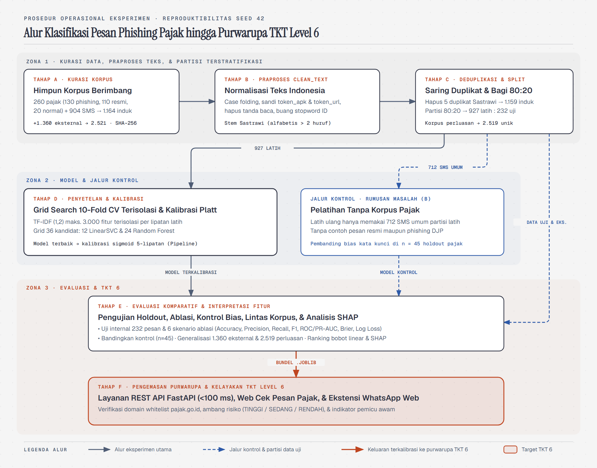

Gambar 2.1 Bagan Alir Prosedur Eksperimen.

## 2.4 Waktu dan Lokasi Penelitian

Penelitian dilaksanakan selama empat bulan, dari Agustus hingga November 2026, mengikuti jadwal rencana studi pada Program Studi PJJ Sistem Informasi UNSIA. Penyusunan korpus, pelatihan model, dan uji purwarupa berlangsung luring di Jakarta Selatan. Untuk menjaga kepatuhan privasi, seluruh bahan uji dihimpun dari arsip publik tanpa mengakses sistem produksi maupun data internal otoritas perpajakan [2], [5]. Rincian jadwal tercantum di Tabel L.2.

## 2.5 Alat dan Bahan Penelitian

Komputasi eksperimen serta pengujian purwarupa memakai laptop berprosesor Intel Core i5-12450H, RAM 16 GB, dan sistem Windows 11 Pro 64-bit. Lingkungan perangkat lunak memakai Python 3.14.7 bersama Scikit-learn 1.9.1 [28] dan Sastrawi 1.0.1 [32]. Pustaka pendukung meliputi Pandas 3.1.1, NumPy 2.5.4, Matplotlib 3.11.2, serta Seaborn 0.13.2. Perangkat SHAP 0.54.1, Joblib 1.6.0, FastAPI 0.163.1, Uvicorn 0.54.0, dan Pytest 9.2.0 menunjang penjelasan hingga uji API di Lampiran (Tabel L.3).

## 2.6 Cara Pengumpulan dan Analisis Data

Pengumpulan bahan perpajakan menerapkan studi dokumentasi [22] atas 68 arsip publik periode 2021 hingga 2026 yang mayoritas terbit antara 2024 dan 2026. Tiga artikel sekunder (`SRC-046`, `SRC-049`, dan `SRC-061` dari DDTC News dan Ortax) disisihkan karena merangkum pengumuman primer `pajak.go.id`. Sesudah menyisihkan 239 SMS promosi Rahmi dan Wibisono, ke-65 arsip terpilih menghasilkan 130 *phishing* lintas 12 modus dan 130 pesan aman (110 siaran resmi DJP dan 20 pesan pajak normal) dalam korpus induk 1.164 baris [2], [5], [6].

Dalam pelaksanaan 10-*Fold* CV [34], vektorizer TF-IDF selalu dibangun ulang di tiap lipatan latih melalui `scikit-learn` [28] untuk mencegah kebocoran data validasi. Guna menjawab Rumusan Masalah (b), model turut dilatih khusus memakai 712 SMS umum partisi latih lalu diuji pada 45 pesan pajak *holdout* dan dibandingkan terhadap model korpus berimbang. Uji lintas korpus turut dijalankan atas 1.360 pesan unik Theodorus dkk. [7] dan Saragih [36] guna mengukur generalisasi eksternal.

## 2.7 Definisi Operasional Variabel dan Parameter

Operasionalisasi penelitian merumuskan variabel bebas, variabel terikat, perlakuan eksperimen, dan parameter pengukuran sesuai kaidah pengujian kuantitatif [22], [23], [24]. Variabel bebas berskala vektor numerik berupa teks hasil `clean_text` yang dipetakan menjadi bobot TF-IDF unigram dan bigram hingga 3.000 fitur. Variabel terikatnya berskala nominal biner yang mencakup kelas 1 (*phishing*) serta kelas 0 (aman atau resmi), disertai perlakuan kontrol 712 SMS terhadap 927 pesan seimbang.

Penyetelan parameter mencakup konstanta `C` pada `LinearSVC`, ukuran serta kedalaman pohon *Random Forest*, dan kalibrasi Platt [27], [28], [30], [31]. Sementara itu, ukuran kinerja memakai metrik klasifikasi dan kalibrasi probabilitas pada skala rasio dari 0 hingga 1 bersama tiga kategori risiko antarmuka. Seluruh matriks definisi operasional beserta indikator kelayakan TKT Level 6 [25], [35] tersusun lengkap pada Lampiran (Tabel L.4).

# BAB III IMPLEMENTASI METODE USULAN

## 3.1 Arsitektur Implementasi Metode Usulan

Implementasi metode usulan mewujudkan enam tahap prosedur operasional Bab II ke dalam sistem perangkat lunak Python 3.14.7 [28]. Arsitektur sistem memisahkan alur pelatihan luring (*offline*) pada direktori `ml/` dari layanan verifikasi daring (*online*) pada `app/backend/`. Pada alur luring, kumpulan teks diubah menjadi vektor TF-IDF berdimensi 3.000 untuk melatih `LinearSVC` terkalibrasi serta `RandomForestClassifier`, lalu dikemas ke `app/backend/model_phishing_pajak.joblib` [27], [28], [31], [33]. Selanjutnya, alur daring memuat bundel tersebut ke peladen FastAPI guna melayani aplikasi web dan ekstensi peramban [19], sebagaimana ditunjukkan pada Gambar 3.1.

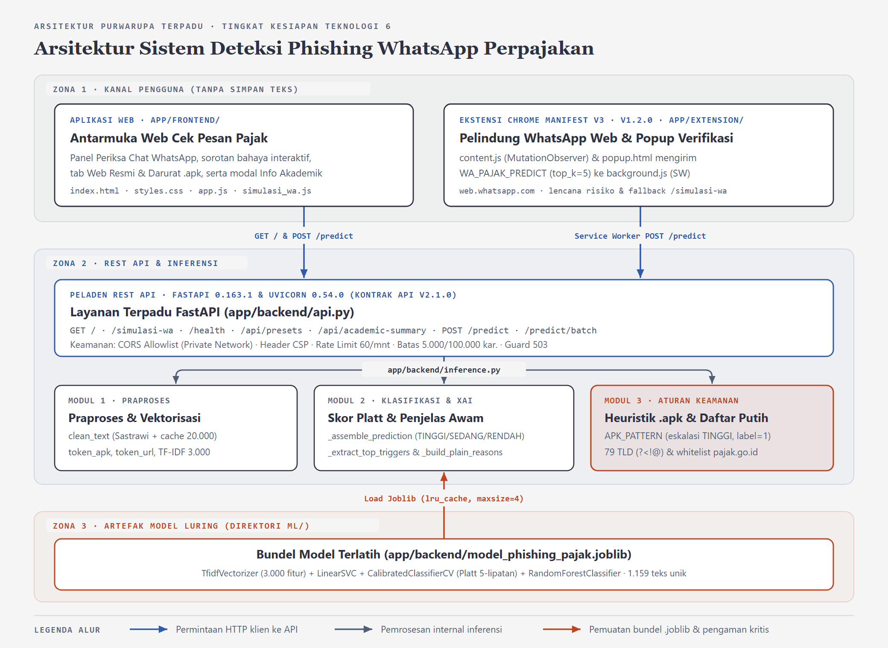

Gambar 3.1 Arsitektur Sistem Terpadu Deteksi *Phishing* WhatsApp Perpajakan.

Dari sudut pandang Sistem Informasi, setiap pesan yang dikirim wajib pajak melewati satu mesin keputusan terpusat di `app/backend/inference.py` agar vonis maupun indikator bahayanya seragam di semua kanal akses. Modul pusat itu menangani klasifikasi probabilistik, pengecekan aturan keamanan perpajakan, penyusunan alasan awam, serta penandaan sorotan pada teks asli. Demi menjaga privasi pengguna, peladen memproses isi pesan secara sementara di memori tanpa menyimpannya ke basis data. Pemetaan sepuluh modul kode sumber terhadap tahapan metodologi tercantum pada Tabel L.5 di Lampiran.

## 3.2 Implementasi Kurasi Korpus dan Praproses Teks

Tahap penyusunan data menghimpun 68 arsip publik terbitan 2021 hingga 2026 melalui `ml/korpus_pajak.py` dan `ml/kurasi_dataset.py` [2], [5]. Skrip `strip_djp_boilerplate` mula-mula menanggalkan *header* dan *footer* halaman web. Berikutnya, kurasi manual memilih 65 sumber unik yang mencakup 45 publikasi resmi domain `pajak.go.id` serta 20 laporan berita dan cek fakta. Tiga artikel sekunder yang merangkum rilis primer DJP (`SRC-046`, `SRC-049`, `SRC-061`) disisihkan agar sumber tidak tumpang tindih. Hasilnya membentuk 260 pesan pajak berimbang, yaitu 130 pesan *phishing* lintas 12 modus dan 130 pesan aman (110 siaran resmi DJP serta 20 percakapan administrasi pajak normal).

Penggabungan 260 teks pajak bersama 904 SMS umum Rahmi dan Wibisono [6] (sesudah menyisihkan 239 iklan promo) membentuk *dataset* induk 1.164 baris yang dikunci oleh 10 *checksum* SHA-256. Untuk uji lintas korpus, himpunan induk dipadukan pula dengan 2.743 SMS biner Theodorus dkk. [7] dan 348 SMS biner Saragih [36]. Fungsi `clean_text` kurasi empat langkah pada `ml/kurasi_dataset.py` (tanpa *stopword* maupun Sastrawi) memangkas 4.255 baris mentah menjadi 2.521 baris pada korpus diperluas.

Setelah melewati penyaringan Sastrawi penuh, korpus diperluas 2.521 baris menyusut dua baris label aman asal Theodorus dkk. menjadi 2.519 baris. Pesan sangat pendek `'anda'` dan `'Ok'` luruh ke *string* kosong sehingga bertumbukan saat deduplikasi dan menyisakan satu baris kosong. Sementara itu, satu baris lain gugur karena penghapusan kata umum `'akan'` menyamakan dua pesan tarif seluler. Sebaliknya, korpus induk 1.159 baris dan korpus pajak 260 baris tetap bersih tanpa satu pun baris kosong.

Sebelum vektorisasi TF-IDF dijalankan pada pelatihan maupun layanan daring, fungsi `clean_text` enam langkah pada `ml/eksperimen_baseline.py` mengonversi kamus kata dasar Sastrawi menjadi struktur himpunan (`set`) berpenyangga `lru_cache` 20.000 entri. Struktur tersebut mempercepat pencarian morfologi menjadi waktu konstan $O(1)$ saat memproses teks pelatihan maupun permintaan pengguna [32]. Setiap pesan masukan melewati enam langkah praproses berurutan berikut:

a) Pengecilan seluruh huruf via metode `lower()` agar variasi kapitalisasi seragam.

b) Konversi pola `.apk` (`r"\.apk\b"`) menjadi `token_apk` sebelum pemindaian URL supaya nama berkas tidak terbaca sebagai alamat web.

c) Pengubahan tautan `http`, `https`, `www`, `bit.ly`, serta sembilan akhiran domain (`.go.id`, `.co.id`, `.my.id`, `.com`, `.net`, `.org`, `.xyz`, `.id`, dan `.cc`) melalui `URL_PATTERN` menjadi `token_url`.

d) Penghapusan simbol nonalfanumerik selain spasi dan garis bawah memakai pola `r"[^a-z0-9\s_]"`.

e) Penyaringan daftar kata umum (*stopword*) Sastrawi dengan tetap melestarikan `token_apk` dan `token_url`.

f) Pengembalian kata alfabetis yang panjangnya melebihi dua huruf (`tok.isalpha() and len(tok) > 2`) ke bentuk kata dasar lewat Sastrawi 1.0.1 [32].

Untuk mengukur kontribusi tiap keputusan praproses secara terkendali pada `ml/eksperimen_komparasi.py`, dua kolom pembanding disimpan mendampingi `teks_sastrawi`. Kolom `clean_text` buatan `ml/kurasi_dataset.py` mempertahankan `token_apk` dan `token_url` tanpa penghapusan daftar kata umum maupun *stemming* bagi skenario ablatif `2_Tanpa_Sastrawi`. Sebaliknya, `clean_text_without_entity_tokens` membentuk kolom `teks_tanpa_token_entitas` bagi skenario `1_Tanpa_Token_Entitas` dengan membuang pola URL, `.apk`, angka, dan garis bawah (`[^a-z\s]`), lalu men-*stem* seluruh token tersisa.

## 3.3 Implementasi Pelatihan Model, Penyetelan Hiperparameter, dan Kalibrasi

Pelatihan model pada `ml/eksperimen_komparasi.py` mengunci nilai `RANDOM_STATE=42` untuk seluruh pemisahan data dan penaksiran model agar eksperimen dapat diulang [28]. Pada korpus induk 1.164 baris, deduplikasi `teks_sastrawi` menyisihkan lima baris identik asal korpus SMS umum sehingga tersisa 1.159 teks unik (697 aman dan 462 penipuan). Himpunan bersih itu dipisah terstratifikasi 80:20 menjadi 927 data latih dan 232 data uji beririsan nol. Selanjutnya, `_precompute_tfidf_folds` membangun `TfidfVectorizer(ngram_range=(1, 2), max_features=3000)` pada `scikit-learn 1.9.1` (token minimal dua huruf `(?u)\b\w\w+\b`) secara terpisah di tiap lipatan *Stratified 10-Fold CV* [34] untuk pembobotan TF-IDF [28], [33] tanpa kebocoran kosakata.

Di atas sepuluh lipatan TF-IDF terisolasi tersebut, fungsi `_run_grid_over_folds` menguji 36 kandidat kombinasi parameter secara sistematis. Ruang pencarian itu mencakup 12 konfigurasi `LinearSVC` dan 24 konfigurasi `RandomForestClassifier` yang diurutkan menurut rata-rata *F1-Score* sepuluh lipatan dengan pemecah seri rata-rata akurasi serta *ROC-AUC*. Rincian rentang kandidat hiperparameter tercantum pada Tabel 3.1, sedangkan konfigurasi pemenang dilaporkan pada Bab IV agar pemisahan metode dan hasil terjaga.

Tabel 3.1 Konfigurasi Ruang Pencarian Hiperparameter pada Penyetelan 10-Fold CV

| Algoritma Klasifikasi | Ruang Pencarian Parameter (`_run_grid_over_folds`) | Jumlah Kandidat |
| :--- | :--- | :---: |
| `LinearSVC` | `C`: `0.1, 0.25, 0.5, 1.0, 2.0, 5.0`; `class_weight`: `None, balanced`; `max_iter=5000`; `random_state=42` | 12 |
| `RandomForestClassifier` | `n_estimators`: `100, 200, 300`; `max_depth`: `None, 30`; `min_samples_split`: `2, 5`; `class_weight`: `None, balanced`; `random_state=42` | 24 |

Sumber: Implementasi Penyetelan Hiperparameter pada `ml/eksperimen_komparasi.py` (2026).

Keluaran mentah `LinearSVC` berupa jarak *hyperplane* perlu dikonversi ke skala probabilitas supaya wajib pajak memahami tingkat keyakinan peringatan secara intuitif [27], [29], [30]. Oleh karena itu, `_make_calibrated_svm_pipeline` membungkus vektorizer TF-IDF bersama `LinearSVC` dalam satu `Pipeline`, lalu menerapkan `CalibratedClassifierCV(method="sigmoid", cv=5)`. Pendekatan ini melatih lima submodel terkalibrasi secara terisolasi dan merata-ratakan peluang akhirnya tanpa membocorkan informasi antarlipatan [28].

Untuk menguji daya generalisasi sekaligus ketahanan terhadap bias kata kunci pajak, `_run_stage4_domain_and_cross_corpus` menjalankan tiga evaluasi lanjutan. Pengujian `Stage 4A` membandingkan model latih 712 SMS umum terhadap model korpus seimbang pada 45 pesan pajak *holdout* tanpa irisan (24 *phishing* dan 21 resmi), disertai 10-*Fold* CV 260 pesan pajak. Evaluasi berlanjut ke 1.360 pesan eksternal unik (`Stage 4B`) serta korpus diperluas 2.519 baris pasca-Sastrawi (`Stage 4C`) [7], [36], sebelum mengekspor `.joblib` dan menghitung nilai SHAP pada 232 data uji [17], [18].

## 3.4 Implementasi Purwarupa Sistem Terpadu Tingkat Kesiapan Teknologi 6

Guna memenuhi kriteria purwarupa TKT Level 6 [25], alur layanan daring dibuat langsung dapat dipakai wajib pajak tanpa langkah teknis rumit. Setiap pesan masuk diproses di `app/backend/inference.py` yang memuat `app/backend/model_phishing_pajak.joblib` lewat `@functools.lru_cache(maxsize=4)` lalu menormalisasi teks memakai `clean_text`. Selain menghitung peluang terkalibrasi `svm_probability`, `_assemble_prediction` menggabungkan hasil model dengan pemeriksaan heuristik `analyze_urls_and_apk`. Pola `APK_PATTERN` (`r"\b[a-z0-9_.-]+\.apk\b"` dengan `re.IGNORECASE`) memindai lampiran `.apk` dan langsung mengeskalasi risiko ke `TINGGI` beserta `label = 1`, sebab DJP tidak pernah mengirim aplikasi melalui WhatsApp.

Pemeriksaan tautan memakai `URL_PATTERN` berdaftar 79 akhiran domain alfabetis (`_BARE_TLD_LIST`), *lookbehind* `(?<!@)`, dan `re.IGNORECASE`. Pola ini menjaga format jam (`17.00`) maupun nominal uang (`Rp1.500.000`) aman dari peringatan palsu. Daftar putih `is_official_djp_domain` hanya meloloskan host `pajak.go.id` atau subdomain `.pajak.go.id`, sedangkan tautan singkat `t.kemenkeu.go.id` dicatat sebagai kandidat pengembangan lanjutan sesuai Bab II.

Penetapan kategori risiko pada `_assemble_prediction` memetakan skor ke tiga tingkat yang mudah dipahami pengguna. Tingkat `TINGGI` berlaku bagi temuan `.apk` atau peluang $p \ge 0{,}75$, sedangkan tingkat `SEDANG` berlaku untuk $0{,}50 \le p < 0{,}75$ maupun adanya domain mencurigakan di luar daftar putih (berstatus `Perlu Verifikasi / Waspada` walau $p < 0{,}50$), dan pesan tanpa indikator bahaya masuk tingkat `RENDAH`. Selanjutnya, `_extract_top_triggers` menghitung perkalian bobot TF-IDF dan `coef_` sebagai `top_triggers`, lalu `_build_plain_reasons` bersama `_extract_highlights_and_triggers` menyusun alasan awam beserta sorotan teks [17].

Layanan antarmuka pemrograman pada `app/backend/api.py` berjalan di atas FastAPI 0.163.1 dan Uvicorn 0.54.0 dengan versi kontrak API `2.1.0` sesuai Tabel L.6. Peladen menerapkan daftar izin CORS (`allow_private_network=True`), *security headers* termasuk *Content-Security-Policy* (CSP), pembatas laju berbobot `RATE_LIMIT_PER_MIN=60` per menit, serta pengaman HTTP 503 jika bundel model absen. Batas panjang masukan dijaga hingga 5.000 karakter per pesan tunggal dan 100.000 karakter per *batch* berisi maksimal 200 pesan.

Di sisi antarmuka pengguna, aplikasi web `app/frontend/` menyediakan tiga tab utama (**Cek Pesan**, **Web Resmi & Ciri Scam**, dan **Darurat .apk**) beserta panel **Periksa Chat WhatsApp** yang dilengkapi tombol **Tempel & Periksa**, tombol **Periksa Pesan** (`Ctrl + Enter`), serta tiga contoh cepat. Sesudah pemeriksaan tuntas, halaman menampilkan kartu vonis, sorotan interaktif, **Alasan Deteksi**, **Langkah Aman**, serta tombol **Info Akademik (`TA UNSIA`)** di *footer*. Rancangan antarmuka web dan ekstensi tersaji pada Gambar L.1.

Untuk pemakaian langsung di *WhatsApp Web*, ekstensi *Chrome Manifest V3* versi `1.2.0` (`app/extension/`) memantau obrolan secara lokal [19]. Skrip `content.js` mengamati DOM lewat `MutationObserver` (*debounce* 150 ms, ulang 1.500 ms), lalu menyematkan tombol **Cek Pesan Pajak** pada pesan masuk minimal 8 karakter atau bermuatan `.apk`/URL serta pesan keluar bertanda `.apk`, URL, atau kata kunci pajak (`TAX_SELF_TEST_RE`). Saat ditekan atau `popup.html` dipakai, ekstensi mengirim `WA_PAJAK_PREDICT` (`top_k = 5`) via `chrome.runtime.sendMessage` ke `background.js` menuju `POST /predict` (atau *fallback* `fetch` langsung menuju peladen lokal, sementara demo terpisah tersedia di `/simulasi-wa`). Hasilnya tampil sebagai lencana risiko di bawah pesan.

## 3.5 Skenario Pengujian Sistem dan Kesiapan Evaluasi

Kesiapan operasional seluruh komponen diuji otomatis memakai Pytest 9.2.0 terhadap 29 fungsi uji pada empat berkas di direktori `tests/`. Kelompok pertama mencakup 13 pengujian data dan eksperimen (`tests/test_integritas_dataset.py` 6 fungsi, `tests/test_eksperimen_baseline.py` 2 fungsi, dan `tests/test_eksperimen_komparasi.py` 5 fungsi). Pengujian ini mengunci kecocokan 10 *checksum* SHA-256, konsistensi deduplikasi Sastrawi bebas kebocoran data, isolasi kalibrasi Platt pada `Pipeline`, arah kontribusi SHAP, keutuhan bundel `.joblib`, serta penurunan kesalahan pada uji kontrol domain pajak (`UJI-10` pada Tabel L.7).

Kelompok kedua mencakup 16 fungsi uji *black-box* pada `tests/test_prototipe_api.py` yang dipetakan satu-ke-satu ke kode `UJI-01` hingga `UJI-09a`, `UJI-09b`, serta `UJI-11` hingga `UJI-16` pada Tabel L.7. Skenario ini memeriksa kesiapan layanan (`/health`, `/`, `/simulasi-wa`), deteksi lampiran `.apk` maupun URL berakhiran `.apk`, penangkalan domain tiruan `pajak.go.id.evil.com`, serta kekebalan atas jam dan nominal uang. Di samping itu, pengujian memastikan penolakan teks kosong (HTTP 422), kesamaan probabilitas `POST /predict/batch`, aktivasi pembatas laju berbobot (HTTP 429 dengan `Retry-After`), kepatuhan CSP dan CORS, galat 503 tanpa kebocoran jalur peladen, hingga kelengkapan data latensi pada `/api/academic-summary`.

# BAB IV HASIL DAN ANALISA

## 4.1 Hasil Eksperimen Komparasi Klasifikasi dan Penyetelan Hiperparameter

Eksperimen komparatif dijalankan melalui `ml/eksperimen_komparasi.py` memakai pengacak tetap `random_state=42` selama 305,86 detik. Penyaringan duplikat Sastrawi menyisakan 1.159 teks unik dari 1.164 baris induk. Data bersih ini terbagi menjadi 927 latih dan 232 uji. Pada *baseline* *holdout* (n = 232), `LinearSVC` bawaan meraih *Accuracy* 96,12% dan *F1-Score* 94,97% (`TN=138`, `FP=2`, `FN=7`, `TP=85`), dengan *Precision* 97,70% serta *Recall* 92,39%. *Random Forest* (`n_estimators=200`) mencatat akurasi 96,12% dan *F1-Score* 95,03% (`TN=137`, `FP=3`, `FN=6`, `TP=86`) [13], [31].

Pengujian berlanjut memakai *Stratified 10-Fold Cross-Validation* terisolasi TF-IDF pada 927 data latih [34]. Skema ini mencegah kosakata validasi bocor ke proses latih. Sebelum penyetelan hiperparameter, `LinearSVC` mencatat *F1-Score* 97,04% (± 2,71%) dan akurasi 97,63% (± 2,20%), dengan *ROC-AUC* 0,9956 dalam rerata 0,0026 detik per lipatan. *Random Forest* standar meraih *F1-Score* 93,68% (± 3,20%) serta akurasi 94,93% (± 2,59%) dengan *ROC-AUC* 0,9905 selama 0,5357 detik per lipatan. Model linear melaju 202,57 kali lebih cepat.

Pencarian *grid* 10-*Fold* CV terisolasi (`_run_grid_over_folds`) menguji 36 kombinasi kandidat hiperparameter [28]. Konfigurasi terbaik `LinearSVC` (`C=2.0`, `class_weight=None`) meraih *F1-Score* 97,16% (± 2,41%) dan akurasi 97,74% (± 1,93%) dengan *ROC-AUC* 0,9956 dalam 0,0039 detik per lipatan [27]. Di pihak lain, *Random Forest* optimal (`n_estimators=100`, `max_depth=None`, `min_samples_split=2`, `class_weight=None`) meraih *F1-Score* 94,07% (± 2,92%) dan *ROC-AUC* 0,9901 (akurasi 95,25% ± 2,39%) dalam 0,3096 detik [31]. Latihan `LinearSVC` tetap 79,36 kali lebih cepat.

Pada himpunan uji tetap (n = 232), kalibrasi *Platt scaling* menggeser akurasi `LinearSVC` terpasang dari 96,12% menjadi 95,69% (`FP=3`, `FN=7`), sedangkan *Random Forest* mencatat 96,55% (`FP=2`, `FN=6`) [29], [30]. Uji eksak McNemar dua sisi menghasilkan p = 0,7266, menandakan selisih dua sampel itu tidak bermakna secara statistik. Interval kepercayaan *bootstrap* 95% akurasi `LinearSVC` Platt membentang dari 93,10% hingga 98,28%. Pemilihan model unggulan bertumpu pada kestabilan CV, efisiensi komputasi, serta kalibrasi peluang *in-domain*. Ringkasan seluruh tahap evaluasi utama tercantum pada Tabel 4.1.

Tabel 4.1 Hasil Komparasi Kinerja Klasifikasi pada Berbagai Tahap Evaluasi

| Tahap Evaluasi dan Himpunan Uji | Model Klasifikasi | *Accuracy* | *Precision* | *Recall* | *F1-Score* | *ROC-AUC* |
| :--- | :--- | :---: | :---: | :---: | :---: | :---: |
| *Baseline Holdout* (n = 232) | `LinearSVC` / RF (*Default*) | 96,12% / 96,12% | 97,70% / 96,63% | 92,39% / 93,48% | 94,97% / 95,03% | 0,9955 / 0,9939 |
| 10-*Fold* CV *Default* (n = 927) | `LinearSVC` / RF (*Default*) | 97,63% / 94,93% | 97,37% / 93,69% | 96,76% / 93,78% | 97,04% / 93,68% | 0,9956 / 0,9905 |
| 10-*Fold* CV *Tuned* (n = 927) | `LinearSVC` (`C=2.0`) / RF *Tuned* | 97,74% / 95,25% | 97,61% / 94,46% | 96,76% / 93,78% | 97,16% / 94,07% | 0,9956 / 0,9901 |
| *Holdout Tuned* Non-Platt (n = 232) | `LinearSVC` (`C=2.0`) | 96,12% | 97,70% | 92,39% | 94,97% | 0,9950 |
| *Holdout* Final (n = 232) | `LinearSVC` Platt / RF *Tuned* | 95,69% / 96,55% | 96,59% / 97,73% | 92,39% / 93,48% | 94,44% / 95,56% | 0,9957 / 0,9936 |
| Kontrol Tanpa Korpus Pajak (n = 45) | `LinearSVC` Platt / RF *Tuned* | 42,22% / 33,33% | 45,00% / 31,25% | 37,50% / 20,83% | 40,91% / 25,00% | 0,3571 / 0,3502 |
| Subset Pajak Seimbang (n = 45) | `LinearSVC` Platt / RF *Tuned* | 95,56% / 95,56% | 95,83% / 95,83% | 95,83% / 95,83% | 95,83% / 95,83% | 0,9960 / 0,9752 |
| 10-*Fold* CV Korpus Pajak (n = 260) | `LinearSVC` (`C=2.0`) / RF *Tuned* | 98,08% / 93,46% | 96,52% / 92,99% | 100,00% / 94,62% | 98,17% / 93,57% | 0,9947 / 0,9905 |
| *Zero-Shot* Eksternal (n = 1.360) | `LinearSVC` Platt / RF *Tuned* | 64,19% / 62,35% | 40,99% / 36,99% | 80,28% / 60,00% | 54,27% / 45,76% | 0,7875 / 0,6978 |
| *Holdout* Korpus Diperluas (n = 504) | `LinearSVC` Platt / RF *Tuned* | 96,03% / 92,46% | 96,75% / 92,00% | 90,85% / 84,15% | 93,71% / 87,90% | 0,9883 / 0,9771 |
| 10-*Fold* CV Diperluas (n = 2.519) | `LinearSVC` (`C=2.0`) / RF *Tuned* | 94,72% / 94,32% | 92,96% / 93,09% | 90,76% / 89,30% | 91,81% / 91,11% | 0,9832 / 0,9799 |

Sumber: Pengolahan Hasil Eksperimen `05-hasil-evaluasi/csv/tabel_komparasi_utama.csv` (2026).

Sebaran empat kuadran *Confusion Matrix* pada himpunan uji `n = 232` tersaji pada Gambar 4.1, sedangkan kurva ROC dan *Precision-Recall* pada Gambar L.2 mencatat *ROC-AUC* 0,9957 terhadap 0,9936 serta *PR-AUC* 0,9943 terhadap 0,9909 [35]. Pergeseran satu sampel `LinearSVC` Platt terjadi di `idx=1082` (`p=0,5506`) akibat perataan lima submodel `CalibratedClassifierCV` (0,43% ukuran uji). Bagi layanan wajib pajak, tujuh *False Negative* meloloskan penipuan, sementara tiga *False Positive* berpotensi memblokir pesan sah.

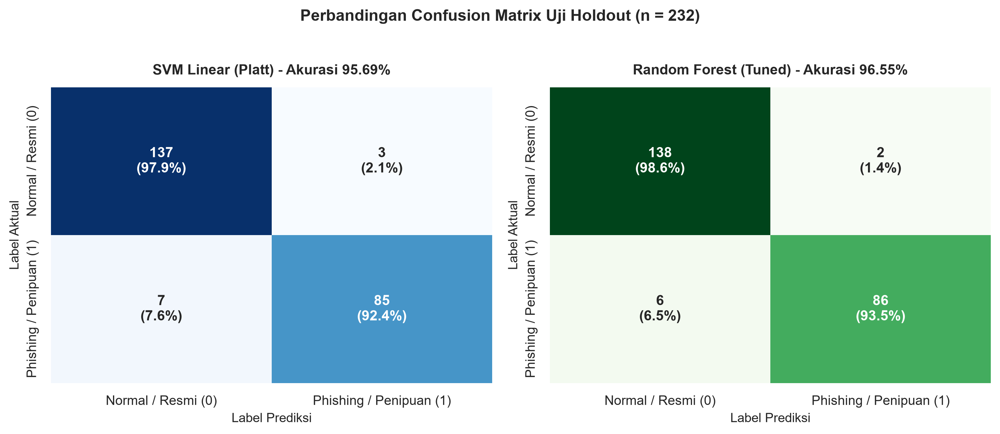

Gambar 4.1 Perbandingan *Confusion Matrix* Uji *Holdout*.

## 4.2 Analisis Kalibrasi Probabilitas dan Studi Ablatif Fitur

Penyajian skor keyakinan di antarmuka menuntut keluaran peluang yang selaras dengan kejadian aktual [29], [30]. Pada uji *holdout* `n = 232`, `LinearSVC` Platt mencatat *Brier Score* 0,02542 dan *Log Loss* 0,09186, jauh lebih rendah dibandingkan *Random Forest* (*Brier Score* 0,04214; *Log Loss* 0,15870). Selisih tersebut setara *Brier Score* 39,68% dan *Log Loss* 42,12% lebih rendah daripada *Random Forest*.

Sebaran skor pada Gambar 4.2 memperkuat keunggulan kalibrasi model linear. Peluang `LinearSVC` mengelompok tegas mendekati nol dan satu sehingga hanya 22 dari 232 pesan (9,48%) berada di zona keraguan 0,2 hingga 0,8, sedangkan skor *Random Forest* menyebar lebih luas pada rentang tengah sebanyak 59 pesan (25,43%). Sebaran lebar berisiko membanjiri layar dengan peringatan abu-abu yang membingungkan wajib pajak.

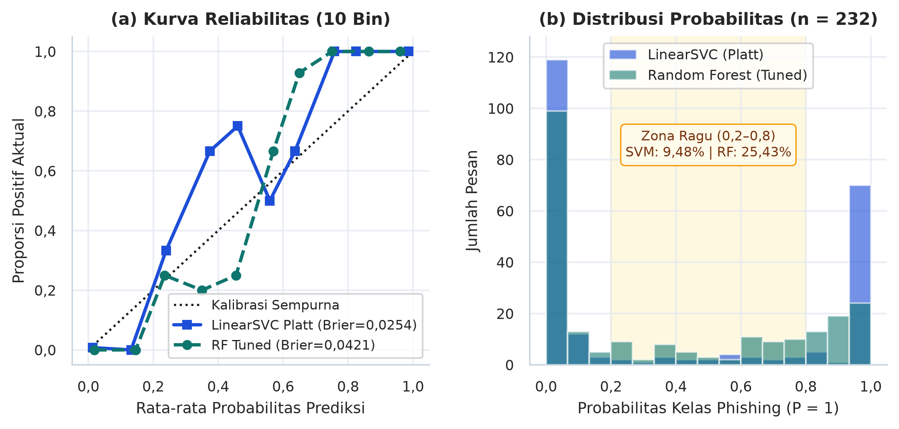

Gambar 4.2 Evaluasi Kalibrasi Probabilitas Model.

Untuk memvalidasi praproses, enam skenario ablatif dijalankan pada `05-hasil-evaluasi/csv/studi_ablatif_fitur.csv` dalam Tabel L.8 [32], [33]. Setelan utama (`teks_sastrawi`, *bigram* `(1, 2)`, 3.000 fitur) meraih *F1-Score* CV `LinearSVC` tertinggi (97,16%). Peniadaan `token_apk` dan `token_url` memangkasnya 1,35 poin menjadi 95,81% serta menjatuhkan *Random Forest* ke 92,42% [16], sedangkan *unigram* saja menurunkannya 1,22 poin menjadi 95,94%.

Peniadaan Sastrawi hanya menimbulkan selisih skor CV `LinearSVC` sebesar 0,0006% (97,1596% terhadap 97,1589%), sedangkan pada *Random Forest* skor CV justru sedikit lebih tinggi di 94,55% dibanding 94,07% [9], [32]. Sementara itu, lonjakan akurasi *holdout* `1_Tanpa_Token_Entitas` ke 97,84% dipicu penyamarataan tautan resmi `pajak.go.id` dan tautan penipu menjadi `token_url` pada uji tunggal bernilai 0,43% per sampel. Daftar putih domain wajib berjalan saat inferensi.

## 4.3 Analisis Ketahanan Bias Kata Kunci Pajak dan Generalisasi Lintas Korpus

Pengujian Tahap 4A menjawab Rumusan Masalah (b) pada 45 pesan pajak *holdout* (21 pesan aman: 19 siaran resmi DJP dan 2 percakapan normal, serta 24 *phishing*). Ketika `LinearSVC` Platt hanya dilatih memakai 712 SMS umum, akurasinya anjlok ke 42,22% (*F1-Score* 40,91%; *ROC-AUC* 0,3571). Sebanyak 11 pesan aman terblokir (`FP=11`; spesifisitas 47,62%) dan 15 penipuan lolos (`FN=15`), sedangkan *Random Forest* kontrol merosot ke akurasi 33,33% dan *F1-Score* 25,00% (`FP=11`, `FN=19`).

Masuknya korpus pajak seimbang ke data latih (1.159 baris) mengangkat kedua model ke *Accuracy* 95,56% dan *F1-Score* 95,83% (`FP=1`, `FN=1`), meloloskan 20 dari 21 pesan aman tersebut [2], [5]. `LinearSVC` Platt meraih *ROC-AUC* 0,9960 (*Brier Score* 0,03289), melampaui *Random Forest* (*ROC-AUC* 0,9752; *Brier* 0,10914). Evaluasi 10-*Fold* CV pada 260 baris pajak turut mengukuhkan `LinearSVC` (*F1-Score* 98,17% ± 2,56%; *Recall* 100,00%) jauh di atas *Random Forest* (93,57% ± 3,03%).

Uji *zero-shot* lintas korpus Tahap 4B mengevaluasi 1.360 pesan unik asal himpunan Theodorus dkk. [7] dan Saragih [36]. Pada uji gabungan itu, `LinearSVC` mempertahankan *Recall* 80,28% (*F1-Score* 54,27%) di atas *Random Forest* (*Recall* 60,00%; *F1-Score* 45,76%), meski presisi turun ke 40,99% (`FP=416`) dan spesifisitas 58,40%. Khusus pada 1.266 pesan Theodorus dkk., presisi tercatat 34,71% dan spesifisitas 58,63% (`FP=412`) akibat pergeseran gaya pesan 2016 ke 2021, sementara 94 baris Saragih bertipologi timpang 90:4 (`FP=4`).

Ketika korpus diperluas ke 2.519 baris pada Tahap 4C, akurasi *holdout* (`n = 504`) `LinearSVC` pulih ke 96,03% berbanding 92,46% pada *Random Forest*. Evaluasi 10-*Fold* CV mencatat 91,81% (± 2,19%) terhadap 91,11% (± 2,58%). Pola pada Gambar L.4 tersebut menegaskan perlunya pembaruan korpus secara berkala mengikuti perubahan diksi layanan pajak.

## 4.4 Analisis Interpretabilitas Fitur dan Kesalahan Prediksi

Transparansi model dikaji lewat koefisien `LinearSVC` pada Gambar L.3 dan Tabel L.9, disertai kontribusi fitur aktif pada `n = 232` memakai `LinearExplainer` serta `TreeExplainer` SHAP pada Gambar L.5 [17], [18]. Token pemicu *phishing* terkuat `LinearSVC` mencakup `no` (+2,2405), `sms` (+1,6940), `rekening` (+1,5083), `info` (+1,4054), `segera` (+1,3778), `pin` (+1,3729), `token_apk` (+1,3582), serta `token_url` (+1,3550). Sebaliknya, bobot penahan negatif terkuat berasal dari `resmi` (-1,0706; *mean* `|SHAP|` 0,0341), `laman`, `kp2kp`, dan `pratama`.

Sinyal percakapan wajar turut diperkuat oleh token `nama1` (-1,2720; `|SHAP|` 0,0395), `yg` (-0,8942; `|SHAP|` 0,0388), dan `aku` (-1,2206; `|SHAP|` 0,0575). Karena `nama1` dan `2016` (-0,6664) merupakan artefak anonimisasi korpus Rahmi [6], keduanya disaring dari antarmuka awam. Sepuluh fitur SHAP teratas *Random Forest* justru didominasi kata pemicu *phishing* seperti `info` (0,0323) dan `no` (0,0323).

Penelusuran galat pada 232 data uji menemukan 13 sampel keliru gabungan pada Tabel L.10 (`LinearSVC` Platt 10, *Random Forest* 8, irisan 5) menggunakan indeks himpunan unik 1.159 baris pasca-deduplikasi. Pada *phishing* `idx=960` (`MPajak_Aktivasi_KSWP.apk`, `p=0,424`), klasifier teks luput, tetapi aturan `has_apk` di `app/backend/inference.py` menaikkan vonis ke `TINGGI`. Pada imbauan resmi `idx=1082` (`www.pajak.go.id`, `p=0,551`), `is_official_djp_domain` melindungi domain, namun tidak menimpa label di rentang 0,50 hingga 0,74 sehingga tertahan `WASPADA` (bundel produksi 1.159 turun ke 0,109). Dua penipuan transfer tanpa tautan (`idx=314`, `idx=102`) terbawa bobot `mandiri` (-0,7612), menandai batas leksikal.

## 4.5 Hasil Pengujian Purwarupa Sistem Terpadu dan Evaluasi Kesiapterapan Teknologi

Pengujian otomatis Pytest 9.2.0 dan `ml/benchmark_purwarupa.py` meluluskan seluruh 29 fungsi uji dalam 7,88 detik. Pengujian itu mencakup 16 skenario API (`UJI-01` hingga `UJI-09a`, `UJI-09b`, serta `UJI-11` hingga `UJI-16`) dan 13 uji integritas `UJI-10` pada Tabel L.11. Pemuatan bundel `.joblib` ke `lru_cache` memerlukan 129,578 ms. Selanjutnya, `inference.py::predict_message` (`n = 232`) mencatat rata-rata 14,542 ms (*median* 14,303 ms; *P95* 16,971 ms; *P99* 18,680 ms). Pada `TestClient` FastAPI, `POST /predict` membukukan rata-rata 35,651 ms (*median* 35,518 ms; *P95* 52,524 ms; *P99* 56,838 ms; maks. 62,120 ms), sedangkan *batch* 50 pesan tuntas dalam 50,295 ms (1,006 ms/pesan).

Tampilan web *Cek Pesan Pajak* dan respons JSON API v2.1.0 diperlihatkan pada Gambar 4.3. Prasetel `Pembaruan_Coretax_DJP.apk` memunculkan lencana `BAHAYA / SCAM` (`Scam 92%`; log JSON `svm_probability=0,9249`), menyorot berkas `.apk`, serta menampilkan empat *chip* pemicu dan ringkasan uji waktu nyata. Pada simulasi ekstensi *Manifest V3* di Gambar L.6, lencana menandai `Pembaruan_Coretax_DJP.apk` serta `djp-coretax-verifikasi.xyz` sebagai `Jangan Klik atau Download!` (`Scam 84%` di `popup.html`), sedangkan `djponline.pajak.go.id` lolos (`Pola Chat Resmi / Normal`; log `svm_probability=0,1023`) dan angka `17.00` aman.

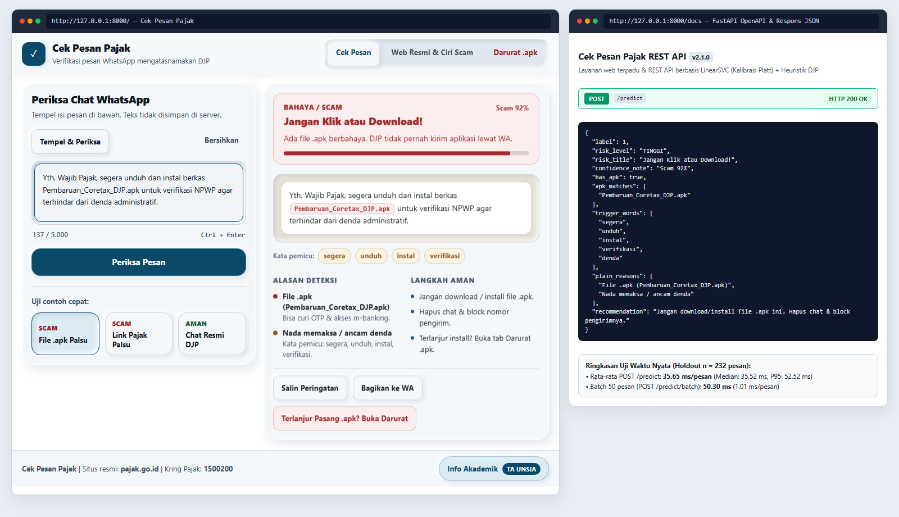

Gambar 4.3 Tangkapan Layar Antarmuka Web *Cek Pesan Pajak* dan Respons API.

Purwarupa memadukan bundel terkalibrasi bersama peladen FastAPI berpagar CORS/CSP dan *rate limiting* yang melayani antarmuka web serta ekstensi pada simulasi dengan latensi *P95* 52,524 ms dan maksimum 62,120 ms di `TestClient` *in-process*. Capaian integrasi tersebut memenuhi indikator **TKT Level 6** menurut Permenristekdikti Nomor 42 Tahun 2016 [25] sebatas demonstrasi simulasi lokal (`/simulasi-wa` dan `TestClient` sekuensial), tanpa mencakup pengukuran jaringan/TLS, DOM `web.whatsapp.com` nyata, uji beban konkuren, maupun *User Acceptance Testing* wajib pajak. Sintesis perbandingan terhadap sepuluh studi terdahulu [6], [7], [9], [10], [11], [13], [15], [16], [17], [19] tercantum pada Tabel L.12.

# BAB V KESIMPULAN

## 5.1 Kesimpulan

Penelitian ini menjawab tiga tujuan pada Subbab 1.4 berdasarkan eksperimen dengan pengacak tetap `random_state=42`. Seluruh temuan bersumber dari korpus kurasi campuran (77,66% SMS umum tahun 2016 serta 22,34% pesan pajak rekonstruksi) dan validasi purwarupa sistem di lingkungan simulasi lokal. Rincian keempat simpulannya tersaji pada butir berikut:

a) Tujuan pertama tercapai lewat 260 pesan pajak berimbang dari 65 sumber publik periode 2021 sampai 2026 (130 *phishing* 12 modus, 130 aman). Penggabungan dengan 904 SMS umum membentuk korpus induk 1.164 baris menjadi 1.159 teks unik. Uji ablatif menetapkan konfigurasi utama menurut rata-rata CV `LinearSVC` (`97,16%`, turun ke 95,81% tanpa token entitas; Sastrawi bergeser 0,0006%). Sebaliknya, *holdout* tunggal tanpa token entitas meraih 97,84% dan CV *Random Forest* tanpa Sastrawi 94,55%.

b) Komparasi menempatkan `LinearSVC` (`C=2.0`) sebagai model pilihan utama dengan *F1-Score* 10-*Fold* CV 97,16% (± 2,41%) versus 94,07% (± 2,92%) pada *Random Forest*, latih 79,36 kali lebih cepat, serta akurasi korpus diperluas 96,03% melawan 92,46%. Pada *holdout* (`n = 232`), akurasi `LinearSVC` Platt (95,69%) tertinggal non-signifikan dari *Random Forest* (96,55%; McNemar p = 0,7266), tetapi unggul kalibrasi *in-domain* (*Brier* 0,02542 vs 0,04214; *Log Loss* 0,09186 vs 0,15870). Pada uji eksternal, *Brier Score* keduanya hampir seri (0,22807 vs 0,22796).

c) Uji kontrol membuktikan peran korpus pajak berimbang dalam menekan salah blokir pesan aman. Pelatihan 712 SMS umum saja hanya memberi akurasi 42,22% untuk `LinearSVC` pada 45 pesan pajak *holdout* (11 dari 21 pesan aman/resmi terblokir) dan 33,33% untuk *Random Forest*. Penambahan korpus pajak mengangkat keduanya ke 95,56% (20 dari 21 pesan aman, terdiri atas 19 siaran DJP dan 2 pesan normal, lolos). Pada *zero-shot* 1.360 pesan eksternal, *Recall* `LinearSVC` 80,28% disertai presisi 40,99% (`FP=416`).

d) Tujuan ketiga terwujud lewat purwarupa terpadu yang memadukan bundel `LinearSVC` Platt, aturan `.apk`, dan daftar putih `pajak.go.id` pada FastAPI, web *Cek Pesan Pajak*, serta ekstensi *WhatsApp Web* (*Manifest V3*). Sebanyak 29 uji Pytest lulus dalam 7,88 detik dengan rerata *in-process* `POST /predict` 35,651 ms (*P95* 52,524 ms; maks. 62,120 ms). Aturan `.apk` menaikkan `idx=960` ke `TINGGI`, sedangkan `idx=1082` turun ke 0,109 di bundel produksi. Sistem memenuhi TKT Level 6 pada simulasi.

## 5.2 Saran

Rekomendasi berikut diturunkan langsung dari keterbatasan nyata pada Bab IV. Keterbatasan tersebut meliputi penurunan presisi lintas korpus, kegagalan fitur leksikal tanpa tautan, serta batas verifikasi pada simulasi lokal. Saran ini ditujukan bagi peneliti lanjutan dan pengelola layanan publik perpajakan. Usulan pengembangan selanjutnya mencakup butir berikut:

a) Pada uji *zero-shot* Tahap 4B, presisi `LinearSVC` turun ke 40,99% (`FP = 416`) akibat pergeseran gaya bahasa antarkorpus dan antarperiode. Korpus latih perlu diperbarui berkala memakai siaran resmi Coretax mutakhir serta pesan penipuan asli aduan warga. Himpunan uji pajak juga perlu diperluas melampaui 45 pesan, disertai normalisasi artefak seperti `nama1` dan `2016`.

b) Galat `idx=314` dan `idx=102` memperlihatkan batas fitur leksikal TF-IDF pada permintaan transfer tanpa tautan maupun `.apk`. Studi lanjutan dapat menguji model kontekstual seperti IndoBERT sambil menjaga latensi di bawah 50 ms. Ambang peluang 0,50 sampai 0,74 juga perlu ditinjau ulang agar kasus `idx=1082` tidak menerima peringatan, di samping menelaah lampiran gambar pada Subbab 1.3.

c) Latensi baru diukur lewat `TestClient` *in-process*, sedangkan ekstensi baru berjalan pada simulasi DOM `/simulasi-wa`. Tahap berikutnya perlu mengukur latensi jaringan nyata, menguji ekstensi pada `web.whatsapp.com`, serta memelihara selektor DOM `content.js`. *User Acceptance Testing* bersama wajib pajak turut dibutuhkan untuk menguji keterbacaan alasan awam menuju TKT Level 7.

# DAFTAR PUSTAKA

[1] Waluyo and N. A. Wijayanti, *Perpajakan Indonesia*, ed. ke-13. Jakarta: Salemba Empat, 2026, ISBN 978-623-181-149-3.

[2] Direktorat Jenderal Pajak, “Penyebarluasan Informasi Mengenai Coretax (Pengumuman Nomor PENG-32/PJ.09/2024),” *Portal Resmi Direktorat Jenderal Pajak Kementerian Keuangan Republik Indonesia*, Nov. 2024. [Online]. Available: https://pajak.go.id/id/pengumuman/penyebarluasan-informasi-mengenai-coretax

[3] N. B. Prakoso, H. Ayu, and H. Zakaria, “Misuse of taxpayer data for phising scams,” *Journal of International Islamic Law, Human Rights, and Public Policy*, vol. 4, no. 3, pp. 1560-1569, Jul. 2026, doi: 10.5281/zenodo.21853029.

[4] R. Alabdan, “Phishing attacks survey: Types, vectors, and technical approaches,” *Future Internet*, vol. 12, no. 10, p. 168, pp. 1-39, Sep. 2020, doi: 10.3390/fi12100168.

[5] Direktorat Jenderal Pajak, “Himpunan pengumuman kewaspadaan penipuan mengatasnamakan Direktorat Jenderal Pajak (PENG-31/PJ.09/2024, PENG-4/PJ.09/2025 yang turut merujuk PENG-1/PJ.09/2025, PENG-29/PJ.09/2025, PENG-50/PJ.09/2025, dan PENG-18/PJ.09/2026),” *Portal Resmi Direktorat Jenderal Pajak Kementerian Keuangan Republik Indonesia*, 2024–2026. [Online]. Available: https://www.pajak.go.id/id/pengumuman

[6] F. Rahmi (dibimbing Y. Wibisono dan R. Megasari), “Aplikasi SMS spam filtering pada Android menggunakan algoritma Naïve Bayes,” Skripsi, Dept. Pendidikan Ilmu Komputer, Universitas Pendidikan Indonesia, Bandung, 2016. [Online]. Available: https://repository.upi.edu/26936/

[7] A. Theodorus, T. K. Prasetyo, R. Hartono, and D. Suhartono, “Short Message Service (SMS) spam filtering using machine learning in Bahasa Indonesia,” in *Proc. 3rd East Indonesia Conf. Comput. Inf. Technol. (EIConCIT)*, Apr. 2021, pp. 199-203, doi: 10.1109/EIConCIT50028.2021.9431859.

[8] D. Irawan, Hamidah, E. B. Perkasa, Yurindra, D. Wahyuningsih, and E. Helmud, “Perbandingan klassifikasi SMS berbasis Support Vector Machine, Naive Bayes Classifier, Random Forest dan Bagging Classifier,” *Jurnal Sisfokom (Sistem Informasi dan Komputer)*, vol. 10, no. 3, pp. 432-437, Dec. 2021, doi: 10.32736/sisfokom.v10i3.1302.

[9] M. S. Al Ghofany, R. Dwiyansaputra, F. Bimantoro, and Khairunnas, “Indonesian SMS spam detection using TF-RF feature weighting method and Support Vector Machine classifier,” in *Proc. First Mandalika Int. Multi-Conf. Sci. Eng. (MIMSE-I-C)*, 2022, pp. 117-129, doi: 10.2991/978-94-6463-084-8_12.

[10] E. Z. Astuti, C. A. Sari, E. H. Rachmawanto, and R. R. Ali, “Comparative study of machine learning algorithms for performing ham or spam classification in SMS,” *Scientific Journal of Informatics*, vol. 11, no. 1, pp. 177-186, Feb. 2024, doi: 10.15294/sji.v11i1.47364.

[11] F. F. Tampinongkol, A. R. Kamila, A. C. Wardhana, A. W. C. Kusuma, and D. Revaldo, “Implementation of Random Forest classification and Support Vector Machine algorithms for phishing link detection,” *Journal of Informatics, Information System, Software Engineering and Applications (INISTA)*, vol. 7, no. 1, pp. 127-137, Nov. 2024, doi: 10.20895/inista.v7i1.1588.

[12] A. Al Tawil, L. Almazaydeh, D. Qawasmeh, B. Qawasmeh, M. Alshinwan, and K. Elleithy, “Comparative analysis of machine learning algorithms for email phishing detection using TF-IDF, Word2Vec, and BERT,” *Computers, Materials & Continua*, vol. 81, no. 2, pp. 3395-3412, Nov. 2024, doi: 10.32604/cmc.2024.057279.

[13] A. A. Ningtias, N. Anwar, A. Ichwani, and R. T. Iswahyudi, “Komparasi kinerja Support Vector Machine dan Random Forest untuk deteksi spam email berbasis TF-IDF teks,” *IKRA-ITH Informatika: Jurnal Komputer dan Informatika*, vol. 10, no. 3, pp. 45-51, Nov. 2026, doi (edisi): 10.37817/ikraith-informatika.v10i3. [Online]. Available: https://journals.upi-yai.ac.id/index.php/ikraith-informatika/article/view/7618

[14] F. M. Efendi, A. K. Adisusilo, and S. Budiprayitno, “Pengembangan sistem deteksi phishing pada WhatsApp berbasis AI dengan integrasi bahasa lokal Surabaya,” *Melek IT Information Technology Journal*, vol. 11, no. 1, pp. 101-112, Jun. 2025, doi: 10.30742/melekitjournal.v11i1.417.

[15] R. B. Saputra, M. Azwar, L. Widyawati, Husain, and K. A. Latif, “Implementasi algoritma SVM pada bot WhatsApp untuk deteksi pesan spam,” *Jurnal Manajemen Informatika dan Sistem Informasi*, vol. 9, no. 1, pp. 39-51, Jan. 2026, doi: 10.36595/misi.v9i1.1803.

[16] M. A. Sembiring, M. F. L. Sibuea, and Anjani, “Optimasi model klasifikasi pesan penipuan digital berbahasa Indonesia menggunakan XGBoost dengan Bayesian Optimization dan SMOTE,” *Journal of Science and Social Research*, vol. 9, no. 3, pp. 5329-5336, Jun. 2026. [Online]. Available: https://jurnal.goretanpena.com/index.php/JSSR/article/view/7212

[17] P. Mishra and A. Yadav, “An explainable and reproducible lightweight machine learning framework for SMS spam detection using TF-IDF and Linear Support Vector Classification,” *International Journal of Advanced Science and Computer Applications*, vol. 5, no. 2, Sep. 2026, doi: 10.47679/ijasca.v5i2.269.

[18] J. Ismail, R. A. Nasution, and M. N. Gea, “Explainable phishing website detection using comparative machine learning and SHAP,” *IDEALIS: Indonesia Journal Information System*, vol. 9, no. 2, pp. 268-277, Jul. 2026, doi: 10.36080/idealis.v9i2.3810.

[19] Suwarno, V. Capricornness, and Y. Christian, “Implementasi machine learning berbasis browser extension untuk deteksi URL phishing menggunakan Logistic Regression classification,” *Komputa: Jurnal Ilmiah Komputer dan Informatika*, vol. 15, no. 1, pp. 23-34, Apr. 2026, doi: 10.34010/komputa.v15i1.18882.

[20] U. Darusalam, M. Ikhwani, C. R. Hassolthine, W. P. Santoso, F. A. S. N. Haq, Y. Aisanafi, and M. N. Ichsan, *Pedoman Teknis Penulisan Tugas Akhir* (Buku Pedoman Penulisan Tugas Akhir SK Rektor Nomor 01 Tahun 2024). Jakarta: Universitas Siber Asia, Apr. 2024.

[21] Sugiyono, *Metode Penelitian Kuantitatif, Kualitatif, dan R&D*, ed. ke-2. Bandung: Alfabeta, 2023.

[22] M. Darwin *et al.*, *Metode Penelitian Pendekatan Kuantitatif*, T. S. Tambunan, Ed. Bandung: CV. Media Sains Indonesia, 2021.

[23] Sugiyono, *Statistika untuk Penelitian*, cet. ke-12, ed. rev. Bandung: Alfabeta, 2007, ISBN 978-979-8433-10-8.

[24] L. P. Sinambela, *Metodologi Penelitian Kuantitatif; Untuk Bidang Ilmu Administrasi, Kebijakan Public, Ekonomi, Sosiologi, Komunikasi dan Ilmu Sosial Lainnya*. Yogyakarta: Graha Ilmu, 2014.

[25] Menteri Riset, Teknologi, dan Pendidikan Tinggi Republik Indonesia, *Peraturan Menteri Riset, Teknologi, dan Pendidikan Tinggi Nomor 42 Tahun 2016 tentang Pengukuran dan Penetapan Tingkat Kesiapterapan Teknologi* (Berita Negara Republik Indonesia Tahun 2016 Nomor 1010). Jakarta: Kementerian Ristekdikti, Jul. 2016.

[26] C. Cortes and V. Vapnik, “Support-vector networks,” *Machine Learning*, vol. 20, no. 3, pp. 273-297, Sep. 1995, doi: 10.1007/BF00994018.

[27] R.-E. Fan, K.-W. Chang, C.-J. Hsieh, X.-R. Wang, and C.-J. Lin, “LIBLINEAR: A library for large linear classification,” *Journal of Machine Learning Research*, vol. 9, pp. 1871-1874, Aug. 2008. [Online]. Available: https://jmlr.org/papers/v9/fan08a.html

[28] F. Pedregosa *et al.*, “Scikit-learn: Machine learning in Python,” *Journal of Machine Learning Research*, vol. 12, pp. 2825-2830, Oct. 2011. [Online]. Available: https://jmlr.org/papers/v12/pedregosa11a.html

[29] J. C. Platt, “Probabilistic outputs for support vector machines and comparisons to regularized likelihood methods,” in *Advances in Large Margin Classifiers*, A. J. Smola, P. Bartlett, B. Schölkopf, and D. Schuurmans, Eds. Cambridge, MA, USA: MIT Press, 2000, pp. 61-74.

[30] H.-T. Lin, C.-J. Lin, and R. C. Weng, “A note on Platt's probabilistic outputs for support vector machines,” *Machine Learning*, vol. 68, no. 3, pp. 267-276, Oct. 2007, doi: 10.1007/s10994-007-5018-6.

[31] L. Breiman, “Random forests,” *Machine Learning*, vol. 45, no. 1, pp. 5-32, Oct. 2001, doi: 10.1023/A:1010933404324.

[32] M. Adriani, J. Asian, B. A. A. Nazief, S. M. M. Tahaghoghi, and H. E. Williams, “Stemming Indonesian: A confix-stripping approach,” *ACM Transactions on Asian Language Information Processing*, vol. 6, no. 4, pp. 1-33, Dec. 2007, doi: 10.1145/1316457.1316459.

[33] G. Salton and C. Buckley, “Term-weighting approaches in automatic text retrieval,” *Information Processing & Management*, vol. 24, no. 5, pp. 513-523, 1988, doi: 10.1016/0306-4573(88)90021-0.

[34] R. Kohavi, “A study of cross-validation and bootstrap for accuracy estimation and model selection,” in *Proc. 14th Int. Joint Conf. Artif. Intell. (IJCAI)*, Montreal, QC, Canada, Aug. 1995, vol. 2, pp. 1137-1143. [Online]. Available: https://www.ijcai.org/Proceedings/95-2/Papers/016.pdf

[35] M. Sokolova and G. Lapalme, “A systematic analysis of performance measures for classification tasks,” *Information Processing & Management*, vol. 45, no. 4, pp. 427-437, Jul. 2009, doi: 10.1016/j.ipm.2009.03.002.

[36] S. C. Saragih, “Indonesian SMS Spam Classifier Dataset,” *GitHub Repository*, 2024. [Online]. Available: https://github.com/Sctian514/Indonesian-sms-spam-classifier (Lisensi MIT).

---

# LAMPIRAN

## Lampiran 1. Matriks Penelitian Terdahulu

Tabel L.1 Matriks Penelitian Terdahulu

| Peneliti dan Tahun            | Objek dan Fitur                                                                                       | Algoritma dan Kinerja                                                                                                                               | Keunggulan serta Kelemahan                                                                                      |
| :---------------------------- | :---------------------------------------------------------------------------------------------------- | :-------------------------------------------------------------------------------------------------------------------------------------------------- | :-------------------------------------------------------------------------------------------------------------- |
| Prakoso dkk. (2026) [3]       | Kajian yuridis-empiris penipuan data wajib pajak *Coretax*, NIK, NPWP, DJP Online, M-Pajak, dan SPT di Indonesia | Analisis kualitatif normatif tanpa eksperimen model klasifikasi ataupun metrik uji kuantitatif                                                      | Memetakan eksploitasi data pajak, tetapi belum membangun detektor teks otomatis                                 |
| Rahmi (2016) [6]               | Korpus SMS Indonesia (1.140 naskah; 1.143 CSV) memakai *Term Frequency* (10-CV)                       | *Multinomial Naïve Bayes* meraih *Accuracy* 94,12% (*spam* vs normal) dan 94,56% (*fraud* vs *promo*)                                               | Merintis korpus publik Indonesia, namun menghapus URL/`.apk` dan tanpa domain pajak                             |
| Theodorus dkk. (2021) [7]     | Korpus 4.125 SMS Indonesia tiga kelas memakai *Bag of Words* 1.500 kata                               | *Random Forest* (*Acc* 94,62%), *LogReg* (94,57%), XGBoost (94,52%), SVM (94,38%)                                                                   | Memperluas korpus pesan Indonesia tanpa fokus *phishing* perpajakan                                             |
| Irawan dkk. (2021) [8]        | 5.571 SMS berbahasa Inggris dari korpus UCI (4.824 *ham*, 747 *spam*) tanpa pemenggalan kata dasar    | *Bagging* (*Performance Score* 97,4%), *Random Forest* (96,8%), *Naïve Bayes* (96,4%), SVM (86,5%)                                                  | Membandingkan empat algoritma pada SMS publik, namun berbahasa Inggris dan SVM tanpa penyetelan                 |
| Al Ghofany dkk. (2022) [9]    | 500 SMS privat Indonesia (325 non-*spam*, 175 *spam*) memakai *stemming* Nazief-Adriani pada TF-IDF & TF-RF (10-*fold* CV × 15 iterasi) | Pada TF-IDF ber-*stemming*: SVM *Sigmoid* (*Acc* 99,60%) dan SVM Linear (99,52%); pada TF-RF: SVM Linear (100%) dan SVM *Sigmoid* (99,96%)         | Membandingkan pembobotan TF-IDF dan TF-RF, namun pada TF-IDF skor *Sigmoid* tanpa *stemming* (99,62%) sedikit lebih tinggi dan belum menguji RF |
| Astuti dkk. (2024) [10]       | 5.572 SMS Inggris korpus UCI (4.825 *ham*, 747 *spam*; tertulis 5.574 di naskah) memakai TF-IDF       | SVC *Sigmoid* (*Acc* 97,93%; *Avg F1-Score* 95%) vs *Random Forest* (*Acc* 97,28%; *Avg F1-Score* 94%)                                              | Menyajikan komparasi metrik pada *dataset* UCI (terdapat selisih cacah uji *support* 1.839 terhadap klaim rasio 70:30), tanpa praproses Indonesia |
| Tampinongkol dkk. (2024) [11] | 59.899 URL (31.544 sah, 28.355 *phishing*) dengan 9 fitur leksikal tautan (pembagian 80:20)           | *Random Forest* (*Acc* 84,95%) vs SVM *default* (77,43%)                                                                                            | Membandingkan RF dan SVM pada tautan, bukan isi rekayasa sosial                                                 |
| Al Tawil dkk. (2024) [12]     | 18.650 surel *phishing* Inggris membandingkan TF-IDF, *Word2Vec*, dan BERT                            | RF TF-IDF (*F1* 0,98; latih 40,39 detik) vs BERT (*F1* 0,99; latih 1.012,66 detik)                                                                  | Mengukur efisiensi waktu TF-IDF, namun tidak menguji SVM                                                        |
| Ningtias dkk. (2026) [13]     | 5.572 pesan SMS Inggris memakai TF-IDF dan optimasi `GridSearchCV`                                    | Linear SVM (*Acc* 98,39%; *F1* 0,9371) vs *Random Forest* (95,96%; *F1* 0,8421)                                                                     | Membuktikan keunggulan Linear SVM pascapenyetelan, tetapi menghapus URL                                         |
| Efendi dkk. (2025) [14]       | *Bot* *WhatsApp* bahasa Indonesia, Jawa, & Surabaya berbasis 3 fitur heuristik (uji 5 pesan)          | Logika *fuzzy* Mamdani dan TSK (skor 0,55–0,83 pada 3 pesan *phishing*; 0,18–0,35 pada 2 pesan aman)                                                | Mendukung dialek daerah *WhatsApp*, namun tanpa pembelajaran terawasi terukur                                   |
| Saputra dkk. (2026) [15]      | 1.320 pesan *WhatsApp* dan SMS Indonesia memakai Sastrawi dan `HashingVectorizer` 5.000 fitur         | Linear SVM (*Acc* 95,45%; *Macro F1* 0,95 pada *split* 80:20)                                                                                       | Menerapkan Sastrawi pada *WhatsApp*, tetapi *hashing* menghilangkan fitur XAI                                   |
| Sembiring dkk. (2026) [16]    | 2.320 pesan penipuan Indonesia dengan token entitas dan TF-IDF kata/karakter                          | MNB (*F1-macro* 0,9693; *Acc* 97,41%), Linear SVM (*Recall* kelas *fraud* 0,9859; *Acc* 96,98%; *F1-macro* 0,9634), dan XGBoost+SMOTE+TPE (*Acc* 96,34%; *F1-macro* 0,9555) | Melestarikan URL/nominal, namun belum menyandikan `.apk` dan ekstensi *WhatsApp*                                |
| Mishra dan Yadav (2026) [17]  | 5.572 SMS berbahasa Inggris memakai pembobotan TF-IDF dan analisis SHAP                               | `LinearSVC` (*Acc* 98,57%; *F1-Score* 94,44%) berbasis kerangka ringan terjelaskan                                                                  | Menghadirkan kerangka `LinearSVC` ringan terjelaskan, namun belum menyasar pesan *WhatsApp* perpajakan          |
| Ismail dkk. (2026) [18]       | 11.430 URL (5.715 *phishing*, 5.715 sah) dengan 87 fitur (leksikal URL, konten halaman, reputasi; *split* 80:20) | XGBoost (*Acc* 96,50%; *F1* 96,51%; *AUC* 0,9943), *Random Forest* (*F1* 96,39%), SVM (*F1* 95,39%) + SHAP                                | Memadukan komparasi enam algoritma dan interpretasi SHAP, tetapi bergantung pada fitur reputasi eksternal       |
| Suwarno dkk. (2026) [19]      | 235.795 URL mentah (235.370 pascapembersihan: 134.850 sah, 100.520 *phishing*) dengan 13 fitur URL & DOM (*split* 80:20) | *Logistic Regression* pada ekstensi *Chrome* (*Acc* 99,53%; *ROC-AUC* 0,9792; latensi 1,40 ms; SUS 81%)                                   | Membuktikan ekstensi peramban *real-time* ramah pengguna (<100 ms), namun berfokus pada URL halaman web         |
| Penelitian Ini (2026)         | *Dataset* induk 1.164 (1.159 unik) & korpus diperluas 2.519 baris unik                                | `LinearSVC` Platt vs *Random Forest* pada TF-IDF (1, 2) + `token_apk`/`token_url`                                                                   | Menguji kendali *keyword bias* domain pajak, interpretasi SHAP, kalibrasi Platt, dan purwarupa ekstensi TKT 6   |

Sumber: Hasil Kajian Pustaka (2026).

## Lampiran 2. Jadwal, Alat, Bahan, dan Definisi Operasional

Tabel L.2 Jadwal Pelaksanaan Penelitian

| Tahap Kegiatan Penelitian                                                                             | Agustus 2026 | September 2026 | Oktober 2026 | November 2026 |
| :---------------------------------------------------------------------------------------------------- | :----------: | :------------: | :----------: | :-----------: |
| Studi literatur, cek kebaruan, dan perumusan proposal                                                 |   Berjalan   |    Selesai     |              |               |
| Pengumpulan sumber DJP serta kurasi *dataset* terverifikasi                                           |              |    Berjalan    |   Selesai    |               |
| Implementasi skrip praproses, TF-IDF, dan eksperimen model                                            |              |                |   Berjalan   |    Selesai    |
| Penyetelan hiperparameter pencarian *grid* 10-*Fold* CV terisolasi, kalibrasi Platt, dan uji ablatif |              |                |   Berjalan   |    Selesai    |
| Perancangan arsitektur purwarupa TKT 6 dan pengujian sistem                                           |              |                |   Berjalan   |    Selesai    |
| Penyusunan laporan lengkap Bab I hingga Bab V dan Lampiran                                            |              |                |   Berjalan   |    Selesai    |

Sumber: Rencana Kerja Penelitian (2026).

Tabel L.3 Spesifikasi Alat dan Bahan Penelitian

| Kategori Komponen               | Nama Komponen / Berkas                            | Spesifikasi dan Peran dalam Penelitian                                                                                         |
| :------------------------------ | :------------------------------------------------ | :----------------------------------------------------------------------------------------------------------------------------- |
| Perangkat Keras                 | Komputer Jinjing Komputasi                        | Prosesor Intel Core i5-12450H, RAM 16 GB, Windows 11 Pro 64-bit                                                                |
| Perangkat Lunak Inti            | Python, Scikit-learn, Sastrawi                    | Python 3.14.7, Scikit-learn 1.9.1 (`LinearSVC`, `RandomForestClassifier`, `CalibratedClassifierCV`), Sastrawi 1.0.1 [28], [32] |
| Perangkat Lunak Pendukung       | Pandas, NumPy, Matplotlib, Seaborn, SHAP, Joblib, Pytest | Pandas 3.1.1, NumPy 2.5.4, Matplotlib 3.11.2, Seaborn 0.13.2, SHAP 0.54.1, Joblib 1.6.0, Pytest 9.2.0                         |
| Rancangan Purwarupa             | FastAPI, Uvicorn, Web Kustom, Ekstensi *Manifest V3* | FastAPI 0.163.1, Uvicorn 0.54.0 (`app/backend/api.py`), Web *Cek Pesan Pajak* (`app/frontend/`), dan Ekstensi *WhatsApp Web* (`app/extension/`) TKT 6 [19], [25] |
| Bahan Korpus SMS Publik         | `Rahmi 2016 Korpus SMS Spam Utama v1.csv`         | 904 SMS Indonesia (335 penipuan, 569 normal); 239 promo disisihkan [6]                                                         |
| Bahan Korpus Pajak              | `Dataset Pajak Terkurasi 260 Baris.csv`           | 260 teks pajak seimbang (130 *phishing*, 110 siaran resmi DJP, 20 normal pajak) dari 65/68 sumber publik 2021–2026 [2], [5]    |
| Bahan Gabungan Induk            | `Dataset Gabungan Utama Biner 1164 Baris.csv`     | Gabungan 904 SMS + 260 teks pajak (1.159 baris unik pasca-Sastrawi), verifikasi SHA-256 [2], [5], [6]                          |
| Bahan Diperluas & Uji Eksternal | `Dataset Gabungan Diperluas Biner 2521 Baris.csv` | Total 2.521 baris (2.519 unik pasca-Sastrawi), terdiri atas 1.159 induk ditambah 1.360 pesan eksternal unik Theodorus dkk. [7] dan Saragih [36] |

Sumber: Dokumentasi Lingkungan Penelitian (2026).

Tabel L.4 Definisi Operasional Variabel dan Parameter Penelitian

| Nama Variabel / Parameter                    | Jenis / Kategori                        | Definisi Operasional, Skala Pengukuran, dan Nilai dalam Eksperimen                                                                                              |
| :------------------------------------------- | :-------------------------------------- | :-------------------------------------------------------------------------------------------------------------------------------------------------------------- |
| Teks Pesan Instan (`Teks` / `teks_sastrawi`) | Variabel Bebas (Vektor Numerik)         | *String* pesan bahasa Indonesia melalui *case folding*, `token_apk`, `token_url`, ekspresi reguler `[^a-z0-9\s_]`, *stopword removal*, dan Sastrawi token alfabetis `len > 2` [32]; `TfidfVectorizer` mempertahankan token minimal dua huruf [28] |
| Label Klasifikasi (`label`)                  | Variabel Terikat (Nominal Biner)        | Kategori nominal biner 1 untuk indikasi *phishing* dan 0 untuk pesan aman/resmi                                                                                 |
| Perlakuan Uji Kontrol Domain Pajak           | Variabel Perlakuan (Nominal Biner)      | Perbandingan pelatihan model tanpa korpus pajak (hanya 712 SMS umum partisi latih) melawan korpus seimbang (927 pesan latih) pada uji kontrol $n = 45$ pesan pajak *holdout* |
| Parameter Ekstraksi TF-IDF                   | Parameter Representasi Fitur            | Pembobotan TF-IDF halus normalisasi *Euclidean* L2 rentang *n-gram* (1, 2) dengan batas fitur 3.000 (skenario ablatif 1.500 dan 5.000) [28], [33]               |
| Parameter `LinearSVC`                        | *Hyperparameter* SVM Linear             | 12 kombinasi pencarian *grid* 10-*Fold* CV terisolasi: `C` {0,1; 0,25; 0,5; 1,0; 2,0; 5,0}, `class_weight` {None, "balanced"}, `max_iter=5000`, `random_state=42` [27], [28] |
| Parameter *Random Forest*                    | *Hyperparameter* Ansambel               | 24 kombinasi pencarian *grid* 10-*Fold* CV terisolasi (total 36 kandidat): `n_estimators` {100, 200, 300}, `max_depth` {None, 30}, `min_samples_split` {2, 5}, `class_weight` {None, "balanced"}, `random_state=42` [28], [31] |
| Parameter Kalibrasi *Platt*                  | Parameter Kalibrasi Probabilitas        | `CalibratedClassifierCV` dengan `method="sigmoid"`, `cv=5` berbasis `Pipeline` yang merata-ratakan peluang lima submodel [28], [29], [30]                      |
| Metrik Evaluasi & Probabilitas               | Variabel Kinerja (Skala Rasio 0 hingga 1) | Diskriminasi dan klasifikasi (*Accuracy*, *Precision*, *Recall*, *F1-Score*, *ROC-AUC*, *PR-AUC*) serta kalibrasi (*Brier Score*, *Log Loss* dengan kliping $\epsilon = 10^{-15}$ eksplisit di `ml/eksperimen_komparasi.py`) [35] |
| Indikator Kesiapan Teknologi & Risiko        | Variabel Kelayakan TKT Level 6          | Integrasi `.joblib` di REST API, web *Cek Pesan Pajak*, dan ekstensi *WhatsApp Web*; latensi <100 ms; daftar putih `pajak.go.id` (kandidat lanjutan `t.kemenkeu.go.id`); kategori risiko TINGGI (`.apk` atau $p \ge 0,75$), SEDANG ($0,50 \le p < 0,75$ atau tautan non-daftar putih), RENDAH, beserta indikator awam [19], [25] |

Sumber: Sintesis Metodologi Penelitian (2026).

## Lampiran 3. Pemetaan Modul Kode, Kontrak API, Matriks Skenario Uji, dan Rancangan Antarmuka

Tabel L.5 Pemetaan Modul Kode Sumber terhadap Tahapan Metodologi Penelitian

| Berkas / Direktori Modul                     | Tahapan Metodologi                 | Peran Teknis dalam Sistem                                                                                             |
| :------------------------------------------- | :--------------------------------- | :-------------------------------------------------------------------------------------------------------------------- |
| `ml/korpus_pajak.py`                         | Kurasi Sumber Perpajakan           | Menyimpan metadata 68 sumber publik, 31 butir katalog IOC/kanal resmi DJP (5 daftar), dan 260 teks pajak             |
| `ml/kurasi_dataset.py`                       | Konstruksi & Provenans             | Membersihkan *boilerplate* DJP, membangun dataset induk 1.164, korpus diperluas 2.521, dan katalog SHA-256            |
| `ml/eksperimen_baseline.py`                  | Praproses & *Baseline*             | Menyediakan `clean_text` Sastrawi enam langkah (`lru_cache` 20.000) dan uji *baseline* 80:20                          |
| `ml/eksperimen_komparasi.py`                 | Penyetelan, Kalibrasi, Evaluasi    | Menjalankan 10-Fold CV, pencarian *grid* terisolasi (`_run_grid_over_folds`), Platt, ablatif, kontrol, SHAP, `.joblib` |
| `ml/benchmark_purwarupa.py`                  | Uji Latensi & Tangkapan Layar      | Menjalankan Pytest otomatis, benchmark latensi `TestClient`, dan merender tangkapan layar serta CSV/JSON hasil         |
| `app/backend/inference.py`                   | Mesin Inferensi Terpadu            | Memuat `.joblib` (`maxsize=4`), menjalankan heuristik `.apk`/79 TLD/`pajak.go.id`, risiko 3 tingkat, dan alasan awam  |
| `app/backend/api.py` & `app/backend/jalankan-server.bat` | Layanan Backend & Web              | Menyajikan web (`/`), simulasi (`/simulasi-wa`), `/health`, `/api/*`, `/predict`, dan `/predict/batch` (API `2.1.0`)  |
| `app/frontend/`                              | Antarmuka Web Pengguna             | Halaman web responsif (`index.html`, `styles.css`, `app.js`, `simulasi_wa.js`) dan modal evaluasi TA                  |
| `app/extension/`                             | Ekstensi *WhatsApp Web*            | Ekstensi *Manifest V3* (`v1.2.0`: `content.js`, `background.js`, `popup.html`) untuk lencana risiko langsung          |
| `tests/`                                     | Verifikasi Otomatis Sistem         | Menjalankan 29 fungsi uji `pytest` atas integritas data, eksperimen model, kontrak API, dan keamanan                  |

Sumber: Dokumentasi Rekayasa Perangkat Lunak Penelitian (2026).

Tabel L.6 Spesifikasi Titik Akhir Layanan Web dan REST API FastAPI (`app/backend/api.py`)

| Metode & Jalur                               | Skema Masukan                                                    | Struktur Keluaran Utama                                                                                                       | Peran dalam Arsitektur                               |
| :------------------------------------------- | :--------------------------------------------------------------- | :---------------------------------------------------------------------------------------------------------------------------- | :--------------------------------------------------- |
| `GET /`                                      | Tanpa badan permintaan                                           | Berkas HTML aplikasi web *Cek Pesan Pajak* (`app/frontend/index.html`)                                                        | Menyajikan aplikasi web utama                        |
| `GET /simulasi-wa`                           | Tanpa badan permintaan                                           | Berkas HTML simulasi *WhatsApp Web* (`app/extension/simulasi_whatsapp_web.html`)                                              | Demo interaktif ekstensi *Manifest V3*               |
| `GET /health`                                | Tanpa badan permintaan                                           | Status `ok`, `models_loaded`, dan `metadata` (HTTP `503` jika bundel absen)                                                   | Pemeriksaan kesiapan layanan web/ekstensi            |
| `GET /api/presets` & `/api/academic-summary` | Tanpa badan permintaan                                           | Tiga prasetel uji, identitas TA, metadata model, benchmark latensi, dan baris `tabel_komparasi_utama.csv`                     | Mengisi tombol contoh cepat dan modal sidang         |
| `POST /predict`                              | JSON `text` (1–5.000 karakter) & `top_k` (1–20; bawaan `8`)      | `label`, `risk_level`, `svm_probability`, `rf_probability`, `plain_reasons`, `highlights`, `trigger_words`, `action_steps`, `inference_ms` (`422`/`429`/`503`) | Inferensi tunggal web dan ekstensi                   |
| `POST /predict/batch`                        | JSON daftar `texts` (1–200 pesan, maks. 100.000 kar.) & `top_k` (bawaan `5`) | Total baris dan hasil per indeks (`422` validasi, `429` batas laju berbobot + `Retry-After`, `503` model absen)               | Pemrosesan pesan massal terbatasi                    |

Sumber: Implementasi Layanan API pada `app/backend/api.py` (2026).

Tabel L.7 Matriks Skenario Pengujian Otomatis Purwarupa dan Integritas Sistem

| Kode Uji  | Berkas / Subjek Pengujian                          | Skenario Masukan & Kondisi Uji                                                  | Keluaran yang Diharapkan                                                |
| :-------- | :------------------------------------------------- | :------------------------------------------------------------------------------ | :---------------------------------------------------------------------- |
| `UJI-01`  | `test_prototipe_api.py` (`GET /health`)            | Permintaan kesiapan peladen API                                                 | HTTP 200 dengan `LinearSVC+Platt` aktif                                 |
| `UJI-02`  | `test_prototipe_api.py` (`POST /predict`)          | Pesan berkas `Coretax_DJP_Update.apk`                                           | Label `1`, `has_apk=True`, risiko `TINGGI`                              |
| `UJI-03`  | `test_prototipe_api.py` (`POST /predict`)          | Tautan palsu `pajak-djp-verifikasi.xyz` beserta jam `17.00`                     | Label `1`, `suspicious_domains` tanpa jam `17.00`                       |
| `UJI-04`  | `test_prototipe_api.py` (`POST /predict`)          | Pengumuman resmi `djponline.pajak.go.id`                                        | Label `0`, risiko `RENDAH`, `official_domains` terisi                   |
| `UJI-05`  | `test_prototipe_api.py` (`is_official_djp_domain`) | Uji pengecoh `pajak.go.id.evil.com` vs domain sah                               | Mengembalikan `False` tiruan, `True` domain sah                         |
| `UJI-06`  | `test_prototipe_api.py` (`POST /predict`)          | Teks spasi kosong                                                               | Ditolak dengan status HTTP 422                                          |
| `UJI-07`  | `test_prototipe_api.py` (`POST /predict/batch`)    | Tiga masukan campuran (`.apk`, spasi, resmi) + teks `5.001` karakter            | HTTP 200 `total=3` (`results[1]` error) & HTTP 422 teks berlebih        |
| `UJI-08`  | `test_prototipe_api.py` (penjaga angka)            | Pesan resmi memuat jam `16.00` dan `Rp1.500.000`                                | `suspicious_domains` kosong, status `RENDAH`                            |
| `UJI-09a` | `test_prototipe_api.py` (`GET /` & pendukung)      | Permintaan web, `/simulasi-wa`, prasetel, ringkasan akademik, & *preflight*     | HTTP 200 beserta *header* keamanan dan identitas TA valid               |
| `UJI-09b` | `test_prototipe_api.py` (*helper* pembatas laju)   | Uji fungsi `_is_rate_limited` pada IP uji vs pengecualian `testclient`          | Membatasi permintaan ke-3 pada batas `2`; `testclient` lolos            |
| `UJI-10`  | `test_integritas_dataset.py` & eksperimen          | Validasi 5 korpus, SHA-256, deduplikasi Sastrawi, Platt, & kontrol (13 fungsi)  | Seluruh 13 pengujian data dan model lulus                               |
| `UJI-11`  | `test_prototipe_api.py` (URL berakhiran `.apk`)    | Tautan `https://.../Coretax_Update.apk`                                         | `has_apk=True`, `suspicious_domains` terisi, risiko `TINGGI`            |
| `UJI-12`  | `test_prototipe_api.py` (*header* CSP)             | Pemeriksaan kebijakan `Content-Security-Policy`                                 | `default-src 'self'`, `script-src 'self'`, `object-src 'none'` aktif    |
| `UJI-13`  | `test_prototipe_api.py` (CORS & *private network*) | *Preflight* dari origin sah (`web.whatsapp.com`, `chrome-extension://`) vs asing| Origin sah mendapat `Access-Control-Allow-Private-Network: true`; asing ditolak |
| `UJI-14`  | `test_prototipe_api.py` (*batch* & paritas)        | *Batch* >100.000 karakter, kuota laju berbobot, serta paritas probabilitas      | HTTP 422 karakter berlebih, HTTP 429 + `Retry-After`, probabilitas sama |
| `UJI-15`  | `test_prototipe_api.py` (ketahanan model absen)    | Permintaan `/health`, `/predict`, `/predict/batch` saat `.joblib` hilang        | HTTP 503 tanpa membocorkan jalur direktori peladen                      |
| `UJI-16`  | `test_prototipe_api.py` (`/api/academic-summary`)  | Verifikasi kelengkapan metadata, tabel evaluasi, dan benchmark latensi          | HTTP 200 dengan metrik benchmark p50 dan rata-rata lengkap              |

Sumber: Implementasi Pengujian Otomatis `pytest` pada Direktori `tests/` (2026).

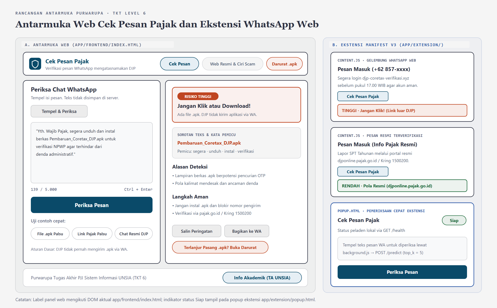

Gambar L.1 Rancangan Antarmuka Web *Cek Pesan Pajak* dan Ekstensi *WhatsApp Web*.

## Lampiran 4. Evaluasi ROC-PR, Studi Ablatif, Bobot Fitur, Analisis Kesalahan, dan Hasil Uji Purwarupa

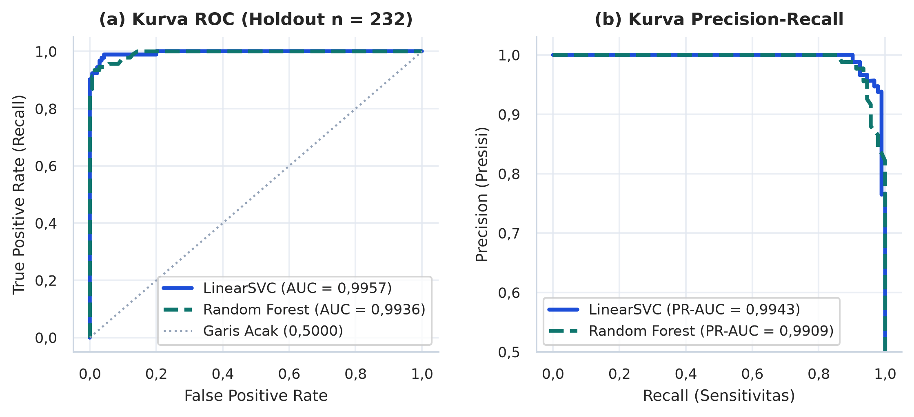

Gambar L.2 Evaluasi Diskriminatif Kurva ROC dan *Precision-Recall*.

Tabel L.8 Hasil Studi Ablatif Praproses dan Representasi Fitur TF-IDF

| Skenario Konfigurasi | Model | CV10 *Accuracy* | CV10 *F1-Score* | *Holdout Accuracy* | *Holdout F1-Score* |
| :--- | :--- | :---: | :---: | :---: | :---: |
| `1_Tanpa_Token_Entitas` | `LinearSVC` / RF | 96,66% / 93,96% | 95,81% / 92,42% | 97,84% / 95,26% | 97,27% / 93,99% |
| `2_Tanpa_Sastrawi` | `LinearSVC` / RF | 97,74% / 95,69% | 97,16% / 94,55% | 96,12% / 96,55% | 95,08% / 95,60% |
| `3_Unigram_Saja` | `LinearSVC` / RF | 96,77% / 95,68% | 95,94% / 94,59% | 96,12% / 96,12% | 95,08% / 95,03% |
| `4_Utama_MaxFeatures_1500` | `LinearSVC` / RF | 97,30% / 95,58% | 96,61% / 94,52% | 96,12% / 96,55% | 95,03% / 95,56% |
| `5_Konfigurasi_Utama_3000` | `LinearSVC` / RF | 97,74% / 95,25% | 97,16% / 94,07% | 96,12% / 96,55% | 94,97% / 95,56% |
| `6_Utama_MaxFeatures_5000` | `LinearSVC` / RF | 97,41% / 94,72% | 96,79% / 93,34% | 96,98% / 96,55% | 96,13% / 95,60% |

Sumber: Hasil Studi Ablatif `05-hasil-evaluasi/csv/studi_ablatif_fitur.csv` (2026).

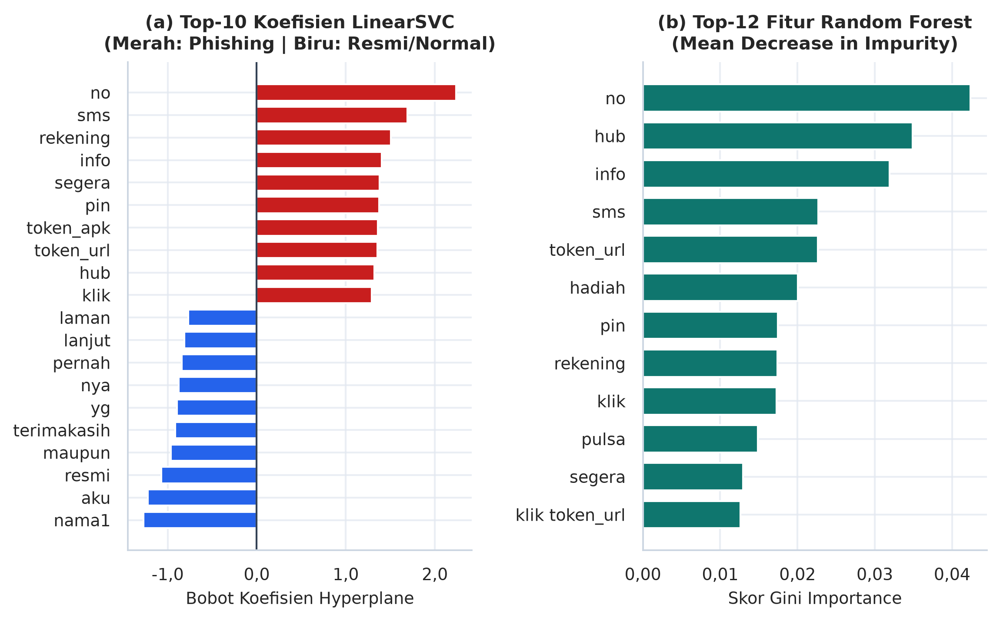

Gambar L.3 Analisis Interpretabilitas Fitur TF-IDF Terbaik.

Tabel L.9 Perbandingan Fitur Teratas `LinearSVC` dan *Random Forest*

| Peringkat | Fitur Positif (`LinearSVC`) | Bobot *w* (+) | Fitur Penahan Resmi/Normal (`LinearSVC`) | Bobot *w* (-) | Fitur Terpenting *Random Forest* | Skor Gini |
| :---: | :--- | :---: | :--- | :---: | :--- | :---: |
| 1 | `no` | +2,2405 | `nama1` | -1,2720 | `no` | 0,0424 |
| 2 | `sms` | +1,6940 | `aku` | -1,2206 | `hub` | 0,0349 |
| 3 | `rekening` | +1,5083 | `resmi` | -1,0706 | `info` | 0,0319 |
| 4 | `info` | +1,4054 | `maupun` | -0,9633 | `sms` | 0,0227 |
| 5 | `segera` | +1,3778 | `terimakasih` | -0,9134 | `token_url` | 0,0226 |
| 6 | `pin` | +1,3729 | `yg` | -0,8942 | `hadiah` | 0,0200 |
| 7 | `token_apk` | +1,3582 | `nya` | -0,8738 | `pin` | 0,0175 |
| 8 | `token_url` | +1,3550 | `pernah` | -0,8417 | `rekening` | 0,0174 |

Sumber: Ekstraksi Bobot Model `05-hasil-evaluasi/csv/fitur_teratas_svm_vs_rf.csv` (2026).

Tabel L.10 Ringkasan Analisis Kesalahan Prediksi pada Himpunan Uji *Holdout*

| Indeks | Sumber dan Kategori | Aktual | Prob. SVM | Prob. RF | Lokasi Galat | Ringkasan Konten dan Penyebab Leksikal |
| :---: | :--- | :---: | :---: | :---: | :--- | :--- |
| 118 | Rahmi (Penipuan) | 1 | 0,566 | 0,420 | RF Saja (FN) | Modus jual rumah mengajak hubungi nomor seluler tanpa kata `hadiah` |
| 50 | Rahmi (Penipuan) | 1 | 0,218 | 0,750 | SVM *Baseline* & Platt (FN) | Tawaran gratis kuota operator dengan banyak angka satuan |
| 491 | Rahmi (Normal) | 0 | 0,543 | 0,170 | SVM *Baseline* & Platt (FP) | Teks amat pendek "Dimulai dari angka 0" tanpa konteks normal |
| 898 | Rahmi (Normal) | 0 | 0,608 | 0,640 | Keduanya (FP) | Pertanyaan singkat "No bri atas nama kamu mana" bermuatan kata `no` |
| 960 | Pajak (`Phishing_APK_MPajak`) | 1 | 0,424 | 0,730 | SVM *Baseline* & Platt (FN) | Gaya surat DJP mengirim `MPajak_Aktivasi_KSWP.apk` tanpa kata spam umum |
| 293 | Rahmi (Penipuan) | 1 | 0,347 | 0,250 | Keduanya (FN) | Notifikasi isi ulang pulsa palsu mirip struk transaksi resmi |
| 1003 | Pajak (`Phishing_Link_NIK_NPWP`) | 1 | 0,787 | 0,340 | RF Saja (FN) | Tautan palsu `form-wajibpajak-djp.com` lolos di RF tetapi tertangkap SVM |
| 52 | Rahmi (Penipuan) | 1 | 0,819 | 0,350 | RF Saja (FN) | Iming-iming bonus internet 5MB bergaya informal |
| 228 | Rahmi (Penipuan) | 1 | 0,494 | 0,610 | SVM *Baseline* & Platt (FN) | Undian *event* bergaya percakapan santai mendekati ambang 0,5 |
| 314 | Rahmi (Penipuan) | 1 | 0,033 | 0,230 | Keduanya (FN) | Instruksi singkat transfer rekening Mandiri tanpa tautan maupun ancaman |
| 102 | Rahmi (Penipuan) | 1 | 0,392 | 0,470 | Keduanya (FN) | Permintaan transfer Mandiri pendek menyerupai pesan keluarga |
| 1082 | Pajak (Pemadanan NIK Resmi) | 0 | 0,551 | 0,600 | Keduanya (FP) | Imbauan resmi ke `www.pajak.go.id` terseret bobot `token_url` dan `login` |
| 165 | Rahmi (Penipuan) | 1 | 0,493 | 0,550 | SVM *Baseline* & Platt (FN) | Tagihan jatuh tempo mengarahkan ke nomor ponsel (p = 0,493) |

Sumber: Analisis Kesalahan `05-hasil-evaluasi/csv/analisis_kesalahan_prediksi.csv` (2026); kolom Indeks mengacu pada indeks baris himpunan unik pasca-deduplikasi Sastrawi (1.159 baris).

Tabel L.11 Hasil Pengujian Fungsional Otomatis dan Latensi Inferensi Purwarupa

| Kode / Metrik | Subjek dan Kondisi Uji | Jumlah Uji / Sampel | Hasil / Waktu Terukur | Status |
| :--- | :--- | :---: | :--- | :---: |
| `UJI-01` | `GET /health` kesiapan FastAPI dan model | 1 | HTTP 200 (`LinearSVC+Platt`) | Lulus (230 ms) |
| `UJI-02` | `POST /predict` berkas `Coretax_DJP_Update.apk` | 1 | Label 1, `has_apk=True`, TINGGI | Lulus (190 ms) |
| `UJI-03` | `POST /predict` domain `pajak-djp-verifikasi.xyz` | 1 | Label 1, tanpa angka 17.00 | Lulus (10 ms) |
| `UJI-04` | `POST /predict` pengumuman `djponline.pajak.go.id` | 1 | Label 0, `official_domains` terisi | Lulus (20 ms) |
| `UJI-05` | `is_official_djp_domain` atas `pajak.go.id.evil.com` | 1 | `False` untuk tiruan | Lulus (<1 ms) |
| `UJI-06` | `POST /predict` masukan spasi kosong | 1 | Ditolak status HTTP 422 | Lulus (<1 ms) |
| `UJI-07` | `POST /predict/batch` 3 masukan & batas 5.000 kar. | 1 | HTTP 200 `total=3` (`results[1]` *error*) & 422 | Lulus (30 ms) |
| `UJI-08` | Penjaga angka pukul 16.00 dan nominal Rp1.500.000 | 1 | `suspicious_domains` kosong, RENDAH | Lulus (30 ms) |
| `UJI-09a` | `GET /`, `/simulasi-wa`, `/api/presets`, `/api/academic-summary` | 1 | HTTP 200 beserta *header* keamanan | Lulus (150 ms) |
| `UJI-09b` | Uji *helper* pembatas laju `_is_rate_limited` vs `testclient` | 1 | Tolak ke-3 pada batas 2; `testclient` lolos | Lulus (<1 ms) |
| `UJI-10` | Suite integritas 5 korpus, SHA-256, Platt, dan `.joblib` | 13 | Seluruh 13 pengujian lulus | Lulus (1.870 ms) |
| `UJI-11` | `POST /predict` tautan berakhiran `.apk` | 1 | `has_apk=True`, `suspicious_domains` terisi | Lulus (30 ms) |
| `UJI-12` | Pemeriksaan *header* `Content-Security-Policy` & izin | 1 | Direktif ketat CSP & `Permissions-Policy` aktif | Lulus (40 ms) |
| `UJI-13` | CORS *allowlist* dan `Access-Control-Allow-Private-Network` | 1 | Origin sah lolos *preflight*; origin asing ditolak | Lulus (30 ms) |
| `UJI-14` | Batas 100.000 kar. *batch*, *rate limit* 429, & paritas | 1 | HTTP 422, HTTP 429 + `Retry-After`, skor sama | Lulus (230 ms) |
| `UJI-15` | Ketahanan HTTP 503 saat bundel `.joblib` absen | 1 | HTTP 503 tanpa membocorkan jalur peladen | Lulus (20 ms) |
| `UJI-16` | Kelengkapan data latensi pada `/api/academic-summary` | 1 | HTTP 200 dengan `direct_p50_ms` hingga `batch_avg_ms` | Lulus (10 ms) |
| `LAT-01` | Latensi lokal `inference.py::predict_message` (*Mean*) | 232 | 14,542 ms/pesan | Memenuhi (<100 ms) |
| `LAT-02` | Latensi lokal `inference.py::predict_message` (*P50/P95/P99*) | 232 | *Median*=14,303 \| *P95*=16,971 \| *P99*=18,680 ms | Memenuhi (<100 ms) |
| `LAT-03` | Latensi REST API `FastAPI POST /predict` (*Mean*) | 232 | 35,651 ms/pesan | Memenuhi (<100 ms) |
| `LAT-04` | Latensi REST API `FastAPI POST /predict` (*P50/P95/P99*) | 232 | *Median*=35,518 \| *P95*=52,524 \| *P99*=56,838 ms | Memenuhi (<100 ms) |
| `LAT-05` | Latensi massal `FastAPI POST /predict/batch` (50 pesan) | 50 | 50,295 ms total (1,006 ms/pesan) | Memenuhi (<100 ms) |

Sumber: Eksekusi `ml/benchmark_purwarupa.py` dan `05-hasil-evaluasi/csv/tabel_pengujian_purwarupa.csv` (2026).

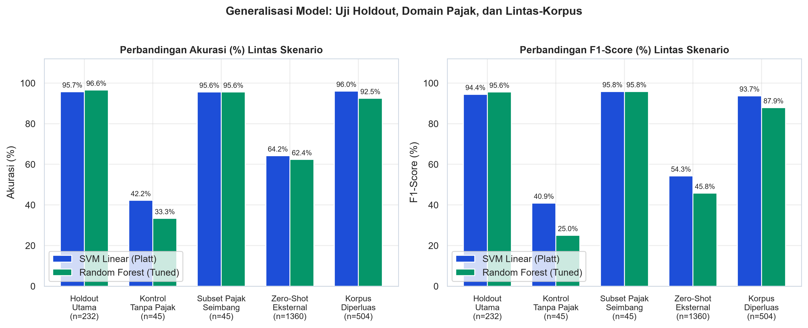

Gambar L.4 Komparasi Generalisasi Lintas Korpus dan Subset Pajak.

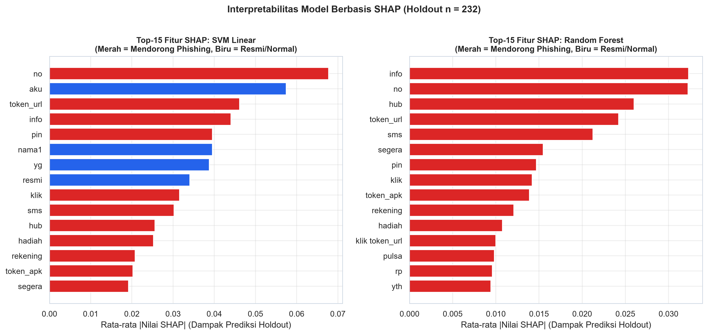

Gambar L.5 Analisis Interpretabilitas Model Berbasis SHAP.

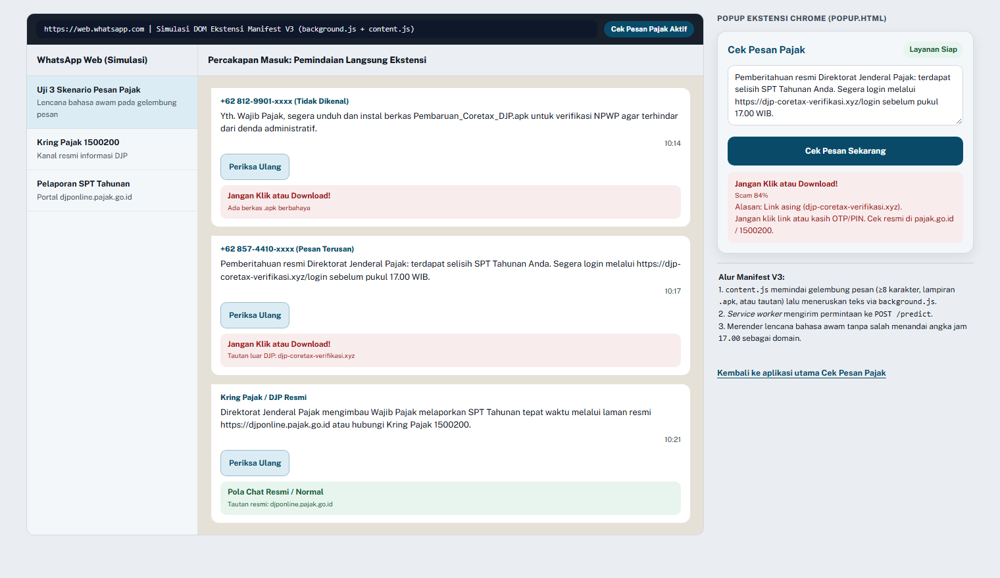

Gambar L.6 Tangkapan Layar Ekstensi Chrome pada Simulasi *WhatsApp Web*.

Tabel L.12 Komparasi Hasil Penelitian terhadap Studi Terdahulu

| Peneliti (Tahun) | Korpus dan Fitur | Model Terbaik dan Kinerja | Kebaruan pada Penelitian Ini |
| :--- | :--- | :--- | :--- |
| Rahmi (2016) [6]; Theodorus dkk. (2021) [7] | 1.140 SMS (TF) & 4.125 SMS Indo (*BoW*) | MNB (*Acc* 94,12% *spam* & 94,56% *fraud*) [6]; RF (94,62% vs SVM 94,38%) [7] | Menambahkan korpus pajak berimbang, pelestarian `.apk`/URL, & uji bias |
| Al Ghofany dkk. (2022) [9]; Astuti dkk. (2024) [10] | 500 SMS Indo & 5.572 SMS Inggris UCI (TF-IDF) | SVM *Sigmoid* (99,60%); SVC *Sigmoid* (97,93%) > RF (97,28%) | Menguji Sastrawi pada korpus pajak publik bersama kalibrasi Platt + SHAP |
| Tampinongkol dkk. (2024) [11]; Ningtias dkk. (2026) [13] | 59.899 URL (9 fitur leksikal) & 5.572 SMS Inggris (TF-IDF) | RF (84,95%) > SVM (77,43%); *Linear* SVM (98,39%) > RF (95,96%) | Memproses teks rekayasa sosial WA pajak sambil menjaga sinyal `.apk`/URL |
| Saputra dkk. (2026) [15]; Sembiring dkk. (2026) [16] | 1.320 pesan WA & SMS (`Hashing`) & 2.320 pesan Indo (TF-IDF) | SVM (*Acc* 95,45%); MNB (*Acc* 97,41%; *F1* 0,9693) & SVM (*Rec* 98,59%) | Menghindari *hashing* agar XAI terbaca, menyandikan `.apk`, & membangun ekstensi |
| Mishra & Yadav (2026) [17]; Suwarno dkk. (2026) [19] | 5.572 SMS Inggris (TF-IDF) [17]; 235.370 URL & DOM [19] | `LinearSVC` XAI (98,57%; *F1* 94,44%) [17]; *LogReg* (99,53%; SUS 81%) [19] | Memadukan XAI, penjaga `pajak.go.id`, web, serta ekstensi WA pajak TKT 6 |
| **Penelitian Ini (2026)** | **1.159 unik (induk) & 2.519 diperluas, TF-IDF `(1, 2)` + Sastrawi** | **`LinearSVC` (CV *Acc* 97,74%, *F1* pajak 98,17%, *Brier* Platt 0,02542)** | **Kontrol bias 42,22% ke 95,56%, SHAP, penjaga `.apk`/domain sah, TKT 6 simulasi (35,65 ms)** |

Sumber: Sintesis Perbandingan Eksperimen dan Literatur (2026).

## Lampiran 5. Daftar Riwayat Hidup Penulis

| Atribut Biodata             | Keterangan Mahasiswa                                                                                                                                  |
| :-------------------------- | :---------------------------------------------------------------------------------------------------------------------------------------------------- |
| Nama Lengkap                | Wan Mirza Dhani                                                                                                                                       |
| Nomor Induk Mahasiswa (NIM) | 240101020194                                                                                                                                          |
| Program Studi               | PJJ Sistem Informasi                                                                                                                                  |
| Fakultas / Universitas      | Universitas Siber Asia (UNSIA)                                                                                                                        |
| Tempat, Tanggal Lahir       | Medan, 22 Maret 1996                                                                                                                                  |
| Domisili                    | Medan, Sumatera Utara                                                                                                                                 |
| Surel Akademik              | wm.dhani@gmail.com                                                                                                                                    |
| Riwayat Pendidikan          | SD Wahidin, SMP Wahidin, SMA Shafiyyatul Amaliyyah, D1 Perpajakan STAN, D3 Perpajakan Universitas Terbuka, S1 Sistem Informasi Universitas Siber Asia |
| Bidang Minat                | Rekayasa Perangkat Lunak, Keamanan Informasi, dan *Natural Language Processing*                                                                       |
