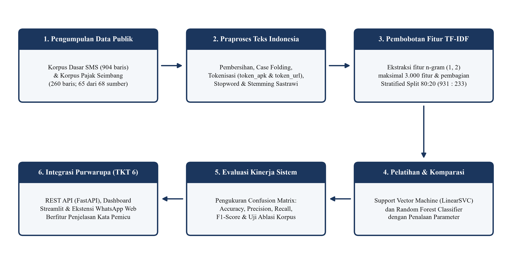

# BAB I PENDAHULUAN

## 1.1 Latar Belakang Masalah

Seiring modernisasi layanan publik, Direktorat Jenderal Pajak (DJP) semakin memperluas komunikasi elektronik dengan pembayar pajak [1]. Langkah ini terlihat dari penerapan Coretax melalui portal daring terpadu `coretaxdjp` dan aplikasi seluler *M-Pajak*. Selain menjadikan NIK berfungsi sebagai NPWP, DJP juga memakai siaran *WhatsApp* resmi untuk menyampaikan pemberitahuan [2]. Kanal ini mempercepat penyebaran imbauan pelaporan pajak tahunan karena informasi langsung sampai kepada masyarakat. Namun, kemudahan tersebut ikut dimanfaatkan pihak yang tidak bertanggung jawab untuk menipu korban.

Kepercayaan masyarakat yang tinggi kepada institusi negara kerap dimanfaatkan untuk penipuan dengan manipulasi psikologis melalui aplikasi pesan singkat [3], [4]. Penelitian ini menelaah 68 arsip publik terverifikasi yang sebagian besar terbit pada 2024 sampai 2026, mencakup pengumuman resmi otoritas pajak, pemberitaan kasus di Kantor Pelayanan Pajak (KPP) dan KP2KP, serta media perpajakan dan situs pemeriksa fakta. Dari arsip tersebut, penulis mengelompokkan dua belas ragam modus penipuan pajak [5]. Pelaku umumnya mengirim berkas instalasi Android berekstensi `.apk` yang disamarkan sebagai pembaruan aplikasi perpajakan resmi. Selain itu, mereka sering menyertakan alamat web palsu seperti `coretax-online` dan lampiran tagihan fiktif agar penerima panik.

Masyarakat umum dan pegawai administrasi keuangan di perusahaan sering kesulitan membedakan siaran asli otoritas pajak dari pesan penipuan [1], [5]. Penipu meniru format surat dinas lengkap dengan nomor regulasinya sehingga pesan tampak meyakinkan. Mereka juga menyisipkan istilah teknis yang biasa dipakai petugas, misalnya kode *billing* pembayaran atau nomor EFIN. Jika filter spam hanya dilatih dengan korpus pesan umum yang tidak diseimbangkan, kata kunci perpajakan tersebut dapat menimbulkan salah prediksi, dan pengumuman sah dari instansi pun ikut terblokir.

Beberapa penelitian terdahulu telah membandingkan algoritma pembelajaran mesin untuk mendeteksi pesan teks berbahaya. Untuk bahasa Indonesia, tersedia korpus SMS berlabel normal, penipuan, dan promo [6]. Pengujian pada kumpulan SMS berbahasa Indonesia memperlihatkan bahwa *Support Vector Machine* dan *Random Forest* dapat mencapai akurasi tinggi dengan representasi kata seperti *bag of words*, TF-IDF, maupun pembobotan TF-RF [7], [8], [9], [10]. Penelitian lain mengkaji deteksi tautan palsu berdasarkan ciri URL [11], deteksi surel *phishing* [12], dan klasifikasi spam berbasis TF-IDF [13]. Adapun studi pada platform WhatsApp baru menyoroti dialek Surabaya [14] dan peladen *bot* [15], sedangkan klasifikasi pesan penipuan digital berbahasa Indonesia secara umum telah diuji dengan XGBoost [16].

Kajian empiris yang secara khusus menyaring penipuan berkedok lembaga pajak masih sangat jarang. Literatur yang tersedia lebih banyak membahas aspek hukum kebocoran data pembayar pajak tanpa membangun sistem klasifikasi otomatis [3]. Celah inilah yang mendasari perbandingan ketepatan *LinearSVC* dan *Random Forest* pada teks penipuan WhatsApp bertema pajak. Penelitian ini menyusun 260 pesan perpajakan berimbang untuk digabungkan dengan 904 pesan umum, dan rancangannya mencakup penyandian `token_apk` bagi berkas instalasi serta `token_url` bagi pranala.

Hasil penelitian ini nantinya diwujudkan sebagai purwarupa aplikasi web interaktif yang dibuat dengan Python dan pustaka Streamlit. Aplikasi dirancang untuk memenuhi standar kesiapan TKT 6 melalui pengujian skenario pesan yang menyerupai kasus nyata [17]. Pengguna cukup menempelkan isi pesan mencurigakan ke halaman antarmuka, lalu sistem menghitung kelas prediksi beserta probabilitas risikonya. Arsitektur mesin klasifikasinya dibuat modular agar mudah dikembangkan menjadi layanan web yang melindungi publik secara lebih luas.

## 1.2 Rumusan Masalah

Modus penipuan digital bertema perpajakan terus berubah, sementara masyarakat memerlukan cara verifikasi awal yang cepat dan dapat diandalkan. Latar belakang di atas memperlihatkan adanya jarak antara kemiripan taktik penipuan dan keterbatasan alat saring konvensional yang tersedia bagi pengguna. Agar perancangan dan pengujian model nantinya terarah, masalah utama penelitian ini dirumuskan menjadi tiga poin berikut:

a) Pesan *phishing* meniru struktur kalimat kedinasan dan menyisipkan istilah perpajakan resmi, sehingga warga sulit memeriksanya secara manual. Akibatnya, jika penerima telanjur memasang berkas berbahaya berekstensi `.apk`, akun dapat dicuri atau korban mengalami kerugian materi.

b) Penyaring spam konvensional yang hanya bertumpu pada korpus SMS umum, tanpa teks resmi pajak, mudah mengalami penyimpangan bobot kata. Ketimpangan data latih itu dapat membuat pengumuman sah dari otoritas terblokir (*false positive*) atau membuat pesan penipuan baru lolos (*false negative*).

c) *Support Vector Machine* memisahkan kelas pada ruang fitur berdimensi tinggi secara linear, sedangkan *Random Forest* bekerja dengan gabungan banyak pohon keputusan. Karena cara kerjanya berbeda, kedua algoritma perlu diuji langsung pada fitur TF-IDF unigram-bigram agar pemilihan model terbaik untuk purwarupa aplikasi web punya dasar yang terukur.

## 1.3 Batasan Masalah

Ruang lingkup penelitian perlu dibatasi dengan jelas agar eksperimen klasifikasi tetap terarah dan tidak melebar ke luar pemrosesan teks. Batasan ini mengatur jenis masukan, sumber korpus, alur praproses, algoritma yang dibandingkan, dan bentuk produk perangkat lunaknya. Enam batasan yang menjadi koridor penelitian Tugas Akhir *Prototype* ini adalah sebagai berikut:

a) Analisis difokuskan pada klasifikasi biner untuk teks pesan instan berbahasa Indonesia, tanpa memproses lampiran gambar atau rekaman suara. Kelas `1` menandai pesan yang terindikasi penipuan, sedangkan kelas `0` menandai pesan normal atau informasi resmi layanan pajak.

b) Bahan penelitian hanya berupa data terbuka yang tersedia untuk umum, tanpa informasi rahasia milik instansi mana pun. Dataset induk berisi 1.164 teks, yaitu 904 pesan SMS publik berbahasa Indonesia berlabel normal dan penipuan [6] serta 260 kutipan teks bertema pajak. Sebanyak 239 pesan promo pada korpus asli (1.143 pesan) tidak diikutsertakan karena penelitian ini berfokus pada klasifikasi biner. Teks bertema pajak dikurasi dari 65 di antara 68 sumber publik yang dihimpun, yang sebagian besar terbit pada 2024 sampai 2026 [2], [5].

c) Pembersihan awal meliputi penghapusan simbol nonalfanumerik, pengubahan teks menjadi huruf kecil, konversi pola `.apk` menjadi `token_apk`, dan penggantian alamat web menjadi `token_url`. Setelah itu, teks melalui penyaringan kata henti, pemotongan imbuhan dengan Sastrawi, dan ekstraksi fitur TF-IDF hingga 3.000 token unigram dan bigram.

d) Eksperimen hanya membandingkan *LinearSVC* dari keluarga *Support Vector Machine* dengan *Random Forest Classifier*. Data dibagi secara acak dengan mempertahankan proporsi kelas (*stratified split*) pada rasio 80:20, sehingga diperoleh 931 data latih dan 233 data uji.

e) Kualitas prediksi dinilai dengan empat indikator dari tabel *Confusion Matrix*, yaitu *Accuracy*, *Precision*, *Recall*, dan *F1-Score*. Pengamatan difokuskan pada algoritma yang lebih konsisten menekan salah prediksi negatif maupun salah blokir terhadap pesan sah.

f) Produk akhir berupa purwarupa aplikasi web yang dibuat dengan Python dan pustaka antarmuka Streamlit untuk memenuhi sasaran TKT 6. Aplikasi menerima teks yang ditempelkan pengguna, kemudian langsung menampilkan status bahaya beserta persentase keyakinan prediksinya.

## 1.4 Tujuan Penelitian

Tujuan penelitian disusun untuk menjawab seluruh rumusan masalah agar eksperimen menghasilkan aplikasi yang akurasinya sudah teruji. Setiap tujuan dinyatakan sebagai tindakan teknis yang keberhasilannya dapat diukur dengan metrik evaluasi pada data uji. Tiga tujuan yang ingin dicapai adalah sebagai berikut:

a) Menyusun dataset teks perpajakan berbahasa Indonesia dengan porsi seimbang antara contoh pesan penipuan dan pengumuman layanan resmi. Dataset itu kemudian diproses dengan tahap praproses khusus dan ekstraksi bobot fitur TF-IDF untuk menangkap pola bahasa yang dipakai penipu.

b) Menguji dan membandingkan kinerja klasifikasi *LinearSVC* dan *Random Forest* berdasarkan akurasi, presisi, *recall*, dan *F1-Score*. Eksperimen ini bertujuan membuktikan kemampuan model mengenali modus penipuan pajak tanpa mengorbankan keandalannya dalam membaca pesan resmi.

c) Merancang purwarupa sistem web pendeteksi pesan penipuan berbasis Streamlit yang memuat model klasifikasi terbaik hasil pengujian. Layanan ini disiapkan agar masyarakat dapat memeriksa pesan mencurigakan secara mandiri lewat perangkat masing-masing.

## 1.5 Manfaat Penelitian

Model klasifikasi dan purwarupa sistem deteksi pesan ini diharapkan memberi manfaat nyata bagi dunia akademik, institusi terkait, dan pembayar pajak. Dataset yang seimbang dan antarmuka uji mandiri dirancang untuk menjawab kebutuhan literasi keamanan digital pada tingkat pengguna akhir. Manfaat penelitian ini dibagi ke dalam tiga aspek berikut:

a) Kontribusi Akademik dan Ilmu Komputer: Menyajikan referensi hasil uji empiris yang terdokumentasi dengan baik tentang kelebihan dan kekurangan *Support Vector Machine* dibandingkan *Random Forest* pada fitur teks pendek. Korpus perpajakan terbuka ini juga dapat dipakai peneliti lain untuk memajukan pemrosesan bahasa alami di Indonesia.

b) Dukungan Teknis bagi Institusi Publik: Menghasilkan temuan pola kalimat dan purwarupa perangkat lunak yang dapat dipertimbangkan DJP maupun pengelola keamanan informasi sebagai pelengkap. Pemetaan dua belas modus penipuan perpajakan ini juga berguna untuk menyusun materi penyuluhan kepada masyarakat yang berbasis bukti lapangan.

c) Kemudahan Proteksi bagi Pembayar Pajak: Menyediakan sarana verifikasi daring yang ringan dan dapat dibuka kapan saja melalui peramban ponsel maupun komputer. Sebelum telanjur mengeklik pranala palsu atau mengunduh berkas `.apk`, masyarakat dapat menilai risiko suatu pesan mencurigakan dengan cepat.

## 1.6 Metode Penelitian

Penelitian ini menggabungkan metode eksperimen kuantitatif dengan alur *Research and Development* (R&D) sesuai ketentuan Tugas Akhir *Prototype* di Universitas Siber Asia [17], [18]. Bahan teks dikumpulkan melalui studi kepustakaan dan pengambilan data terstruktur dari 68 laman otoritatif [19]. Laman-laman tersebut memuat siaran resmi otoritas pajak Indonesia, keterangan pers unit layanan, situs pemeriksa fakta, portal berita perpajakan, dan media nasional [2], [5]. Seluruh sumber berasal dari domain publik tanpa akses ke sistem internal.

Sebanyak 260 catatan teks perpajakan yang diambil dari 65 sumber tersebut dibagi rata menjadi 130 contoh penipuan dari dua belas kategori modus dan 130 contoh pesan sah dari sepuluh kategori, yaitu pengumuman layanan resmi dan percakapan perpajakan yang wajar. Proporsi yang setara ini penting agar model tidak bias terhadap istilah pajak saat berlatih. Korpus pajak tersebut kemudian digabung dengan 904 pesan SMS publik Indonesia sehingga terbentuk dataset gabungan berisi 1.164 baris teks [6]. Rincian komposisinya disajikan pada Tabel 1.1.

Tabel 1.1 Komposisi Korpus Dataset Penelitian

| Sumber Korpus | Asal Pengumpulan | Kategori Phishing | Kategori Aman | Jumlah Total |
| :--- | :--- | :---: | :---: | :---: |
| Kumpulan SMS Publik Indonesia | Repositori Akademik UPI (Rahmi & Wibisono) [6] | 335 | 569 | 904 |
| Kumpulan Teks Khusus Perpajakan | Kurasi 65 dari 68 sumber publik (DJP, media, pemeriksa fakta) [2], [5] | 130 | 130 | 260 |
| Himpunan Data Gabungan Induk | Integrasi Korpus SMS Umum serta Teks Pajak | 465 | 699 | 1.164 |

Sumber: Olahan Data Penelitian (2026).

Praproses teks bahasa Indonesia mencakup penghapusan karakter asing, pengecilan huruf, penyandian `token_apk`, dan penyandian `token_url`. Teks lalu melewati pembuangan kata henti, pengembalian ke kata dasar dengan Sastrawi, dan transformasi menjadi matriks TF-IDF unigram-bigram sebanyak 3.000 kolom [9], [10], [13], sebelum dibagi 80:20 secara terstratifikasi [11]. Pelatihan dan penyetelan parameter dilakukan pada *LinearSVC* dan *Random Forest*. Model yang unggul berdasarkan *Confusion Matrix* kemudian dihubungkan ke antarmuka Streamlit TKT 6. Urutan tahapannya ditunjukkan pada Gambar 1.1.

Gambar 1.1 Tahapan Metode Penelitian.

Matriks bobot TF-IDF memiliki ribuan dimensi dengan sebagian besar nilainya nol (*sparse*), sedangkan SVM dikenal mampu menangani data berdimensi tinggi dengan baik [11]. Berdasarkan hal itu, disusun hipotesis kerja [20], [21] bahwa *LinearSVC* sebagai pemisah linear menghasilkan *Recall* dan *F1-Score* yang lebih baik daripada *Random Forest*. Dugaan tersebut sejalan dengan uji pendahuluan pada 233 data uji: *LinearSVC* memperoleh akurasi 98,28%, *Recall* 0,98, dan *F1-Score* 0,98 dengan hanya dua negatif palsu dan dua positif palsu. Pada data uji yang sama, *Random Forest* mencatat akurasi 95,28%, *Recall* 0,95, dan *F1-Score* 0,94.

---

# DAFTAR PUSTAKA

[1] Waluyo, *Perpajakan Indonesia*, ed. ke-13. Jakarta: Salemba Empat, 2020.

[2] Direktorat Jenderal Pajak, “Penyebarluasan Informasi Mengenai Coretax (Pengumuman Nomor PENG-32/PJ.09/2024),” *Portal Resmi Direktorat Jenderal Pajak Kementerian Keuangan Republik Indonesia*, Nov. 2024. [Online]. Available: https://pajak.go.id/id/pengumuman/penyebarluasan-informasi-mengenai-coretax

[3] N. B. Prakoso, H. Ayu, and H. Zakaria, “Misuse of taxpayer data for phising scams,” *Journal of International Islamic Law, Human Rights, and Public Policy*, vol. 4, no. 3, pp. 1560-1569, Jul. 2026, doi: 10.5281/zenodo.21853029.

[4] R. Alabdan, “Phishing attacks survey: Types, vectors, and technical approaches,” *Future Internet*, vol. 12, no. 10, p. 168, Oct. 2020, doi: 10.3390/fi12100168.

[5] Direktorat Jenderal Pajak, “Waspada penipuan yang mengatasnamakan Direktorat Jenderal Pajak (Pengumuman Nomor PENG-31/PJ.09/2024 s.d. PENG-18/PJ.09/2026),” *Portal Resmi Direktorat Jenderal Pajak Kementerian Keuangan Republik Indonesia*, 2026. [Online]. Available: https://www.pajak.go.id/id/pengumuman/waspada-penipuan-yang-mengatasnamakan-direktorat-jenderal-pajak

[6] F. Rahmi and Y. Wibisono, “Aplikasi SMS spam filtering pada Android menggunakan algoritma Naïve Bayes,” Skripsi, Dept. Pendidikan Ilmu Komputer, Universitas Pendidikan Indonesia, Bandung, 2016. [Online]. Available: https://repository.upi.edu/26936/

[7] A. Theodorus, T. K. Prasetyo, R. Hartono, and D. Suhartono, “Short Message Service (SMS) spam filtering using machine learning in Bahasa Indonesia,” in *Proc. 3rd East Indonesia Conf. Comput. Inf. Technol. (EIConCIT)*, Apr. 2021, pp. 199-203, doi: 10.1109/EIConCIT50028.2021.9431859.

[8] D. Irawan, Hamidah, E. B. Perkasa, Yurindra, D. Wahyuningsih, and E. Helmud, “Perbandingan klassifikasi SMS berbasis Support Vector Machine, Naive Bayes Classifier, Random Forest dan Bagging Classifier,” *Jurnal Sisfokom (Sistem Informasi dan Komputer)*, vol. 10, no. 3, pp. 432-437, Dec. 2021, doi: 10.32736/sisfokom.v10i3.1302.

[9] M. S. Al Ghofany, R. Dwiyansaputra, F. Bimantoro, and Khairunnas, “Indonesian SMS spam detection using TF-RF feature weighting method and Support Vector Machine classifier,” in *Proc. First Mandalika Int. Multi-Conf. Sci. Eng. (MIMSE-I-C)*, 2022, pp. 117-129, doi: 10.2991/978-94-6463-084-8_12.

[10] E. Z. Astuti, C. A. Sari, E. H. Rachmawanto, and R. R. Ali, “Comparative study of machine learning algorithms for performing ham or spam classification in SMS,” *Scientific Journal of Informatics*, vol. 11, no. 1, pp. 177-186, Feb. 2024, doi: 10.15294/sji.v11i1.47364.

[11] F. F. Tampinongkol, A. R. Kamila, A. C. Wardhana, A. W. C. Kusuma, and D. Revaldo, “Implementation of Random Forest classification and Support Vector Machine algorithms for phishing link detection,” *Journal of Informatics Information System Software Engineering and Applications (INISTA)*, vol. 7, no. 1, pp. 127-137, Nov. 2024, doi: 10.20895/inista.v7i1.1588.

[12] A. Al Tawil, L. H. Almazaydeh, D. Qawasmeh, B. Qawasmeh, M. Alshinwan, and K. Elleithy, “Comparative analysis of machine learning algorithms for email phishing detection using TF-IDF, Word2Vec, and BERT,” *Computers, Materials & Continua*, vol. 81, no. 2, pp. 3395-3412, Nov. 2024, doi: 10.32604/cmc.2024.057279.

[13] A. A. Ningtias, N. Anwar, A. Ichwani, and R. T. Iswahyudi, “Komparasi kinerja Support Vector Machine dan Random Forest untuk deteksi spam email berbasis TF-IDF teks,” *IKRA-ITH Informatika: Jurnal Komputer dan Informatika*, vol. 10, no. 3, pp. 45-51, Nov. 2026.

[14] F. M. Efendi, A. K. Adisusilo, and S. Budiprayitno, “Pengembangan sistem deteksi phishing pada WhatsApp berbasis AI dengan integrasi bahasa lokal Surabaya,” *Melek IT Information Technology Journal*, vol. 11, no. 1, pp. 101-112, Jun. 2025, doi: 10.30742/melekitjournal.v11i1.417.

[15] R. B. Saputra, M. Azwar, L. Widyawati, Husain, and K. A. Latif, “Implementasi algoritma SVM pada bot WhatsApp untuk deteksi pesan spam,” *Jurnal Manajemen Informatika dan Sistem Informasi*, vol. 9, no. 1, pp. 39-51, Jan. 2026, doi: 10.36595/misi.v9i1.1803.

[16] M. A. Sembiring, M. F. L. Sibuea, and Anjani, “Optimasi model klasifikasi pesan penipuan digital berbahasa Indonesia menggunakan XGBoost dengan Bayesian Optimization dan SMOTE,” *Journal of Science and Social Research*, vol. 9, no. 3, pp. 5329-5336, Jun. 2026, doi: 10.54314/jssr.v9i3.7212.

[17] C. R. Hassolthine, U. Darusalam, and M. Ikhwani, *Pedoman Teknis Penulisan Tugas Akhir Mahasiswa Universitas Siber Asia (SK Rektor Nomor 01 Tahun 2024)*. Jakarta: Universitas Siber Asia, 2024.

[18] Sugiyono, *Metode Penelitian Kuantitatif, Kualitatif, dan R&D*, ed. ke-2. Bandung: Alfabeta, 2023.

[19] M. Darwin, M. R. Mamondol, S. A. Sormin, and Y. Nurhayati, *Metode Penelitian Pendekatan Kuantitatif*. Bandung: Media Sains Indonesia, 2021.

[20] Sugiyono, *Statistika untuk Penelitian*. Bandung: Alfabeta, 2019.

[21] L. P. Sinambela, *Metodologi Penelitian Kuantitatif: Teoretik dan Praktik*. Depok: Rajawali Pers, 2021.
