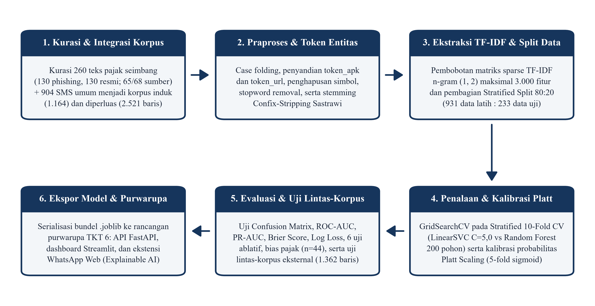

# BAB II LANDASAN METODE

## 2.1 Penelitian Terdahulu dan Matriks Komparasi

Transformasi administrasi perpajakan elektronik mendorong Direktorat Jenderal Pajak memperluas kanal komunikasi digital dengan masyarakat [1]. Pemanfaatan siaran resmi *WhatsApp Blast* untuk sosialisasi sistem inti administrasi perpajakan Coretax mempercepat penyebaran informasi layanan kepada wajib pajak [2]. Namun, celah penyalahgunaan data dan keterbatasan literasi keamanan digital kerap dimanfaatkan pelaku kejahatan siber melalui pesan penipuan [3]. Serangan rekayasa sosial berbasis pesan singkat atau *smishing* memicu kepanikan penerima lewat peniruan identitas resmi [4]. Pelaku umumnya menyebarkan berkas berbahaya berekstensi `.apk` atau tautan tiruan yang menyerupai pengumuman otoritas perpajakan [5].

Sejumlah studi terdahulu telah menguji pembelajaran mesin untuk penyaringan pesan berbahaya di Indonesia maupun internasional. Penelitian rintisan merilis korpus SMS berbahasa Indonesia memakai algoritma *Multinomial Naïve Bayes* dan *Term Frequency* [6], yang kemudian diperluas oleh kajian multi-algoritma berbasis *Bag of Words* [7] serta komparasi *Bagging*, *Random Forest*, dan *Support Vector Machine* [8]. Penerapan *stemming* morfologi bahasa Indonesia bersama TF-IDF meningkatkan ketepatan *Support Vector Machine* pada teks pendek [9], sementara kajian lain membandingkan kinerja *Support Vector Machine*, *Random Forest*, XGBoost, dan *Logistic Regression* [10].

Kajian komparatif *Random Forest* dan *Support Vector Machine* turut dilakukan pada deteksi tautan *phishing* [11], surel berbahasa Inggris dengan perbandingan TF-IDF, *Word2Vec*, dan BERT [12], serta penyetelan parameter *GridSearchCV* pada data SMS [13]. Pada ekosistem pesan instan Indonesia, penelitian terkini mengembangkan bot WhatsApp berbasis logika *fuzzy* [14], peladen bot *Support Vector Machine* dengan *stemming* Sastrawi [15], serta penyandian token entitas untuk pesan penipuan digital [16].

Kajian pendukung juga menelaah klasifikasi SMS berbahasa Indonesia memakai *Support Vector Machine* [17], pembobotan TF-IDF pada teks pendek [18], [19], serta rekayasa fitur *smishing* [20]. Peneliti lain membandingkan algoritma deteksi *phishing* pada surel [21], [22], menyaring penipuan berbahasa Indonesia di media sosial [23], merancang kerangka *LinearSVC* ringan yang dapat dijelaskan [24], menerapkan *Explainable AI* [25], dan membangun ekstensi peramban [26].

Tabel 2.1 Matriks Penelitian Terdahulu

| Peneliti dan Tahun | Objek dan Fitur | Algoritma dan Kinerja | Keunggulan serta Kelemahan |
| :--- | :--- | :--- | :--- |
| Prakoso dkk. (2026) [3] | Kajian yuridis-empiris penipuan data wajib pajak Coretax, NPWP, dan PKP di Indonesia | Analisis kualitatif normatif tanpa eksperimen model klasifikasi ataupun metrik uji kuantitatif | Unggul memetakan rantai eksploitasi data pajak dan regulasi terkait, tetapi belum membangun detektor teks otomatis |
| Rahmi dan Wibisono (2016) [6] | Korpus SMS bahasa Indonesia (1.143 baris rilis) dengan fitur *Term Frequency* dan validasi sepuluh lipatan | Algoritma *Multinomial Naïve Bayes* meraih rata-rata *Accuracy* 94,12% untuk spam dan 94,56% untuk penipuan | Merintis korpus publik SMS Indonesia, namun menghapus URL atau `.apk` dan tidak menguji domain pajak |
| Theodorus dkk. (2021) [7] | Korpus 4.125 SMS berbahasa Indonesia tiga kelas memakai fitur *Bag of Words* sebanyak 1.500 kata | *Random Forest* mencapai *Accuracy* 94,62%, diikuti *Logistic Regression* 94,57%, XGBoost 94,52%, dan SVM 94,38% | Memperluas korpus pesan Indonesia, tetapi masih memakai *Bag of Words* polos tanpa fokus *phishing* perpajakan |
| Al Ghofany dkk. (2022) [9] | Sebanyak 500 SMS privat Indonesia memakai *stemming* Nazief-Adriani serta fitur TF-IDF dan TF-RF | Pada TF-IDF, SVM Sigmoid mencatat *Accuracy* 99,60% dan SVM Linear mencapai 99,52% (10-*fold* CV) | Membuktikan efektivitas *stemming* bahasa Indonesia pada SVM, tetapi belum membandingkan dengan *Random Forest* |
| Astuti dkk. (2024) [10] | Dataset publik 5.574 SMS berbahasa Inggris menggunakan pembobotan TF-IDF dan pembagian 70:30 | SVC Sigmoid meraih *Accuracy* 97,93% dan *F1-Score* 95%, mengungguli *Random Forest* (*F1-Score* 94%) | Menyajikan komparasi multi-algoritma dengan metrik lengkap, namun belum memakai praproses bahasa Indonesia |
| Tampinongkol dkk. (2024) [11] | Dataset 59.899 URL *phishing* dengan ekstraksi sembilan fitur leksikal tautan dan pembagian 80:20 | *Random Forest* mencatat *Accuracy* 84,95% (*F1-Score* 0,8405), sedangkan SVM RBF mencapai 77,43% (*F1-Score* 0,7469) | Membandingkan RF dan SVM pada kasus *phishing* besar, tetapi tidak menganalisis teks rekayasa sosial |
| Al Tawil dkk. (2024) [12] | Sebanyak 18.650 surel *phishing* berbahasa Inggris membandingkan fitur TF-IDF, *Word2Vec*, dan BERT | Fitur TF-IDF pada RF mencatat *F1-Score* 0,98 dalam 40,39 detik, sedangkan BERT meraih 0,99 dengan waktu 1.012,66 detik | Mengukur akurasi sekaligus efisiensi waktu komputasi TF-IDF, namun tidak menguji SVM pada eksperimennya |
| Ningtias dkk. (2026) [13] | Sebanyak 5.572 pesan SMS berbahasa Inggris memakai TF-IDF dan optimasi `GridSearchCV` | Linear SVM mencapai *Accuracy* 98,39% (*F1-Score* 0,9371) mengungguli *Random Forest* (*Accuracy* 95,96%; *F1-Score* 0,8421) | Membuktikan keunggulan Linear SVM atas RF pascapenalaan, tetapi masih menghapus tautan URL saat praproses |
| Efendi dkk. (2025) [14] | Lima sampel pesan uji WhatsApp berbahasa Indonesia serta dialek lokal memakai tiga fitur heuristik | Logika *fuzzy* Mamdani dan TSK menghasilkan skor keyakinan 0,55 hingga 0,83 untuk tiga pesan *phishing* | Merintis integrasi pesan WhatsApp beserta dialek daerah, namun belum memakai pembelajaran terawasi terukur |
| Saputra dkk. (2026) [15] | Sebanyak 1.320 pesan WA dan SMS Indonesia memakai *stemming* Sastrawi serta `HashingVectorizer` 5.000 fitur | Linear SVM meraih *Accuracy* 95,45% dan *Macro F1* 0,95 pada pembagian uji 80:20 melalui peladen bot | Menerapkan praproses Sastrawi pada pesan WhatsApp Indonesia, tetapi `HashingVectorizer` menghilangkan keterjelasan fitur |
| Sembiring dkk. (2026) [16] | Sebanyak 2.320 pesan penipuan Indonesia dengan penyandian token entitas serta TF-IDF kata dan karakter | *Recall* kelas penipuan tertinggi dicapai Linear SVM (0,9859), sedangkan model optimasi XGBoost meraih *Accuracy* 96,34% | Mempertahankan jejak entitas URL dan nominal uang, namun belum menyandikan `.apk` ataupun tema perpajakan |
| Mishra dan Yadav (2026) [24] serta Suwarno dkk. (2026) [26] | Korpus SMS spam berbasis TF-IDF [24] serta deteksi URL *phishing* pada ekstensi peramban [26] | Kerangka `LinearSVC` menghasilkan bobot fitur yang mudah dijelaskan [24], sementara ekstensi peramban mempercepat verifikasi [26] | Menunjukkan kelayakan `LinearSVC` yang *explainable* dan akses langsung di peramban, namun belum terpadu untuk WhatsApp |
| Penelitian Ini (2026) | Dataset induk 1.164 pesan (904 SMS umum ditambah 260 pesan pajak seimbang) dan korpus diperluas 2.521 baris | Komparasi `LinearSVC` berkalibrasi *Platt scaling* dan *Random Forest* pada TF-IDF `(1, 2)` dengan penyandian `token_apk` dan `token_url` | Mengatasi *keyword bias* pajak, menguji ablatif serta lintas-korpus, dan menghasilkan purwarupa ekstensi *WhatsApp Web* TKT 6 |

Sumber: Hasil Kajian Pustaka (2026).

Pemetaan terhadap literatur di atas menyingkap empat celah riset utama, yaitu ketiadaan korpus *phishing* WhatsApp perpajakan yang seimbang, hilangnya sinyal `.apk` atau URL saat pembersihan teks, belum terkalibrasinya probabilitas `LinearSVC` dalam komparasi melawan *Random Forest*, serta minimnya purwarupa ekstensi peramban yang dapat menjelaskan kata pemicu. Rancangan penelitian ini disusun mengikuti pedoman Tugas Akhir *Prototype* Universitas Siber Asia [27] melalui pendekatan eksperimen kuantitatif dan *Research and Development* [28], penataan sumber data publik [29], pengujian statistik komparatif [30], serta pengawasan validitas eksperimen [31].

## 2.2 Landasan Teori dan Metode Khusus

### 2.2.1 Algoritma Support Vector Machine, LinearSVC, dan Kalibrasi Platt

Algoritma *Support Vector Machine* mencari bidang pemisah (*hyperplane*) optimal yang memaksimalkan jarak *margin* antara dua kelas data pada ruang vektor berdimensi tinggi [32]. Untuk teks dengan ribuan fitur *sparse* TF-IDF, implementasi `LinearSVC` memakai pustaka optimasi LIBLINEAR guna menyelesaikan fungsi objektif *soft-margin* L2-*loss* melalui metode *dual coordinate descent* [33]. Kelas target dipetakan ke nilai *y*ᵢ bernilai -1 atau +1, sementara parameter `C` mengatur keseimbangan lebar *margin* dan penalti galat.

**Persamaan (2.1)** *LinearSVC*: min (1/2)||w||² + C ∑ᵢ max(0, 1-yᵢ(wᵀxᵢ+b))²

Keluaran mentah fungsi keputusan `LinearSVC` berupa nilai jarak bertanda *f*(*x*) = *w*ᵀ*x* + *b* terhadap *hyperplane*, bukan probabilitas risiko dalam rentang nol hingga satu. Nilai bobot koefisien *w*ⱼ pada setiap token sekaligus menyediakan transparansi kontribusi kata pemicu penipuan maupun kata penanda pesan resmi. Agar keluaran skor risiko setara dengan model berbasis pohon, skor jarak tersebut dipetakan menjadi probabilitas posterior melalui fungsi logistik sigmoid parametrik *Platt scaling* dengan parameter skalar *A* dan *B* [34].

**Persamaan (2.2)** *Platt Scaling*: P(y=1|f(x)) = 1 / (1 + exp(A·f(x)+B))

### 2.2.2 Algoritma Random Forest

Algoritma *Random Forest* merupakan metode pembelajaran ansambel yang menggabungkan banyak pohon keputusan (*decision tree*) independen untuk meningkatkan stabilitas prediksi dan menekan varians model tunggal [35]. Setiap pohon di dalam hutan dibentuk menggunakan mekanisme *bootstrap aggregating* (*bagging*), yaitu pengambilan sampel acak berulang dengan pengembalian dari himpunan data latih. Pada setiap titik pemecahan simpul, algoritma hanya mengevaluasi subset acak dari keseluruhan fitur guna mengurangi korelasi antar-pohon di dalam ansambel.

**Persamaan (2.3)** Impuritas Gini: Gini(t) = 1 - ∑ₖ p(k|t)²

Pembangunan tiap pohon keputusan mengacu pada penurunan nilai impuritas Gini untuk memilih fitur dan ambang pembatas terbaik di setiap cabang simpul [35]. Pada matriks teks TF-IDF yang berdimensi tiga ribu kolom dan bernilai sangat jarang (*sparse*), pemecahan berbasis ambang batas fitur tunggal sering kurang optimal menangkap kombinasi istilah yang tersebar. Penentuan kelas akhir memakai pemungutan suara mayoritas atau rata-rata peluang seluruh *B* pohon keputusan penyusun hutan secara agregat.

**Persamaan (2.4)** *Random Forest*: P(y=1|x) = (1/B) ∑ᵦ Pᵦ(y=1|x)

### 2.2.3 Praproses Teks Bahasa Indonesia dan Pembobotan Fitur TF-IDF

Representasi teks mentah menjadi vektor numerik terstruktur memerlukan pembobotan istilah *Term Frequency-Inverse Document Frequency* (TF-IDF) yang menggabungkan frekuensi kemunculan lokal token dan kelangkaannya di seluruh korpus [36]. Token yang sering muncul pada sebuah pesan penipuan tetapi jarang ditemukan di pesan normal memperoleh bobot lebih tinggi dibandingkan kosakata umum. Setiap vektor dokumen dinormalisasi dengan norma Euclidean L2 agar panjang pesan WhatsApp yang beragam tidak memengaruhi besaran magnitudo vektor fitur secara berlebihan.

**Persamaan (2.5)** w(t,d) = [tf(t,d)·(ln((1+N)/(1+df(t)))+1)]/||v(d)||₂

Sebelum masuk ke tahap ekstraksi *unigram* dan *bigram*, pesan berbahasa Indonesia melewati rangkaian praproses agar variasi penulisan maupun imbuhan dapat diseragamkan [37]. Tahapan ini meliputi penyeragaman huruf kecil, penyandian pola ekstensi `.apk` menjadi `token_apk` dan tautan web menjadi `token_url` sebelum simbol nonalfanumerik dihapus, serta pembuangan kata henti. Pemotongan imbuhan memakai Sastrawi berbasis algoritma *Confix-Stripping* diterapkan khusus pada kata alfabetik lebih dari dua huruf, sedangkan token khusus dan angka tetap dipertahankan utuh.

### 2.2.4 Validasi Silang Terstratifikasi, Metrik Evaluasi, dan Kesiapterapan Teknologi

Evaluasi keandalan model klasifikasi pada komposisi kelas yang tidak persis seimbang membutuhkan *Stratified K-Fold Cross-Validation* untuk menekan bias sekaligus varians estimasi akurasi [38]. Setiap lipatan membagi data latih dengan proporsi kelas identik sehingga model diuji secara bergantian pada seluruh partisi. Pengukuran mutu prediksi memakai matriks konfusi empat kuadran (*True Positive*, *True Negative*, *False Positive*, dan *False Negative*) untuk menghitung *Accuracy*, *Precision*, *Recall*, serta *F1-Score* secara komprehensif [39].

**Persamaan (2.6a)** *Accuracy*: Acc = (TP + TN) / (TP + TN + FP + FN)

**Persamaan (2.6b)** *Precision*: Prec = TP / (TP + FP)

**Persamaan (2.7a)** *Recall*: Rec = TP / (TP + FN)

**Persamaan (2.7b)** *F1-Score*: F1 = 2·(Prec·Rec) / (Prec + Rec)

Seluruh alur komputasi eksperimen dari ekstraksi fitur, penalaan parameter `GridSearchCV`, hingga pelatihan model dijalankan memakai pustaka Scikit-learn berbasis estimator terpadu [40]. Purwarupa sistem ditargetkan mencapai Tingkat Kesiapan Teknologi (TKT) Level 6 yang mensyaratkan demonstrasi model dan subsistem terintegrasi pada lingkungan operasional yang relevan [41]. Selain akurasi batas keputusan, ketajaman peringkat probabilitas dinilai melalui metrik *ROC-AUC*, *PR-AUC*, *Brier Score*, dan *Log Loss* dengan perbaikan optimasi Newton pada *Platt scaling* untuk mencegah ketidakstabilan numerik [42].

**Persamaan (2.8a)** *Brier Score*: BS = (1/N) ∑ᵢ (pᵢ - yᵢ)²

**Persamaan (2.8b)** *Log Loss*: LL = -(1/N) ∑ᵢ [yᵢlog(pᵢ) + (1-yᵢ)log(1-pᵢ)]

## 2.3 Prosedur Operasional dan Bagan Alir Penelitian

Penelitian ini menggunakan desain eksperimen kuantitatif komparatif yang dipadukan dengan pengembangan purwarupa perangkat lunak berbasis *Research and Development* [27], [28]. Desain eksperimen dibangun di atas asumsi bahwa setiap pesan berdiri sebagai pengamatan independen dalam pembagian data terstratifikasi, informasi klasifikasi direpresentasikan oleh bobot *unigram* dan *bigram* TF-IDF tanpa pemrosesan gambar atau berkas `.apk` secara biner, serta nilai pengacak tetap (`random_state=42`) menjamin replikabilitas hasil [40]. Rangkaian prosedur operasionalnya terbagi menjadi enam tahapan berikut:

a) Tahap kurasi korpus mengumpulkan teks perpajakan publik dari enam puluh lima sumber otoritatif berimbang (masing-masing seratus tiga puluh pesan *phishing* dan resmi), lalu menggabungkannya dengan korpus SMS publik Indonesia menjadi himpunan induk 1.164 baris beserta korpus diperluas 2.521 baris berverifikasi *checksum* SHA-256 [2], [5], [6].

b) Tahap praproses mengubah teks menjadi huruf kecil, menyandikan ekstensi `.apk` ke `token_apk` dan tautan web ke `token_url`, membuang karakter nonalfanumerik, menghapus kata henti, serta menerapkan *stemming* Sastrawi pada kata berimbuhan [37].

c) Tahap ekstraksi fitur membagi data induk secara terstratifikasi dengan rasio 80:20 menjadi 931 data latih dan 233 data uji, kemudian membangun vektor bobot TF-IDF *unigram* dan *bigram* maksimal tiga ribu fitur di atas data latih [36].

d) Tahap penalaan dan kalibrasi menjalankan *GridSearchCV* dengan *Stratified 10-Fold Cross-Validation* terisolasi di tiap lipatan untuk mencari parameter optimal `LinearSVC` dan *Random Forest*, lalu mengkalibrasi skor `LinearSVC` dengan *Platt scaling* lima lipatan [33], [38], [42].

e) Tahap evaluasi lanjutan membandingkan kedua model memakai *Confusion Matrix*, kurva ROC-PR, *Brier Score*, *Log Loss*, enam skenario studi ablatif, uji ketahanan bias kata kunci pada 44 pesan pajak, serta uji generalisasi lintas-korpus pada 1.362 pesan eksternal [39].

f) Tahap pengemasan menyimpan bundel *vectorizer* TF-IDF beserta model terkalibrasi ke format `.joblib` untuk diintegrasikan pada rancangan layanan REST API FastAPI, *dashboard* Streamlit, dan ekstensi *WhatsApp Web* berfitur *Explainable AI* guna memenuhi capaian TKT 6 [24], [26], [41].

Kriteria desain purwarupa menuntut respons klasifikasi waktu nyata, penyajian probabilitas terkalibrasi, sorotan kata pemicu berbasis bobot `LinearSVC`, deteksi pola `.apk`, serta pemeriksaan domain resmi `pajak.go.id` tanpa penyalinan manual [24], [26]. Kesiapan fungsionalitas rancangan sistem tersebut nantinya diuji melalui skenario *black-box* terhadap pesan resmi DJP, pesan penipuan pendek, dan tautan tiruan pada lingkungan relevan [41]. Urutan keterkaitan enam tahapan prosedur eksperimen disajikan pada Gambar 2.1.

Gambar 2.1 Bagan Alir Prosedur Eksperimen.

## 2.4 Waktu dan Lokasi Penelitian

Penelitian Tugas Akhir ini berlangsung selama empat bulan, terhitung sejak Agustus hingga November 2026, mengikuti kalender akademik Program Studi PJJ Sistem Informasi Universitas Siber Asia [27]. Seluruh kegiatan kajian literatur, pengambilan sumber otoritatif publik, eksperimen pemodelan di komputer lokal, hingga penyusunan draf naskah dilaksanakan secara bertahap dan terukur. Pembagian jadwal kerja empat bulan tersebut dirancang untuk memastikan setiap luaran dari kurasi korpus hingga validasi eksperimen dapat diselesaikan tepat waktu sebelum tahap implementasi purwarupa.

Pelaksanaan riset bertempat di Jakarta Selatan sebagai lokasi peneliti dengan koordinasi bimbingan dan pelaporan progres secara daring di lingkungan Universitas Siber Asia. Pengambilan bahan teks perpajakan dilakukan sepenuhnya secara daring terhadap arsip pengumuman publik yang dapat diakses bebas tanpa memasuki jaringan internal instansi mana pun [2], [5]. Rincian alokasi waktu per tahapan kegiatan penelitian selama empat bulan disajikan pada Tabel 2.2.

Tabel 2.2 Jadwal Pelaksanaan Penelitian

| Tahap Kegiatan Penelitian | Agustus 2026 | September 2026 | Oktober 2026 | November 2026 |
| :--- | :---: | :---: | :---: | :---: |
| Studi literatur, cek kebaruan, dan perumusan proposal | Berjalan | Selesai | | |
| Pengumpulan sumber DJP serta kurasi dataset terverifikasi | | Berjalan | Selesai | |
| Implementasi skrip praproses, TF-IDF, dan eksperimen model | | | Berjalan | Selesai |
| Penalaan *GridSearchCV*, kalibrasi Platt, dan uji ablatif | | | Berjalan | Selesai |
| Perancangan arsitektur purwarupa TKT 6 dan pengujian sistem | | | | Berjalan |
| Penyusunan laporan lengkap Bab I hingga Bab V | | | Berjalan | Berjalan |

Sumber: Rencana Kerja Penelitian (2026).

## 2.5 Alat dan Bahan Penelitian

Eksperimen pemodelan bahasa alami dan evaluasi komparatif dijalankan pada satu unit komputer jinjing lokal dengan sistem operasi Microsoft Windows 11 Pro 64-bit, prosesor Intel Core i5-12450H generasi kedua belas, serta memori utama sebesar 16 GB. Konfigurasi perangkat keras tersebut memadai untuk mengeksekusi tiga puluh enam kombinasi pencarian *grid*, validasi silang sepuluh lipatan, studi ablatif enam skenario, serta pengujian lintas-korpus hingga tuntas dalam waktu komputasi terukur sebesar 228,37 detik.

Lingkungan perangkat lunak dibangun di atas bahasa pemrograman Python versi 3.11.9 yang terisolasi dalam pengelola paket terpisah agar pustaka komputasi berjalan konsisten [40]. Pustaka utama mencakup Scikit-learn 1.9.1 untuk algoritma klasifikasi dan metrik, Sastrawi 1.0.1 untuk *stemming* bahasa Indonesia [37], serta Pandas, NumPy, Matplotlib, Joblib, dan Pytest. Bahan penelitian berupa kumpulan korpus teks publik terkurasi beserta rincian spesifikasi seluruh perangkat disajikan pada Tabel 2.3.

Tabel 2.3 Spesifikasi Alat dan Bahan Penelitian

| Kategori Komponen | Nama Komponen / Berkas | Spesifikasi dan Peran dalam Penelitian |
| :--- | :--- | :--- |
| Perangkat Keras | Komputer Jinjing Komputasi | Prosesor Intel Core i5-12450H, RAM 16 GB, sistem operasi Microsoft Windows 11 Pro 64-bit untuk eksperimen lokal |
| Perangkat Lunak Inti | Python, Scikit-learn, Sastrawi | Python 3.11.9, Scikit-learn 1.9.1 (`LinearSVC`, `RandomForestClassifier`, `TfidfVectorizer`, `CalibratedClassifierCV`), Sastrawi 1.0.1 [37], [40] |
| Perangkat Lunak Pendukung | Pandas, NumPy, Matplotlib, Joblib, Pytest | Pandas 3.1.1, NumPy 2.4.6, Matplotlib 3.11.2, Joblib 1.6.0 untuk serialisasi model, serta Pytest 9.2.0 untuk uji integritas |
| Rancangan Purwarupa | FastAPI, Streamlit, Ekstensi Manifest V3 | Rancangan REST API FastAPI, *dashboard* Streamlit 1.67.0, serta ekstensi *WhatsApp Web* TKT 6 [26], [41] |
| Bahan Korpus SMS Publik | `Rahmi 2016 Korpus SMS Spam Utama v1.csv` | Berisi 904 SMS Indonesia (335 penipuan, 569 normal); 239 promo dieksklusi dari 1.143 baris [6] |
| Bahan Korpus Pajak | `Dataset Pajak Terkurasi 260 Baris.csv` | Berisi 260 teks pajak seimbang (130 *phishing*, 130 resmi) dari 65/68 sumber publik [2], [5] |
| Bahan Gabungan Induk | `Dataset Gabungan Utama Biner 1164 Baris.csv` | Gabungan 904 SMS umum dan 260 teks pajak (465 kelas `1`, 699 kelas `0`) berverifikasi SHA-256 |
| Bahan Diperluas dan Uji Eksternal | `Dataset Gabungan Diperluas Biner 2521 Baris.csv` | Korpus 2.521 baris (822 kelas `1`, 1.699 kelas `0`), memuat 1.362 pesan eksternal Theodorus [7] dan Saragih |

Sumber: Dokumentasi Lingkungan Penelitian (2026).

## 2.6 Cara Pengumpulan dan Analisis Data

Pengumpulan bahan penelitian menerapkan studi dokumentasi dan seleksi data publik terverifikasi dari lembaga otoritatif tanpa melibatkan data rahasia wajib pajak [29]. Sebanyak enam puluh lima dari enam puluh delapan arsip resmi DJP, media pajak, dan pemeriksa fakta dipilih menjadi 130 contoh *phishing* dari dua belas modus serta 130 teks resmi dari sepuluh layanan [2], [5]. Tiga sumber berulang dieksklusi untuk menjaga keseimbangan distribusi, lalu 239 pesan promo Rahmi (2016) turut disisihkan agar korpus induk 1.164 baris tetap fokus pada klasifikasi biner [6].

Analisis data komparatif dijalankan secara bertahap dimulai dari pembagian data induk terstratifikasi 80:20 (`random_state=42`) menjadi 931 data latih dan 233 data uji untuk mencegah kebocoran informasi evaluasi [30], [31]. Matriks TF-IDF dibangun ulang secara terisolasi di setiap lipatan *Stratified 10-Fold Cross-Validation* (`shuffle=True`, `random_state=42`) sebelum pencarian *grid* (`GridSearchCV`) mengevaluasi 12 konfigurasi `LinearSVC` (`C` dari 0,1 sampai 5,0; `class_weight`) dan 24 konfigurasi `RandomForestClassifier` (`n_estimators`, `max_depth`, `min_samples_split`, `class_weight`) [38], [40].

Tahap analisis lanjutan menguji kalibrasi *Platt scaling* lima lipatan, enam skenario studi ablatif, serta uji ketahanan bias kata kunci pada 44 sampel pajak di himpunan uji. Generalisasi eksternal diukur memakai uji *zero-shot* pada 1.362 pesan lintas-korpus dari Theodorus dkk. dan Saragih serta uji korpus diperluas 2.521 baris hasil deduplikasi kolom `clean_text` yang menyisihkan lima duplikat internal dan kelas promo [7]. Kualitas keterjelasan model turut dievaluasi melalui bobot fitur teratas `LinearSVC` dan analisis kesalahan prediksi [24], [39].

## 2.7 Definisi Operasional Variabel dan Parameter

Operasionalisasi variabel dan parameter penelitian ditetapkan agar setiap komponen masukan teks, kategori target biner, penyetelan *hyperparameter* algoritma, dan tolok ukur evaluasi memiliki batasan yang dapat diukur secara objektif [29], [30]. Variabel bebas berupa string pesan instan berbahasa Indonesia yang ditransformasikan menjadi fitur TF-IDF berdimensi hingga tiga ribu kolom, sedangkan variabel terikat berupa label biner kelas `1` untuk indikasi *phishing* dan kelas `0` untuk pesan aman atau resmi.

Parameter algoritma meliputi besaran penalti margin `C` dan pembobotan kelas pada `LinearSVC`, jumlah pohon, kedalaman maksimum, serta batas pemecahan simpul pada *Random Forest*, serta metode kalibrasi sigmoid lima lipatan pada *Platt scaling* [33], [35], [42]. Tolok ukur capaian sistem mencakup metrik klasifikasi diskrit, ketajaman peringkat probabilitas, galat kalibrasi, serta demonstrasi purwarupa fungsional pada lingkungan relevan TKT Level 6 [39], [41]. Ringkasan lengkap definisi operasional variabel dan parameter tersebut disajikan pada Tabel 2.4.

Tabel 2.4 Definisi Operasional Variabel dan Parameter Penelitian

| Nama Variabel / Parameter | Jenis / Kategori | Definisi Operasional dan Nilai dalam Eksperimen |
| :--- | :--- | :--- |
| Teks Pesan Instan (`Teks` / `teks_sastrawi`) | Variabel Bebas (Masukan) | String pesan teks berbahasa Indonesia yang dipraproses menjadi huruf kecil, `token_apk`, `token_url`, serta bentuk dasar Sastrawi [37] |
| Label Klasifikasi (`label`) | Variabel Terikat (Target Biner) | Kategori biner bernilai `1` untuk indikasi *phishing* dan bernilai `0` untuk pesan aman atau resmi |
| Parameter Ekstraksi TF-IDF | Parameter Representasi Fitur | Pembobotan TF-IDF berrentang `ngram_range` `(1, 2)` dengan batas `max_features` utama `3.000` (diuji ablatif pada `1.500` dan `5.000`) [36] |
| Parameter `LinearSVC` | *Hyperparameter* SVM Linear | Ruang pencarian `C` dalam `{0,1; 0,25; 0,5; 1,0; 2,0; 5,0}`, `class_weight` dalam `{None, "balanced"}`, dan `max_iter=5000` [33], [40] |
| Parameter *Random Forest* | *Hyperparameter* Ansambel Pohon | Ruang pencarian `n_estimators` dalam `{100, 200, 300}`, `max_depth` dalam `{None, 30}`, `min_samples_split` dalam `{2, 5}`, dan `class_weight` [35] |
| Parameter Kalibrasi *Platt* | Parameter Kalibrasi Probabilitas | Wrapper `CalibratedClassifierCV` memakai `method="sigmoid"` dengan `cv=5` untuk mengonversi skor keputusan `LinearSVC` ke probabilitas [34], [42] |
| Metrik Evaluasi Klasifikasi | Variabel Kinerja Utama | Pengukuran *Accuracy*, *Precision*, *Recall*, *F1-Score*, *ROC-AUC*, *PR-AUC*, *Brier Score*, dan *Log Loss* [38], [39] |
| Indikator Kesiapan Teknologi (TKT) | Variabel Kelayakan Purwarupa | Capaian TKT 6 melalui bundel `.joblib` pada REST API, Streamlit, dan ekstensi *WhatsApp Web* [41] |

Sumber: Sintesis Metodologi Penelitian (2026).

---

# DAFTAR PUSTAKA

[1] Waluyo, *Perpajakan Indonesia*, ed. ke-13. Jakarta: Salemba Empat, 2020.

[2] Direktorat Jenderal Pajak, “Penyebarluasan Informasi Mengenai Coretax (Pengumuman Nomor PENG-32/PJ.09/2024),” *Portal Resmi Direktorat Jenderal Pajak Kementerian Keuangan Republik Indonesia*, Nov. 2024. [Online]. Available: https://pajak.go.id/id/pengumuman/penyebarluasan-informasi-mengenai-coretax

[3] N. B. Prakoso, H. Ayu, and H. Zakaria, “Misuse of taxpayer data for phising scams,” *Journal of International Islamic Law, Human Rights, and Public Policy*, vol. 4, no. 3, pp. 1560-1569, Jul. 2026, doi: 10.5281/zenodo.21853029.

[4] R. Alabdan, “Phishing attacks survey: Types, vectors, and technical approaches,” *Future Internet*, vol. 12, no. 10, p. 168, Oct. 2020, doi: 10.3390/fi12100168.

[5] Direktorat Jenderal Pajak, “Waspada penipuan yang mengatasnamakan Direktorat Jenderal Pajak (Pengumuman Nomor PENG-31/PJ.09/2024 s.d. PENG-18/PJ.09/2026),” *Portal Resmi Direktorat Jenderal Pajak Kementerian Keuangan Republik Indonesia*, 2026. [Online]. Available: https://www.pajak.go.id/id/pengumuman/waspada-penipuan-yang-mengatasnamakan-direktorat-jenderal-pajak

[6] F. Rahmi and Y. Wibisono, “Aplikasi SMS spam filtering pada Android menggunakan algoritma Naïve Bayes,” Skripsi, Dept. Pendidikan Ilmu Komputer, Universitas Pendidikan Indonesia, Bandung, 2016. [Online]. Available: https://repository.upi.edu/26936/

[7] A. Theodorus, T. K. Prasetyo, R. Hartono, and D. Suhartono, “Short Message Service (SMS) spam filtering using machine learning in Bahasa Indonesia,” in *Proc. 3rd East Indonesia Conf. Comput. Inf. Technol. (EIConCIT)*, Apr. 2021, pp. 199-203, doi: 10.1109/EIConCIT50028.2021.9431859.

[8] D. Irawan, Hamidah, E. B. Perkasa, Yurindra, D. Wahyuningsih, and E. Helmud, “Perbandingan klassifikasi SMS berbasis Support Vector Machine, Naive Bayes Classifier, Random Forest dan Bagging Classifier,” *Jurnal Sisfokom (Sistem Informasi dan Komputer)*, vol. 10, no. 3, pp. 432-437, Dec. 2021, doi: 10.32736/sisfokom.v10i3.1302.

[9] M. S. Al Ghofany, R. Dwiyansaputra, F. Bimantoro, and Khairunnas, “Indonesian SMS spam detection using TF-RF feature weighting method and Support Vector Machine classifier,” in *Proc. First Mandalika Int. Multi-Conf. Sci. Eng. (MIMSE-I-C)*, 2022, pp. 117-129, doi: 10.2991/978-94-6463-084-8_12.

[10] E. Z. Astuti, C. A. Sari, E. H. Rachmawanto, and R. R. Ali, “Comparative study of machine learning algorithms for performing ham or spam classification in SMS,” *Scientific Journal of Informatics*, vol. 11, no. 1, pp. 177-186, Feb. 2024, doi: 10.15294/sji.v11i1.47364.

[11] F. F. Tampinongkol, A. R. Kamila, A. C. Wardhana, A. W. C. Kusuma, and D. Revaldo, “Implementation of Random Forest classification and Support Vector Machine algorithms for phishing link detection,” *Journal of Informatics Information System Software Engineering and Applications (INISTA)*, vol. 7, no. 1, pp. 127-137, Nov. 2024, doi: 10.20895/inista.v7i1.1588.

[12] A. Al Tawil, L. H. Almazaydeh, D. Qawasmeh, B. Qawasmeh, M. Alshinwan, and K. Elleithy, “Comparative analysis of machine learning algorithms for email phishing detection using TF-IDF, Word2Vec, and BERT,” *Computers, Materials & Continua*, vol. 81, no. 2, pp. 3395-3412, Nov. 2024, doi: 10.32604/cmc.2024.057279.

[13] A. A. Ningtias, N. Anwar, A. Ichwani, and R. T. Iswahyudi, “Komparasi kinerja Support Vector Machine dan Random Forest untuk deteksi spam email berbasis TF-IDF teks,” *IKRA-ITH Informatika: Jurnal Komputer dan Informatika*, vol. 10, no. 3, pp. 45-51, Nov. 2026.

[14] F. M. Efendi, A. K. Adisusilo, and S. Budiprayitno, “Pengembangan sistem deteksi phishing pada WhatsApp berbasis AI dengan integrasi bahasa lokal Surabaya,” *Melek IT Information Technology Journal*, vol. 11, no. 1, pp. 101-112, Jun. 2025, doi: 10.30742/melekitjournal.v11i1.417.

[15] R. B. Saputra, M. Azwar, L. Widyawati, Husain, and K. A. Latif, “Implementasi algoritma SVM pada bot WhatsApp untuk deteksi pesan spam,” *Jurnal Manajemen Informatika dan Sistem Informasi*, vol. 9, no. 1, pp. 39-51, Jan. 2026, doi: 10.36595/misi.v9i1.1803.

[16] M. A. Sembiring, M. F. L. Sibuea, and Anjani, “Optimasi model klasifikasi pesan penipuan digital berbahasa Indonesia menggunakan XGBoost dengan Bayesian Optimization dan SMOTE,” *Journal of Science and Social Research*, vol. 9, no. 3, pp. 5329-5336, Jun. 2026, doi: 10.54314/jssr.v9i3.7212.

[17] A. Setiyono and H. F. Pardede, “Klasifikasi SMS spam menggunakan Support Vector Machine,” *Jurnal Pilar Nusa Mandiri*, vol. 15, no. 2, pp. 275-280, Sep. 2019, doi: 10.33480/pilar.v15i2.693.

[18] N. J. Saputra, “Analysis of SMS spam detection using TF-IDF: A study on SMS Spam Collection dataset,” *Jurnal Sosial Teknologi*, vol. 4, no. 4, pp. 213-217, Apr. 2024, doi: 10.59188/jurnalsostech.v4i4.1214.

[19] H. Ahammad, M. Samsuzzaman, M. H. Rashid, and M. A. Masud, “Comparative analysis of machine learning algorithms for spam SMS classification using TF-IDF vectorization,” in *Proc. IEEE Int. Conf. Future Mach. Learn. Data Sci. (FMLDS)*, Nov. 2025, pp. 736-741, doi: 10.1109/fmlds67896.2025.00123.

[20] S. K. Birthriya, P. Ahlawat, and A. K. Jain, “Machine learning-based smishing detection using fuzzy logic and TF-IDF feature engineering,” *Franklin Open*, vol. 14, p. 100506, Mar. 2026, doi: 10.1016/j.fraope.2026.100506.

[21] R. Fauzan, A. V. Vitianingsih, D. Cahyono, A. L. Maukar, and Y. A. B. Suprio, “Penerapan algoritma klasifikasi pada machine learning untuk deteksi phishing,” *MALCOM: Indonesian Journal of Machine Learning and Computer Science*, vol. 5, no. 2, pp. 531-540, Mar. 2025, doi: 10.57152/malcom.v5i2.1968.

[22] I. P. Sari, O. K. Sulaiman, D. Apdilah, and P. Simanjuntak, “Analisis komparatif Support Vector Machine dan Random Forest untuk deteksi email phishing,” *Applied Information Technology and Computer Science (AICOMS)*, vol. 4, no. 2, pp. 18-27, Nov. 2025, doi: 10.58466/aicoms.v4i2.1806.

[23] I. K. Izzah, I. Riadi, and A. Fadlil, “Analisis kinerja machine learning untuk deteksi konten penipuan berbahasa Indonesia di Twitter,” *Rabit: Jurnal Teknologi dan Sistem Informasi Univrab*, vol. 11, no. 1, pp. 725-742, Jan. 2026, doi: 10.36341/rabit.v11i1.7124.

[24] P. Mishra and A. Yadav, “An explainable and reproducible lightweight machine learning framework for SMS spam detection using TF-IDF and Linear Support Vector Classification,” *International Journal of Advanced Science and Computer Applications*, vol. 5, no. 2, Sep. 2026, doi: 10.47679/ijasca.v5i2.269.

[25] J. Ismail, R. A. Nasution, and M. N. Gea, “Deteksi phishing URL menggunakan XGBoost dengan Explainable AI pada Web Page Phishing Detection dataset,” *IDEALIS: InDonEsiA journaL Information System*, vol. 9, no. 2, pp. 268-277, Jul. 2026, doi: 10.36080/idealis.v9i2.3810.

[26] Suwarno, V. Capricornness, and Y. Christian, “Implementasi machine learning berbasis browser extension untuk deteksi URL phishing menggunakan Logistic Regression classification,” *Komputa: Jurnal Ilmiah Komputer dan Informatika*, vol. 15, no. 1, May 2026, doi: 10.34010/komputa.v15i1.18882.

[27] C. R. Hassolthine, U. Darusalam, and M. Ikhwani, *Pedoman Teknis Penulisan Tugas Akhir Mahasiswa Universitas Siber Asia (SK Rektor Nomor 01 Tahun 2024)*. Jakarta: Universitas Siber Asia, 2024.

[28] Sugiyono, *Metode Penelitian Kuantitatif, Kualitatif, dan R&D*, ed. ke-2. Bandung: Alfabeta, 2023.

[29] M. Darwin, M. R. Mamondol, S. A. Sormin, and Y. Nurhayati, *Metode Penelitian Pendekatan Kuantitatif*. Bandung: Media Sains Indonesia, 2021.

[30] Sugiyono, *Statistika untuk Penelitian*. Bandung: Alfabeta, 2019.

[31] L. P. Sinambela, *Metodologi Penelitian Kuantitatif: Teoretik dan Praktik*. Depok: Rajawali Pers, 2021.

[32] C. Cortes and V. Vapnik, “Support-vector networks,” *Machine Learning*, vol. 20, no. 3, pp. 273-297, Sep. 1995, doi: 10.1007/BF00994018.

[33] R.-E. Fan, K.-W. Chang, C.-J. Hsieh, X.-R. Wang, and C.-J. Lin, “LIBLINEAR: A library for large linear classification,” *Journal of Machine Learning Research*, vol. 9, pp. 1871-1874, Aug. 2008. [Online]. Available: https://jmlr.org/papers/v9/fan08a.html

[34] J. C. Platt, “Probabilistic outputs for support vector machines and comparisons to regularized likelihood methods,” in *Advances in Large Margin Classifiers*, A. J. Smola, P. Bartlett, B. Schölkopf, and D. Schuurmans, Eds. Cambridge, MA, USA: MIT Press, 2000, pp. 61-74.

[35] L. Breiman, “Random forests,” *Machine Learning*, vol. 45, no. 1, pp. 5-32, Oct. 2001, doi: 10.1023/A:1010933404324.

[36] G. Salton and C. Buckley, “Term-weighting approaches in automatic text retrieval,” *Information Processing & Management*, vol. 24, no. 5, pp. 513-523, 1988, doi: 10.1016/0306-4573(88)90021-0.

[37] M. Adriani, J. Asian, B. A. A. Nazief, S. M. M. Tahaghoghi, and H. E. Williams, “Stemming Indonesian: A confix-stripping approach,” *ACM Transactions on Asian Language Information Processing*, vol. 6, no. 4, pp. 1-33, Dec. 2007, doi: 10.1145/1316457.1316459.

[38] R. Kohavi, “A study of cross-validation and bootstrap for accuracy estimation and model selection,” in *Proc. 14th Int. Joint Conf. Artif. Intell. (IJCAI)*, Montreal, QC, Canada, Aug. 1995, vol. 2, pp. 1137-1143. [Online]. Available: https://www.ijcai.org/Proceedings/95-2/Papers/016.pdf

[39] M. Sokolova and G. Lapalme, “A systematic analysis of performance measures for classification tasks,” *Information Processing & Management*, vol. 45, no. 4, pp. 427-437, Jul. 2009, doi: 10.1016/j.ipm.2009.03.002.

[40] F. Pedregosa *et al.*, “Scikit-learn: Machine Learning in Python,” *Journal of Machine Learning Research*, vol. 12, pp. 2825-2830, Oct. 2011. [Online]. Available: https://jmlr.org/papers/v12/pedregosa11a.html

[41] Menteri Riset, Teknologi, dan Pendidikan Tinggi Republik Indonesia, *Peraturan Menteri Riset, Teknologi, dan Pendidikan Tinggi Nomor 42 Tahun 2016 tentang Pengukuran dan Penetapan Tingkat Kesiapterapan Teknologi* (Berita Negara Republik Indonesia Tahun 2016 Nomor 1010). Jakarta: Kementerian Ristekdikti, Jul. 2016.

[42] H.-T. Lin, C.-J. Lin, and R. C. Weng, “A note on Platt's probabilistic outputs for support vector machines,” *Machine Learning*, vol. 68, no. 3, pp. 267-276, Aug. 2007, doi: 10.1007/s10994-007-5018-6.
