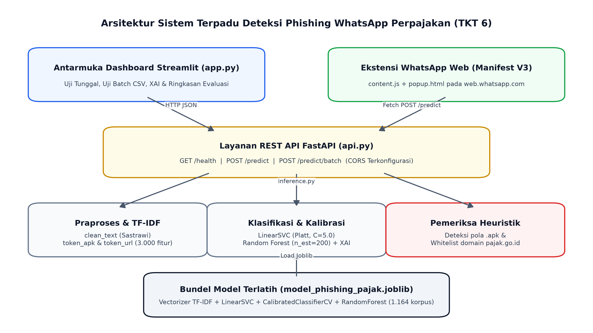
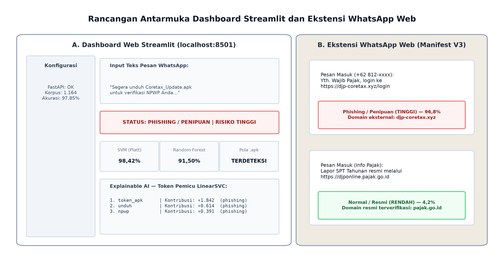

# BAB III IMPLEMENTASI METODE USULAN

## 3.1 Arsitektur Implementasi Metode Usulan

Implementasi metode usulan pada penelitian ini menerjemahkan kerangka teoretis dan prosedur operasional pada Bab II ke dalam sistem perangkat lunak yang dapat direplikasi secara penuh. Seluruh rangkaian pemrosesan dibangun menggunakan bahasa pemrograman Python 3.11.9 dengan pembagian modul yang terpisah antara kurasi korpus, pelatihan model, dan layanan inferensi purwarupa [40]. Pemisahan modul tersebut menjamin bahwa transformasi teks yang diterapkan saat pelatihan identik dengan transformasi saat pesan baru diperiksa oleh pengguna akhir.

Alur kerja sistem terbagi menjadi dua jalur utama, yakni jalur pelatihan luring untuk menghasilkan bundel model terkalibrasi dan jalur inferensi daring untuk melayani pemeriksaan pesan secara langsung. Pada jalur luring, data mentah dari korpus SMS publik dan korpus perpajakan dikurasi, dibersihkan, lalu diekstraksi menjadi vektor TF-IDF berdimensi tiga ribu fitur unigram dan bigram [6], [36]. Jalur daring kemudian memuat bundel model yang telah diserialisasi ke dalam layanan *REST API* berbasis FastAPI agar dapat diakses oleh *dashboard* web Streamlit maupun ekstensi peramban *WhatsApp Web* [26].

**Gambar 3.1 Arsitektur Sistem Terpadu Deteksi *Phishing* WhatsApp Perpajakan.**

Seperti diperlihatkan pada Gambar 3.1, arsitektur terpadu memusatkan seluruh logika klasifikasi dan pemeriksaan heuristik pada satu modul inferensi bersama bernama `inference.py`. Pendekatan terpusat tersebut mencegah duplikasi aturan praproses antara antarmuka web Streamlit dan ekstensi peramban *Manifest V3*. Apabila layanan FastAPI sedang tidak aktif pada perangkat lokal, *dashboard* Streamlit tetap dapat beralih secara otomatis ke mode cadangan lokal melalui pemanggilan langsung modul `inference.py`.

## 3.2 Implementasi Kurasi Korpus dan Praproses Teks

Tahap awal implementasi berfokus pada penyusunan dataset biner yang bersih, berimbang secara kontekstual, dan memiliki jejak asal data yang dapat diaudit. Modul `src/korpus_pajak.py` menghimpun dua ratus enam puluh kutipan teks bertema perpajakan yang terdiri atas seratus tiga puluh pesan penipuan dan seratus tiga puluh pengumuman resmi Direktorat Jenderal Pajak [2], [5]. Selanjutnya, modul `src/kurasi_dataset.py` menggabungkan korpus perpajakan tersebut dengan sembilan ratus empat pesan SMS berbahasa Indonesia dari korpus Rahmi [6], setelah mengeksklusi dua ratus tiga puluh sembilan pesan promo.

Penggabungan kedua sumber data menghasilkan korpus induk sebanyak seribu seratus enam puluh empat baris yang terbagi menjadi empat ratus enam puluh lima pesan kelas penipuan dan enam ratus sembilan puluh sembilan pesan kelas normal. Untuk memastikan keutuhan berkas selama eksperimen berulang, setiap berkas data olahan diverifikasi menggunakan nilai *hash* kriptografis SHA-256 yang tercatat pada katalog provenans. Selain korpus induk, disiapkan pula korpus uji perluasan sebanyak dua ribu lima ratus dua puluh satu baris yang memuat tambahan data eksternal dari korpus Theodorus dan Saragih guna menguji ketahanan model lintas sumber [7].

Setiap teks mentah yang masuk ke jalur pelatihan maupun inferensi melewati fungsi pembersihan terpadu `clean_text` di dalam modul `src/eksperimen_baseline.py`. Proses pembersihan dijalankan secara berurutan agar pola teknis khas penipuan WhatsApp tidak hilang sebelum tahap pembobotan kata dilakukan. Urutan transformasi teks pada fungsi `clean_text` dirinci sebagai berikut:

a) Seluruh karakter huruf diubah menjadi huruf kecil (*case folding*) dan pola tautan situs web diganti menjadi token khusus `token_url` sebelum penghapusan tanda baca dijalankan.

b) Pola nama berkas aplikasi Android yang diakhiri ekstensi `.apk` dideteksi menggunakan ekspresi reguler lalu dikonversi menjadi token seragam `token_apk` agar variasi nama file tetap tertangkap sebagai satu sinyal ancaman.

c) Karakter selain huruf, angka, dan spasi dibersihkan, kemudian kata henti (*stopword*) umum bahasa Indonesia disaring menggunakan kamus Sastrawi kecuali kata yang berpotensi membawa konteks kehati-hatian.

d) Setiap kata dasar diekstraksi menggunakan algoritma *stemming* Nazief-Adriani pada pustaka Sastrawi 1.0.1 sebelum diumpankan ke vektorisasi TF-IDF dengan batas maksimum tiga ribu fitur unigram dan bigram [36], [37].

Pembagian data latih dan data uji diterapkan secara terstratifikasi dengan rasio delapan puluh berbanding dua puluh menggunakan `random_state` bernilai empat puluh dua. Strategi tersebut menghasilkan sembilan ratus tiga puluh satu data latih dan dua ratus tiga puluh tiga data uji dengan proporsi kelas yang seragam di kedua himpunan. Seluruh pembobotan TF-IDF hanya dihitung (*fit*) pada himpunan data latih untuk mencegah kebocoran informasi statistik dari data uji ke dalam proses pelatihan.

## 3.3 Implementasi Pelatihan Model, Penyetelan Hiperparameter, dan Kalibrasi

Tahap pemodelan diimplementasikan di dalam modul `src/eksperimen_komparasi.py` untuk membandingkan kinerja `LinearSVC` dan `RandomForestClassifier` secara adil pada kondisi dasar maupun setelah penyetelan hiperparameter [33], [35], [40]. Pada tahap dasar, kedua algoritma dilatih dengan parameter bawaan Scikit-learn serta dievaluasi menggunakan validasi silang sepuluh lipatan terstratifikasi (*Stratified 10-Fold Cross-Validation*) pada sembilan ratus tiga puluh satu data latih [38]. Evaluasi lipatan berganda tersebut bertujuan memantau kestabilan akurasi, presisi, *recall*, dan *F1-Score* sebelum model diuji pada data uji tetap.

Pencarian kombinasi hiperparameter optimal dilaksanakan melalui metode `GridSearchCV` sepuluh lipatan dengan metrik sasaran *F1-Score*. Sebanyak tiga puluh enam konfigurasi parameter diuji pada ruang pencarian untuk menemukan keseimbangan terbaik antara kemampuan generalisasi dan pencegahan *overfitting*. Rincian ruang pencarian serta konfigurasi optimal yang terpilih untuk masing-masing algoritma dirangkum pada Tabel 3.1.

Tabel 3.1 Konfigurasi Ruang Pencarian Hiperparameter dan Parameter Terpilih

| Algoritma Klasifikasi | Ruang Pencarian Parameter (`GridSearchCV`) | Konfigurasi Terpilih |
| :--- | :--- | :--- |
| `LinearSVC` | `C`: `0.1, 0.5, 1.0, 2.0, 5.0, 10.0`; `class_weight`: `None, balanced` | `C=5.0`, `class_weight=None` |
| `RandomForestClassifier` | `n_estimators`: `100, 200, 300`; `max_depth`: `None, 20, 40`; `min_samples_split`: `2, 5`; `class_weight`: `None, balanced` | `n_estimators=200`, `max_depth=None`, `min_samples_split=5`, `class_weight=None` |

Sumber: Hasil Eksekusi `GridSearchCV` Modul `eksperimen_komparasi.py` (2026).

Keluaran mentah `LinearSVC` berupa jarak terhadap *hyperplane* pemisah yang tidak langsung merepresentasikan peluang probabilitas kelas [33]. Agar purwarupa dapat menampilkan tingkat keyakinan persentase risiko yang terkalibrasi secara statistik, diterapkan metode kalibrasi sigmoid Platt melalui `CalibratedClassifierCV` lima lipatan pada model `LinearSVC` terpilih [34], [42]. Kualitas kalibrasi probabilitas kemudian diukur menggunakan metrik *Brier Score* dan *Log Loss* untuk memastikan peluang keluaran selaras dengan frekuensi empiris pesan penipuan.

Model final beserta vektorizer TF-IDF dilatih ulang pada keseluruhan seribu seratus enam puluh empat baris korpus induk menggunakan konfigurasi hiperparameter terbaik, lalu diserialisasi ke dalam berkas `06 Prototipe Aplikasi/model_phishing_pajak.joblib` melalui pustaka Joblib dengan tingkat kompresi tiga. Bundel serialisasi tersebut menyimpan empat objek inti, yakni `vectorizer`, `svm_linear` untuk ekstraksi bobot fitur *explainable AI*, `svm_calibrated` untuk prediksi probabilitas Platt, dan `random_forest` sebagai pembanding langsung. Penyimpanan metadata pelatihan di dalam bundel memudahkan verifikasi versi model saat layanan API dijalankan.

## 3.4 Implementasi Purwarupa Sistem Terpadu Tingkat Kesiapan Teknologi 6

Purwarupa sistem dikembangkan untuk memenuhi indikator Tingkat Kesiapan Teknologi enam sesuai Peraturan Menteri Riset, Teknologi, dan Pendidikan Tinggi Nomor 42 Tahun 2016, yaitu demonstrasi prototipe dalam lingkungan simulasi yang relevan [41]. Seluruh komponen aplikasi ditempatkan di dalam direktori `06 Prototipe Aplikasi/` dan dibagi menjadi empat artefak terstruktur. Pembagian artefak tersebut memastikan antarmuka pengguna, layanan antarmuka pemrograman aplikasi, serta ekstensi peramban tetap ringan dan mudah dipelihara.

Lapisan inti inferensi diwujudkan pada berkas `inference.py` yang menggabungkan klasifikasi pembelajaran mesin dengan dua lapis pemeriksaan heuristik domain perpajakan. Pemeriksaan lapis pertama mendeteksi keberadaan nama berkas berekstensi `.apk` pada teks mentah karena Direktorat Jenderal Pajak tidak pernah mendistribusikan aplikasi resmi melalui lampiran WhatsApp [5]. Pemeriksaan lapis kedua mengekstrak seluruh alamat tautan dari pesan lalu memverifikasi apakah nama domain berakhir tepat pada `pajak.go.id` atau subdomain resminya guna mencegah manipulasi domain tiruan seperti `pajak.go.id.evil.com`.

Di atas modul inferensi, dibangun layanan *REST API* menggunakan FastAPI pada berkas `api.py` dengan dukungan kebijakan *Cross-Origin Resource Sharing* untuk asal permintaan lokal dan ekstensi peramban. Layanan API tersebut menyediakan tiga titik akhir (*endpoint*) utama yang melayani pemeriksaan kesiapan sistem maupun inferensi teks secara tunggal ataupun berkelompok. Spesifikasi teknis ketiga titik akhir layanan API dirangkum pada Tabel 3.2.

Tabel 3.2 Spesifikasi Titik Akhir Layanan REST API FastAPI (`api.py`)

| Metode & Jalur | Parameter Masukan | Keluaran Utama | Fungsi dalam Sistem |
| :--- | :--- | :--- | :--- |
| `GET /health` | Tanpa parameter | Status `ok`, daftar model, metadata korpus | Memverifikasi kesiapan layanan dan bundel Joblib |
| `POST /predict` | JSON `text` (1–5.000 karakter) dan `top_k` | Label, tingkat risiko, probabilitas SVM & RF, heuristik `.apk`/domain, token pemicu XAI | Klasifikasi pesan tunggal untuk Streamlit dan Ekstensi WA Web |
| `POST /predict/batch` | JSON daftar `texts` (maksimum 200 pesan) | Daftar hasil prediksi terindeks per baris | Pemrosesan massal berkas CSV pada *dashboard* web |

Sumber: Dokumentasi Perancangan Purwarupa `06 Prototipe Aplikasi/api.py` (2026).

Fitur penjelasan keputusan (*explainable AI*) dihitung pada setiap permintaan `POST /predict` dengan mengalikan bobot TF-IDF kata pada pesan masukan terhadap koefisien vektor `LinearSVC` terlatih [24]. Token dengan nilai kontribusi absolut terbesar ditampilkan kepada pengguna beserta arah dukungannya terhadap kelas *phishing* atau kelas resmi. Transparansi kata pemicu tersebut membantu pengguna memahami alasan teknis di balik status peringatan yang muncul pada layar.

Antarmuka pengguna berbasis web dibangun menggunakan Streamlit 1.67.0 pada berkas `app.py` dengan tiga tab fungsional, yakni uji pesan tunggal, uji *batch* berkas CSV, dan ringkasan metrik evaluasi model. Untuk mempercepat demonstrasi pengujian, disediakan pula tiga tombol contoh pesan siap pakai yang mencakup skenario *phishing* berkas `.apk`, skenario tautan domain tiruan, serta pengumuman resmi `djponline.pajak.go.id`. Sementara itu, ekstensi peramban Chrome berarsitektur *Manifest V3* ditempatkan di direktori `extension/` dengan berkas `manifest.json`, `content.js`, `styles.css`, `popup.html`, dan `popup.js`.

**Gambar 3.2 Rancangan Antarmuka *Dashboard* Streamlit dan Ekstensi *WhatsApp Web*.**

Skrip `content.js` pada ekstensi bekerja mengamati kemunculan gelembung pesan masuk di halaman `web.whatsapp.com` melalui `MutationObserver`, lalu menyisipkan tombol pemeriksaan langsung di bawah teks pesan. Saat tombol ditekan, ekstensi mengirimkan isi pesan ke titik akhir `http://127.0.0.1:8000/predict` dan menampilkan lencana warna tingkat risiko (`RENDAH`, `SEDANG`, atau `TINGGI`) beserta ringkasan kata pemicu. Rancangan visual kedua antarmuka purwarupa tersebut disajikan secara berdampingan pada Gambar 3.2.

## 3.5 Skenario Pengujian Sistem dan Kesiapan Evaluasi

Sebelum hasil kinerja dibahas secara mendalam pada Bab IV, ditetapkan serangkaian skenario pengujian fungsional dan evaluasi empiris untuk memastikan seluruh komponen bekerja sesuai rancangan. Pengujian otomatis diimplementasikan menggunakan pustaka Pytest pada direktori `tests/` yang mencakup berkas `test_integritas_dataset.py`, `test_eksperimen_baseline.py`, `test_eksperimen_komparasi.py`, dan `test_prototipe_api.py`. Pendekatan pengujian terotomasi menjamin bahwa perubahan kode tidak merusak keutuhan data latih maupun logika verifikasi domain resmi.

Pengujian fungsional *black-box* terhadap layanan API dan aturan heuristik difokuskan pada enam kasus uji utama yang mewakili kondisi operasional di lapangan. Setiap kasus uji dirancang untuk memvalidasi respons model terhadap pesan penipuan eksplisit, manipulasi domain mirip situs resmi, pengumuman sah pemerintah, hingga penolakan masukan kosong. Rincian skenario pengujian fungsional purwarupa dipaparkan pada Tabel 3.3.

Tabel 3.3 Matriks Skenario Pengujian Fungsional Purwarupa (`test_prototipe_api.py`)

| Kode Uji | Skenario Masukan | Perilaku yang Diharapkan | Status Validasi |
| :--- | :--- | :--- | :--- |
| `UJI-01` | Permintaan `GET /health` | Status HTTP 200 dengan daftar model `LinearSVC+Platt` dan `RandomForest` aktif | Terverifikasi Lulus |
| `UJI-02` | Pesan *phishing* memuat pola `.apk` | Label `1`, `has_apk=True`, tingkat risiko `TINGGI`, token pemicu XAI terisi | Terverifikasi Lulus |
| `UJI-03` | Pesan *phishing* tautan domain palsu | Label `1`, domain eksternal tercatat pada `suspicious_domains` | Terverifikasi Lulus |
| `UJI-04` | Pengumuman resmi `djponline.pajak.go.id` | Label `0`, domain tercatat pada `official_domains`, `suspicious_domains` kosong | Terverifikasi Lulus |
| `UJI-05` | Uji domain tiruan `pajak.go.id.evil.com` | Fungsi `is_official_djp_domain` mengembalikan nilai `False` | Terverifikasi Lulus |
| `UJI-06` | Masukan teks kosong atau spasi | API menolak permintaan dengan kode status HTTP 422 (*Unprocessable Entity*) | Terverifikasi Lulus |

Sumber: Hasil Pengujian Otomatis `pytest` Modul `tests/test_prototipe_api.py` (2026).

Selain pengujian fungsional antarmuka, kesiapan evaluasi model juga dilengkapi dengan enam skenario studi ablatif pada `eksperimen_komparasi.py` untuk mengukur kontribusi token khusus, *stemming* Sastrawi, dan fitur *bigram*. Pengujian ketahanan lintas korpus disiapkan pula menggunakan korpus perluasan dua ribu lima ratus dua puluh satu baris serta uji khusus dua ratus enam puluh teks perpajakan. Seluruh keluaran numerik, matriks konfusi, kurva *ROC* dan *Precision-Recall*, serta analisis kesalahan prediksi siap dikaji lebih lanjut pada Bab IV.
