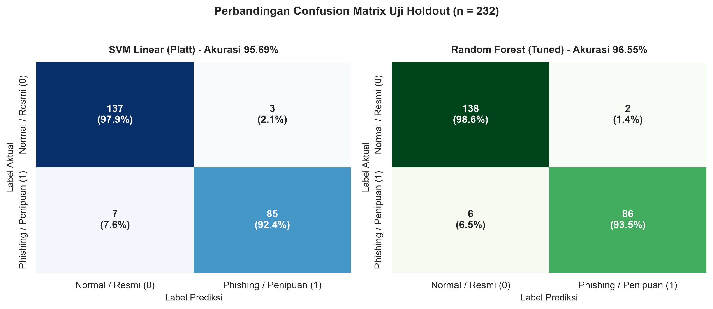
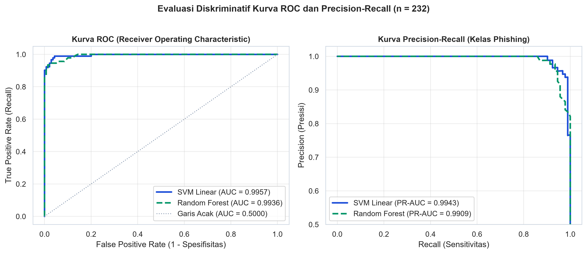
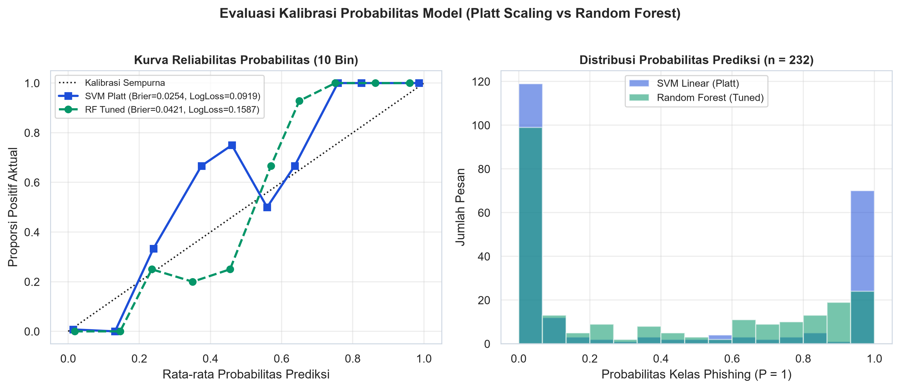
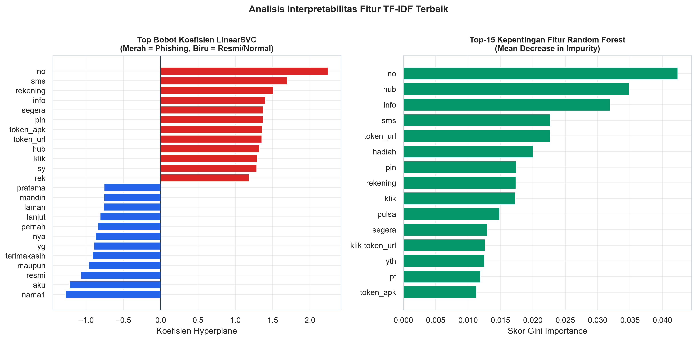
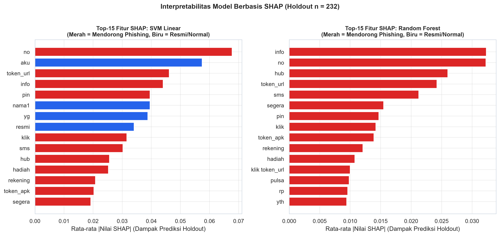
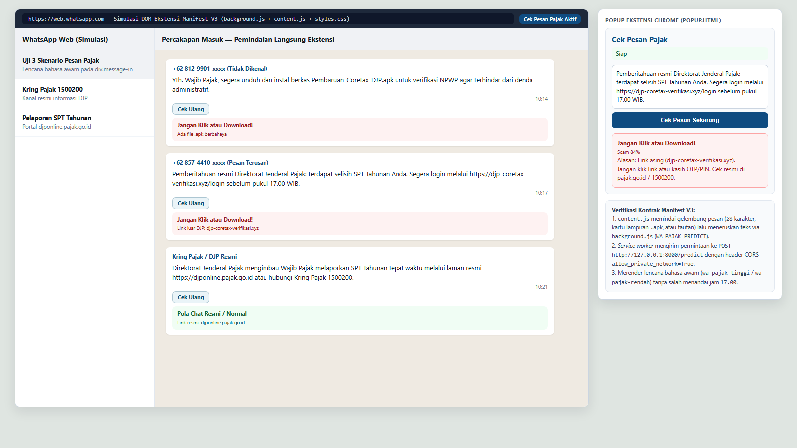

# BAB IV HASIL DAN ANALISA

## 4.1 Hasil Eksperimen Komparasi Klasifikasi dan Penyetelan Hiperparameter

Seluruh rangkaian eksperimen komparatif dieksekusi secara otomatis oleh skrip `src/eksperimen_komparasi.py` dengan pengacak tetap `random_state=42` selama 193,47 detik. Deduplikasi lima baris identik hasil Sastrawi pada korpus induk 1.164 baris menghasilkan 1.159 teks unik yang dibagi terstratifikasi 80:20 menjadi 927 data latih dan 232 data uji bagi `LinearSVC` serta `RandomForestClassifier` [33], [35]. Penyaringan pra-pembagian ini mencegah kebocoran sampel identik lintas himpunan uji.

Pada uji *baseline* himpunan tetap (`n = 232`), `LinearSVC` bawaan meraih *Accuracy* 96,12%, *Precision* 97,70%, *Recall* 92,39%, dan *F1-Score* 94,97% (`TN = 138`, `FP = 2`, `FN = 7`, `TP = 85`). Pembanding *Random Forest* (`n_estimators=200`) mencatat *Accuracy* 96,12%, *Precision* 96,63%, *Recall* 93,48%, serta *F1-Score* 95,03% (`TN = 137`, `FP = 3`, `FN = 6`, `TP = 86`) [13], [32]. Kedua algoritma memulai evaluasi dengan sembilan kesalahan prediksi.

Evaluasi berlanjut dengan *Stratified 10-Fold Cross-Validation* pada 927 data latih menggunakan kosakata TF-IDF yang terisolasi tiap lipatan guna mencegah kebocoran data [38]. Sebelum penalaan, `LinearSVC` mencatat rata-rata *F1-Score* 97,04% (± 2,71%), *Accuracy* 97,63%, dan *ROC-AUC* 0,9956 dalam waktu latih 0,0026 detik per lipatan. Pada lipatan sama, *Random Forest* meraih *F1-Score* 93,68% (± 3,20%) dan *Accuracy* 94,93% dalam 0,6010 detik.

Proses penalaan melalui `GridSearchCV` mengevaluasi tiga puluh enam kandidat, terdiri atas dua belas konfigurasi `LinearSVC` dan dua puluh empat konfigurasi *Random Forest* [40]. Kandidat terbaik `LinearSVC` terpilih pada `C=2.0` dan `class_weight=None` dengan rata-rata *F1-Score* 97,16% (± 2,41%), *Accuracy* 97,74%, serta *ROC-AUC* 0,9956 dalam 0,0027 detik per lipatan. Nilai `mean_train_f1` mencapai 1,0000 sehingga regularisasi `C=2.0` menjaga keseimbangan margin terhadap kejenuhan data latih.

Pencarian *grid* pada *Random Forest* memilih kombinasi `n_estimators=100`, `max_depth=None`, `min_samples_split=2`, dan `class_weight=None` sebagai setelan terbaik. Konfigurasi tersebut menghasilkan rata-rata *F1-Score* sepuluh lipatan sebesar 94,07% (± 2,92%), *Accuracy* 95,25%, *Recall* 93,78%, serta *ROC-AUC* 0,9901 dalam 0,2841 detik per lipatan. Walaupun jumlah pohon berkurang separuh dibandingkan setelan awal, waktu pelatihannya tetap sekitar 106,6 kali lebih lambat daripada `LinearSVC` per lipatan [33], [35].

Pada himpunan uji tetap (`n = 232`), `LinearSVC` terpenala (`C=2.0`) mempertahankan *Accuracy* 96,12% lalu bergeser ke 95,69% (`FP = 3`, `FN = 7`) sesudah kalibrasi *Platt scaling* berbasis `Pipeline` lima lipatan, sementara *Random Forest* mencatat *Accuracy* 96,55% (`FP = 2`, `FN = 6`) [34], [42]. Selisih satu hingga dua sampel (`0,43%` sampai `0,86%`) pada ambang diskrit `0,5` berada dalam simpangan baku validasi silang (± 2,41%), sedangkan `LinearSVC` Platt tetap unggul pada *ROC-AUC* 0,9957 dan *PR-AUC* 0,9943.

Tabel 4.1 Hasil Komparasi Kinerja Klasifikasi pada Berbagai Tahap Evaluasi

| Tahap Evaluasi dan Himpunan Uji | Model Klasifikasi | *Accuracy* | *Precision* | *Recall* | *F1-Score* | *ROC-AUC* |
| :--- | :--- | :---: | :---: | :---: | :---: | :---: |
| *Baseline Holdout* (`n = 232`) | `LinearSVC` (Default) | 96,12% | 97,70% | 92,39% | 94,97% | 0,9955 |
| *Baseline Holdout* (`n = 232`) | *Random Forest* (Default) | 96,12% | 96,63% | 93,48% | 95,03% | 0,9939 |
| *10-Fold CV* Default (`n = 927`) | `LinearSVC` (Default) | 97,63% | 97,37% | 96,76% | 97,04% | 0,9956 |
| *10-Fold CV* Default (`n = 927`) | *Random Forest* (Default) | 94,93% | 93,69% | 93,78% | 93,68% | 0,9905 |
| *10-Fold CV Tuned* (`n = 927`) | `LinearSVC` (`C=2.0`) | 97,74% | 97,61% | 96,76% | 97,16% | 0,9956 |
| *10-Fold CV Tuned* (`n = 927`) | *Random Forest* (Tuned) | 95,25% | 94,46% | 93,78% | 94,07% | 0,9901 |
| *Holdout Tuned* (`n = 232`) | `LinearSVC` (Tuned) | 96,12% | 97,70% | 92,39% | 94,97% | 0,9950 |
| *Holdout* Final (`n = 232`) | `LinearSVC` (Platt Sigmoid) | 95,69% | 96,59% | 92,39% | 94,44% | 0,9957 |
| *Holdout* Final (`n = 232`) | *Random Forest* (Tuned) | 96,55% | 97,73% | 93,48% | 95,56% | 0,9936 |

Sumber: Pengolahan Hasil Eksperimen `src/eksperimen_komparasi.py` (2026).

Sebagaimana dirangkum pada Tabel 4.1, pengemasan `LinearSVC` bersama `Pipeline` *Platt scaling* unggul konsisten sebesar 3,09 poin *F1-Score* pada validasi silang sepuluh lipatan sekaligus meraih daya pisah peringkat tertinggi. Perbandingan sebaran prediksi empat kuadran *Confusion Matrix* pada himpunan uji `n = 232` tampak jelas pada Gambar 4.1. Selanjutnya, ketajaman kurva diskriminatif *Receiver Operating Characteristic* dan *Precision-Recall* disajikan pada Gambar 4.2 [39].

Gambar 4.1 Perbandingan *Confusion Matrix* Uji *Holdout*.

Gambar 4.2 Evaluasi Diskriminatif Kurva ROC dan *Precision-Recall*.

Visualisasi pada Gambar 4.1 menunjukkan bahwa pergeseran satu sampel antara `LinearSVC` murni (`TN = 138`, `FP = 2`) dan `LinearSVC` Platt (`TN = 137`, `FP = 3`) terjadi pada `idx=1082` (`p = 0,5506`) akibat perataan lima submodel `CalibratedClassifierCV` yang masing-masing dilatih pada delapan puluh persen data latih. Sebagai kompensasi, pada Gambar 4.2 kurva `LinearSVC` Platt mencapai *ROC-AUC* 0,9957 dan *PR-AUC* 0,9943, melampaui *Random Forest* (*ROC-AUC* 0,9936; *PR-AUC* 0,9909) di seluruh rentang ambang keputusan.

## 4.2 Analisis Kalibrasi Probabilitas dan Studi Ablatif Fitur

Pemanfaatan skor risiko probabilistik di antarmuka pengguna menuntut kesesuaian antara nilai peluang keluaran model dan frekuensi kejadian aktual di lapangan [34], [42]. Pengujian kalibrasi pada 232 data uji membuktikan bahwa *Platt scaling* lima lipatan terisolasi `Pipeline` atas `LinearSVC` menghasilkan *Brier Score* sebesar 0,02542 dan *Log Loss* sebesar 0,09186. Nilai galat kalibrasi tersebut terpaut jauh di bawah kinerja *Random Forest* yang mencatat *Brier Score* sebesar 0,04214 dan *Log Loss* sebesar 0,15870.

Penerapan kalibrasi sigmoid pada `LinearSVC` menekan galat probabilitas kuadratik *Brier Score* sebesar 39,68% daripada pemungutan suara seratus pohon *Random Forest* sekaligus memangkas *Log Loss* sebesar 42,12%. Perbedaan mutu penyelarasan skor peluang kedua algoritma tampak jelas pada kurva reliabilitas sepuluh interval dan histogram sebaran di Gambar 4.3. Sebaran skor menjadi terpusat.

Gambar 4.3 Evaluasi Kalibrasi Probabilitas Model.

Distribusi probabilitas pada Gambar 4.3 memperlihatkan bahwa `LinearSVC` terkalibrasi memisahkan pesan aman dan pesan *phishing* secara tegas menuju dua kutub ekstrem mendekati nol dan satu. Sebaliknya, probabilitas *Random Forest* tersebar lebih banyak di wilayah ketidakpastian antara 0,2 hingga 0,8 karena sifat agregasi pohon keputusan yang merata-ratakan suara cabang pada matriks kata jarang [35]. Keunggulan polarisasi tersebut membuat penetapan kategori risiko `RENDAH`, `SEDANG`, dan `TINGGI` di purwarupa menjadi jauh lebih konsisten.

Untuk mengisolasi pengaruh tiap komponen praproses teks dan batas dimensi fitur, dieksekusi enam skenario studi ablatif menggunakan parameter hasil penalaan terbaik. Pengujian mencakup penghapusan token entitas `token_apk` dan `token_url`, peniadaan *stemming* Sastrawi, pembatasan fitur ke unigram saja, serta variasi batas kosakata maksimum dari 1.500 hingga 5.000 fitur TF-IDF [36], [37]. Seluruh hasil perbandingan lintas enam skenario ablatif disajikan pada Tabel 4.2.

Tabel 4.2 Hasil Studi Ablatif Praproses dan Representasi Fitur TF-IDF

| Skenario Konfigurasi | Model | CV10 *Accuracy* | CV10 *F1-Score* | *Holdout Accuracy* | *Holdout F1-Score* |
| :--- | :--- | :---: | :---: | :---: | :---: |
| `1_Tanpa_Token_Entitas` | `LinearSVC` | 96,66% | 95,81% | 97,84% | 97,27% |
| `1_Tanpa_Token_Entitas` | *Random Forest* | 93,96% | 92,42% | 95,26% | 93,99% |
| `2_Tanpa_Sastrawi` | `LinearSVC` | 97,74% | 97,16% | 96,12% | 95,08% |
| `2_Tanpa_Sastrawi` | *Random Forest* | 95,69% | 94,55% | 96,55% | 95,60% |
| `3_Unigram_Saja` | `LinearSVC` | 96,77% | 95,94% | 96,12% | 95,08% |
| `3_Unigram_Saja` | *Random Forest* | 95,68% | 94,59% | 96,12% | 95,03% |
| `4_Utama_MaxFeatures_1500` | `LinearSVC` | 97,30% | 96,61% | 96,12% | 95,03% |
| `4_Utama_MaxFeatures_1500` | *Random Forest* | 95,58% | 94,52% | 96,55% | 95,56% |
| `5_Konfigurasi_Utama_3000` | `LinearSVC` | 97,74% | 97,16% | 96,12% | 94,97% |
| `5_Konfigurasi_Utama_3000` | *Random Forest* | 95,25% | 94,07% | 96,55% | 95,56% |
| `6_Utama_MaxFeatures_5000` | `LinearSVC` | 97,41% | 96,79% | 96,98% | 96,13% |
| `6_Utama_MaxFeatures_5000` | *Random Forest* | 94,72% | 93,34% | 96,55% | 95,60% |

Sumber: Hasil Studi Ablatif `05 Hasil Evaluasi/studi_ablatif_fitur.csv` (2026).

Data pada Tabel 4.2 menunjukkan bahwa pemilihan `5_Konfigurasi_Utama_3000` didasarkan pada rata-rata *F1-Score* validasi silang sepuluh lipatan tertinggi untuk `LinearSVC` (`97,16%`, *Accuracy* `97,74%`). Penghapusan penyandian `token_apk` dan `token_url` (`1_Tanpa_Token_Entitas`) menurunkan *F1-Score* validasi silang `LinearSVC` sebesar 1,35 poin ke 95,81% serta menjatuhkan *Random Forest* ke 92,42% [16]. Pembatasan kosakata menjadi unigram saja (`3_Unigram_Saja`) turut memangkas *F1-Score* validasi silang `LinearSVC` sebesar 1,22 poin ke 95,94%.

Dua temuan metodologis pada Tabel 4.2 perlu dicermati secara objektif. Pertama, selisih validasi silang `LinearSVC` antara `5_Konfigurasi_Utama_3000` (`97,1596%`) dan `2_Tanpa_Sastrawi` (`97,1589%`) hanya `0,0007%`, sehingga Sastrawi terutama berfungsi menyeragamkan variasi morfologi kata berimbuhan [9], [37]. Kedua, tingginya akurasi *holdout* tunggal `1_Tanpa_Token_Entitas` (`97,84%`) terjadi karena penyamaran seluruh tautan ke satu fitur generik `token_url` pada konfigurasi utama memberi bobot positif pada siaran resmi DJP bertautan `www.pajak.go.id` (`idx=1082`) sebelum lapisan penjaga domain diterapkan.

## 4.3 Analisis Ketahanan Bias Kata Kunci Pajak dan Generalisasi Lintas Korpus

Pengujian khusus ketahanan bias kata kunci pajak dijalankan pada `Tahap 4A` menggunakan irisan 45 pesan bertema pajak di himpunan uji (`21` pesan layanan resmi dan `24` penipuan). Pada ambang diskrit `0,5`, `LinearSVC` terkalibrasi dan *Random Forest* sama-sama mencatat *Accuracy* 95,56%, *Precision* 95,83%, *Recall* 95,83%, dan *F1-Score* 95,83% (`TN = 20`, `FP = 1`, `FN = 1`, `TP = 23`). Sebanyak dua puluh dari dua puluh satu pengumuman resmi DJP lolos tanpa salah blokir [2], [5].

Meskipun hasil prediksi diskrit pada 45 sampel uji seri, kualitas probabilitas dan stabilitas lintas-lipatan `LinearSVC` jauh melampaui *Random Forest*. Pada subset uji pajak tersebut, `LinearSVC` Platt meraih *ROC-AUC* 0,9960, *PR-AUC* 0,9968, dan *Brier Score* 0,03289, mengungguli *Random Forest* yang mencatat *ROC-AUC* 0,9752 serta *Brier Score* 0,10914. Pada validasi silang sepuluh lipatan atas seluruh 260 rekaman pajak, `LinearSVC` mencapai *F1-Score* 98,17% (*Recall* 100,00%; *Accuracy* 98,08%) dibanding *Random Forest* sebesar 93,57% (*Accuracy* 93,46%).

Pengujian `Tahap 4B` mengevaluasi model produksi terhadap 3.091 baris biner mentah eksternal Theodorus dkk. (`2.743`) dan Saragih (`348`), yang menghasilkan 1.360 pesan uji unik pascadeduplikasi 1.483 duplikat internal serta 248 irisan korpus utama [7]. Pada uji *zero-shot*, `LinearSVC` meraih *Accuracy* 64,19%, *Recall* 80,28%, *F1-Score* 54,27%, dan *ROC-AUC* 0,7875, mengungguli *Random Forest* (*Accuracy* 62,35%; *Recall* 60,00%; *F1-Score* 45,76%). Penurunan presisi dipicu 416 positif palsu (*spesifisitas* 58,40%) akibat *domain shift* SMS normal, sedangkan 94 baris sisa Saragih timpang (`90` penipuan berbanding `4` normal).

Guna membuktikan bahwa keterbatasan *zero-shot* bersumber dari pergeseran ragam kosakata korpus dan bukan kelemahan arsitektur model, `Tahap 4C` melatih ulang kedua algoritma pada korpus diperluas 2.519 baris unik pascadeduplikasi Sastrawi. Hasil *holdout* (`n = 504`) memulihkan kinerja `LinearSVC` terkalibrasi secara signifikan hingga *Accuracy* 96,03%, *Precision* 96,75%, *Recall* 90,85%, *F1-Score* 93,71%, *ROC-AUC* 0,9883, dan *Brier Score* 0,03578. Sementara itu, *Random Forest* mencatat *Accuracy* 92,46% (*F1-Score* 87,90%), serta pada validasi silang 2.519 baris kedua model mencapai *F1-Score* 91,81% dan 91,11%. Perbandingan seluruh skenario ketahanan domain ditampilkan pada Gambar 4.5.

Gambar 4.5 Komparasi Generalisasi Lintas Korpus dan Subset Pajak.

Temuan pada Gambar 4.5 memberi implikasi praktis bagi perancangan sistem deteksi penipuan berbahasa Indonesia. Meski `LinearSVC` tangguh menjaga *Recall* 80,28% di luar distribusi serta *F1-Score* validasi silang 98,17% pada domain pajak, pembaruan korpus latih tetap wajib dijalankan secara berkala agar ragam pesan normal baru tidak keliru terblokir. Adaptasi kosakata mencegah galat presisi.

## 4.4 Analisis Interpretabilitas Fitur dan Kesalahan Prediksi

Transparansi keputusan model merupakan salah satu kontribusi utama purwarupa ini untuk menjawab celah riset pada literatur sebelumnya [24], [25]. Pemeriksaan vektor koefisien *hyperplane* pada `LinearSVC` menunjukkan pemisahan arah polaritas yang sangat intuitif antara token penanda penipuan (koefisien positif) dan token penanda pesan resmi atau percakapan normal (koefisien negatif). Sebaliknya, ukuran *Mean Decrease in Impurity* (*Gini importance*) pada *Random Forest* hanya menilai seberapa kuat suatu token memecah simpul pohon tanpa membedakan arah kelasnya.

Pada sisi positif `LinearSVC`, fitur penanda *phishing* terkuat berturut-turut ditempati `no` (+2,241), `sms` (+1,694), `rekening` (+1,508), `info` (+1,405), `segera` (+1,378), `pin` (+1,373), `token_apk` (+1,358), `token_url` (+1,355), `hub` (+1,322), serta `klik` (+1,292). Masuknya `token_apk` dan `token_url` pada delapan besar fitur positif membuktikan bahwa penyandian khusus ekstensi aplikasi Android dan tautan menjadi sinyal pembeda utama penipuan. Bobot tersebut langsung menaikkan skor risiko.

Pada sisi negatif `LinearSVC`, koefisien penahan kelas normal dan resmi diisi oleh `nama1` (-1,272), pronomina percakapan `aku` (-1,221), `resmi` (-1,071), `maupun` (-0,963), `terimakasih` (-0,913), `yg` (-0,894), `nya` (-0,874), dan `pernah` (-0,842). Token pengaman kelembagaan lain meliputi `laman` (-0,766), `pratama` (-0,759), `kp2kp` (-0,750), `resmi token_url` (-0,676), `kpp pratama` (-0,642), serta `edukasi` (-0,619). Daftar fitur teratas kedua algoritma dibandingkan pada Gambar 4.4 dan dirinci pada Tabel 4.3.

Gambar 4.4 Analisis Interpretabilitas Fitur TF-IDF Terbaik.

Tabel 4.3 Perbandingan Fitur Teratas `LinearSVC` dan *Random Forest*

| Peringkat | Fitur Positif *Phishing* (`LinearSVC`) | Bobot *w* (+) | Fitur Penahan Resmi/Normal (`LinearSVC`) | Bobot *w* (-) | Fitur Terpenting *Random Forest* | Skor Gini |
| :---: | :--- | :---: | :--- | :---: | :--- | :---: |
| 1 | `no` | +2,2405 | `nama1` | -1,2720 | `no` | 0,0424 |
| 2 | `sms` | +1,6940 | `aku` | -1,2206 | `hub` | 0,0349 |
| 3 | `rekening` | +1,5083 | `resmi` | -1,0706 | `info` | 0,0319 |
| 4 | `info` | +1,4054 | `maupun` | -0,9633 | `sms` | 0,0227 |
| 5 | `segera` | +1,3778 | `terimakasih` | -0,9134 | `token_url` | 0,0226 |
| 6 | `pin` | +1,3729 | `yg` | -0,8942 | `hadiah` | 0,0200 |
| 7 | `token_apk` | +1,3582 | `nya` | -0,8738 | `pin` | 0,0175 |
| 8 | `token_url` | +1,3550 | `pernah` | -0,8417 | `rekening` | 0,0174 |

Sumber: Ekstraksi Bobot Model `05 Hasil Evaluasi/fitur_teratas_svm_vs_rf.csv` (2026).

Interpretasi Tabel 4.3 memerlukan pembedaan antara fitur bahasa alami dan artefak korpus dasar. Kemunculan token `nama1` (-1,2720) dan tahun `2016` (-0,6664) pada sisi negatif merupakan artefak anonimisasi nama penerima dari korpus SMS normal Rahmi dan Wibisono yang menyumbang 899 dari 1.159 baris. Oleh sebab itu, pada lapisan penjelas purwarupa (`inference.py`), token netral atau artefak korpus tidak ditampilkan kepada pengguna, melainkan difokuskan pada kata pemicu desakan, ancaman, dan ajakan berisiko.

Untuk memvalidasi dampak fitur pada keputusan aktual himpunan uji *holdout* (`n = 232`), dijalankan analisis *SHapley Additive exPlanations* (SHAP) memakai `LinearExplainer` untuk `LinearSVC` (satuan margin *hyperplane*) dan `TreeExplainer` (*interventional*) untuk *Random Forest* (satuan probabilitas) [25]. Karena perbedaan skala numerik kedua *explainer*, pembandingan lintas model dilakukan berdasarkan peringkat `mean(|SHAP|)` dan arah dorongan rata-rata saat fitur aktif (`x_test > 0`). Ringkasan hasilnya tampak pada Gambar 4.8.

Gambar 4.8 Analisis Interpretabilitas Model Berbasis SHAP (*Holdout* `n = 232`).

Hasil SHAP pada Gambar 4.8 memperlihatkan fitur berimpak absolut terbesar pada `LinearSVC`, mencakup `no` (0,0677; *Phishing*), `aku` (0,0575; *Resmi/Normal*), `token_url` (0,0461; *Phishing*), `info` (0,0440; *Phishing*), `pin` (0,0395; *Phishing*), `nama1` (0,0395; *Resmi/Normal*), `yg` (0,0388; *Resmi/Normal*), dan `resmi` (0,0341; *Resmi/Normal*). Fitur penting berikutnya meliputi `klik` (0,0316; *Phishing*), `sms` (0,0302; *Phishing*), `token_apk` (0,0202; *Phishing*), serta `segera` (0,0192; *Phishing*). Arah dorongan fitur selaras penuh dengan tanda koefisien *hyperplane*.

Pada *Random Forest*, seluruh sepuluh fitur SHAP teratas didominasi penanda kelas positif (*Phishing*), dipimpin `info` (0,0323), `no` (0,0323), `hub` (0,0260), `token_url` (0,0242), `sms` (0,0212), `segera` (0,0155), `pin` (0,0147), `klik` (0,0142), `token_apk` (0,0139), dan `rekening` (0,0121). Kata `wajib` (0,0092) dan `wajib pajak` (0,0069) turut condong ke arah *Phishing* pada korpus gabungan karena mayoritas kelas normal berasal dari SMS umum non-pajak, namun bias ini telah teredam pada evaluasi khusus 260 teks pajak seimbang.

Penelusuran atas seluruh prediksi yang meleset di himpunan uji `n = 232` menemukan tiga belas sampel salah prediksi gabungan (`10` kesalahan pada `LinearSVC` Platt dan `8` kesalahan pada *Random Forest*, dengan `5` sampel beririsan pada kedua model). Lima sampel hanya meleset pada `LinearSVC` (keduanya di *baseline* maupun terkalibrasi), tiga sampel hanya meleset pada *Random Forest*, dan lima sampel sulit meleset bersamaan pada kedua model. Rincian ketigabelas sampel terangkum pada Tabel 4.4.

Tabel 4.4 Ringkasan Analisis Kesalahan Prediksi pada Himpunan Uji *Holdout*

| Indeks | Sumber dan Kategori | Aktual | Probabilitas SVM | Probabilitas RF | Lokasi Galat | Ringkasan Konten dan Penyebab Leksikal |
| :---: | :--- | :---: | :---: | :---: | :--- | :--- |
| 118 | Rahmi (Penipuan) | 1 | 0,566 | 0,420 | RF Saja (FN) | Modus jual rumah di bandara mengajak hubungi nomor seluler tanpa kata `hadiah` |
| 50 | Rahmi (Penipuan) | 1 | 0,218 | 0,750 | SVM Baseline & Platt (FN) | Tawaran gratis telepon dan kuota operator dengan banyak angka satuan |
| 491 | Rahmi (Normal) | 0 | 0,543 | 0,170 | SVM Baseline & Platt (FP) | Teks sangat pendek berbunyi "Dimulai dari angka 0" tanpa konteks normal |
| 898 | Rahmi (Normal) | 0 | 0,608 | 0,640 | Keduanya (FP) | Pertanyaan singkat "No bri atas nama kamu mana" memuat kata pemicu `no` |
| 960 | Pajak (`Phishing_APK_MPajak`) | 1 | 0,424 | 0,730 | SVM Baseline & Platt (FN) | Gaya pengumuman formal DJP mengajak unduh `MPajak_Aktivasi_KSWP.apk` tanpa kata spam umum |
| 293 | Rahmi (Penipuan) | 1 | 0,347 | 0,250 | Keduanya (FN) | Notifikasi isi ulang pulsa palsu menyerupai struk transaksi normal |
| 1003 | Pajak (`Phishing_Link_NIK_NPWP`) | 1 | 0,787 | 0,340 | RF Saja (FN) | Instruksi pembaruan KTP/KK via `form-wajibpajak-djp.com` lolos di RF tapi tertangkap SVM |
| 52 | Rahmi (Penipuan) | 1 | 0,819 | 0,350 | RF Saja (FN) | Iming-iming bonus internet 5MB dengan istilah informal singkat |
| 228 | Rahmi (Penipuan) | 1 | 0,494 | 0,610 | SVM Baseline & Platt (FN) | Pesan undian hadiah *event* bergaya percakapan santai mendekati ambang `0,5` |
| 314 | Rahmi (Penipuan) | 1 | 0,033 | 0,230 | Keduanya (FN) | Instruksi singkat transfer rekening Mandiri tanpa tautan maupun ancaman |
| 102 | Rahmi (Penipuan) | 1 | 0,392 | 0,470 | Keduanya (FN) | Permintaan transfer rekening Mandiri singkat bergaya pesan keluarga |
| 1082 | Pajak (Pemadanan NIK Resmi) | 0 | 0,551 | 0,600 | Keduanya (FP) | Imbauan resmi login ke `www.pajak.go.id` terseret bobot positif `token_url` dan `login` |
| 165 | Rahmi (Penipuan) | 1 | 0,493 | 0,550 | SVM Baseline & Platt (FN) | Tagihan jatuh tempo mengajak lapor ke nomor telepon (`p = 0,493` tepat di bawah `0,5`) |

Sumber: Analisis Kesalahan `05 Hasil Evaluasi/analisis_kesalahan_prediksi.csv` (2026).

Pengamatan atas Tabel 4.4 menyingkap dua kasus kunci pada domain perpajakan yang menjadi landasan arsitektural purwarupa hibrida. Pada `idx=960`, pesan penipuan `MPajak_Aktivasi_KSWP.apk` ditulis dengan kalimat birokratis formal sehingga peluang `LinearSVC` murni tertahan di `0,424` (`FN`), sementara pada `idx=1082` pesan resmi pemadanan NIK yang memuat `www.pajak.go.id` terkena positif palsu di kedua model (`0,551` dan `0,600`) karena penyamaran `token_url` menyamakan domain sah dengan tautan penipu. Kedua kelemahan representasi TF-IDF murni ini teratasi sepenuhnya oleh lapisan heuristik `has_apk` dan `is_official_djp_domain` pada `inference.py`.

## 4.5 Hasil Pengujian Purwarupa Sistem Terpadu dan Evaluasi Kesiapterapan Teknologi

Pengujian fungsional purwarupa TKT Level 6 berjalan otomatis memakai Pytest 9.2.0 terhadap dua puluh tiga kasus uji beserta tolok ukur latensi `src/benchmark_purwarupa.py` pada 232 sampel *holdout*. Seluruh dua puluh tiga pengujian (`UJI-01` sampai `UJI-10`) lulus seratus persen dalam waktu eksekusi total 6,30 detik. Hasil ini membuktikan integritas SHA-256 dataset, deduplikasi Sastrawi, isolasi `Pipeline` kalibrasi Platt, reproduksi `.joblib`, kontrak API, web *Cek Pesan Pajak*, serta penjagaan domain pengecoh dan angka jam.

Pengukuran waktu nyata menunjukkan pemuatan awal bundel `.joblib` ke memori memerlukan 258,167 ms dan selanjutnya ditahan di memori melalui `lru_cache`. Setelah termuat, fungsi `predict_message` pada `inference.py` memproses satu pesan berikut analisis heuristik, sorotan teks, dan alasan awam dalam rata-rata 25,005 ms (*median* 20,638 ms; *P95* 45,643 ms). Melalui antarmuka HTTP `POST /predict` FastAPI, latensi penuh tercatat 27,211 ms/pesan (*median* 25,271 ms; *P95* 37,566 ms), sedangkan pemrosesan massal `POST /predict/batch` lima puluh pesan tuntas dalam 750,066 ms (15,001 ms/pesan). Rekapitulasi pengujian disajikan pada Tabel 4.5.

Tabel 4.5 Hasil Pengujian Fungsional Otomatis dan Latensi Inferensi Purwarupa

| Kode / Metrik | Subjek dan Kondisi Uji | Jumlah Uji / Sampel | Hasil / Waktu Terukur | Status |
| :--- | :--- | :---: | :---: | :---: |
| `UJI-01` | `GET /health` kesiapan peladen FastAPI & bundel model | 1 | HTTP 200 (`LinearSVC+Platt` aktif) | Lulus (140 ms) |
| `UJI-02` | `POST /predict` pesan modus `Coretax_DJP_Update.apk` | 1 | Label `1`, `has_apk=True`, risiko `TINGGI` | Lulus (130 ms) |
| `UJI-03` | `POST /predict` domain palsu `pajak-djp-verifikasi.xyz` | 1 | Label `1`, domain curiga tercatat tanpa `17.00` | Lulus (20 ms) |
| `UJI-04` | `POST /predict` pengumuman resmi `djponline.pajak.go.id` | 1 | Label `0`, risiko `RENDAH`, `official_domains` terisi | Lulus (30 ms) |
| `UJI-05` | `is_official_djp_domain` uji pengecoh `pajak.go.id.evil.com` | 1 | Mengembalikan `False` untuk tiruan | Lulus (<1 ms) |
| `UJI-06` | `POST /predict` pengiriman teks spasi kosong | 1 | Ditolak dengan status HTTP 422 | Lulus (10 ms) |
| `UJI-07` | `POST /predict/batch` dua teks campuran *phishing* dan resmi | 1 | HTTP 200 dengan `total=2` | Lulus (40 ms) |
| `UJI-08` | Penjagaan angka pukul `16.00` dan nominal `Rp1.500.000` | 1 | `suspicious_domains` kosong, status `RENDAH` | Lulus (20 ms) |
| `UJI-09` | `GET /`, `/api/presets`, dan `/api/academic-summary` | 1 | HTTP 200 antarmuka web *Cek Pesan Pajak* | Lulus (290 ms) |
| `UJI-10` | Suite integritas 5 korpus, SHA-256, deduplikasi, Platt, dan `.joblib` | 13 | Seluruh 13 pengujian data/model valid | Lulus (820 ms) |
| `LAT-01` | Latensi lokal `inference.py::predict_message` (*Mean* / *P95*) | 232 | 25,005 ms/pesan (*P95* = 45,643 ms) | Memenuhi (<100 ms) |
| `LAT-02` | Latensi REST API `FastAPI POST /predict` (*Mean* / *P95*) | 232 | 27,211 ms/pesan (*P95* = 37,566 ms) | Memenuhi (<100 ms) |
| `LAT-03` | Latensi massal `FastAPI POST /predict/batch` (50 pesan) | 50 | 750,066 ms total (15,001 ms/pesan) | Memenuhi (<100 ms) |

Sumber: Eksekusi `src/benchmark_purwarupa.py` dan `05 Hasil Evaluasi/tabel_pengujian_purwarupa.csv` (2026).

Demonstrasi antarmuka aplikasi diverifikasi pada tiga prasetel skenario nyata lewat web *Cek Pesan Pajak* (`GET /`), respons JSON FastAPI, serta simulasi ekstensi *WhatsApp Web* berarsitektur *Manifest V3*. Pada prasetel berkas berbahaya `Pembaruan_Coretax_DJP.apk`, sistem menetapkan status berisiko tinggi *BAHAYA / SCAM* dengan indikasi scam 92% (skor internal `LinearSVC` Platt 92,49% dan *Random Forest* 95,00%). Sistem menyoroti langsung berkas `.apk` di gelembung WhatsApp dan menampilkan chip kata pemicu (*segera*, *unduh*, *instal*, *verifikasi*) beserta respons JSON FastAPI pada Gambar 4.6.

Gambar 4.6 Tangkapan Layar Antarmuka Web *Cek Pesan Pajak* dan Respons API.

Pengujian pada antarmuka ekstensi *Manifest V3* memakai halaman `simulasi_whatsapp_web.html` yang menampilkan tiga gelembung percakapan beserta jendela *popup* ekstensi pada Gambar 4.7. Prasetel domain palsu `djp-coretax-verifikasi.xyz` ditandai berisiko tinggi *BAHAYA / SCAM* (indikasi scam 84%, skor `LinearSVC` 84,28%), sedangkan pengumuman resmi `djponline.pajak.go.id` diloloskan aman (skor penipuan 10,23%, keyakinan aman 90%). Pemindaian `content.js` melalui *service worker* `background.js` serta penyempurnaan `URL_PATTERN` bersyarat *top-level domain* alfabetis terbukti mencegah salah penandaan pukul `17.00` dan nominal `Rp1.500.000`.

Gambar 4.7 Tangkapan Layar Ekstensi Chrome pada Simulasi *WhatsApp Web*.

Mengacu pada indikator Tingkat Kesiapan Teknologi Peraturan Menteri Riset, Teknologi, dan Pendidikan Tinggi Nomor 42 Tahun 2016 [41], purwarupa telah memenuhi kriteria **TKT Level 6**. Penilaian tersebut didasarkan pada demonstrasi subsistem terintegrasi meliputi bundel `.joblib`, API FastAPI, web *Cek Pesan Pajak*, serta ekstensi *Manifest V3* pada simulasi *WhatsApp Web* dengan dua puluh tiga uji otomatis lulus serta latensi persentil ke-95 di bawah lima puluh milidetik. Purwarupa siap diterapkan.

Sebagai penutup analisis hasil, capaian penelitian ini dibandingkan langsung dengan studi terdahulu yang telah dipetakan pada Bab II [6], [7], [9], [10], [11], [13], [15], [16], [24], [26]. Pembandingan tersebut menyoroti perbedaan karakteristik korpus bahasa Indonesia, jenis fitur teks, pemilihan algoritma, serta keberadaan purwarupa terpakai. Ringkasan kinerja model dan mekanisme mitigasi bias dirinci pada Tabel 4.6.

Tabel 4.6 Komparasi Hasil Penelitian terhadap Studi Terdahulu

| Peneliti (Tahun) | Korpus & Fitur | Model Terbaik & Kinerja | Mitigasi Bias, Kalibrasi, & Purwarupa |
| :--- | :--- | :--- | :--- |
| Rahmi dan Wibisono (2016) [6] | 1.143 SMS Indonesia, *Term Frequency* | *Multinomial Naïve Bayes* (*Acc* 94,12%-94,56%) | Belum melestarikan token entitas, tanpa korpus pajak |
| Theodorus dkk. (2021) [7] | 4.125 SMS Indonesia, *BoW* 1.500 | *Random Forest* (*Acc* 94,62% vs SVM 94,38%) | Belum fokus tema *phishing* pajak dan tanpa purwarupa |
| Al Ghofany dkk. (2022) [9] | Sebanyak 500 SMS privat Indonesia, TF-IDF + Sastrawi | SVM Sigmoid (*Acc* 99,60%) & Linear (99,52%) | Belum membandingkan dengan *Random Forest* maupun XAI |
| Astuti dkk. (2024) [10] | 5.574 SMS Inggris, TF-IDF | SVC Sigmoid (*Acc* 97,93%, *F1* 95%) | Tanpa praproses bahasa Indonesia dan tanpa ekstensi |
| Tampinongkol dkk. (2024) [11] | 59.899 URL *phishing*, 9 fitur leksikal | *Random Forest* (*Acc* 84,95% vs SVM RBF 77,43%) | Fokus leksikal tautan, bukan isi rekayasa sosial teks |
| Ningtias dkk. (2026) [13] | 5.572 SMS Inggris, TF-IDF + `GridSearchCV` | Linear SVM (*Acc* 98,39%, *F1* 93,71%) > RF (95,96%) | Menghapus URL saat praproses, tanpa kalibrasi Platt |
| Saputra dkk. (2026) [15] | 1.320 pesan WA/SMS Indo, Sastrawi + *Hashing* | Linear SVM (*Acc* 95,45%, *Macro F1* 0,95) | `HashingVectorizer` menghilangkan keterjelasan fitur XAI |
| Sembiring dkk. (2026) [16] | 2.320 pesan penipuan Indo, token entitas | XGBoost (*Acc* 96,34%), Linear SVM (*Rec* 98,59%) | Belum menyandikan `.apk`, tanpa domain pajak & ekstensi |
| Mishra dan Yadav (2026) [24]; Suwarno dkk. (2026) [26] | SMS TF-IDF [24]; URL *phishing* [26] | `LinearSVC` terjelaskan [24]; Ekstensi *LogReg* [26] | Belum terpadu untuk WhatsApp Indonesia tema otoritas pajak |
| **Penelitian Ini (2026)** | **1.159 teks unik (dari 1.164 induk) & 2.519 diperluas, TF-IDF `(1, 2)` + Sastrawi** | **`LinearSVC` Platt (*10-Fold CV* 97,74%, *F1* pajak 98,17%, *Holdout* 95,69%, *Brier* 0,02542)** | **Mitigasi *keyword bias* pajak, XAI koefisien & SHAP, *guard* `.apk`/domain sah, purwarupa TKT 6 (27,21 ms)** |

Sumber: Sintesis Perbandingan Eksperimen dan Literatur (2026).

Secara keseluruhan, hasil pada Tabel 4.6 memperlihatkan keunggulan rancangan sistem yang memadukan korpus pajak seimbang 260 baris, penyandian `token_apk` dan `token_url`, kalibrasi Platt terisolasi `Pipeline`, serta heuristik `pajak.go.id`. Kombinasi tersebut melampaui keterbatasan penyaring teks konvensional yang kerap salah memblokir imbauan pajak resmi ataupun meloloskan pesan `.apk` bergaya birokratis. Keunggulan validasi silang, kalibrasi peluang, kejelasan kata pemicu, dan latensi di bawah 50 ms menjadi pijakan empiris perumusan Bab V.

---

# DAFTAR PUSTAKA

[2] Direktorat Jenderal Pajak, “Penyebarluasan Informasi Mengenai Coretax (Pengumuman Nomor PENG-32/PJ.09/2024),” *Portal Resmi Direktorat Jenderal Pajak Kementerian Keuangan Republik Indonesia*, Nov. 2024. [Online]. Available: https://pajak.go.id/id/pengumuman/penyebarluasan-informasi-mengenai-coretax

[5] Direktorat Jenderal Pajak, “Waspada penipuan yang mengatasnamakan Direktorat Jenderal Pajak (Pengumuman Nomor PENG-31/PJ.09/2024 s.d. PENG-18/PJ.09/2026),” *Portal Resmi Direktorat Jenderal Pajak Kementerian Keuangan Republik Indonesia*, 2026. [Online]. Available: https://www.pajak.go.id/id/pengumuman/waspada-penipuan-yang-mengatasnamakan-direktorat-jenderal-pajak

[6] F. Rahmi and Y. Wibisono, “Aplikasi SMS spam filtering pada Android menggunakan algoritma Naïve Bayes,” Skripsi, Dept. Pendidikan Ilmu Komputer, Universitas Pendidikan Indonesia, Bandung, 2016. [Online]. Available: https://repository.upi.edu/26936/

[7] A. Theodorus, T. K. Prasetyo, R. Hartono, and D. Suhartono, “Short Message Service (SMS) spam filtering using machine learning in Bahasa Indonesia,” in *Proc. 3rd East Indonesia Conf. Comput. Inf. Technol. (EIConCIT)*, Apr. 2021, pp. 199-203, doi: 10.1109/EIConCIT50028.2021.9431859.

[9] M. S. Al Ghofany, R. Dwiyansaputra, F. Bimantoro, and Khairunnas, “Indonesian SMS spam detection using TF-RF feature weighting method and Support Vector Machine classifier,” in *Proc. First Mandalika Int. Multi-Conf. Sci. Eng. (MIMSE-I-C)*, 2022, pp. 117-129, doi: 10.2991/978-94-6463-084-8_12.

[10] E. Z. Astuti, C. A. Sari, E. H. Rachmawanto, and R. R. Ali, “Comparative study of machine learning algorithms for performing ham or spam classification in SMS,” *Scientific Journal of Informatics*, vol. 11, no. 1, pp. 177-186, Feb. 2024, doi: 10.15294/sji.v11i1.47364.

[11] F. F. Tampinongkol, A. R. Kamila, A. C. Wardhana, A. W. C. Kusuma, and D. Revaldo, “Implementation of Random Forest classification and Support Vector Machine algorithms for phishing link detection,” *Journal of Informatics Information System Software Engineering and Applications (INISTA)*, vol. 7, no. 1, pp. 127-137, Nov. 2024, doi: 10.20895/inista.v7i1.1588.

[13] A. A. Ningtias, N. Anwar, A. Ichwani, and R. T. Iswahyudi, “Komparasi kinerja Support Vector Machine dan Random Forest untuk deteksi spam email berbasis TF-IDF teks,” *IKRA-ITH Informatika: Jurnal Komputer dan Informatika*, vol. 10, no. 3, pp. 45-51, Nov. 2026.

[15] R. B. Saputra, M. Azwar, L. Widyawati, Husain, and K. A. Latif, “Implementasi algoritma SVM pada bot WhatsApp untuk deteksi pesan spam,” *Jurnal Manajemen Informatika dan Sistem Informasi*, vol. 9, no. 1, pp. 39-51, Jan. 2026, doi: 10.36595/misi.v9i1.1803.

[16] M. A. Sembiring, M. F. L. Sibuea, and Anjani, “Optimasi model klasifikasi pesan penipuan digital berbahasa Indonesia menggunakan XGBoost dengan Bayesian Optimization dan SMOTE,” *Journal of Science and Social Research*, vol. 9, no. 3, pp. 5329-5336, Jun. 2026, doi: 10.54314/jssr.v9i3.7212.

[24] P. Mishra and A. Yadav, “An explainable and reproducible lightweight machine learning framework for SMS spam detection using TF-IDF and Linear Support Vector Classification,” *International Journal of Advanced Science and Computer Applications*, vol. 5, no. 2, Sep. 2026, doi: 10.47679/ijasca.v5i2.269.

[25] J. Ismail, R. A. Nasution, and M. N. Gea, “Deteksi phishing URL menggunakan XGBoost dengan Explainable AI pada Web Page Phishing Detection dataset,” *IDEALIS: InDonEsiA journaL Information System*, vol. 9, no. 2, pp. 268-277, Jul. 2026, doi: 10.36080/idealis.v9i2.3810.

[26] Suwarno, V. Capricornness, and Y. Christian, “Implementasi machine learning berbasis browser extension untuk deteksi URL phishing menggunakan Logistic Regression classification,” *Komputa: Jurnal Ilmiah Komputer dan Informatika*, vol. 15, no. 1, May 2026, doi: 10.34010/komputa.v15i1.18882.

[32] C. Cortes and V. Vapnik, “Support-vector networks,” *Machine Learning*, vol. 20, no. 3, pp. 273-297, Sep. 1995, doi: 10.1007/BF00994018.

[33] R.-E. Fan, K.-W. Chang, C.-J. Hsieh, X.-R. Wang, and C.-J. Lin, “LIBLINEAR: A library for large linear classification,” *Journal of Machine Learning Research*, vol. 9, pp. 1871-1874, Aug. 2008. [Online]. Available: https://jmlr.org/papers/v9/fan08a.html

[34] J. C. Platt, “Probabilistic outputs for support vector machines and comparisons to regularized likelihood methods,” in *Advances in Large Margin Classifiers*, A. J. Smola, P. Bartlett, B. Schölkopf, and D. Schuurmans, Eds. Cambridge, MA, USA: MIT Press, 2000, pp. 61-74.

[35] L. Breiman, “Random forests,” *Machine Learning*, vol. 45, no. 1, pp. 5-32, Oct. 2001, doi: 10.1023/A:1010933404324.

[36] G. Salton and C. Buckley, “Term-weighting approaches in automatic text retrieval,” *Information Processing & Management*, vol. 24, no. 5, pp. 513-523, 1988, doi: 10.1016/0306-4573(88)90021-0.

[37] M. Adriani, J. Asian, B. A. A. Nazief, S. M. M. Tahaghoghi, and H. E. Williams, “Stemming Indonesian: A confix-stripping approach,” *ACM Transactions on Asian Language Information Processing*, vol. 6, no. 4, pp. 1-33, Dec. 2007, doi: 10.1145/1316457.1316459.

[38] R. Kohavi, “A study of cross-validation and bootstrap for accuracy estimation and model selection,” in *Proc. 14th Int. Joint Conf. Artif. Intell. (IJCAI)*, Montreal, QC, Canada, Aug. 1995, vol. 2, pp. 1137-1143. [Online]. Available: https://www.ijcai.org/Proceedings/95-2/Papers/016.pdf

[39] M. Sokolova and G. Lapalme, “A systematic analysis of performance measures for classification tasks,” *Information Processing & Management*, vol. 45, no. 4, pp. 427-437, Jul. 2009, doi: 10.1016/j.ipm.2009.03.002.

[40] F. Pedregosa *et al.*, “Scikit-learn: Machine Learning in Python,” *Journal of Machine Learning Research*, vol. 12, pp. 2825-2830, Oct. 2011. [Online]. Available: https://jmlr.org/papers/v12/pedregosa11a.html

[41] Menteri Riset, Teknologi, dan Pendidikan Tinggi Republik Indonesia, *Peraturan Menteri Riset, Teknologi, dan Pendidikan Tinggi Nomor 42 Tahun 2016 tentang Pengukuran dan Penetapan Tingkat Kesiapterapan Teknologi* (Berita Negara Republik Indonesia Tahun 2016 Nomor 1010). Jakarta: Kementerian Ristekdikti, Jul. 2016.

[42] H.-T. Lin, C.-J. Lin, and R. C. Weng, “A note on Platt's probabilistic outputs for support vector machines,” *Machine Learning*, vol. 68, no. 3, pp. 267-276, Aug. 2007, doi: 10.1007/s10994-007-5018-6.