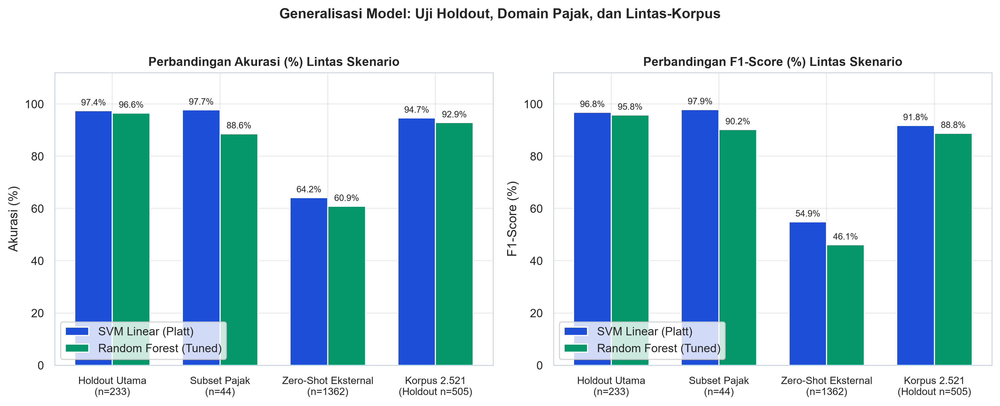
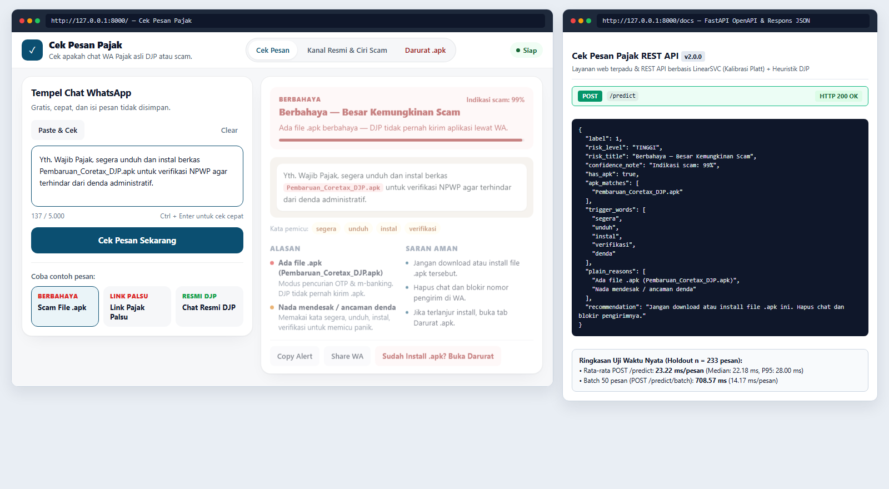

# BAB IV HASIL DAN ANALISA

## 4.1 Hasil Eksperimen Komparasi Klasifikasi dan Penyetelan Hiperparameter

Seluruh rangkaian eksperimen komparatif dieksekusi secara otomatis oleh skrip `src/eksperimen_komparasi.py` dengan pengacak tetap `random_state=42` selama 297,57 detik. Pembagian terstratifikasi 80:20 terhadap korpus induk 1.164 baris menghasilkan 931 data latih dan 233 data uji bagi `LinearSVC` serta `RandomForestClassifier` [33], [35]. Pengujian awal mengonfirmasi ketajaman pemisah linear pada matriks TF-IDF tiga ribu fitur.

Pada uji *baseline* himpunan tetap (`n = 233`), `LinearSVC` bawaan meraih *Accuracy* 98,28% dengan *Precision*, *Recall*, dan *F1-Score* seragam 97,85%. Kesalahannya hanya dua positif palsu dan dua negatif palsu. Pembanding *Random Forest* (`n_estimators=200`) mencatat *Accuracy* 95,28%, *Precision* 93,62%, *Recall* 94,62%, serta *F1-Score* 94,12%. Hutan pohon menyisakan enam positif palsu dan lima negatif palsu [13], [32].

Evaluasi berlanjut dengan *Stratified 10-Fold Cross-Validation* pada 931 data latih menggunakan kosakata TF-IDF yang terisolasi tiap lipatan guna mencegah kebocoran data [38]. Sebelum penalaan, `LinearSVC` mencatat rata-rata *F1-Score* 96,64% (± 2,68%), *Accuracy* 97,31%, dan *ROC-AUC* 0,9956 dalam waktu latih 0,0036 detik per lipatan. Pada lipatan sama, *Random Forest* meraih *F1-Score* 93,81% (± 2,30%) dan *Accuracy* 95,06% dalam 0,6860 detik.

Proses penalaan melalui `GridSearchCV` mengevaluasi tiga puluh enam kandidat, terdiri atas dua belas konfigurasi `LinearSVC` dan dua puluh empat konfigurasi *Random Forest* [40]. Kandidat terbaik `LinearSVC` terpilih pada `C=5.0` dan `class_weight=None` dengan rata-rata *F1-Score* 97,18% (± 2,56%), *Accuracy* 97,74%, serta *ROC-AUC* 0,9951 dalam 0,0065 detik per lipatan. Penaikan `C` dari 1,0 ke 5,0 memperketat margin agar frasa penipuan spesifik lebih tertangkap.

Pencarian *grid* pada *Random Forest* memilih kombinasi `n_estimators=200`, `max_depth=None`, `min_samples_split=5`, dan `class_weight=None` sebagai setelan terbaik. Konfigurasi tersebut mengangkat *F1-Score* sepuluh lipatan menjadi 94,19% (± 2,13%), *Accuracy* 95,27%, *Recall* 95,72%, serta *ROC-AUC* 0,9914 dalam 0,6272 detik per lipatan. Pembatasan pemecahan simpul memang memperbaiki generalisasi, tetapi waktu pelatihannya tetap sekitar 96,9 kali lebih lambat dibandingkan `LinearSVC` per lipatan [33], [35].

Pada himpunan uji tetap (`n = 233`), akurasi `LinearSVC` bergeser dari 98,28% (`C=1,0`) menjadi 97,85% pascapenalaan (`C=5,0`) lalu 97,42% sesudah kalibrasi *Platt scaling* lima lipatan [34], [42]. Perubahan ini mencerminkan imbal balik alami antara ketegasan margin dan ketepatan skor probabilitas. Meski positif palsu bertambah menjadi empat (`FP = 4`, `FN = 2`), model terkalibrasi menjaga *Recall* 97,85% dan meraih *ROC-AUC* tertinggi 0,9982. Capaian tersebut mengungguli *Random Forest* yang mencatat *Accuracy* 96,57% serta *Precision* 93,81%.

Tabel 4.1 Hasil Komparasi Kinerja Klasifikasi pada Berbagai Tahap Evaluasi

| Tahap Evaluasi dan Himpunan Uji | Model Klasifikasi | *Accuracy* | *Precision* | *Recall* | *F1-Score* | *ROC-AUC* |
| :--- | :--- | :---: | :---: | :---: | :---: | :---: |
| *Baseline Holdout* (`n = 233`) | `LinearSVC` (Default) | 98,28% | 97,85% | 97,85% | 97,85% | 0,9980 |
| *Baseline Holdout* (`n = 233`) | *Random Forest* (Default) | 95,28% | 93,62% | 94,62% | 94,12% | 0,9959 |
| *10-Fold CV* Default (`n = 931`) | `LinearSVC` (Default) | 97,31% | 97,15% | 96,25% | 96,64% | 0,9956 |
| *10-Fold CV* Default (`n = 931`) | *Random Forest* (Default) | 95,06% | 93,74% | 94,10% | 93,81% | 0,9907 |
| *10-Fold CV Tuned* (`n = 931`) | `LinearSVC` (`C=5.0`) | 97,74% | 97,69% | 96,79% | 97,18% | 0,9951 |
| *10-Fold CV Tuned* (`n = 931`) | *Random Forest* (Tuned) | 95,27% | 92,96% | 95,72% | 94,19% | 0,9914 |
| *Holdout Tuned* (`n = 233`) | `LinearSVC` (Tuned) | 97,85% | 96,81% | 97,85% | 97,33% | 0,9979 |
| *Holdout* Final (`n = 233`) | `LinearSVC` (Platt Sigmoid) | 97,42% | 95,79% | 97,85% | 96,81% | 0,9982 |
| *Holdout* Final (`n = 233`) | *Random Forest* (Tuned) | 96,57% | 93,81% | 97,85% | 95,79% | 0,9973 |

Sumber: Pengolahan Hasil Eksperimen `src/eksperimen_komparasi.py` (2026).

Sebagaimana dirangkum pada Tabel 4.1, pengemasan `LinearSVC` bersama *Platt scaling* mempertahankan daya pisah peringkat tertinggi sekaligus menyeimbangkan risiko salah blokir dan lolosnya penipuan. Perbandingan sebaran prediksi empat kuadran *Confusion Matrix* pada himpunan uji `n = 233` tampak jelas pada Gambar 4.1. Selanjutnya, ketajaman kurva diskriminatif *Receiver Operating Characteristic* dan *Precision-Recall* disajikan pada Gambar 4.2 [39].

Gambar 4.1 Perbandingan *Confusion Matrix* Uji *Holdout*.

Gambar 4.2 Evaluasi Diskriminatif Kurva ROC dan *Precision-Recall*.

Visualisasi pada Gambar 4.1 mengonfirmasi bahwa kedua model hanya melewatkan dua pesan penipuan umum (`FN = 2`, sensitivitas kelas penipuan 97,8%). Namun, `LinearSVC` terkalibrasi unggul menjaga spesifisitas kelas normal sebesar 97,1% (`TN = 136`, `FP = 4`) dibanding *Random Forest* pada angka 95,7% (`TN = 134`, `FP = 6`). Pada Gambar 4.2, kurva *LinearSVC* hampir menempel sudut kiri atas dengan *ROC-AUC* 0,9982 dan *PR-AUC* 0,9975, yang menunjukkan keandalan pemeringkatan pesan berisiko tinggi di berbagai ambang keputusan.

## 4.2 Analisis Kalibrasi Probabilitas dan Studi Ablatif Fitur

Pemanfaatan skor risiko probabilistik di antarmuka pengguna menuntut kesesuaian antara nilai peluang keluaran model dan frekuensi kejadian aktual di lapangan [34], [42]. Pengujian kalibrasi pada 233 data uji membuktikan bahwa *Platt scaling* lima lipatan atas `LinearSVC` menghasilkan *Brier Score* sebesar 0,01900 dan *Log Loss* sebesar 0,06883. Nilai galat kalibrasi tersebut terpaut jauh di bawah kinerja *Random Forest* yang mencatat *Brier Score* sebesar 0,03555 dan *Log Loss* sebesar 0,14426.

Penerapan kalibrasi sigmoid pada `LinearSVC` menekan galat probabilitas kuadratik *Brier Score* sebesar 46,55% daripada pemungutan suara dua ratus pohon *Random Forest* sekaligus memangkas *Log Loss* sebesar 52,29%. Perbedaan mutu penyelarasan skor peluang kedua algoritma tampak jelas pada kurva reliabilitas sepuluh interval dan histogram sebaran di Gambar 4.3. Sebaran skor menjadi terpusat.

Gambar 4.3 Evaluasi Kalibrasi Probabilitas Model.

Distribusi probabilitas pada Gambar 4.3 memperlihatkan bahwa `LinearSVC` terkalibrasi memisahkan pesan aman dan pesan *phishing* secara tegas menuju dua kutub ekstrem mendekati nol dan satu. Sebaliknya, probabilitas *Random Forest* tersebar lebih banyak di wilayah ketidakpastian antara 0,2 hingga 0,8 karena sifat agregasi pohon keputusan yang merata-ratakan suara cabang pada matriks kata jarang [35]. Keunggulan polarisasi tersebut membuat penetapan kategori risiko `RENDAH`, `SEDANG`, dan `TINGGI` di purwarupa menjadi jauh lebih konsisten.

Untuk mengisolasi pengaruh tiap komponen praproses teks dan batas dimensi fitur, dieksekusi enam skenario studi ablatif menggunakan parameter hasil penalaan terbaik. Pengujian mencakup penghapusan token entitas `token_apk` dan `token_url`, peniadaan *stemming* Sastrawi, pembatasan fitur ke unigram saja, serta variasi batas kosakata maksimum dari 1.500 hingga 5.000 fitur TF-IDF [36], [37]. Seluruh hasil perbandingan lintas enam skenario ablatif disajikan pada Tabel 4.2.

Tabel 4.2 Hasil Studi Ablatif Praproses dan Representasi Fitur TF-IDF

| Skenario Konfigurasi | Model | CV10 *Accuracy* | CV10 *F1-Score* | *Holdout Accuracy* | *Holdout F1-Score* |
| :--- | :--- | :---: | :---: | :---: | :---: |
| `1_Tanpa_Token_Entitas` | `LinearSVC` | 97,10% | 96,36% | 96,57% | 95,79% |
| `1_Tanpa_Token_Entitas` | *Random Forest* | 93,77% | 92,20% | 95,28% | 94,18% |
| `2_Tanpa_Sastrawi` | `LinearSVC` | 97,64% | 97,06% | 98,28% | 97,89% |
| `2_Tanpa_Sastrawi` | *Random Forest* | 96,24% | 95,28% | 97,42% | 96,74% |
| `3_Unigram_Saja` | `LinearSVC` | 96,35% | 95,43% | 97,00% | 96,30% |
| `3_Unigram_Saja` | *Random Forest* | 95,49% | 94,35% | 96,14% | 95,24% |
| `4_Utama_MaxFeatures_1500` | `LinearSVC` | 96,99% | 96,24% | 96,57% | 95,79% |
| `4_Utama_MaxFeatures_1500` | *Random Forest* | 94,85% | 93,71% | 96,14% | 95,24% |
| `5_Konfigurasi_Utama_3000` | `LinearSVC` | 97,74% | 97,18% | 97,85% | 97,33% |
| `5_Konfigurasi_Utama_3000` | *Random Forest* | 95,27% | 94,19% | 96,57% | 95,79% |
| `6_Utama_MaxFeatures_5000` | `LinearSVC` | 96,67% | 95,88% | 97,00% | 96,30% |
| `6_Utama_MaxFeatures_5000` | *Random Forest* | 94,95% | 93,72% | 95,71% | 94,74% |

Sumber: Hasil Studi Ablatif `05 Hasil Evaluasi/studi_ablatif_fitur.csv` (2026).

Data pada Tabel 4.2 menyingkap tiga temuan penting mengenai desain fitur teks Indonesia. Penghapusan penyandian `token_apk` dan `token_url` (`1_Tanpa_Token_Entitas`) menurunkan *F1-Score* validasi silang `LinearSVC` ke 96,36% serta menjatuhkan *Random Forest* ke 92,20%, yang menegaskan perlunya pelestarian penanda lampiran [16]. Pembatasan kosakata menjadi unigram saja (`3_Unigram_Saja`) memangkas *F1-Score* `LinearSVC` sebesar 1,75 poin akibat hilangnya bigram seperti `klik token_url`.

Variasi kapasitas kosakata memperlihatkan bahwa dimensi 3.000 fitur pada `5_Konfigurasi_Utama_3000` paling kokoh menjaga generalisasi `LinearSVC` (97,18%) dibandingkan batas 1.500 fitur (96,24%) maupun 5.000 fitur (95,88%) yang memicu *overfitting*. Walau skenario `2_Tanpa_Sastrawi` sempat menyentuh akurasi *holdout* tunggal tertinggi sebesar 98,28%, rata-rata validasi silang sepuluh lipatannya (97,06%) tetap tertinggal sehingga penyatuan akar kata lebih konsisten secara umum [9], [37].

## 4.3 Analisis Ketahanan Bias Kata Kunci Pajak dan Generalisasi Lintas Korpus

Pengujian khusus ketahanan bias kata kunci pajak dijalankan pada `Tahap 4A` menggunakan irisan 44 pesan bertema pajak di himpunan uji (`21` pesan layanan resmi dan `23` penipuan). Pada pengujian tersebut, `LinearSVC` terkalibrasi meraih *Accuracy* 97,73%, *Precision* 95,83%, *Recall* 100,00%, *F1-Score* 97,87%, *ROC-AUC* 1,0000, dan *Brier Score* 0,02712. Hanya muncul satu positif palsu dan nol negatif palsu, sehingga surat resmi DJP tetap lolos meski mengandung kosakata pajak [2], [5].

Sebaliknya, kinerja *Random Forest* menurun tajam pada subset pajak dengan *Accuracy* 88,64%, *Precision* 82,14%, *F1-Score* 90,20%, serta *Brier Score* 0,09289. Lima pesan pengumuman resmi otoritas pajak keliru ditandai sebagai *phishing* (`FP = 5`, `FN = 0`). Kesenjangan serupa berulang pada validasi silang sepuluh lipatan atas 260 rekaman pajak, dengan *F1-Score* `LinearSVC` 98,17% (*Accuracy* 98,08%) dibandingkan 92,92% (*Accuracy* 92,69%) milik *Random Forest*.

Pengujian `Tahap 4B` mengevaluasi model produksi pada 1.362 pesan unik eksternal dari Theodorus dkk. (`1.268` baris) dan Saragih (`94` baris) tanpa pelatihan ulang [7]. Pada skenario *zero-shot* ini, `LinearSVC` mencatat *Accuracy* 64,17%, *Precision* 41,14%, *Recall* 82,50%, *F1-Score* 54,90%, dan *ROC-AUC* 0,7930. *Random Forest* merosot ke *Accuracy* 60,87%, *Recall* 63,33%, dan *F1-Score* 46,11%. Presisi turun karena 421 pesan normal Theodorus berisi kosakata SMS 2021 (*domain shift* leksikal).

Guna membuktikan bahwa keterbatasan *zero-shot* bersumber dari pergeseran ragam kosakata korpus dan bukan kelemahan arsitektur model, `Tahap 4C` melatih ulang kedua algoritma pada korpus diperluas 2.521 baris. Hasil *holdout* (`n = 505`) memulihkan kinerja `LinearSVC` terkalibrasi secara signifikan hingga *Accuracy* 94,65%, *Precision* 92,07%, *Recall* 91,52%, *F1-Score* 91,79%, *ROC-AUC* 0,9818, dan *Brier Score* 0,04352. Sementara itu, *Random Forest* mencatat *Accuracy* 92,87%, *Recall* 86,67%, dan *F1-Score* 88,82%, serta pada validasi silang 2.521 baris kedua model mencapai *F1-Score* masing-masing 91,81% dan 91,53%. Perbandingan seluruh skenario ketahanan domain ditampilkan pada Gambar 4.5.

Gambar 4.5 Komparasi Generalisasi Lintas Korpus dan Subset Pajak.

Temuan pada Gambar 4.5 memberi implikasi praktis bagi perancangan sistem deteksi penipuan berbahasa Indonesia. Meski `LinearSVC` tangguh menjaga *Recall* 82,50% di luar distribusi serta akurasi 97,73% pada domain pajak, pembaruan korpus latih tetap wajib dijalankan secara berkala agar ragam pesan normal baru tidak keliru terblokir. Adaptasi kosakata mencegah galat presisi.

## 4.4 Analisis Interpretabilitas Fitur dan Kesalahan Prediksi

Transparansi keputusan model merupakan salah satu kontribusi utama purwarupa ini untuk menjawab celah riset pada literatur sebelumnya [24], [25]. Pemeriksaan vektor koefisien *hyperplane* pada `LinearSVC` menunjukkan pemisahan arah polaritas yang sangat intuitif antara token penanda penipuan (koefisien positif) dan token penanda pesan resmi atau percakapan normal (koefisien negatif). Sebaliknya, ukuran *Mean Decrease in Impurity* (*Gini importance*) pada *Random Forest* hanya menilai seberapa kuat suatu token memecah simpul pohon tanpa membedakan arah kelasnya.

Pada sisi positif `LinearSVC`, fitur penanda *phishing* terkuat berturut-turut ditempati `no` (+2,338), `sms` (+1,876), `hub` (+1,774), `token_apk` (+1,764), `info` (+1,604), `rekening` (+1,575), `klik` (+1,562), `hp` (+1,507), serta frasa `klik token_url` (+1,101). Masuknya `token_apk` pada empat besar fitur positif membuktikan bahwa penyandian khusus ekstensi aplikasi Android menjadi sinyal deterministik penipuan Coretax palsu. Bobot tersebut langsung menaikkan skor risiko.

Pada sisi negatif `LinearSVC`, koefisien penahan kelas normal dan resmi diisi oleh `nama1` (-1,431), pronomina percakapan `aku` (-1,167), `terimakasih` (-1,093), `maupun` (-1,085), dan `resmi` (-1,067). Token pengaman kelembagaan lain meliputi `guna` (-0,999), `pratama` (-0,809), `laman` (-0,803), `kp2kp` (-0,773), `resmi pajak` (-0,743), serta `edukasi` (-0,681). Daftar fitur teratas kedua algoritma dibandingkan pada Gambar 4.4 dan dirinci pada Tabel 4.3.

Gambar 4.4 Analisis Interpretabilitas Fitur TF-IDF Terbaik.

Tabel 4.3 Perbandingan Fitur Teratas `LinearSVC` dan *Random Forest*

| Peringkat | Fitur Positif *Phishing* (`LinearSVC`) | Bobot *w* (+) | Fitur Penahan Resmi/Normal (`LinearSVC`) | Bobot *w* (-) | Fitur Terpenting *Random Forest* | Skor Gini |
| :---: | :--- | :---: | :--- | :---: | :--- | :---: |
| 1 | `no` | +2,3382 | `nama1` | -1,4306 | `info` | 0,0362 |
| 2 | `sms` | +1,8762 | `aku` | -1,1666 | `no` | 0,0350 |
| 3 | `hub` | +1,7742 | `terimakasih` | -1,0925 | `token_url` | 0,0318 |
| 4 | `token_apk` | +1,7642 | `maupun` | -1,0846 | `hadiah` | 0,0248 |
| 5 | `info` | +1,6044 | `resmi` | -1,0668 | `sms` | 0,0241 |
| 6 | `rekening` | +1,5749 | `guna` | -0,9991 | `pin` | 0,0232 |
| 7 | `klik` | +1,5621 | `kalau` | -0,9711 | `hub` | 0,0228 |
| 8 | `hp` | +1,5073 | `lanjut` | -0,9616 | `klik` | 0,0193 |

Sumber: Ekstraksi Bobot Model `05 Hasil Evaluasi/fitur_teratas_svm_vs_rf.csv` (2026).

Ketiadaan penanda polaritas pada skor Gini di Tabel 4.3 menjelaskan mengapa *Random Forest* lebih rentan terkena bias kata kunci pajak dibandingkan `LinearSVC`. Kata `token_url` menempati peringkat ketiga skor Gini terbesar (0,0318) di *Random Forest* tanpa bobot penyeimbang negatif dari kata `resmi`, `laman`, maupun `kp2kp`. Akibatnya, pengumuman resmi DJP yang menyertakan tautan sah `www.pajak.go.id` mudah terdorong menuju kelas penipuan ketika pohon-pohon keputusan bercabang pada keberadaan `token_url`.

Untuk memvalidasi dampak fitur pada keputusan aktual himpunan uji *holdout* (`n = 233`), dijalankan analisis *SHapley Additive exPlanations* (SHAP) memakai `LinearExplainer` untuk `LinearSVC` dan `TreeExplainer` (*interventional*) untuk *Random Forest* [25]. Berbeda dari bobot statis atau skor Gini global, nilai `mean(|SHAP|)` mengukur rata-rata pergeseran prediksi tiap pesan beserta arah dorongannya terhadap kelas *phishing* ataupun resmi. Ringkasan hasilnya tampak pada Gambar 4.8.

Gambar 4.8 Analisis Interpretabilitas Model Berbasis SHAP (*Holdout* `n = 233`).

Hasil SHAP pada Gambar 4.8 memperlihatkan fitur berimpak absolut terbesar pada `LinearSVC`, mencakup `no` (0,0727; *Phishing*), `aku` (0,0551; *Resmi/Normal*), `info` (0,0512; *Phishing*), `nama1` (0,0474; *Phishing*), dan `yg` (0,0436; *Resmi/Normal*). Fitur berpengaruh berikutnya meliputi `pin` (0,0433; *Phishing*), `token_url` (0,0404; *Phishing*), `klik` (0,0374; *Phishing*), `resmi` (0,0341; *Resmi/Normal*), serta `token_apk` (0,0264; *Phishing*). Arah dorongan fitur tetap terpisah tegas.

Pada *Random Forest*, fitur `token_url` menempati dampak tertinggi (`0,0363`; *Phishing*), diikuti `no` (`0,0318`), `sms` (`0,0271`), `info` (`0,0268`), `pin` (`0,0208`), `hadiah` (`0,0155`), `klik` (`0,0145`), serta `token_apk` (`0,0114`). Temuan SHAP itu membuktikan bahwa `LinearSVC` memisahkan sinyal instruktif berbahaya (`klik`, `token_url`, `token_apk`) dari konteks pengumuman resmi (`yg`, `resmi`) secara jauh lebih konsisten dibanding *Random Forest*.

Penelusuran atas seluruh prediksi yang meleset di himpunan uji `n = 233` menemukan tepat tiga belas sampel salah prediksi. Lima kasus hanya meleset di `LinearSVC` terkalibrasi, mencakup tiga positif palsu umum dan dua negatif palsu promosi penipuan. Tujuh kasus lain hanya terjadi pada *Random Forest*, yakni satu positif palsu operator, empat pengumuman resmi pajak, serta dua penipuan umum. Satu kasus sulit meleset bersamaan pada kedua model. Rincian lengkap ketigabelas sampel terangkum pada Tabel 4.4.

Tabel 4.4 Ringkasan Analisis Kesalahan Prediksi pada Himpunan Uji *Holdout*

| Indeks | Sumber dan Kategori | Aktual | Probabilitas SVM | Probabilitas RF | Lokasi Galat | Ringkasan Konten dan Penyebab Leksikal |
| :---: | :--- | :---: | :---: | :---: | :--- | :--- |
| 334 | Rahmi (Penipuan) | 1 | 0,718 | 0,425 | RF Saja (FN) | Ajakan kirim format SMS ke nomor seluler tanpa kata `hadiah`/`rekening` |
| 52 | Rahmi (Penipuan) | 1 | 0,964 | 0,438 | RF Saja (FN) | Iming-iming bonus internet 5MB dengan istilah informal singkat |
| 50 | Rahmi (Penipuan) | 1 | 0,208 | 0,772 | SVM Saja (FN) | Tawaran gratis telepon dan kuota operator dengan banyak angka satuan |
| 97 | Rahmi (Penipuan) | 1 | 0,394 | 0,522 | SVM Saja (FN) | Promosi situs perjudian daring memuat `token_url` tanpa kata desakan |
| 839 | Rahmi (Normal) | 0 | 0,523 | 0,249 | SVM Saja (FP) | Kalimat konfirmasi pesanan singkat minim fitur penahan kelas resmi |
| 495 | Rahmi (Normal) | 0 | 0,743 | 0,136 | SVM Saja (FP) | Teks sangat pendek berbunyi "Dimulai dari angka 0" tanpa konteks |
| 463 | Rahmi (Normal) | 0 | 0,529 | 0,084 | SVM Saja (FP) | Cuplikan jalur `localhost` rumah sakit tanpa kosakata percakapan umum |
| 753 | Rahmi (Normal) | 0 | 0,370 | 0,502 | RF Saja (FP) | Promo FUP operator memuat `token_url` dan kode `info838` |
| 1126 | Pajak (KP2KP Bandarjaya) | 0 | 0,408 | 0,590 | RF Saja (FP) | Apresiasi wajib pajak melapor lampiran PDF curiga memicu fitur `wajib` |
| 1122 | Pajak (KP2KP Sinjai) | 0 | 0,065 | 0,529 | RF Saja (FP) | Imbauan konfirmasi WA/email `kp2kp.sinjai@pajak.go.id` terseret `token_url` |
| 943 | Pajak (Kring Pajak) | 0 | 0,103 | 0,515 | RF Saja (FP) | Arahan konsultasi KPP dan `1500200` terdorong kata `sila` dan `hubung` |
| 1065 | Pajak (WA Blast Coretax) | 0 | 0,070 | 0,516 | RF Saja (FP) | Imbauan merujuk laman resmi `www.pajak.go.id` terseret token tautan |
| 1087 | Pajak (Pemadanan NIK) | 0 | 0,712 | 0,637 | Keduanya (FP) | Imbauan pemadanan NIK-NPWP memuat `sila`, `login`, `token_url`, tanpa `resmi` kuat |

Sumber: Analisis Kesalahan `05 Hasil Evaluasi/analisis_kesalahan_prediksi.csv` (2026).

Pengamatan atas Tabel 4.4 menunjukkan bahwa empat pengumuman resmi otoritas pajak (`idx=1126`, `idx=1122`, `idx=943`, dan `idx=1065`) lolos aman di `LinearSVC` Platt berkat penanda resmi `kp2kp`, `resmi`, dan `laman`. Sebaliknya, *Random Forest* keliru memblokirnya dengan skor tipis (`0,515` hingga `0,590`). Satu-satunya pesan pajak yang meleset di kedua model (`idx=1087`) berisi siaran pemadanan NIK-NPWP dengan kata `sila`, `login`, dan `token_url`. Heuristik `is_official_djp_domain` melengkapinya lewat validasi domain sah `pajak.go.id`.

## 4.5 Hasil Pengujian Purwarupa Sistem Terpadu dan Evaluasi Kesiapterapan Teknologi

Pengujian fungsional purwarupa TKT Level 6 berjalan otomatis memakai Pytest 9.2.0 terhadap dua puluh kasus uji beserta tolok ukur latensi `src/benchmark_purwarupa.py` pada 233 sampel *holdout*. Seluruh dua puluh pengujian (`UJI-01` sampai `UJI-10`) lulus seratus persen dalam waktu eksekusi total 5,17 detik. Hasil ini membuktikan integritas SHA-256 dataset, reproduksi metrik `.joblib`, kontrak API, web *Cek Pesan Pajak*, serta penjagaan domain pengecoh dan angka jam.

Pengukuran waktu nyata menunjukkan pemuatan awal bundel `.joblib` ke memori hanya memerlukan 61,255 ms berkat mekanisme `lru_cache`. Setelah termuat, fungsi `predict_message` pada `inference.py` memproses satu pesan berikut analisis heuristik, sorotan teks, dan alasan awam dalam rata-rata 14,371 ms (*P95* 17,829 ms). Melalui antarmuka HTTP `POST /predict` FastAPI, latensi penuh tercatat 23,217 ms/pesan (*P95* 27,998 ms), sedangkan pemrosesan massal `POST /predict/batch` lima puluh pesan tuntas dalam 708,565 ms (14,171 ms/pesan). Rekapitulasi pengujian disajikan pada Tabel 4.5.

Tabel 4.5 Hasil Pengujian Fungsional Otomatis dan Latensi Inferensi Purwarupa

| Kode / Metrik | Subjek dan Kondisi Uji | Jumlah Uji / Sampel | Hasil / Waktu Terukur | Status |
| :--- | :--- | :---: | :---: | :---: |
| `UJI-01` | `GET /health` kesiapan peladen FastAPI & bundel model | 1 | HTTP 200 (`LinearSVC+Platt` aktif) | Lulus (60 ms) |
| `UJI-02` | `POST /predict` pesan modus `Coretax_DJP_Update.apk` | 1 | Label `1`, `has_apk=True`, risiko `TINGGI` | Lulus (70 ms) |
| `UJI-03` | `POST /predict` domain palsu `pajak-djp-verifikasi.xyz` | 1 | Label `1`, domain curiga tercatat tanpa `17.00` | Lulus (20 ms) |
| `UJI-04` | `POST /predict` pengumuman resmi `djponline.pajak.go.id` | 1 | Label `0`, risiko `RENDAH`, `official_domains` terisi | Lulus (20 ms) |
| `UJI-05` | `is_official_djp_domain` uji pengecoh `pajak.go.id.evil.com` | 1 | Mengembalikan `False` untuk tiruan | Lulus (<1 ms) |
| `UJI-06` | `POST /predict` pengiriman teks spasi kosong | 1 | Ditolak dengan status HTTP 422 | Lulus (10 ms) |
| `UJI-07` | `POST /predict/batch` dua teks campuran *phishing* dan resmi | 1 | HTTP 200 dengan `total=2` | Lulus (30 ms) |
| `UJI-08` | Penjagaan angka pukul `16.00` dan nominal `Rp1.500.000` | 1 | `suspicious_domains` kosong, status `RENDAH` | Lulus (20 ms) |
| `UJI-09` | `GET /`, `/api/presets`, dan `/api/academic-summary` | 1 | HTTP 200 antarmuka web *Cek Pesan Pajak* | Lulus (180 ms) |
| `UJI-10` | Suite integritas 5 korpus, SHA-256, baseline, Platt, dan `.joblib` | 11 | Seluruh 11 pengujian data/model valid | Lulus (380 ms) |
| `LAT-01` | Latensi lokal `inference.py::predict_message` (*Mean* / *P95*) | 233 | 14,371 ms/pesan (*P95* = 17,829 ms) | Memenuhi (<100 ms) |
| `LAT-02` | Latensi REST API `FastAPI POST /predict` (*Mean* / *P95*) | 233 | 23,217 ms/pesan (*P95* = 27,998 ms) | Memenuhi (<100 ms) |
| `LAT-03` | Latensi massal `FastAPI POST /predict/batch` (50 pesan) | 50 | 708,565 ms total (14,171 ms/pesan) | Memenuhi (<100 ms) |

Sumber: Eksekusi `src/benchmark_purwarupa.py` dan `05 Hasil Evaluasi/tabel_pengujian_purwarupa.csv` (2026).

Demonstrasi antarmuka aplikasi diverifikasi pada tiga prasetel skenario nyata lewat web *Cek Pesan Pajak* (`GET /`), respons JSON FastAPI, serta simulasi ekstensi *WhatsApp Web* berarsitektur *Manifest V3*. Pada prasetel berkas berbahaya `Pembaruan_Coretax_DJP.apk`, sistem menetapkan status berisiko tinggi *Berbahaya* dengan indikasi scam 99% (skor internal `LinearSVC` 98,73% vs *Random Forest* 93,43%). Sistem menyoroti langsung berkas `.apk` di gelembung WhatsApp dan menampilkan chip kata pemicu (*segera*, *unduh*, *instal*, *verifikasi*) beserta respons JSON FastAPI pada Gambar 4.6.

Gambar 4.6 Tangkapan Layar Antarmuka Web *Cek Pesan Pajak* dan Respons API.

Pengujian pada antarmuka ekstensi *Manifest V3* memakai halaman `simulasi_whatsapp_web.html` yang menampilkan tiga gelembung percakapan beserta jendela *popup* ekstensi pada Gambar 4.7. Prasetel domain palsu `djp-coretax-verifikasi.xyz` ditandai berisiko tinggi *Berbahaya* (indikasi scam 89%), sedangkan pengumuman resmi `djponline.pajak.go.id` diloloskan aman (skor penipuan 9,63%). Pemindaian `content.js` melalui *service worker* `background.js` serta penyempurnaan `URL_PATTERN` bersyarat *top-level domain* alfabetis terbukti mencegah salah penandaan pukul `17.00` dan nominal `Rp1.500.000`.

Gambar 4.7 Tangkapan Layar Ekstensi Chrome pada Simulasi *WhatsApp Web*.

Mengacu pada indikator Tingkat Kesiapan Teknologi Peraturan Menteri Riset, Teknologi, dan Pendidikan Tinggi Nomor 42 Tahun 2016 [41], purwarupa telah memenuhi kriteria **TKT Level 6**. Penilaian tersebut didasarkan pada demonstrasi subsistem terintegrasi meliputi bundel `.joblib`, API FastAPI, web *Cek Pesan Pajak*, serta ekstensi *Manifest V3* pada simulasi *WhatsApp Web* dengan dua puluh uji otomatis lulus serta latensi persentil ke-95 di bawah tiga puluh milidetik. Purwarupa siap diterapkan.

Sebagai penutup analisis hasil, capaian penelitian ini dibandingkan langsung dengan studi terdahulu yang telah dipetakan pada Bab II [6], [7], [9], [10], [11], [13], [15], [16], [24], [26]. Pembandingan tersebut menyoroti perbedaan karakteristik korpus bahasa Indonesia, jenis fitur teks, pemilihan algoritma, serta keberadaan purwarupa terpakai. Ringkasan kinerja model dan mekanisme mitigasi bias dirinci pada Tabel 4.6.

Tabel 4.6 Komparasi Hasil Penelitian terhadap Studi Terdahulu

| Peneliti (Tahun) | Korpus & Fitur | Model Terbaik & Kinerja | Mitigasi Bias, Kalibrasi, & Purwarupa |
| :--- | :--- | :--- | :--- |
| Rahmi dan Wibisono (2016) [6] | 1.143 SMS Indonesia, *Term Frequency* | *Multinomial Naïve Bayes* (*Acc* 94,12%-94,56%) | Belum melestarikan token entitas, tanpa korpus pajak |
| Theodorus dkk. (2021) [7] | 4.125 SMS Indonesia, *BoW* 1.500 | *Random Forest* (*Acc* 94,62% vs SVM 94,38%) | Belum fokus tema *phishing* pajak dan tanpa purwarupa |
| Al Ghofany dkk. (2022) [9] | Sebanyak 500 SMS privat Indonesia, TF-IDF + Sastrawi | SVM Sigmoid (*Acc* 99,60%) & Linear (99,52%) | Belum membandingkan dengan *Random Forest* maupun XAI |
| Astuti dkk. (2024) [10] | 5.574 SMS Inggris, TF-IDF | SVC Sigmoid (*Acc* 97,93%, *F1* 95%) | Tanpa praproses bahasa Indonesia dan tanpa ekstensi |
| Tampinongkol dkk. (2024) [11] | 59.899 URL *phishing*, 9 fitur leksikal | *Random Forest* (*Acc* 84,95% vs SVM RBF 77,43%) | Fokus leksikal tautan, bukan isi rekayasa sosial teks |
| Ningtias dkk. (2026) [13] | 5.572 SMS Inggris, TF-IDF + `GridSearchCV` | Linear SVM (*Acc* 98,39%, *F1* 93,71%) > RF (95,96%) | Menghapus URL saat praproses, tanpa kalibrasi Platt |
| Saputra dkk. (2026) [15] | 1.320 pesan WA/SMS Indo, Sastrawi + *Hashing* | Linear SVM (*Acc* 95,45%, *Macro F1* 0,95) | `HashingVectorizer` menghilangkan keterjelasan fitur XAI |
| Sembiring dkk. (2026) [16] | 2.320 pesan penipuan Indo, token entitas | XGBoost (*Acc* 96,34%), Linear SVM (*Rec* 98,59%) | Belum menyandikan `.apk`, tanpa domain pajak & ekstensi |
| Mishra dan Yadav (2026) [24]; Suwarno dkk. (2026) [26] | SMS TF-IDF [24]; URL *phishing* [26] | `LinearSVC` terjelaskan [24]; Ekstensi *LogReg* [26] | Belum terpadu untuk WhatsApp Indonesia tema otoritas pajak |
| **Penelitian Ini (2026)** | **1.164 teks (904 SMS + 260 pajak) & 2.521 diperluas, TF-IDF `(1, 2)` + Sastrawi** | **`LinearSVC` Platt (*Acc* 97,42% *holdout*, 98,28% *baseline*, 97,73% pajak, *Brier* 0,019)** | **Mitigasi *keyword bias* pajak, XAI koefisien, *guard* `.apk`/domain sah, purwarupa TKT 6 (23,22 ms)** |

Sumber: Sintesis Perbandingan Eksperimen dan Literatur (2026).

Secara keseluruhan, hasil pada Tabel 4.6 memperlihatkan keunggulan rancangan sistem yang memadukan korpus pajak seimbang 260 baris, penyandian `token_apk` dan `token_url`, kalibrasi Platt, serta heuristik `pajak.go.id`. Kombinasi tersebut melampaui keterbatasan penyaring teks konvensional yang kerap salah memblokir imbauan pajak resmi. Akurasi tinggi, presisi pesan DJP, kejelasan kata pemicu, dan latensi persentil ke-95 di bawah 30 ms menjadi pijakan empiris perumusan Bab V.

---

# DAFTAR PUSTAKA

[2] Direktorat Jenderal Pajak, “Penyebarluasan Informasi Mengenai Coretax (Pengumuman Nomor PENG-32/PJ.09/2024),” *Portal Resmi Direktorat Jenderal Pajak Kementerian Keuangan Republik Indonesia*, Nov. 2024. [Online]. Available: https://pajak.go.id/id/pengumuman/penyebarluasan-informasi-mengenai-coretax

[5] Direktorat Jenderal Pajak, “Waspada penipuan yang mengatasnamakan Direktorat Jenderal Pajak (Pengumuman Nomor PENG-31/PJ.09/2024 s.d. PENG-18/PJ.09/2026),” *Portal Resmi Direktorat Jenderal Pajak Kementerian Keuangan Republik Indonesia*, 2026. [Online]. Available: https://www.pajak.go.id/id/pengumuman/waspada-penipuan-yang-mengatasnamakan-direktorat-jenderal-pajak

[6] F. Rahmi and Y. Wibisono, “Aplikasi SMS spam filtering pada Android menggunakan algoritma Naïve Bayes,” Skripsi, Dept. Pendidikan Ilmu Komputer, Universitas Pendidikan Indonesia, Bandung, 2016. [Online]. Available: https://repository.upi.edu/26936/

[7] A. Theodorus, T. K. Prasetyo, R. Hartono, and D. Suhartono, “Short Message Service (SMS) spam filtering using machine learning in Bahasa Indonesia,” in *Proc. 3rd East Indonesia Conf. Comput. Inf. Technol. (EIConCIT)*, Apr. 2021, pp. 199-203, doi: 10.1109/EIConCIT50028.2021.9431859.

[9] M. S. Al Ghofany, R. Dwiyansaputra, F. Bimantoro, and Khairunnas, “Indonesian SMS spam detection using TF-RF feature weighting method and Support Vector Machine classifier,” in *Proc. First Mandalika Int. Multi-Conf. Sci. Eng. (MIMSE-I-C)*, 2022, pp. 117-129, doi: 10.2991/978-94-6463-084-8_12.

[10] E. Z. Astuti, C. A. Sari, E. H. Rachmawanto, and R. R. Ali, “Comparative study of machine learning algorithms for performing ham or spam classification in SMS,” *Scientific Journal of Informatics*, vol. 11, no. 1, pp. 177-186, Feb. 2024, doi: 10.15294/sji.v11i1.47364.

[11] F. F. Tampinongkol, A. R. Kamila, A. C. Wardhana, A. W. C. Kusuma, and D. Revaldo, “Implementation of Random Forest classification and Support Vector Machine algorithms for phishing link detection,” *Journal of Informatics Information System Software Engineering and Applications (INISTA)*, vol. 7, no. 1, pp. 127-137, Nov. 2024, doi: 10.20895/inista.v7i1.1588.

[13] A. A. Ningtias, N. Anwar, A. Ichwani, and R. T. Iswahyudi, “Komparasi kinerja Support Vector Machine dan Random Forest untuk deteksi spam email berbasis TF-IDF teks,” *IKRA-ITH Informatika: Jurnal Komputer dan Informatika*, vol. 10, no. 3, pp. 45-51, Nov. 2026.

[15] R. B. Saputra, M. Azwar, L. Widyawati, Husain, and K. A. Latif, “Implementasi algoritma SVM pada bot WhatsApp untuk deteksi pesan spam,” *Jurnal Manajemen Informatika dan Sistem Informasi*, vol. 9, no. 1, pp. 39-51, Jan. 2026, doi: 10.36595/misi.v9i1.1803.

[16] M. A. Sembiring, M. F. L. Sibuea, and Anjani, “Optimasi model klasifikasi pesan penipuan digital berbahasa Indonesia menggunakan XGBoost dengan Bayesian Optimization dan SMOTE,” *Journal of Science and Social Research*, vol. 9, no. 3, pp. 5329-5336, Jun. 2026, doi: 10.54314/jssr.v9i3.7212.

[24] P. Mishra and A. Yadav, “An explainable and reproducible lightweight machine learning framework for SMS spam detection using TF-IDF and Linear Support Vector Classification,” *International Journal of Advanced Science and Computer Applications*, vol. 5, no. 2, Sep. 2026, doi: 10.47679/ijasca.v5i2.269.

[25] J. Ismail, R. A. Nasution, and M. N. Gea, “Deteksi phishing URL menggunakan XGBoost dengan Explainable AI pada Web Page Phishing Detection dataset,” *IDEALIS: InDonEsiA journaL Information System*, vol. 9, no. 2, pp. 268-277, Jul. 2026, doi: 10.36080/idealis.v9i2.3810.

[26] Suwarno, V. Capricornness, and Y. Christian, “Implementasi machine learning berbasis browser extension untuk deteksi URL phishing menggunakan Logistic Regression classification,” *Komputa: Jurnal Ilmiah Komputer dan Informatika*, vol. 15, no. 1, May 2026, doi: 10.34010/komputa.v15i1.18882.

[32] C. Cortes and V. Vapnik, “Support-vector networks,” *Machine Learning*, vol. 20, no. 3, pp. 273-297, Sep. 1995, doi: 10.1007/BF00994018.

[33] R.-E. Fan, K.-W. Chang, C.-J. Hsieh, X.-R. Wang, and C.-J. Lin, “LIBLINEAR: A library for large linear classification,” *Journal of Machine Learning Research*, vol. 9, pp. 1871-1874, Aug. 2008. [Online]. Available: https://jmlr.org/papers/v9/fan08a.html

[34] J. C. Platt, “Probabilistic outputs for support vector machines and comparisons to regularized likelihood methods,” in *Advances in Large Margin Classifiers*, A. J. Smola, P. Bartlett, B. Schölkopf, and D. Schuurmans, Eds. Cambridge, MA, USA: MIT Press, 2000, pp. 61-74.

[35] L. Breiman, “Random forests,” *Machine Learning*, vol. 45, no. 1, pp. 5-32, Oct. 2001, doi: 10.1023/A:1010933404324.

[36] G. Salton and C. Buckley, “Term-weighting approaches in automatic text retrieval,” *Information Processing & Management*, vol. 24, no. 5, pp. 513-523, 1988, doi: 10.1016/0306-4573(88)90021-0.

[37] M. Adriani, J. Asian, B. A. A. Nazief, S. M. M. Tahaghoghi, and H. E. Williams, “Stemming Indonesian: A confix-stripping approach,” *ACM Transactions on Asian Language Information Processing*, vol. 6, no. 4, pp. 1-33, Dec. 2007, doi: 10.1145/1316457.1316459.

[38] R. Kohavi, “A study of cross-validation and bootstrap for accuracy estimation and model selection,” in *Proc. 14th Int. Joint Conf. Artif. Intell. (IJCAI)*, Montreal, QC, Canada, Aug. 1995, vol. 2, pp. 1137-1143. [Online]. Available: https://www.ijcai.org/Proceedings/95-2/Papers/016.pdf

[39] M. Sokolova and G. Lapalme, “A systematic analysis of performance measures for classification tasks,” *Information Processing & Management*, vol. 45, no. 4, pp. 427-437, Jul. 2009, doi: 10.1016/j.ipm.2009.03.002.

[40] F. Pedregosa *et al.*, “Scikit-learn: Machine Learning in Python,” *Journal of Machine Learning Research*, vol. 12, pp. 2825-2830, Oct. 2011. [Online]. Available: https://jmlr.org/papers/v12/pedregosa11a.html

[41] Menteri Riset, Teknologi, dan Pendidikan Tinggi Republik Indonesia, *Peraturan Menteri Riset, Teknologi, dan Pendidikan Tinggi Nomor 42 Tahun 2016 tentang Pengukuran dan Penetapan Tingkat Kesiapterapan Teknologi* (Berita Negara Republik Indonesia Tahun 2016 Nomor 1010). Jakarta: Kementerian Ristekdikti, Jul. 2016.

[42] H.-T. Lin, C.-J. Lin, and R. C. Weng, “A note on Platt's probabilistic outputs for support vector machines,” *Machine Learning*, vol. 68, no. 3, pp. 267-276, Aug. 2007, doi: 10.1007/s10994-007-5018-6.