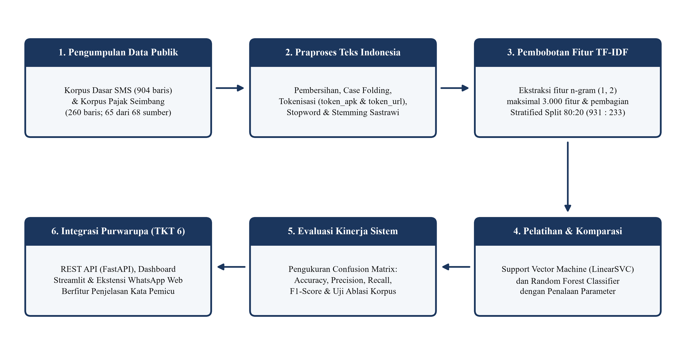

# TUGAS AKHIR

## KOMPARASI ALGORITMA SUPPORT VECTOR MACHINE DAN RANDOM FOREST DALAM DETEKSI PESAN PHISHING WHATSAPP MENGATASNAMAKAN OTORITAS PERPAJAKAN

## Sebagai Salah Satu Syarat untuk Memperoleh Gelar Sarjana Komputer pada Program Studi PJJ Sistem Informasi

## Oleh :

## 240101020194, Wan Mirza Dhani

## PROGRAM STUDI PJJ SISTEM INFORMASI

## UNIVERSITAS SIBER ASIA

## NOVEMBER 2026

---

# HALAMAN PERNYATAAN ORISINALITAS

Saya yang bertanda-tangan di bawah ini:

| Atribut Identitas | Keterangan Mahasiswa |
| :--- | :--- |
| Nama | Wan Mirza Dhani |
| NIM | 240101020194 |
| Judul Tugas Akhir | Komparasi Algoritma Support Vector Machine dan Random Forest dalam Deteksi Pesan Phishing WhatsApp Mengatasnamakan Otoritas Perpajakan |

Menyatakan dengan sesungguhnya bahwa Tugas Akhir ini merupakan hasil penelitian, pemikiran dan pemaparan asli saya sendiri. Saya tidak mencantumkan tanpa pengakuan bahan-bahan yang telah dipublikasikan sebelumnya atau ditulis oleh orang lain, atau sebagai bahan yang pernah diajukan untuk gelar atau ijazah pada Universitas Siber Asia atau Perguruan Tinggi lainnya.

Apabila di kemudian hari terdapat penyimpangan dan ketidakbenaran dalam pernyataan ini, maka saya bersedia menerima sanksi akademik sesuai dengan peraturan yang berlaku di Universitas Siber Asia.

Demikian pernyataan ini saya buat.

| Tempat dan Tanggal | Tanda Tangan di Atas Materai Rp10.000 | Nama Lengkap Mahasiswa |
| :--- | :---: | :--- |
| Jakarta, ...... / ................ / 2026 | (materai Rp 10.000,-) | (Wan Mirza Dhani) |

---

# HALAMAN PENGESAHAN

Tugas Akhir ini diajukan oleh :

| Atribut Pengajuan | Keterangan Mahasiswa |
| :--- | :--- |
| Nama | Wan Mirza Dhani |
| NIM | 240101020194 |
| Program Studi | PJJ Sistem Informasi |
| Judul Tugas Akhir | Komparasi Algoritma Support Vector Machine dan Random Forest dalam Deteksi Pesan Phishing WhatsApp Mengatasnamakan Otoritas Perpajakan |

Telah berhasil dipertahankan di hadapan Dewan Penguji dan diterima sebagai bagian persyaratan yang diperlukan untuk memperoleh gelar Sarjana Komputer pada Program Studi PJJ Sistem Informasi Universitas Siber Asia.

| Jabatan Dewan Sidang | Nama Lengkap dan Gelar Akademik | Tanda Tangan |
| :--- | :--- | :--- |
| Ketua Sidang / Dosen Penguji I | (..........................................) | .......................... |
| Dosen Penguji II | (..........................................) | .......................... |
| Dosen Pembimbing I | (Novi Dian Nathasia, S.Kom., MMSI) | .......................... |
| Dosen Pembimbing II | (..........................................) | .......................... |
| Ketua Program Studi | (Vika Febri Muliati, S.Kom., M.Kom) | .......................... |
| Ditetapkan di | Jakarta | |
| Tanggal | ...... / ................ / 2026 | |

---

# ABSTRAK

Pelaku *phishing* di WhatsApp yang mengaku sebagai Direktorat Jenderal Pajak kerap mengirim berkas `.apk` atau tautan *Coretax* palsu kepada korban. Penelitian ini membandingkan algoritma *Support Vector Machine* (`LinearSVC`) dan *Random Forest* menggunakan fitur *Term Frequency-Inverse Document Frequency* (TF-IDF), lalu menanamkan model terbaik ke aplikasi web *Cek Pesan Pajak* serta ekstensi peramban *WhatsApp Web*. Dataset induk berjumlah 1.164 teks (904 pesan umum dan 260 pesan pajak berimbang) yang menghasilkan 1.159 teks unik pascadeduplikasi *stopword removal* dan *stemming* Sastrawi. Pada validasi silang sepuluh lipatan (*10-Fold CV*), `LinearSVC` meraih *F1-Score* 97,16% (*Accuracy* 97,74%) mengungguli *Random Forest* sebesar 94,07% (*Accuracy* 95,25%), serta mencapai *F1-Score* 98,17% pada korpus pajak 260 baris. Setelah penalaan parameter dan kalibrasi *Platt scaling* berbasis *Pipeline*, `LinearSVC` mencatat akurasi *holdout* 95,69% (*ROC-AUC* 0,9957; *Brier Score* 0,02542) yang lebih terkalibrasi dibandingkan *Random Forest* (*Brier Score* 0,04214), serta unggul pada korpus diperluas 2.519 baris (96,03% berbanding 92,46%). Integrasi model terkalibrasi bersama penjaga heuristik `.apk` dan domain `pajak.go.id` ke peladen FastAPI serta ekstensi peramban memampukan verifikasi langsung berbahasa awam.

Kata Kunci: Deteksi Phishing, Otoritas Perpajakan, Random Forest, Support Vector Machine, TF-IDF.

# ABSTRACT

Scammers impersonating Indonesia's Directorate General of Taxes on WhatsApp frequently send malicious `.apk` files or fake *Coretax* links. This study compares *Support Vector Machine* (`LinearSVC`) and *Random Forest* classifiers using *Term Frequency-Inverse Document Frequency* (TF-IDF) features, then embeds the calibrated model into the *Cek Pesan Pajak* web application and a *WhatsApp Web* browser extension. The primary dataset comprises 1,164 Indonesian texts (904 general messages and 260 balanced tax messages), yielding 1,159 unique texts after Sastrawi stopword removal, stemming, and deduplication. Under stratified 10-fold cross-validation, `LinearSVC` achieved a 97.16% *F1-Score* (97.74% accuracy), outperforming *Random Forest* at 94.07% (95.25% accuracy), while reaching a 98.17% *F1-Score* on the 260-row tax corpus. Following hyperparameter tuning and pipeline-isolated Platt scaling calibration, `LinearSVC` recorded 95.69% holdout accuracy (0.9957 *ROC-AUC*, 0.02542 *Brier Score*) with superior probability calibration over *Random Forest* (0.04214 *Brier Score*), and led on the 2,519-row extended corpus (96.03% versus 92.46%). Integrating the calibrated model with `.apk` and official `pajak.go.id` domain guards into a FastAPI service and browser extension enables instant plain-language verification.

Keywords: Phishing Detection, Random Forest, Support Vector Machine, Tax Authority, TF-IDF.

---

# KATA PENGANTAR

Puji syukur penulis panjatkan kepada Tuhan Yang Maha Esa. Atas rahmat-Nya, penulis dapat menyelesaikan Tugas Akhir berjudul *"Komparasi Algoritma Support Vector Machine dan Random Forest dalam Deteksi Pesan Phishing WhatsApp Mengatasnamakan Otoritas Perpajakan"*. Tugas Akhir dengan skema *Prototype* ini disusun sebagai salah satu syarat untuk meraih gelar Sarjana Komputer pada Program Studi PJJ Sistem Informasi Universitas Siber Asia.

Topik ini penulis pilih karena semakin sering ditemukan kasus penipuan lewat WhatsApp yang mencatut nama otoritas perpajakan di Indonesia. Penelitian ini tidak mungkin selesai tanpa bantuan dan bimbingan banyak pihak, sejak masa perkuliahan hingga laporan ini tersusun. Oleh sebab itu, penulis mengucapkan terima kasih yang tulus kepada:

a) Bapak Jang Youn Cho, Ph.D., CPA, selaku Rektor Universitas Siber Asia, yang memimpin penyelenggaraan pendidikan tinggi daring sehingga proses studi penulis dapat berjalan.

b) Bapak Dr. Ucuk Darusalam, S.T., M.T., selaku Wakil Rektor Bidang Akademik, Penelitian dan Pengabdian Kepada Masyarakat Universitas Siber Asia, yang mendukung tersedianya fasilitas belajar dan penelitian bagi mahasiswa.

c) Ibu Vika Febri Muliati, S.Kom., M.Kom, selaku Ketua Program Studi PJJ Sistem Informasi Universitas Siber Asia, yang memberikan arahan akademik selama penulis menempuh studi.

d) Bapak Novi Dian Nathasia, S.Kom., MMSI, selaku Dosen Pembimbing Tugas Akhir, yang meluangkan waktu dan pikiran untuk membimbing penulis hingga penelitian ini selesai.

e) Seluruh dosen pengajar Program Studi PJJ Sistem Informasi Universitas Siber Asia, yang telah membekali penulis dengan ilmu komputasi yang sangat berguna.

f) Orang tua dan keluarga penulis, yang tidak pernah berhenti mendoakan. Dukungan moral dan materi dari keluarga menjadi sumber kekuatan utama bagi penulis.

g) Rekan-rekan mahasiswa Program Studi PJJ Sistem Informasi dan semua pihak yang telah membantu penulis. Diskusi selama penyusunan karya ilmiah ini sangat menolong penyelesaian purwarupa sistem.

Penulis menyadari laporan Tugas Akhir ini masih memiliki keterbatasan yang dapat diperbaiki pada penelitian selanjutnya. Karena itu, kritik dan saran yang membangun dari pembaca sangat penulis harapkan untuk menyempurnakan sistem deteksi ini ke depan. Akhir kata, semoga Tuhan Yang Maha Esa membalas kebaikan semua pihak yang telah membantu, dan semoga Tugas Akhir ini bermanfaat bagi pengembangan ilmu pengetahuan.

| Tempat dan Waktu Penyusunan | Identitas Penyusun |
| :--- | :---: |
| Jakarta, November 2026 | **Penulis** |

---

# DAFTAR ISI

| Bagian / Bab / Subbab | Halaman |
| :--- | :---: |
| Halaman Judul | i |
| Halaman Pernyataan Orisinalitas | ii |
| Halaman Pengesahan | iii |
| Halaman Abstrak dan *Abstract* | iv |
| Kata Pengantar | v |
| Daftar Isi | vii |
| Daftar Gambar | ix |
| Daftar Tabel | x |
| Bab I Pendahuluan | 1 |
| 1.1 Latar Belakang Masalah | 1 |
| 1.2 Rumusan Masalah | 2 |
| 1.3 Batasan Masalah | 3 |
| 1.4 Tujuan Penelitian | 4 |
| 1.5 Manfaat Penelitian | 5 |
| 1.6 Metode Penelitian | 6 |
| Bab II Landasan Metode | 8 |
| 2.1 Penelitian Terdahulu dan Matriks Komparasi | 8 |
| 2.2 Landasan Teori dan Metode Khusus | 11 |
| 2.2.1 Algoritma *Support Vector Machine*, *LinearSVC*, dan Kalibrasi Platt | 11 |
| 2.2.2 Algoritma *Random Forest* | 11 |
| 2.2.3 Praproses Teks Bahasa Indonesia dan Pembobotan Fitur TF-IDF | 12 |
| 2.2.4 Validasi Silang Terstratifikasi, Metrik Evaluasi, dan Kesiapterapan Teknologi | 13 |
| 2.3 Prosedur Operasional dan Bagan Alir Penelitian | 13 |
| 2.4 Waktu dan Lokasi Penelitian | 15 |
| 2.5 Alat dan Bahan Penelitian | 16 |
| 2.6 Cara Pengumpulan dan Analisis Data | 17 |
| 2.7 Definisi Operasional Variabel dan Parameter | 18 |
| Bab III Implementasi Metode Usulan | 20 |
| 3.1 Arsitektur Implementasi Metode Usulan | 20 |
| 3.2 Implementasi Kurasi Korpus dan Praproses Teks | 22 |
| 3.3 Implementasi Pelatihan Model, Penyetelan Hiperparameter, dan Kalibrasi | 24 |
| 3.4 Implementasi Purwarupa Sistem Terpadu Tingkat Kesiapan Teknologi 6 | 26 |
| 3.5 Skenario Pengujian Sistem dan Kesiapan Evaluasi | 29 |
| Bab IV Hasil dan Analisa | 31 |
| 4.1 Hasil Eksperimen Komparasi Klasifikasi dan Penyetelan Hiperparameter | 31 |
| 4.2 Analisis Kalibrasi Probabilitas dan Studi Ablatif Fitur | 34 |
| 4.3 Analisis Ketahanan Bias Kata Kunci Pajak dan Generalisasi Lintas Korpus | 36 |
| 4.4 Analisis Interpretabilitas Fitur dan Kesalahan Prediksi | 37 |
| 4.5 Hasil Pengujian Purwarupa Sistem Terpadu dan Evaluasi Kesiapterapan Teknologi | 42 |
| Daftar Pustaka | 47 |

---

# DAFTAR GAMBAR

| Nomor Gambar | Judul Gambar | Halaman |
| :--- | :--- | :---: |
| Gambar 1.1 | Tahapan Metode Penelitian | 7 |
| Gambar 2.1 | Bagan Alir Prosedur Eksperimen | 15 |
| Gambar 3.1 | Arsitektur Sistem Terpadu Deteksi *Phishing* WhatsApp Perpajakan | 20 |
| Gambar 3.2 | Rancangan Antarmuka Web *Cek Pesan Pajak* dan Ekstensi *WhatsApp Web* | 28 |
| Gambar 4.1 | Perbandingan *Confusion Matrix* Uji *Holdout* | 33 |
| Gambar 4.2 | Evaluasi Diskriminatif Kurva ROC dan *Precision-Recall* | 33 |
| Gambar 4.3 | Evaluasi Kalibrasi Probabilitas Model | 34 |
| Gambar 4.4 | Analisis Interpretabilitas Fitur TF-IDF Terbaik | 38 |
| Gambar 4.5 | Komparasi Generalisasi Lintas Korpus dan Subset Pajak | 37 |
| Gambar 4.6 | Tangkapan Layar Antarmuka Web *Cek Pesan Pajak* dan Respons API | 44 |
| Gambar 4.7 | Tangkapan Layar Ekstensi Chrome pada Simulasi *WhatsApp Web* | 45 |
| Gambar 4.8 | Analisis Interpretabilitas Model Berbasis SHAP | 40 |

---

# DAFTAR TABEL

| Nomor Tabel | Judul Tabel | Halaman |
| :--- | :--- | :---: |
| Tabel 1.1 | Komposisi Korpus Dataset Penelitian | 6 |
| Tabel 2.1 | Matriks Penelitian Terdahulu | 9 |
| Tabel 2.2 | Jadwal Pelaksanaan Penelitian | 15 |
| Tabel 2.3 | Spesifikasi Alat dan Bahan Penelitian | 16 |
| Tabel 2.4 | Definisi Operasional Variabel dan Parameter Penelitian | 19 |
| Tabel 3.1 | Pemetaan Modul Kode Sumber terhadap Tahapan Metodologi Penelitian | 21 |
| Tabel 3.2 | Konfigurasi Ruang Pencarian Hiperparameter dan Parameter Terpilih | 25 |
| Tabel 3.3 | Spesifikasi Titik Akhir Layanan Web dan REST API FastAPI (`api.py`) | 27 |
| Tabel 3.4 | Matriks Skenario Pengujian Otomatis Purwarupa dan Integritas Sistem | 29 |
| Tabel 4.1 | Hasil Komparasi Kinerja Klasifikasi pada Berbagai Tahap Evaluasi | 32 |
| Tabel 4.2 | Hasil Studi Ablatif Praproses dan Representasi Fitur TF-IDF | 35 |
| Tabel 4.3 | Perbandingan Fitur Teratas `LinearSVC` dan *Random Forest* | 38 |
| Tabel 4.4 | Ringkasan Analisis Kesalahan Prediksi pada Himpunan Uji *Holdout* | 41 |
| Tabel 4.5 | Hasil Pengujian Fungsional Otomatis dan Latensi Inferensi Purwarupa | 42 |
| Tabel 4.6 | Komparasi Hasil Penelitian terhadap Studi Terdahulu | 45 |

---

# BAB I PENDAHULUAN

## 1.1 Latar Belakang Masalah

Seiring modernisasi layanan publik, Direktorat Jenderal Pajak (DJP) semakin memperluas komunikasi elektronik dengan pembayar pajak [1]. Langkah ini terlihat dari penerapan Coretax melalui portal daring terpadu `coretaxdjp` dan aplikasi seluler *M-Pajak*. Selain menjadikan NIK berfungsi sebagai NPWP, DJP memakai siaran *WhatsApp* resmi untuk menyampaikan pemberitahuan [2]. Kanal ini mempercepat penyebaran imbauan pelaporan pajak tahunan kepada masyarakat. Namun, kemudahan itu ikut disalahgunakan penipu.

Kepercayaan masyarakat kepada institusi negara kerap dimanfaatkan untuk penipuan melalui aplikasi pesan singkat [3], [4]. Penelitian ini menelaah 68 arsip publik terverifikasi yang mayoritas terbit pada 2024 sampai 2026. Sumber arsip mencakup pengumuman resmi otoritas pajak, berita kasus KPP serta KP2KP, media perpajakan, dan situs pemeriksa fakta. Dari arsip tersebut, penulis memetakan dua belas modus penipuan pajak [5]. Pelaku mengirim berkas `.apk` pembaruan palsu, tautan tiruan seperti `coretax-online`, atau tagihan fiktif.

Masyarakat umum dan pegawai administrasi keuangan di perusahaan sering kesulitan membedakan siaran asli otoritas pajak dari pesan penipuan [1], [5]. Penipu meniru format surat dinas lengkap dengan nomor regulasinya sehingga pesan tampak meyakinkan. Mereka menyisipkan istilah teknis petugas, seperti kode *billing* atau nomor EFIN. Jika filter spam hanya dilatih memakai korpus pesan umum, kata kunci perpajakan itu rentan memicu salah prediksi. Pengumuman sah instansi pun ikut terblokir.

Beberapa penelitian terdahulu telah membandingkan algoritma pembelajaran mesin untuk mendeteksi pesan teks berbahaya. Untuk bahasa Indonesia, tersedia korpus SMS berlabel normal, penipuan, dan promo [6]. Pengujian pada kumpulan SMS tersebut membuktikan bahwa *Support Vector Machine* dan *Random Forest* meraih akurasi tinggi saat dipadukan dengan *bag of words*, TF-IDF, maupun pembobotan TF-RF [7], [8], [9], [10]. Penelitian lain mengkaji deteksi tautan palsu berbasis ciri URL [11], surel *phishing* [12], serta klasifikasi spam berbasis TF-IDF [13].

Studi penipuan berbahasa Indonesia pada platform digital baru menyoroti dialek Surabaya di WhatsApp [14], peladen *bot* [15], serta pesan penipuan lintas topik menggunakan XGBoost [16]. Sejumlah kajian lain turut menguji klasifikasi *SMS* dan *smishing* berbasis TF-IDF [17], [18], [19], [20], perbandingan *Support Vector Machine* dengan *Random Forest* untuk deteksi *phishing* [21], [22], serta penyaringan konten penipuan berbahasa Indonesia di media sosial X [23].

Kajian empiris yang secara khusus menyaring penipuan berkedok lembaga pajak masih sangat jarang. Literatur yang tersedia lebih banyak membahas aspek hukum kebocoran data pembayar pajak tanpa membangun sistem klasifikasi otomatis [3]. Celah inilah yang mendasari perbandingan ketepatan *LinearSVC* dan *Random Forest* pada teks penipuan WhatsApp bertema pajak. Penelitian ini menyusun 260 pesan pajak berimbang yang dipadukan dengan 904 pesan umum beserta penyandian `token_apk` dan `token_url` untuk meredam bias kata kunci (*keyword bias*). Sistem juga menyajikan keterjelasan prediksi berbasis bobot `LinearSVC` serta pemeriksaan domain resmi `pajak.go.id` agar pengguna mengetahui alasan suatu pesan ditandai berbahaya [24], [25].

Menyalin pesan secara manual ke situs terpisah kerap merepotkan pengguna. Karena itu, penelitian ini mewujudkan purwarupa TKT 6 yang memadukan layanan *backend* REST API berbasis FastAPI, antarmuka web *Cek Pesan Pajak* ramah awam, dan ekstensi peramban *WhatsApp Web* [26], [27]. Ekstensi tersebut menyuntikkan tombol *Cek Pesan Pajak* langsung pada gelembung percakapan untuk menampilkan status risiko, alasan dalam bahasa sehari-hari, serta saran tindakan aman secara instan. Arsitektur mesin klasifikasinya dirancang modular agar mudah diterapkan lebih luas.

## 1.2 Rumusan Masalah

Modus penipuan digital bertema perpajakan terus berubah, sementara masyarakat memerlukan cara verifikasi awal yang cepat dan dapat diandalkan. Latar belakang di atas memperlihatkan adanya jarak antara kemiripan taktik penipuan dan keterbatasan alat saring konvensional yang tersedia bagi pengguna. Agar perancangan dan pengujian model nantinya terarah, masalah utama penelitian ini dirumuskan menjadi tiga poin berikut:

a) Pesan *phishing* meniru gaya surat dinas dan memakai istilah perpajakan resmi, sehingga warga sulit memverifikasinya secara manual. Jika penerima telanjur memasang berkas berbahaya berekstensi `.apk`, akun dapat dicuri atau korban menderita kerugian finansial.

b) Penyaring spam konvensional yang hanya bertumpu pada korpus SMS umum mudah mengalami bias bobot kata. Ketimpangan data latih itu dapat menyebabkan pengumuman sah otoritas terblokir (*false positive*) atau membuat pesan penipuan baru lolos (*false negative*).

c) *Support Vector Machine* memisahkan kelas pada ruang fitur berdimensi tinggi secara linear, sedangkan *Random Forest* menggabungkan banyak pohon keputusan. Kedua algoritma perlu diuji langsung pada fitur TF-IDF unigram-bigram agar pemilihan model terbaik memiliki dasar yang terukur. Hasilnya menjadi landasan perancangan REST API, antarmuka web *Cek Pesan Pajak*, dan ekstensi *WhatsApp Web* berpenjelasan indikator pemicu.

## 1.3 Batasan Masalah

Ruang lingkup penelitian perlu dibatasi dengan jelas agar eksperimen klasifikasi tetap terarah dan tidak melebar ke luar pemrosesan teks. Batasan ini mengatur jenis masukan, sumber korpus, alur praproses, algoritma yang dibandingkan, dan bentuk produk perangkat lunaknya. Enam batasan yang menjadi koridor penelitian Tugas Akhir *Prototype* ini adalah sebagai berikut:

a) Analisis difokuskan pada klasifikasi biner teks pesan instan berbahasa Indonesia, tanpa lampiran gambar atau suara. Kelas `1` menandai pesan terindikasi penipuan, sedangkan kelas `0` menandai pesan normal atau informasi resmi layanan pajak.

b) Bahan penelitian hanya berupa data terbuka tanpa informasi rahasia instansi mana pun. Dataset induk berisi 1.164 teks, yaitu 904 SMS publik berbahasa Indonesia [6] dan 260 kutipan bertema pajak. Sebanyak 239 pesan promo pada korpus asli (1.143 pesan) disisihkan demi fokus klasifikasi biner. Teks pajak dikurasi dari 65 di antara 68 sumber publik yang dihimpun pada periode 2024 sampai 2026 [2], [5].

c) Pembersihan awal meliputi penghapusan simbol nonalfanumerik, pengubahan huruf kecil, konversi pola `.apk` menjadi `token_apk`, dan penggantian tautan menjadi `token_url`. Teks lalu melewati penyaringan kata henti, pemotongan imbuhan Sastrawi, serta ekstraksi TF-IDF hingga 3.000 token unigram dan bigram.

d) Eksperimen hanya membandingkan *LinearSVC* dengan *Random Forest Classifier*. Setelah deduplikasi lima teks identik hasil praproses Sastrawi pada 1.164 baris induk, diperoleh 1.159 teks unik yang dibagi terstratifikasi (*stratified split*) 80:20 menjadi 927 data latih dan 232 data uji.

e) Kualitas prediksi dinilai dengan empat indikator dari tabel *Confusion Matrix*, yaitu *Accuracy*, *Precision*, *Recall*, dan *F1-Score*. Pengamatan difokuskan pada algoritma yang lebih konsisten menekan salah prediksi negatif maupun salah blokir terhadap pesan sah.

f) Produk akhir dikemas sebagai purwarupa TKT 6 berbahasa Python. Sistemnya memadukan *backend* REST API FastAPI, antarmuka web *Cek Pesan Pajak* ramah pengguna awam, serta ekstensi peramban *WhatsApp Web* (Manifest V3). Sistem juga menyajikan penjelasan indikator risiko berbasis bobot `LinearSVC` dalam bahasa awam, deteksi berkas `.apk`, serta pemeriksaan domain resmi `pajak.go.id` tanpa salin-tempel manual.

## 1.4 Tujuan Penelitian

Tujuan penelitian ini disusun untuk menjawab ketiga rumusan masalah secara terarah sehingga eksperimen menghasilkan purwarupa sistem yang teruji secara empiris. Setiap sasaran dirumuskan sebagai tahapan teknis yang capaian kinerjanya dapat diukur menggunakan parameter evaluasi kuantitatif pada himpunan data uji maupun pengujian fungsional sistem. Adapun tiga tujuan utama penelitian ini adalah sebagai berikut:

a) Menyusun dataset teks perpajakan berbahasa Indonesia berimbang antara contoh pesan penipuan dan pengumuman resmi. Dataset itu lalu diproses melalui tahapan praproses khusus serta ekstraksi bobot fitur TF-IDF untuk menangkap pola bahasa penipu.

b) Menguji dan membandingkan kinerja klasifikasi *LinearSVC* dan *Random Forest* berdasarkan akurasi, presisi, *recall*, dan *F1-Score*. Eksperimen ini membuktikan keandalan model mengenali penipuan pajak tanpa salah memblokir pesan resmi.

c) Merancang purwarupa deteksi penipuan terpadu berbasis REST API FastAPI, web *Cek Pesan Pajak*, dan ekstensi *WhatsApp Web*. Sistem ini memuat model terbaik berfitur penjelasan indikator risiko agar masyarakat dapat memeriksa pesan langsung tanpa menyalin manual.

## 1.5 Manfaat Penelitian

Model klasifikasi dan purwarupa sistem deteksi pesan ini diharapkan memberi manfaat nyata bagi dunia akademik dan Universitas Siber Asia (UNSIA), institusi publik terkait, serta masyarakat pembayar pajak. Dataset yang seimbang, arsitektur layanan API terpadu, dan antarmuka uji langsung dirancang untuk menjawab kebutuhan literasi keamanan digital pada tingkat pengguna akhir. Manfaat penelitian ini dibagi ke dalam tiga aspek berikut:

a) Kontribusi Akademik dan Manfaat bagi Universitas Siber Asia: Menyajikan bukti empiris kelebihan dan kelemahan *Support Vector Machine* dibanding *Random Forest* beserta pembuktian mitigasi *keyword bias* pada teks pendek. Bagi Universitas Siber Asia, korpus perpajakan terbuka dan modul purwarupa ini dapat menjadi bahan praktikum *Natural Language Processing* di Program Studi PJJ Sistem Informasi, sekaligus memperkuat literasi keamanan siber bagi sivitas akademika.

b) Dukungan Teknis bagi Institusi Publik: Menghasilkan temuan pola kalimat dan purwarupa perangkat lunak yang dapat dipertimbangkan DJP maupun pengelola keamanan informasi sebagai pelengkap. Pemetaan dua belas modus penipuan perpajakan ini juga berguna untuk menyusun materi penyuluhan kepada masyarakat yang berbasis bukti lapangan.

c) Kemudahan Proteksi bagi Pembayar Pajak: Menyediakan sarana verifikasi daring lewat aplikasi web *Cek Pesan Pajak* dan tombol periksa pada ekstensi *WhatsApp Web*. Sebelum mengeklik pranala palsu atau mengunduh berkas `.apk`, masyarakat dapat menilai risiko pesan beserta alasan indikator pemicunya secara instan.

## 1.6 Metode Penelitian

Penelitian ini menggabungkan metode eksperimen kuantitatif dengan alur *Research and Development* (R&D) sesuai ketentuan Tugas Akhir *Prototype* di Universitas Siber Asia [27], [28]. Bahan teks dikumpulkan melalui studi kepustakaan dan pengambilan data terstruktur dari 68 laman otoritatif [29]. Laman-laman tersebut memuat siaran resmi otoritas pajak Indonesia, keterangan pers unit layanan, situs pemeriksa fakta, portal berita perpajakan, dan media nasional [2], [5]. Seluruh sumber berasal dari domain publik.

Sebanyak 260 catatan teks perpajakan dikurasi dari 65 sumber publik tersebut. Jumlahnya dibagi rata menjadi 130 contoh penipuan dari dua belas modus dan 130 pesan sah dari sepuluh kategori layanan maupun percakapan wajar. Proporsi setara ini menjaga agar model tidak bias terhadap istilah pajak. Korpus pajak itu digabung dengan 904 pesan SMS publik Indonesia menjadi dataset induk berisi 1.164 baris teks [6]. Rinciannya disajikan pada Tabel 1.1.

Tabel 1.1 Komposisi Korpus Dataset Penelitian

| Sumber Korpus | Asal Pengumpulan | Kategori Phishing | Kategori Aman | Jumlah Total |
| :--- | :--- | :---: | :---: | :---: |
| Kumpulan SMS Publik Indonesia | Repositori Akademik UPI (Rahmi & Wibisono) [6] | 335 | 569 | 904 |
| Kumpulan Teks Khusus Perpajakan | Kurasi 65 dari 68 sumber publik (DJP, media, pemeriksa fakta) [2], [5] | 130 | 130 | 260 |
| Himpunan Data Gabungan Induk | Integrasi Korpus SMS Umum serta Teks Pajak | 465 | 699 | 1.164 |

Sumber: Olahan Data Penelitian (2026).

Praproses teks bahasa Indonesia mencakup penghapusan karakter asing, pengecilan huruf, penyandian `token_apk`, dan penyandian `token_url`. Teks lalu melewati pembuangan kata henti, pengembalian ke kata dasar dengan Sastrawi, dan transformasi menjadi matriks TF-IDF unigram-bigram sebanyak 3.000 kolom [9], [10], [13], [18], [19], sebelum dibagi 80:20 secara terstratifikasi [11], [22]. Pelatihan dan penalaan parameter dijalankan pada *LinearSVC* serta *Random Forest*. Model terbaik diintegrasikan ke layanan REST API FastAPI, web *Cek Pesan Pajak*, dan ekstensi *WhatsApp Web* untuk mencapai TKT 6 [24], [26]. Urutannya ditunjukkan pada Gambar 1.1.

Gambar 1.1 Tahapan Metode Penelitian.

Matriks bobot TF-IDF memiliki ribuan dimensi dengan sebagian besar nilainya nol (*sparse*), sedangkan SVM dikenal mampu menangani data berdimensi tinggi dengan baik [11], [24]. Berdasarkan hal itu, disusun hipotesis kerja [30], [31] bahwa *LinearSVC* menghasilkan *Recall* dan *F1-Score* validasi silang serta kalibrasi probabilitas lebih baik daripada *Random Forest*. Uji pada 45 pesan pajak di himpunan uji dan 260 pesan pajak membuktikan pentingnya penyeimbangan korpus.

Pelatihan memakai korpus SMS umum saja hanya meraih akurasi 40,91% pada subset pajak. Tanpa penyeimbangan pesan resmi, akurasinya hanya mencapai 52,27% karena pengumuman sah terkena *false positive*. Setelah penyeimbangan dan deduplikasi 1.159 baris unik, `LinearSVC` meraih rata-rata *F1-Score* validasi silang sepuluh lipatan 97,16% (*Accuracy* 97,74%) mengungguli *Random Forest* sebesar 94,07% (*Accuracy* 95,25%). Pascapenalaan serta kalibrasi *Platt scaling*, `LinearSVC` mencatat akurasi uji 95,69% (*Brier Score* 0,02542; *ROC-AUC* 0,9957) serta *F1-Score* 98,17% pada validasi silang 260 pesan pajak, melampaui *Random Forest* sebesar 93,57%.

---

# DAFTAR PUSTAKA

[1] Waluyo, *Perpajakan Indonesia*, ed. ke-13. Jakarta: Salemba Empat, 2020.

[2] Direktorat Jenderal Pajak, “Penyebarluasan Informasi Mengenai Coretax (Pengumuman Nomor PENG-32/PJ.09/2024),” *Portal Resmi Direktorat Jenderal Pajak Kementerian Keuangan Republik Indonesia*, Nov. 2024. [Online]. Available: https://pajak.go.id/id/pengumuman/penyebarluasan-informasi-mengenai-coretax

[3] N. B. Prakoso, H. Ayu, and H. Zakaria, “Misuse of taxpayer data for phising scams,” *Journal of International Islamic Law, Human Rights, and Public Policy*, vol. 4, no. 3, pp. 1560-1569, Jul. 2026, doi: 10.5281/zenodo.21853029.

[4] R. Alabdan, “Phishing attacks survey: Types, vectors, and technical approaches,” *Future Internet*, vol. 12, no. 10, p. 168, Oct. 2020, doi: 10.3390/fi12100168.

[5] Direktorat Jenderal Pajak, “Waspada penipuan yang mengatasnamakan Direktorat Jenderal Pajak (Pengumuman Nomor PENG-31/PJ.09/2024 s.d. PENG-18/PJ.09/2026),” *Portal Resmi Direktorat Jenderal Pajak Kementerian Keuangan Republik Indonesia*, 2026. [Online]. Available: https://www.pajak.go.id/id/pengumuman/waspada-penipuan-yang-mengatasnamakan-direktorat-jenderal-pajak

[6] F. Rahmi and Y. Wibisono, “Aplikasi SMS spam filtering pada Android menggunakan algoritma Naïve Bayes,” Skripsi, Dept. Pendidikan Ilmu Komputer, Universitas Pendidikan Indonesia, Bandung, 2016. [Online]. Available: https://repository.upi.edu/26936/

[7] A. Theodorus, T. K. Prasetyo, R. Hartono, and D. Suhartono, “Short Message Service (SMS) spam filtering using machine learning in Bahasa Indonesia,” in *Proc. 3rd East Indonesia Conf. Comput. Inf. Technol. (EIConCIT)*, Apr. 2021, pp. 199-203, doi: 10.1109/EIConCIT50028.2021.9431859.

[8] D. Irawan, Hamidah, E. B. Perkasa, Yurindra, D. Wahyuningsih, and E. Helmud, “Perbandingan klassifikasi SMS berbasis Support Vector Machine, Naive Bayes Classifier, Random Forest dan Bagging Classifier,” *Jurnal Sisfokom (Sistem Informasi dan Komputer)*, vol. 10, no. 3, pp. 432-437, Dec. 2021, doi: 10.32736/sisfokom.v10i3.1302.

[9] M. S. Al Ghofany, R. Dwiyansaputra, F. Bimantoro, and Khairunnas, “Indonesian SMS spam detection using TF-RF feature weighting method and Support Vector Machine classifier,” in *Proc. First Mandalika Int. Multi-Conf. Sci. Eng. (MIMSE-I-C)*, 2022, pp. 117-129, doi: 10.2991/978-94-6463-084-8_12.

[10] E. Z. Astuti, C. A. Sari, E. H. Rachmawanto, and R. R. Ali, “Comparative study of machine learning algorithms for performing ham or spam classification in SMS,” *Scientific Journal of Informatics*, vol. 11, no. 1, pp. 177-186, Feb. 2024, doi: 10.15294/sji.v11i1.47364.

[11] F. F. Tampinongkol, A. R. Kamila, A. C. Wardhana, A. W. C. Kusuma, and D. Revaldo, “Implementation of Random Forest classification and Support Vector Machine algorithms for phishing link detection,” *Journal of Informatics Information System Software Engineering and Applications (INISTA)*, vol. 7, no. 1, pp. 127-137, Nov. 2024, doi: 10.20895/inista.v7i1.1588.

[12] A. Al Tawil, L. H. Almazaydeh, D. Qawasmeh, B. Qawasmeh, M. Alshinwan, and K. Elleithy, “Comparative analysis of machine learning algorithms for email phishing detection using TF-IDF, Word2Vec, and BERT,” *Computers, Materials & Continua*, vol. 81, no. 2, pp. 3395-3412, Nov. 2024, doi: 10.32604/cmc.2024.057279.

[13] A. A. Ningtias, N. Anwar, A. Ichwani, and R. T. Iswahyudi, “Komparasi kinerja Support Vector Machine dan Random Forest untuk deteksi spam email berbasis TF-IDF teks,” *IKRA-ITH Informatika: Jurnal Komputer dan Informatika*, vol. 10, no. 3, pp. 45-51, Nov. 2026.

[14] F. M. Efendi, A. K. Adisusilo, and S. Budiprayitno, “Pengembangan sistem deteksi phishing pada WhatsApp berbasis AI dengan integrasi bahasa lokal Surabaya,” *Melek IT Information Technology Journal*, vol. 11, no. 1, pp. 101-112, Jun. 2025, doi: 10.30742/melekitjournal.v11i1.417.

[15] R. B. Saputra, M. Azwar, L. Widyawati, Husain, and K. A. Latif, “Implementasi algoritma SVM pada bot WhatsApp untuk deteksi pesan spam,” *Jurnal Manajemen Informatika dan Sistem Informasi*, vol. 9, no. 1, pp. 39-51, Jan. 2026, doi: 10.36595/misi.v9i1.1803.

[16] M. A. Sembiring, M. F. L. Sibuea, and Anjani, “Optimasi model klasifikasi pesan penipuan digital berbahasa Indonesia menggunakan XGBoost dengan Bayesian Optimization dan SMOTE,” *Journal of Science and Social Research*, vol. 9, no. 3, pp. 5329-5336, Jun. 2026, doi: 10.54314/jssr.v9i3.7212.

[17] A. Setiyono and H. F. Pardede, “Klasifikasi SMS spam menggunakan Support Vector Machine,” *Jurnal Pilar Nusa Mandiri*, vol. 15, no. 2, pp. 275-280, Sep. 2019, doi: 10.33480/pilar.v15i2.693.

[18] N. J. Saputra, “Analysis of SMS spam detection using TF-IDF: A study on SMS Spam Collection dataset,” *Jurnal Sosial Teknologi*, vol. 4, no. 4, pp. 213-217, Apr. 2024, doi: 10.59188/jurnalsostech.v4i4.1214.

[19] H. Ahammad, M. Samsuzzaman, M. H. Rashid, and M. A. Masud, “Comparative analysis of machine learning algorithms for spam SMS classification using TF-IDF vectorization,” in *Proc. IEEE Int. Conf. Future Mach. Learn. Data Sci. (FMLDS)*, Nov. 2025, pp. 736-741, doi: 10.1109/fmlds67896.2025.00123.

[20] S. K. Birthriya, P. Ahlawat, and A. K. Jain, “Machine learning-based smishing detection using fuzzy logic and TF-IDF feature engineering,” *Franklin Open*, vol. 14, p. 100506, Mar. 2026, doi: 10.1016/j.fraope.2026.100506.

[21] R. Fauzan, A. V. Vitianingsih, D. Cahyono, A. L. Maukar, and Y. A. B. Suprio, “Penerapan algoritma klasifikasi pada machine learning untuk deteksi phishing,” *MALCOM: Indonesian Journal of Machine Learning and Computer Science*, vol. 5, no. 2, pp. 531-540, Mar. 2025, doi: 10.57152/malcom.v5i2.1968.

[22] I. P. Sari, O. K. Sulaiman, D. Apdilah, and P. Simanjuntak, “Analisis komparatif Support Vector Machine dan Random Forest untuk deteksi email phishing,” *Applied Information Technology and Computer Science (AICOMS)*, vol. 4, no. 2, pp. 18-27, Nov. 2025, doi: 10.58466/aicoms.v4i2.1806.

[23] I. K. Izzah, I. Riadi, and A. Fadlil, “Analisis kinerja machine learning untuk deteksi konten penipuan berbahasa Indonesia di Twitter,” *Rabit: Jurnal Teknologi dan Sistem Informasi Univrab*, vol. 11, no. 1, pp. 725-742, Jan. 2026, doi: 10.36341/rabit.v11i1.7124.

[24] P. Mishra and A. Yadav, “An explainable and reproducible lightweight machine learning framework for SMS spam detection using TF-IDF and Linear Support Vector Classification,” *International Journal of Advanced Science and Computer Applications*, vol. 5, no. 2, Sep. 2026, doi: 10.47679/ijasca.v5i2.269.

[25] J. Ismail, R. A. Nasution, and M. N. Gea, “Deteksi phishing URL menggunakan XGBoost dengan Explainable AI pada Web Page Phishing Detection dataset,” *IDEALIS: InDonEsiA journaL Information System*, vol. 9, no. 2, pp. 268-277, Jul. 2026, doi: 10.36080/idealis.v9i2.3810.

[26] Suwarno, V. Capricornness, and Y. Christian, “Implementasi machine learning berbasis browser extension untuk deteksi URL phishing menggunakan Logistic Regression classification,” *Komputa: Jurnal Ilmiah Komputer dan Informatika*, vol. 15, no. 1, May 2026, doi: 10.34010/komputa.v15i1.18882.

[27] C. R. Hassolthine, U. Darusalam, and M. Ikhwani, *Pedoman Teknis Penulisan Tugas Akhir Mahasiswa Universitas Siber Asia (SK Rektor Nomor 01 Tahun 2024)*. Jakarta: Universitas Siber Asia, 2024.

[28] Sugiyono, *Metode Penelitian Kuantitatif, Kualitatif, dan R&D*, ed. ke-2. Bandung: Alfabeta, 2023.

[29] M. Darwin, M. R. Mamondol, S. A. Sormin, and Y. Nurhayati, *Metode Penelitian Pendekatan Kuantitatif*. Bandung: Media Sains Indonesia, 2021.

[30] Sugiyono, *Statistika untuk Penelitian*. Bandung: Alfabeta, 2019.

[31] L. P. Sinambela, *Metodologi Penelitian Kuantitatif: Teoretik dan Praktik*. Depok: Rajawali Pers, 2021.
