# TUGAS AKHIR

## KOMPARASI ALGORITMA SUPPORT VECTOR MACHINE DAN RANDOM FOREST DALAM DETEKSI PESAN PHISHING WHATSAPP MENGATASNAMAKAN OTORITAS PERPAJAKAN

## Sebagai Salah Satu Syarat untuk Memperoleh Gelar Sarjana Komputer pada Program Studi PJJ Sistem Informasi

## Oleh :

## 240101020194, Wan Mirza Dhani

## PROGRAM STUDI PJJ SISTEM INFORMASI

## UNIVERSITAS SIBER ASIA

## NOVEMBER 2026

---

# HALAMAN PERNYATAAN ORISINALITAS

Saya yang bertanda-tangan di bawah ini:

| Atribut Identitas | Keterangan Mahasiswa |
| :--- | :--- |
| Nama | Wan Mirza Dhani |
| NIM | 240101020194 |
| Judul Tugas Akhir | Komparasi Algoritma Support Vector Machine dan Random Forest dalam Deteksi Pesan Phishing WhatsApp Mengatasnamakan Otoritas Perpajakan |

Menyatakan dengan sesungguhnya bahwa Tugas Akhir ini merupakan hasil penelitian, pemikiran dan pemaparan asli saya sendiri. Saya tidak mencantumkan tanpa pengakuan bahan-bahan yang telah dipublikasikan sebelumnya atau ditulis oleh orang lain, atau sebagai bahan yang pernah diajukan untuk gelar atau ijazah pada Universitas Siber Asia atau Perguruan Tinggi lainnya.

Apabila di kemudian hari terdapat penyimpangan dan ketidakbenaran dalam pernyataan ini, maka saya bersedia menerima sanksi akademik sesuai dengan peraturan yang berlaku di Universitas Siber Asia.

Demikian pernyataan ini saya buat.

| Tempat dan Tanggal | Tanda Tangan di Atas Materai Rp10.000 | Nama Lengkap Mahasiswa |
| :--- | :---: | :--- |
| Jakarta, ...... / ................ / 2026 | (materai Rp 10.000,-) | (Wan Mirza Dhani) |

---

# HALAMAN PENGESAHAN

Tugas Akhir ini diajukan oleh :

| Atribut Pengajuan | Keterangan Mahasiswa |
| :--- | :--- |
| Nama | Wan Mirza Dhani |
| NIM | 240101020194 |
| Program Studi | PJJ Sistem Informasi |
| Judul Tugas Akhir | Komparasi Algoritma Support Vector Machine dan Random Forest dalam Deteksi Pesan Phishing WhatsApp Mengatasnamakan Otoritas Perpajakan |

Telah berhasil dipertahankan di hadapan Dewan Penguji dan diterima sebagai bagian persyaratan yang diperlukan untuk memperoleh gelar Sarjana Komputer pada Program Studi PJJ Sistem Informasi Universitas Siber Asia.

| Jabatan Dewan Sidang | Nama Lengkap dan Gelar Akademik | Tanda Tangan |
| :--- | :--- | :--- |
| Ketua Sidang / Dosen Penguji I | (..........................................) | .......................... |
| Dosen Penguji II | (..........................................) | .......................... |
| Dosen Pembimbing I | (Novi Dian Nathasia, S.Kom., MMSI) | .......................... |
| Dosen Pembimbing II | (..........................................) | .......................... |
| Ketua Program Studi | (Vika Febri Muliati, S.Kom., M.Kom) | .......................... |
| Ditetapkan di | Jakarta | |
| Tanggal | ...... / ................ / 2026 | |

---

# ABSTRAK

Pelaku *phishing* di WhatsApp yang mengaku sebagai Direktorat Jenderal Pajak kerap mengirim berkas `.apk` atau tautan *Coretax* palsu kepada korban. Penelitian ini membandingkan algoritma *Support Vector Machine* (`LinearSVC`) dan *Random Forest* menggunakan fitur *Term Frequency-Inverse Document Frequency* (TF-IDF), lalu menanamkan model terbaik ke aplikasi web *Cek Pesan Pajak* serta ekstensi peramban *WhatsApp Web*. Dataset induk berjumlah 1.164 teks (904 pesan umum dan 260 pesan pajak berimbang) yang menghasilkan 1.159 teks unik pascadeduplikasi *stopword removal* dan *stemming* Sastrawi. Pada validasi silang sepuluh lipatan (*10-Fold CV*), `LinearSVC` meraih *F1-Score* 97,16% (*Accuracy* 97,74%) mengungguli *Random Forest* sebesar 94,07% (*Accuracy* 95,25%), serta mencapai *F1-Score* 98,17% pada korpus pajak 260 baris. Setelah penalaan parameter dan kalibrasi *Platt scaling* berbasis *Pipeline*, `LinearSVC` mencatat akurasi *holdout* 95,69% (*ROC-AUC* 0,9957; *Brier Score* 0,02542) yang lebih terkalibrasi dibandingkan *Random Forest* (*Brier Score* 0,04214), serta unggul pada korpus diperluas 2.519 baris (96,03% berbanding 92,46%). Integrasi model terkalibrasi bersama penjaga heuristik `.apk` dan domain `pajak.go.id` ke peladen FastAPI serta ekstensi peramban memampukan verifikasi langsung berbahasa awam.

Kata Kunci: Deteksi Phishing, Otoritas Perpajakan, Random Forest, Support Vector Machine, TF-IDF.

# ABSTRACT

Scammers impersonating Indonesia's Directorate General of Taxes on WhatsApp frequently send malicious `.apk` files or fake *Coretax* links. This study compares *Support Vector Machine* (`LinearSVC`) and *Random Forest* classifiers using *Term Frequency-Inverse Document Frequency* (TF-IDF) features, then embeds the calibrated model into the *Cek Pesan Pajak* web application and a *WhatsApp Web* browser extension. The primary dataset comprises 1,164 Indonesian texts (904 general messages and 260 balanced tax messages), yielding 1,159 unique texts after Sastrawi stopword removal, stemming, and deduplication. Under stratified 10-fold cross-validation, `LinearSVC` achieved a 97.16% *F1-Score* (97.74% accuracy), outperforming *Random Forest* at 94.07% (95.25% accuracy), while reaching a 98.17% *F1-Score* on the 260-row tax corpus. Following hyperparameter tuning and pipeline-isolated Platt scaling calibration, `LinearSVC` recorded 95.69% holdout accuracy (0.9957 *ROC-AUC*, 0.02542 *Brier Score*) with superior probability calibration over *Random Forest* (0.04214 *Brier Score*), and led on the 2,519-row extended corpus (96.03% versus 92.46%). Integrating the calibrated model with `.apk` and official `pajak.go.id` domain guards into a FastAPI service and browser extension enables instant plain-language verification.

Keywords: Phishing Detection, Random Forest, Support Vector Machine, Tax Authority, TF-IDF.

---

# KATA PENGANTAR

Puji syukur penulis panjatkan kepada Tuhan Yang Maha Esa. Atas rahmat-Nya, penulis dapat menyelesaikan Tugas Akhir berjudul *"Komparasi Algoritma Support Vector Machine dan Random Forest dalam Deteksi Pesan Phishing WhatsApp Mengatasnamakan Otoritas Perpajakan"*. Tugas Akhir dengan skema *Prototype* ini disusun sebagai salah satu syarat untuk meraih gelar Sarjana Komputer pada Program Studi PJJ Sistem Informasi Universitas Siber Asia.

Topik ini penulis pilih karena semakin sering ditemukan kasus penipuan lewat WhatsApp yang mencatut nama otoritas perpajakan di Indonesia. Penelitian ini tidak mungkin selesai tanpa bantuan dan bimbingan banyak pihak, sejak masa perkuliahan hingga laporan ini tersusun. Oleh sebab itu, penulis mengucapkan terima kasih yang tulus kepada:

a) Bapak Jang Youn Cho, Ph.D., CPA, selaku Rektor Universitas Siber Asia, yang memimpin penyelenggaraan pendidikan tinggi daring sehingga proses studi penulis dapat berjalan.

b) Bapak Dr. Ucuk Darusalam, S.T., M.T., selaku Wakil Rektor Bidang Akademik, Penelitian dan Pengabdian Kepada Masyarakat Universitas Siber Asia, yang mendukung tersedianya fasilitas belajar dan penelitian bagi mahasiswa.

c) Ibu Vika Febri Muliati, S.Kom., M.Kom, selaku Ketua Program Studi PJJ Sistem Informasi Universitas Siber Asia, yang memberikan arahan akademik selama penulis menempuh studi.

d) Bapak Novi Dian Nathasia, S.Kom., MMSI, selaku Dosen Pembimbing Tugas Akhir, yang meluangkan waktu dan pikiran untuk membimbing penulis hingga penelitian ini selesai.

e) Seluruh dosen pengajar Program Studi PJJ Sistem Informasi Universitas Siber Asia, yang telah membekali penulis dengan ilmu komputasi yang sangat berguna.

f) Orang tua dan keluarga penulis, yang tidak pernah berhenti mendoakan. Dukungan moral dan materi dari keluarga menjadi sumber kekuatan utama bagi penulis.

g) Rekan-rekan mahasiswa Program Studi PJJ Sistem Informasi dan semua pihak yang telah membantu penulis. Diskusi selama penyusunan karya ilmiah ini sangat menolong penyelesaian purwarupa sistem.

Penulis menyadari laporan Tugas Akhir ini masih memiliki keterbatasan yang dapat diperbaiki pada penelitian selanjutnya. Karena itu, kritik dan saran yang membangun dari pembaca sangat penulis harapkan untuk menyempurnakan sistem deteksi ini ke depan. Akhir kata, semoga Tuhan Yang Maha Esa membalas kebaikan semua pihak yang telah membantu, dan semoga Tugas Akhir ini bermanfaat bagi pengembangan ilmu pengetahuan.

| Tempat dan Waktu Penyusunan | Identitas Penyusun |
| :--- | :---: |
| Jakarta, November 2026 | **Penulis** |

---

# DAFTAR ISI

| Bagian / Bab / Subbab | Halaman |
| :--- | :---: |
| Halaman Judul | i |
| Halaman Pernyataan Orisinalitas | ii |
| Halaman Pengesahan | iii |
| Halaman Abstrak dan *Abstract* | iv |
| Kata Pengantar | v |
| Daftar Isi | vii |
| Daftar Gambar | ix |
| Daftar Tabel | x |
| Bab I Pendahuluan | 1 |
| 1.1 Latar Belakang Masalah | 1 |
| 1.2 Rumusan Masalah | 2 |
| 1.3 Batasan Masalah | 3 |
| 1.4 Tujuan Penelitian | 4 |
| 1.5 Manfaat Penelitian | 5 |
| 1.6 Metode Penelitian | 6 |
| Bab II Landasan Metode | 8 |
| 2.1 Penelitian Terdahulu dan Matriks Komparasi | 8 |
| 2.2 Landasan Teori dan Metode Khusus | 11 |
| 2.2.1 Algoritma *Support Vector Machine*, *LinearSVC*, dan Kalibrasi Platt | 11 |
| 2.2.2 Algoritma *Random Forest* | 11 |
| 2.2.3 Praproses Teks Bahasa Indonesia dan Pembobotan Fitur TF-IDF | 12 |
| 2.2.4 Validasi Silang Terstratifikasi, Metrik Evaluasi, dan Kesiapterapan Teknologi | 13 |
| 2.3 Prosedur Operasional dan Bagan Alir Penelitian | 13 |
| 2.4 Waktu dan Lokasi Penelitian | 15 |
| 2.5 Alat dan Bahan Penelitian | 16 |
| 2.6 Cara Pengumpulan dan Analisis Data | 17 |
| 2.7 Definisi Operasional Variabel dan Parameter | 18 |
| Bab III Implementasi Metode Usulan | 20 |
| 3.1 Arsitektur Implementasi Metode Usulan | 20 |
| 3.2 Implementasi Kurasi Korpus dan Praproses Teks | 22 |
| 3.3 Implementasi Pelatihan Model, Penyetelan Hiperparameter, dan Kalibrasi | 24 |
| 3.4 Implementasi Purwarupa Sistem Terpadu Tingkat Kesiapan Teknologi 6 | 26 |
| 3.5 Skenario Pengujian Sistem dan Kesiapan Evaluasi | 29 |
| Bab IV Hasil dan Analisa | 31 |
| 4.1 Hasil Eksperimen Komparasi Klasifikasi dan Penyetelan Hiperparameter | 31 |
| 4.2 Analisis Kalibrasi Probabilitas dan Studi Ablatif Fitur | 34 |
| 4.3 Analisis Ketahanan Bias Kata Kunci Pajak dan Generalisasi Lintas Korpus | 36 |
| 4.4 Analisis Interpretabilitas Fitur dan Kesalahan Prediksi | 37 |
| 4.5 Hasil Pengujian Purwarupa Sistem Terpadu dan Evaluasi Kesiapterapan Teknologi | 42 |
| Daftar Pustaka | 47 |

---

# DAFTAR GAMBAR

| Nomor Gambar | Judul Gambar | Halaman |
| :--- | :--- | :---: |
| Gambar 1.1 | Tahapan Metode Penelitian | 7 |
| Gambar 2.1 | Bagan Alir Prosedur Eksperimen | 15 |
| Gambar 3.1 | Arsitektur Sistem Terpadu Deteksi *Phishing* WhatsApp Perpajakan | 20 |
| Gambar 3.2 | Rancangan Antarmuka Web *Cek Pesan Pajak* dan Ekstensi *WhatsApp Web* | 28 |
| Gambar 4.1 | Perbandingan *Confusion Matrix* Uji *Holdout* | 33 |
| Gambar 4.2 | Evaluasi Diskriminatif Kurva ROC dan *Precision-Recall* | 33 |
| Gambar 4.3 | Evaluasi Kalibrasi Probabilitas Model | 34 |
| Gambar 4.4 | Analisis Interpretabilitas Fitur TF-IDF Terbaik | 38 |
| Gambar 4.5 | Komparasi Generalisasi Lintas Korpus dan Subset Pajak | 37 |
| Gambar 4.6 | Tangkapan Layar Antarmuka Web *Cek Pesan Pajak* dan Respons API | 44 |
| Gambar 4.7 | Tangkapan Layar Ekstensi Chrome pada Simulasi *WhatsApp Web* | 45 |
| Gambar 4.8 | Analisis Interpretabilitas Model Berbasis SHAP | 40 |

---

# DAFTAR TABEL

| Nomor Tabel | Judul Tabel | Halaman |
| :--- | :--- | :---: |
| Tabel 1.1 | Komposisi Korpus Dataset Penelitian | 6 |
| Tabel 2.1 | Matriks Penelitian Terdahulu | 9 |
| Tabel 2.2 | Jadwal Pelaksanaan Penelitian | 15 |
| Tabel 2.3 | Spesifikasi Alat dan Bahan Penelitian | 16 |
| Tabel 2.4 | Definisi Operasional Variabel dan Parameter Penelitian | 19 |
| Tabel 3.1 | Pemetaan Modul Kode Sumber terhadap Tahapan Metodologi Penelitian | 21 |
| Tabel 3.2 | Konfigurasi Ruang Pencarian Hiperparameter dan Parameter Terpilih | 25 |
| Tabel 3.3 | Spesifikasi Titik Akhir Layanan Web dan REST API FastAPI (`api.py`) | 27 |
| Tabel 3.4 | Matriks Skenario Pengujian Otomatis Purwarupa dan Integritas Sistem | 29 |
| Tabel 4.1 | Hasil Komparasi Kinerja Klasifikasi pada Berbagai Tahap Evaluasi | 32 |
| Tabel 4.2 | Hasil Studi Ablatif Praproses dan Representasi Fitur TF-IDF | 35 |
| Tabel 4.3 | Perbandingan Fitur Teratas `LinearSVC` dan *Random Forest* | 38 |
| Tabel 4.4 | Ringkasan Analisis Kesalahan Prediksi pada Himpunan Uji *Holdout* | 41 |
| Tabel 4.5 | Hasil Pengujian Fungsional Otomatis dan Latensi Inferensi Purwarupa | 42 |
| Tabel 4.6 | Komparasi Hasil Penelitian terhadap Studi Terdahulu | 45 |

---

# BAB I PENDAHULUAN

## 1.1 Latar Belakang Masalah

Seiring modernisasi layanan publik, Direktorat Jenderal Pajak (DJP) semakin memperluas komunikasi elektronik dengan pembayar pajak [1]. Langkah ini terlihat dari penerapan Coretax melalui portal daring terpadu `coretaxdjp` dan aplikasi seluler *M-Pajak*. Selain menjadikan NIK berfungsi sebagai NPWP, DJP memakai siaran *WhatsApp* resmi untuk menyampaikan pemberitahuan [2]. Kanal ini mempercepat penyebaran imbauan pelaporan pajak tahunan kepada masyarakat. Namun, kemudahan itu ikut disalahgunakan penipu.

Kepercayaan masyarakat kepada institusi negara kerap dimanfaatkan untuk penipuan melalui aplikasi pesan singkat [3], [4]. Penelitian ini menelaah 68 arsip publik terverifikasi yang mayoritas terbit pada 2024 sampai 2026. Sumber arsip mencakup pengumuman resmi otoritas pajak, berita kasus KPP serta KP2KP, media perpajakan, dan situs pemeriksa fakta. Dari arsip tersebut, penulis memetakan dua belas modus penipuan pajak [5]. Pelaku mengirim berkas `.apk` pembaruan palsu, tautan tiruan seperti `coretax-online`, atau tagihan fiktif.

Masyarakat umum dan pegawai administrasi keuangan di perusahaan sering kesulitan membedakan siaran asli otoritas pajak dari pesan penipuan [1], [5]. Penipu meniru format surat dinas lengkap dengan nomor regulasinya sehingga pesan tampak meyakinkan. Mereka menyisipkan istilah teknis petugas, seperti kode *billing* atau nomor EFIN. Jika filter spam hanya dilatih memakai korpus pesan umum, kata kunci perpajakan itu rentan memicu salah prediksi. Pengumuman sah instansi pun ikut terblokir.

Beberapa penelitian terdahulu telah membandingkan algoritma pembelajaran mesin untuk mendeteksi pesan teks berbahaya. Untuk bahasa Indonesia, tersedia korpus SMS berlabel normal, penipuan, dan promo [6]. Pengujian pada kumpulan SMS tersebut membuktikan bahwa *Support Vector Machine* dan *Random Forest* meraih akurasi tinggi saat dipadukan dengan *bag of words*, TF-IDF, maupun pembobotan TF-RF [7], [8], [9], [10]. Penelitian lain mengkaji deteksi tautan palsu berbasis ciri URL [11], surel *phishing* [12], serta klasifikasi spam berbasis TF-IDF [13].

Studi penipuan berbahasa Indonesia pada platform digital baru menyoroti dialek Surabaya di WhatsApp [14], peladen *bot* [15], serta pesan penipuan lintas topik menggunakan XGBoost [16]. Sejumlah kajian lain turut menguji klasifikasi *SMS* dan *smishing* berbasis TF-IDF [17], [18], [19], [20], perbandingan *Support Vector Machine* dengan *Random Forest* untuk deteksi *phishing* [21], [22], serta penyaringan konten penipuan berbahasa Indonesia di media sosial X [23].

Kajian empiris yang secara khusus menyaring penipuan berkedok lembaga pajak masih sangat jarang. Literatur yang tersedia lebih banyak membahas aspek hukum kebocoran data pembayar pajak tanpa membangun sistem klasifikasi otomatis [3]. Celah inilah yang mendasari perbandingan ketepatan *LinearSVC* dan *Random Forest* pada teks penipuan WhatsApp bertema pajak. Penelitian ini menyusun 260 pesan pajak berimbang yang dipadukan dengan 904 pesan umum beserta penyandian `token_apk` dan `token_url` untuk meredam bias kata kunci (*keyword bias*). Sistem juga menyajikan keterjelasan prediksi berbasis bobot `LinearSVC` serta pemeriksaan domain resmi `pajak.go.id` agar pengguna mengetahui alasan suatu pesan ditandai berbahaya [24], [25].

Menyalin pesan secara manual ke situs terpisah kerap merepotkan pengguna. Karena itu, penelitian ini mewujudkan purwarupa TKT 6 yang memadukan layanan *backend* REST API berbasis FastAPI, antarmuka web *Cek Pesan Pajak* ramah awam, dan ekstensi peramban *WhatsApp Web* [26], [27]. Ekstensi tersebut menyuntikkan tombol *Cek Pesan Pajak* langsung pada gelembung percakapan untuk menampilkan status risiko, alasan dalam bahasa sehari-hari, serta saran tindakan aman secara instan. Arsitektur mesin klasifikasinya dirancang modular agar mudah diterapkan lebih luas.

## 1.2 Rumusan Masalah

Modus penipuan digital bertema perpajakan terus berubah, sementara masyarakat memerlukan cara verifikasi awal yang cepat dan dapat diandalkan. Latar belakang di atas memperlihatkan adanya jarak antara kemiripan taktik penipuan dan keterbatasan alat saring konvensional yang tersedia bagi pengguna. Agar perancangan dan pengujian model nantinya terarah, masalah utama penelitian ini dirumuskan menjadi tiga poin berikut:

a) Pesan *phishing* meniru gaya surat dinas dan memakai istilah perpajakan resmi, sehingga warga sulit memverifikasinya secara manual. Jika penerima telanjur memasang berkas berbahaya berekstensi `.apk`, akun dapat dicuri atau korban menderita kerugian finansial.

b) Penyaring spam konvensional yang hanya bertumpu pada korpus SMS umum mudah mengalami bias bobot kata. Ketimpangan data latih itu dapat menyebabkan pengumuman sah otoritas terblokir (*false positive*) atau membuat pesan penipuan baru lolos (*false negative*).

c) *Support Vector Machine* memisahkan kelas pada ruang fitur berdimensi tinggi secara linear, sedangkan *Random Forest* menggabungkan banyak pohon keputusan. Kedua algoritma perlu diuji langsung pada fitur TF-IDF unigram-bigram agar pemilihan model terbaik memiliki dasar yang terukur. Hasilnya menjadi landasan perancangan REST API, antarmuka web *Cek Pesan Pajak*, dan ekstensi *WhatsApp Web* berpenjelasan indikator pemicu.

## 1.3 Batasan Masalah

Ruang lingkup penelitian perlu dibatasi dengan jelas agar eksperimen klasifikasi tetap terarah dan tidak melebar ke luar pemrosesan teks. Batasan ini mengatur jenis masukan, sumber korpus, alur praproses, algoritma yang dibandingkan, dan bentuk produk perangkat lunaknya. Enam batasan yang menjadi koridor penelitian Tugas Akhir *Prototype* ini adalah sebagai berikut:

a) Analisis difokuskan pada klasifikasi biner teks pesan instan berbahasa Indonesia, tanpa lampiran gambar atau suara. Kelas `1` menandai pesan terindikasi penipuan, sedangkan kelas `0` menandai pesan normal atau informasi resmi layanan pajak.

b) Bahan penelitian hanya berupa data terbuka tanpa informasi rahasia instansi mana pun. Dataset induk berisi 1.164 teks, yaitu 904 SMS publik berbahasa Indonesia [6] dan 260 kutipan bertema pajak. Sebanyak 239 pesan promo pada korpus asli (1.143 pesan) disisihkan demi fokus klasifikasi biner. Teks pajak dikurasi dari 65 di antara 68 sumber publik yang dihimpun pada periode 2024 sampai 2026 [2], [5].

c) Pembersihan awal meliputi penghapusan simbol nonalfanumerik, pengubahan huruf kecil, konversi pola `.apk` menjadi `token_apk`, dan penggantian tautan menjadi `token_url`. Teks lalu melewati penyaringan kata henti, pemotongan imbuhan Sastrawi, serta ekstraksi TF-IDF hingga 3.000 token unigram dan bigram.

d) Eksperimen hanya membandingkan *LinearSVC* dengan *Random Forest Classifier*. Setelah deduplikasi lima teks identik hasil praproses Sastrawi pada 1.164 baris induk, diperoleh 1.159 teks unik yang dibagi terstratifikasi (*stratified split*) 80:20 menjadi 927 data latih dan 232 data uji.

e) Kualitas prediksi dinilai dengan empat indikator dari tabel *Confusion Matrix*, yaitu *Accuracy*, *Precision*, *Recall*, dan *F1-Score*. Pengamatan difokuskan pada algoritma yang lebih konsisten menekan salah prediksi negatif maupun salah blokir terhadap pesan sah.

f) Produk akhir dikemas sebagai purwarupa TKT 6 berbahasa Python. Sistemnya memadukan *backend* REST API FastAPI, antarmuka web *Cek Pesan Pajak* ramah pengguna awam, serta ekstensi peramban *WhatsApp Web* (Manifest V3). Sistem juga menyajikan penjelasan indikator risiko berbasis bobot `LinearSVC` dalam bahasa awam, deteksi berkas `.apk`, serta pemeriksaan domain resmi `pajak.go.id` tanpa salin-tempel manual.

## 1.4 Tujuan Penelitian

Tujuan penelitian ini disusun untuk menjawab ketiga rumusan masalah secara terarah sehingga eksperimen menghasilkan purwarupa sistem yang teruji secara empiris. Setiap sasaran dirumuskan sebagai tahapan teknis yang capaian kinerjanya dapat diukur menggunakan parameter evaluasi kuantitatif pada himpunan data uji maupun pengujian fungsional sistem. Adapun tiga tujuan utama penelitian ini adalah sebagai berikut:

a) Menyusun dataset teks perpajakan berbahasa Indonesia berimbang antara contoh pesan penipuan dan pengumuman resmi. Dataset itu lalu diproses melalui tahapan praproses khusus serta ekstraksi bobot fitur TF-IDF untuk menangkap pola bahasa penipu.

b) Menguji dan membandingkan kinerja klasifikasi *LinearSVC* dan *Random Forest* berdasarkan akurasi, presisi, *recall*, dan *F1-Score*. Eksperimen ini membuktikan keandalan model mengenali penipuan pajak tanpa salah memblokir pesan resmi.

c) Merancang purwarupa deteksi penipuan terpadu berbasis REST API FastAPI, web *Cek Pesan Pajak*, dan ekstensi *WhatsApp Web*. Sistem ini memuat model terbaik berfitur penjelasan indikator risiko agar masyarakat dapat memeriksa pesan langsung tanpa menyalin manual.

## 1.5 Manfaat Penelitian

Model klasifikasi dan purwarupa sistem deteksi pesan ini diharapkan memberi manfaat nyata bagi dunia akademik dan Universitas Siber Asia (UNSIA), institusi publik terkait, serta masyarakat pembayar pajak. Dataset yang seimbang, arsitektur layanan API terpadu, dan antarmuka uji langsung dirancang untuk menjawab kebutuhan literasi keamanan digital pada tingkat pengguna akhir. Manfaat penelitian ini dibagi ke dalam tiga aspek berikut:

a) Kontribusi Akademik dan Manfaat bagi Universitas Siber Asia: Menyajikan bukti empiris kelebihan dan kelemahan *Support Vector Machine* dibanding *Random Forest* beserta pembuktian mitigasi *keyword bias* pada teks pendek. Bagi Universitas Siber Asia, korpus perpajakan terbuka dan modul purwarupa ini dapat menjadi bahan praktikum *Natural Language Processing* di Program Studi PJJ Sistem Informasi, sekaligus memperkuat literasi keamanan siber bagi sivitas akademika.

b) Dukungan Teknis bagi Institusi Publik: Menghasilkan temuan pola kalimat dan purwarupa perangkat lunak yang dapat dipertimbangkan DJP maupun pengelola keamanan informasi sebagai pelengkap. Pemetaan dua belas modus penipuan perpajakan ini juga berguna untuk menyusun materi penyuluhan kepada masyarakat yang berbasis bukti lapangan.

c) Kemudahan Proteksi bagi Pembayar Pajak: Menyediakan sarana verifikasi daring lewat aplikasi web *Cek Pesan Pajak* dan tombol periksa pada ekstensi *WhatsApp Web*. Sebelum mengeklik pranala palsu atau mengunduh berkas `.apk`, masyarakat dapat menilai risiko pesan beserta alasan indikator pemicunya secara instan.

## 1.6 Metode Penelitian

Penelitian ini menggabungkan metode eksperimen kuantitatif dengan alur *Research and Development* (R&D) sesuai ketentuan Tugas Akhir *Prototype* di Universitas Siber Asia [27], [28]. Bahan teks dikumpulkan melalui studi kepustakaan dan pengambilan data terstruktur dari 68 laman otoritatif [29]. Laman-laman tersebut memuat siaran resmi otoritas pajak Indonesia, keterangan pers unit layanan, situs pemeriksa fakta, portal berita perpajakan, dan media nasional [2], [5]. Seluruh sumber berasal dari domain publik.

Sebanyak 260 catatan teks perpajakan dikurasi dari 65 sumber publik tersebut. Jumlahnya dibagi rata menjadi 130 contoh penipuan dari dua belas modus dan 130 pesan sah dari sepuluh kategori layanan maupun percakapan wajar. Proporsi setara ini menjaga agar model tidak bias terhadap istilah pajak. Korpus pajak itu digabung dengan 904 pesan SMS publik Indonesia menjadi dataset induk berisi 1.164 baris teks [6]. Rinciannya disajikan pada Tabel 1.1.

Tabel 1.1 Komposisi Korpus Dataset Penelitian

| Sumber Korpus | Asal Pengumpulan | Kategori Phishing | Kategori Aman | Jumlah Total |
| :--- | :--- | :---: | :---: | :---: |
| Kumpulan SMS Publik Indonesia | Repositori Akademik UPI (Rahmi & Wibisono) [6] | 335 | 569 | 904 |
| Kumpulan Teks Khusus Perpajakan | Kurasi 65 dari 68 sumber publik (DJP, media, pemeriksa fakta) [2], [5] | 130 | 130 | 260 |
| Himpunan Data Gabungan Induk | Integrasi Korpus SMS Umum serta Teks Pajak | 465 | 699 | 1.164 |

Sumber: Olahan Data Penelitian (2026).

Praproses teks bahasa Indonesia mencakup penghapusan karakter asing, pengecilan huruf, penyandian `token_apk`, dan penyandian `token_url`. Teks lalu melewati pembuangan kata henti, pengembalian ke kata dasar dengan Sastrawi, dan transformasi menjadi matriks TF-IDF unigram-bigram sebanyak 3.000 kolom [9], [10], [13], [18], [19], sebelum dibagi 80:20 secara terstratifikasi [11], [22]. Pelatihan dan penalaan parameter dijalankan pada *LinearSVC* serta *Random Forest*. Model terbaik diintegrasikan ke layanan REST API FastAPI, web *Cek Pesan Pajak*, dan ekstensi *WhatsApp Web* untuk mencapai TKT 6 [24], [26]. Urutannya ditunjukkan pada Gambar 1.1.

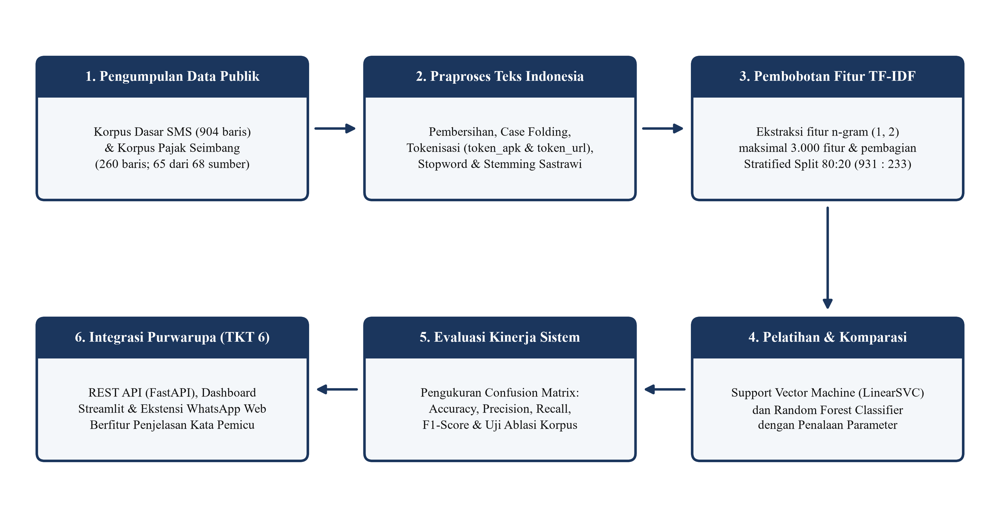

Gambar 1.1 Tahapan Metode Penelitian.

Matriks bobot TF-IDF memiliki ribuan dimensi dengan sebagian besar nilainya nol (*sparse*), sedangkan SVM dikenal mampu menangani data berdimensi tinggi dengan baik [11], [24]. Berdasarkan hal itu, disusun hipotesis kerja [30], [31] bahwa *LinearSVC* menghasilkan *Recall* dan *F1-Score* validasi silang serta kalibrasi probabilitas lebih baik daripada *Random Forest*. Uji pada 45 pesan pajak di himpunan uji dan 260 pesan pajak membuktikan pentingnya penyeimbangan korpus.

Pelatihan memakai korpus SMS umum saja hanya meraih akurasi 40,91% pada subset pajak. Tanpa penyeimbangan pesan resmi, akurasinya hanya mencapai 52,27% karena pengumuman sah terkena *false positive*. Setelah penyeimbangan dan deduplikasi 1.159 baris unik, `LinearSVC` meraih rata-rata *F1-Score* validasi silang sepuluh lipatan 97,16% (*Accuracy* 97,74%) mengungguli *Random Forest* sebesar 94,07% (*Accuracy* 95,25%). Pascapenalaan serta kalibrasi *Platt scaling*, `LinearSVC` mencatat akurasi uji 95,69% (*Brier Score* 0,02542; *ROC-AUC* 0,9957) serta *F1-Score* 98,17% pada validasi silang 260 pesan pajak, melampaui *Random Forest* sebesar 93,57%.

---

# BAB II LANDASAN METODE

## 2.1 Penelitian Terdahulu dan Matriks Komparasi

Transformasi administrasi perpajakan elektronik mendorong Direktorat Jenderal Pajak memperluas kanal komunikasi digital dengan masyarakat [1]. Pemanfaatan siaran resmi *WhatsApp Blast* untuk sosialisasi sistem inti administrasi perpajakan Coretax mempercepat penyebaran informasi layanan kepada wajib pajak [2]. Namun, celah penyalahgunaan data dan keterbatasan literasi keamanan digital kerap dimanfaatkan pelaku kejahatan siber melalui pesan penipuan [3]. Serangan rekayasa sosial berbasis pesan singkat atau *smishing* memicu kepanikan penerima lewat peniruan identitas resmi [4]. Pelaku umumnya menyebarkan berkas berbahaya berekstensi `.apk` atau tautan tiruan yang menyerupai pengumuman otoritas perpajakan [5].

Sejumlah studi terdahulu telah menguji pembelajaran mesin untuk penyaringan pesan berbahaya di Indonesia maupun internasional. Penelitian rintisan merilis korpus SMS berbahasa Indonesia memakai *Multinomial Naïve Bayes* dan *Term Frequency* [6]. Kajian selanjutnya menguji beberapa algoritma berbasis *Bag of Words* [7], serta membandingkan *Bagging*, *Random Forest*, dan *Support Vector Machine* [8]. Penerapan *stemming* morfologi Indonesia bersama TF-IDF meningkatkan ketepatan *Support Vector Machine* pada teks pendek [9]. Kajian lain membandingkan *Support Vector Machine*, *Random Forest*, XGBoost, dan *Logistic Regression* [10].

Kajian komparatif *Random Forest* dan *Support Vector Machine* turut dilakukan pada deteksi tautan *phishing* [11]. Studi lain membandingkan TF-IDF, *Word2Vec*, dan BERT pada surel berbahasa Inggris [12], serta penyetelan `GridSearchCV` pada data SMS [13]. Pada ekosistem pesan instan Indonesia, peneliti mengembangkan bot WhatsApp berbasis logika *fuzzy* [14]. Peneliti lain merancang peladen bot *Support Vector Machine* berimbuhan Sastrawi [15], serta menyandikan token entitas pada pesan penipuan digital [16].

Kajian pendukung menelaah klasifikasi SMS berbahasa Indonesia memakai *Support Vector Machine* [17], pembobotan TF-IDF pada teks pendek [18], [19], serta rekayasa fitur *smishing* [20]. Peneliti lain membandingkan deteksi *phishing* pada surel [21], [22] dan menyaring penipuan berbahasa Indonesia di media sosial [23]. Kajian mutakhir lainnya merancang kerangka *LinearSVC* ringan yang dapat dijelaskan [24], menerapkan *Explainable AI* [25], serta membangun ekstensi peramban [26].

Tabel 2.1 Matriks Penelitian Terdahulu

| Peneliti dan Tahun | Objek dan Fitur | Algoritma dan Kinerja | Keunggulan serta Kelemahan |
| :--- | :--- | :--- | :--- |
| Prakoso dkk. (2026) [3] | Kajian yuridis-empiris penipuan data wajib pajak Coretax, NPWP, dan PKP di Indonesia | Analisis kualitatif normatif tanpa eksperimen model klasifikasi ataupun metrik uji kuantitatif | Unggul memetakan rantai eksploitasi data pajak dan regulasi terkait, tetapi belum membangun detektor teks otomatis |
| Rahmi dan Wibisono (2016) [6] | Korpus SMS bahasa Indonesia (1.143 baris rilis) dengan fitur *Term Frequency* dan validasi sepuluh lipatan | Algoritma *Multinomial Naïve Bayes* meraih rata-rata *Accuracy* 94,12% untuk spam dan 94,56% untuk penipuan | Merintis korpus publik SMS Indonesia, namun menghapus URL atau `.apk` dan tidak menguji domain pajak |
| Theodorus dkk. (2021) [7] | Korpus 4.125 SMS berbahasa Indonesia tiga kelas memakai fitur *Bag of Words* sebanyak 1.500 kata | *Random Forest* mencapai *Accuracy* 94,62%, diikuti *Logistic Regression* 94,57%, XGBoost 94,52%, dan SVM 94,38% | Memperluas korpus pesan Indonesia, tetapi masih memakai *Bag of Words* polos tanpa fokus *phishing* perpajakan |
| Al Ghofany dkk. (2022) [9] | Sebanyak 500 SMS privat Indonesia memakai *stemming* Nazief-Adriani serta fitur TF-IDF dan TF-RF | Pada TF-IDF, SVM Sigmoid mencatat *Accuracy* 99,60% dan SVM Linear mencapai 99,52% (10-*fold* CV) | Membuktikan efektivitas *stemming* bahasa Indonesia pada SVM, tetapi belum membandingkan dengan *Random Forest* |
| Astuti dkk. (2024) [10] | Dataset publik 5.574 SMS berbahasa Inggris menggunakan pembobotan TF-IDF dan pembagian 70:30 | SVC Sigmoid meraih *Accuracy* 97,93% dan *F1-Score* 95%, mengungguli *Random Forest* (*F1-Score* 94%) | Menyajikan komparasi multi-algoritma dengan metrik lengkap, namun belum memakai praproses bahasa Indonesia |
| Tampinongkol dkk. (2024) [11] | Dataset 59.899 URL *phishing* dengan ekstraksi sembilan fitur leksikal tautan dan pembagian 80:20 | *Random Forest* mencatat *Accuracy* 84,95% (*F1-Score* 0,8405), sedangkan SVM RBF mencapai 77,43% (*F1-Score* 0,7469) | Membandingkan RF dan SVM pada kasus *phishing* besar, tetapi tidak menganalisis teks rekayasa sosial |
| Al Tawil dkk. (2024) [12] | Sebanyak 18.650 surel *phishing* berbahasa Inggris membandingkan fitur TF-IDF, *Word2Vec*, dan BERT | Fitur TF-IDF pada RF mencatat *F1-Score* 0,98 dalam 40,39 detik, sedangkan BERT meraih 0,99 dengan waktu 1.012,66 detik | Mengukur akurasi sekaligus efisiensi waktu komputasi TF-IDF, namun tidak menguji SVM pada eksperimennya |
| Ningtias dkk. (2026) [13] | Sebanyak 5.572 pesan SMS berbahasa Inggris memakai TF-IDF dan optimasi `GridSearchCV` | Linear SVM mencapai *Accuracy* 98,39% (*F1-Score* 0,9371) mengungguli *Random Forest* (*Accuracy* 95,96%; *F1-Score* 0,8421) | Membuktikan keunggulan Linear SVM atas RF pascapenalaan, tetapi masih menghapus tautan URL saat praproses |
| Efendi dkk. (2025) [14] | Lima sampel pesan uji WhatsApp berbahasa Indonesia serta dialek lokal memakai tiga fitur heuristik | Logika *fuzzy* Mamdani dan TSK menghasilkan skor keyakinan 0,55 hingga 0,83 untuk tiga pesan *phishing* | Merintis integrasi pesan WhatsApp beserta dialek daerah, namun belum memakai pembelajaran terawasi terukur |
| Saputra dkk. (2026) [15] | Sebanyak 1.320 pesan WA dan SMS Indonesia memakai *stemming* Sastrawi serta `HashingVectorizer` 5.000 fitur | Linear SVM meraih *Accuracy* 95,45% dan *Macro F1* 0,95 pada pembagian uji 80:20 melalui peladen bot | Menerapkan praproses Sastrawi pada pesan WhatsApp Indonesia, tetapi `HashingVectorizer` menghilangkan keterjelasan fitur |
| Sembiring dkk. (2026) [16] | Sebanyak 2.320 pesan penipuan Indonesia dengan penyandian token entitas serta TF-IDF kata dan karakter | *Recall* kelas penipuan tertinggi dicapai Linear SVM (0,9859), sedangkan model optimasi XGBoost meraih *Accuracy* 96,34% | Mempertahankan jejak entitas URL dan nominal uang, namun belum menyandikan `.apk` ataupun tema perpajakan |
| Mishra dan Yadav (2026) [24] serta Suwarno dkk. (2026) [26] | Korpus SMS spam berbasis TF-IDF [24] serta deteksi URL *phishing* pada ekstensi peramban [26] | Kerangka `LinearSVC` menghasilkan bobot fitur yang mudah dijelaskan [24], sementara ekstensi peramban mempercepat verifikasi [26] | Menunjukkan kelayakan `LinearSVC` yang *explainable* dan akses langsung di peramban, namun belum terpadu untuk WhatsApp |
| Penelitian Ini (2026) | Dataset induk 1.164 pesan (1.159 unik pascadeduplikasi Sastrawi) dan korpus diperluas 2.519 baris unik | Komparasi `LinearSVC` berkalibrasi *Platt scaling* (`Pipeline`) dan *Random Forest* pada TF-IDF `(1, 2)` dengan penyandian `token_apk` dan `token_url` | Mengatasi *keyword bias* pajak, menguji ablatif serta lintas-korpus, dan menghasilkan purwarupa ekstensi *WhatsApp Web* TKT 6 |

Sumber: Hasil Kajian Pustaka (2026).

Pemetaan literatur tersebut menyingkap empat celah riset utama. Pertama, belum tersedia korpus *phishing* WhatsApp perpajakan yang seimbang. Kedua, sinyal `.apk` atau URL kerap terbuang saat pembersihan teks, sementara kalibrasi `LinearSVC` melawan *Random Forest* dan ekstensi penjelas kata pemicu masih minim. Rancangan penelitian ini mengikuti pedoman Tugas Akhir *Prototype* Universitas Siber Asia lewat eksperimen kuantitatif dan *Research and Development* [27], [28]. Penelitian juga menerapkan penataan sumber publik [29], uji statistik komparatif [30], serta pengawasan validitas eksperimen [31].

## 2.2 Landasan Teori dan Metode Khusus

### 2.2.1 Algoritma Support Vector Machine, LinearSVC, dan Kalibrasi Platt

Algoritma *Support Vector Machine* mencari bidang pemisah (*hyperplane*) optimal yang memaksimalkan jarak *margin* antara dua kelas data pada ruang vektor berdimensi tinggi [32]. Untuk teks dengan ribuan fitur *sparse* TF-IDF, implementasi `LinearSVC` memakai pustaka optimasi LIBLINEAR guna menyelesaikan fungsi objektif *soft-margin* L2-*loss* melalui metode *dual coordinate descent* [33]. Kelas target dipetakan ke nilai *y*ᵢ bernilai -1 atau +1, sementara parameter `C` mengatur keseimbangan lebar *margin* dan penalti galat.

**Persamaan (2.1)** *LinearSVC*: min (1/2)||w||² + C ∑ᵢ max(0, 1-yᵢ(wᵀxᵢ+b))²

Keluaran mentah fungsi keputusan `LinearSVC` berupa jarak bertanda *f*(*x*) = *w*ᵀ*x* + *b* terhadap *hyperplane*, bukan peluang nol hingga satu. Nilai bobot koefisien *w*ⱼ setiap token menyediakan transparansi kontribusi kata pemicu penipuan maupun pesan resmi. Agar setara dengan model berbasis pohon, skor jarak itu dipetakan menjadi probabilitas posterior memakai fungsi sigmoid *Platt scaling* berparameter *A* dan *B* [34].

**Persamaan (2.2)** *Platt Scaling*: P(y=1|f(x)) = 1 / (1 + exp(A·f(x)+B))

### 2.2.2 Algoritma Random Forest

Algoritma *Random Forest* merupakan ansambel banyak pohon keputusan independen untuk meningkatkan stabilitas prediksi dan menekan varians model tunggal [35]. Setiap pohon di dalam hutan dibentuk menggunakan mekanisme *bootstrap aggregating* (*bagging*), yaitu pengambilan sampel acak berulang dengan pengembalian dari himpunan data latih. Pada setiap titik pemecahan simpul, algoritma hanya mengevaluasi subset acak dari keseluruhan fitur guna mengurangi korelasi antar-pohon di dalam ansambel.

**Persamaan (2.3)** Impuritas Gini: Gini(t) = 1 - ∑ₖ p(k|t)²

Pembangunan tiap pohon keputusan mengacu pada penurunan impuritas Gini untuk memilih fitur dan ambang pemecah terbaik pada tiap cabang simpul [35]. Pada matriks teks TF-IDF berdimensi tiga ribu kolom yang bernilai jarang (*sparse*), pemecahan fitur tunggal sering kurang optimal menangkap kombinasi istilah tersebar. Kelas akhir ditentukan melalui suara mayoritas atau rata-rata peluang seluruh *B* pohon penyusun hutan secara agregat.

**Persamaan (2.4)** *Random Forest*: P(y=1|x) = (1/B) ∑ᵦ Pᵦ(y=1|x)

### 2.2.3 Praproses Teks Bahasa Indonesia dan Pembobotan Fitur TF-IDF

Representasi teks mentah menjadi vektor numerik terstruktur memerlukan pembobotan istilah *Term Frequency-Inverse Document Frequency* (TF-IDF) yang menggabungkan frekuensi kemunculan lokal token dan kelangkaannya di seluruh korpus [36]. Token yang sering muncul pada sebuah pesan penipuan tetapi jarang ditemukan di pesan normal memperoleh bobot lebih tinggi dibandingkan kosakata umum. Setiap vektor dokumen dinormalisasi dengan norma Euclidean L2 agar panjang pesan WhatsApp yang beragam tidak memengaruhi besaran magnitudo vektor fitur secara berlebihan.

**Persamaan (2.5)** w(t,d) = [tf(t,d)·(ln((1+N)/(1+df(t)))+1)]/||v(d)||₂

Sebelum masuk ke tahap ekstraksi *unigram* dan *bigram*, pesan berbahasa Indonesia melewati rangkaian praproses agar variasi penulisan maupun imbuhan dapat diseragamkan [37]. Tahapan ini meliputi penyeragaman huruf kecil, penyandian pola ekstensi `.apk` menjadi `token_apk` dan tautan web menjadi `token_url` sebelum simbol nonalfanumerik dihapus, serta pembuangan kata henti. Pemotongan imbuhan memakai Sastrawi berbasis algoritma *Confix-Stripping* diterapkan khusus pada kata alfabetik lebih dari dua huruf, sedangkan token khusus dan angka tetap dipertahankan utuh.

### 2.2.4 Validasi Silang Terstratifikasi, Metrik Evaluasi, dan Kesiapterapan Teknologi

Evaluasi keandalan model klasifikasi pada komposisi kelas yang tidak persis seimbang membutuhkan *Stratified K-Fold Cross-Validation* untuk menekan bias sekaligus varians estimasi akurasi [38]. Setiap lipatan membagi data latih dengan proporsi kelas identik sehingga model diuji secara bergantian pada seluruh partisi. Pengukuran mutu prediksi memakai matriks konfusi empat kuadran (*True Positive*, *True Negative*, *False Positive*, dan *False Negative*) untuk menghitung *Accuracy*, *Precision*, *Recall*, serta *F1-Score* secara komprehensif [39].

**Persamaan (2.6a)** *Accuracy*: Acc = (TP + TN) / (TP + TN + FP + FN)

**Persamaan (2.6b)** *Precision*: Prec = TP / (TP + FP)

**Persamaan (2.7a)** *Recall*: Rec = TP / (TP + FN)

**Persamaan (2.7b)** *F1-Score*: F1 = 2·(Prec·Rec) / (Prec + Rec)

Seluruh alur komputasi dari ekstraksi fitur hingga pelatihan dijalankan memakai pustaka Scikit-learn berbasis estimator terpadu [40]. Purwarupa sistem ditargetkan mencapai Tingkat Kesiapan Teknologi (TKT) Level 6 yang mensyaratkan demonstrasi subsistem terintegrasi pada lingkungan relevan [41]. Ketajaman peringkat probabilitas dinilai lewat *ROC-AUC*, *PR-AUC*, *Brier Score*, dan *Log Loss*. Optimasi *Platt scaling* juga menerapkan metode Newton untuk mencegah ketidakstabilan numerik [42].

**Persamaan (2.8a)** *Brier Score*: BS = (1/N) ∑ᵢ (pᵢ - yᵢ)²

**Persamaan (2.8b)** *Log Loss*: LL = -(1/N) ∑ᵢ [yᵢlog(pᵢ) + (1-yᵢ)log(1-pᵢ)]

## 2.3 Prosedur Operasional dan Bagan Alir Penelitian

Penelitian ini memadukan eksperimen kuantitatif komparatif dengan pengembangan purwarupa perangkat lunak berbasis *Research and Development* [27], [28]. Setiap pesan diperlakukan sebagai pengamatan independen dalam pembagian data terstratifikasi. Informasi klasifikasi direpresentasikan oleh bobot *unigram* dan *bigram* TF-IDF tanpa pemrosesan gambar atau biner `.apk`. Nilai pengacak tetap (`random_state=42`) mengunci replikabilitas eksperimen [40]. Prosedur operasionalnya terbagi menjadi enam tahap berikut:

a) Tahap kurasi korpus menghimpun teks pajak publik dari enam puluh lima sumber otoritatif berimbang, masing-masing seratus tiga puluh pesan *phishing* dan resmi. Data lalu digabung dengan korpus SMS publik Indonesia menjadi himpunan induk 1.164 baris serta korpus perluasan 2.521 baris berverifikasi SHA-256 [2], [5], [6].

b) Tahap praproses menyeragamkan huruf kecil, menyandikan ekstensi `.apk` ke `token_apk`, serta mengubah tautan web ke `token_url`. Teks kemudian dibersihkan dari karakter nonalfanumerik, kata henti, lalu dipotong imbuhannya memakai Sastrawi [37].

c) Tahap ekstraksi fitur mendeduplikasi lima baris identik hasil Sastrawi menjadi 1.159 teks unik lalu membaginya terstratifikasi 80:20 menjadi 927 data latih dan 232 data uji. Vektor bobot TF-IDF *unigram* dan *bigram* maksimal tiga ribu fitur dihitung hanya di atas data latih [36].

d) Tahap penalaan dan kalibrasi menjalankan *GridSearchCV* dengan *Stratified 10-Fold Cross-Validation* terisolasi guna mencari parameter optimal `LinearSVC` serta *Random Forest*. Skor `LinearSVC` selanjutnya dikalibrasi memakai `Pipeline` TF-IDF dan *Platt scaling* lima lipatan [33], [38], [42].

e) Tahap evaluasi lanjutan membandingkan kedua model memakai *Confusion Matrix*, kurva ROC-PR, *Brier Score*, dan *Log Loss*. Analisis turut mencakup enam studi ablatif, uji bias kata kunci pada 45 pesan pajak, serta uji lintas-korpus 1.360 pesan eksternal unik [39].

f) Tahap pengemasan menyimpan bundel *vectorizer* TF-IDF dan model terkalibrasi ke format `.joblib`. Bundel itu diintegrasikan ke REST API FastAPI, antarmuka web *Cek Pesan Pajak*, serta ekstensi *WhatsApp Web* berfitur *Explainable AI* guna mencapai TKT 6 [24], [26], [41].

Kriteria desain purwarupa menuntut respons klasifikasi waktu nyata dan penyajian probabilitas terkalibrasi. Sistem wajib menyorot kata pemicu berbasis bobot `LinearSVC`, mendeteksi pola `.apk`, dan memeriksa domain resmi `pajak.go.id` tanpa salin-tempel manual [24], [26]. Kesiapan rancangan tersebut diuji memakai skenario *black-box* terhadap pesan resmi DJP, penipuan pendek, dan tautan tiruan [41]. Keterkaitan enam tahapannya terlihat pada Gambar 2.1.

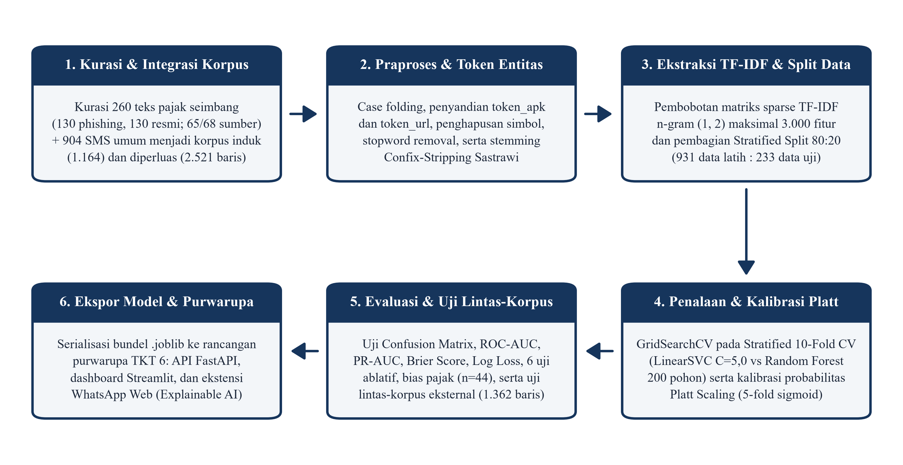

Gambar 2.1 Bagan Alir Prosedur Eksperimen.

## 2.4 Waktu dan Lokasi Penelitian

Penelitian Tugas Akhir ini berlangsung selama empat bulan, terhitung sejak Agustus hingga November 2026, mengikuti kalender akademik Program Studi PJJ Sistem Informasi Universitas Siber Asia [27]. Seluruh kegiatan kajian literatur, pengambilan sumber otoritatif publik, eksperimen pemodelan di komputer lokal, hingga penyusunan draf naskah dilaksanakan secara bertahap dan terukur. Pembagian jadwal kerja empat bulan tersebut dirancang untuk memastikan setiap luaran dari kurasi korpus hingga validasi eksperimen dapat diselesaikan tepat waktu sebelum tahap implementasi purwarupa.

Pelaksanaan riset bertempat di Jakarta Selatan sebagai lokasi peneliti dengan koordinasi bimbingan dan pelaporan progres secara daring di lingkungan Universitas Siber Asia. Pengambilan bahan teks perpajakan dilakukan sepenuhnya secara daring terhadap arsip pengumuman publik yang dapat diakses bebas tanpa memasuki jaringan internal instansi mana pun [2], [5]. Rincian alokasi waktu per tahapan kegiatan penelitian selama empat bulan disajikan pada Tabel 2.2.

Tabel 2.2 Jadwal Pelaksanaan Penelitian

| Tahap Kegiatan Penelitian | Agustus 2026 | September 2026 | Oktober 2026 | November 2026 |
| :--- | :---: | :---: | :---: | :---: |
| Studi literatur, cek kebaruan, dan perumusan proposal | Berjalan | Selesai | | |
| Pengumpulan sumber DJP serta kurasi dataset terverifikasi | | Berjalan | Selesai | |
| Implementasi skrip praproses, TF-IDF, dan eksperimen model | | | Berjalan | Selesai |
| Penalaan *GridSearchCV*, kalibrasi Platt, dan uji ablatif | | | Berjalan | Selesai |
| Perancangan arsitektur purwarupa TKT 6 dan pengujian sistem | | | | Berjalan |
| Penyusunan laporan lengkap Bab I hingga Bab V | | | Berjalan | Berjalan |

Sumber: Rencana Kerja Penelitian (2026).

## 2.5 Alat dan Bahan Penelitian

Eksperimen pemodelan dan evaluasi komparatif dijalankan pada komputer jinjing lokal bersistem operasi Microsoft Windows 11 Pro 64-bit. Perangkat tersebut memakai prosesor Intel Core i5-12450H dan memori utama 16 GB. Spesifikasi itu memadai untuk mengeksekusi tiga puluh enam kombinasi pencarian *grid*, validasi silang sepuluh lipatan, studi ablatif, serta uji lintas-korpus. Seluruh alur komputasi tuntas dalam waktu terukur 193,47 detik.

Lingkungan perangkat lunak dibangun di atas bahasa pemrograman Python versi 3.11.9 dalam pengelola paket terpisah agar pustaka komputasi konsisten [40]. Pustaka inti mencakup Scikit-learn 1.9.1 untuk algoritma klasifikasi serta Sastrawi 1.0.1 untuk *stemming* bahasa Indonesia [37]. Pengolahan data, analisis SHAP (*LinearExplainer* serta *TreeExplainer*), dan pengujian memakai Pandas, NumPy, Matplotlib, Joblib, serta Pytest. Rincian spesifikasi perangkat tercantum pada Tabel 2.3.

Tabel 2.3 Spesifikasi Alat dan Bahan Penelitian

| Kategori Komponen | Nama Komponen / Berkas | Spesifikasi dan Peran dalam Penelitian |
| :--- | :--- | :--- |
| Perangkat Keras | Komputer Jinjing Komputasi | Prosesor Intel Core i5-12450H, RAM 16 GB, sistem operasi Microsoft Windows 11 Pro 64-bit untuk eksperimen lokal |
| Perangkat Lunak Inti | Python, Scikit-learn, Sastrawi | Python 3.11.9, Scikit-learn 1.9.1 (`LinearSVC`, `RandomForestClassifier`, `TfidfVectorizer`, `CalibratedClassifierCV`), Sastrawi 1.0.1 [37], [40] |
| Perangkat Lunak Pendukung | Pandas, NumPy, Matplotlib, SHAP, Joblib, Pytest | Pandas 3.1.1, NumPy 2.4.6, Matplotlib 3.11.2, SHAP (`LinearExplainer` dan `TreeExplainer`), Joblib 1.6.0 untuk serialisasi model, serta Pytest 9.2.0 untuk uji integritas |
| Rancangan Purwarupa | FastAPI, Web Kustom, Ekstensi Manifest V3 | Rancangan REST API dan antarmuka web *Cek Pesan Pajak* berbasis FastAPI (`HTML`/`CSS`/`JS`), serta ekstensi *WhatsApp Web* TKT 6 [26], [41] |
| Bahan Korpus SMS Publik | `Rahmi 2016 Korpus SMS Spam Utama v1.csv` | Berisi 904 SMS Indonesia (335 penipuan, 569 normal); 239 promo dieksklusi dari 1.143 baris [6] |
| Bahan Korpus Pajak | `Dataset Pajak Terkurasi 260 Baris.csv` | Berisi 260 teks pajak seimbang (130 *phishing*, 130 resmi) dari 65/68 sumber publik [2], [5] |
| Bahan Gabungan Induk | `Dataset Gabungan Utama Biner 1164 Baris.csv` | Gabungan 904 SMS umum dan 260 teks pajak (1.159 baris unik pascadeduplikasi Sastrawi) berverifikasi SHA-256 |
| Bahan Diperluas dan Uji Eksternal | `Dataset Gabungan Diperluas Biner 2521 Baris.csv` | Korpus 2.521 baris (2.519 unik pasca-Sastrawi), disertai 1.360 pesan eksternal unik Theodorus [7] dan Saragih |

Sumber: Dokumentasi Lingkungan Penelitian (2026).

## 2.6 Cara Pengumpulan dan Analisis Data

Pengumpulan bahan penelitian menerapkan studi dokumentasi dan seleksi data publik terverifikasi tanpa melibatkan data rahasia wajib pajak [29]. Sebanyak enam puluh lima dari enam puluh delapan arsip resmi DJP, media pajak, dan pemeriksa fakta dipilih. Seleksi itu menghasilkan 130 contoh *phishing* dari dua belas modus serta 130 teks resmi dari sepuluh layanan [2], [5]. Tiga sumber berulang dan 239 promo Rahmi disisihkan demi fokus biner pada 1.164 baris [6].

Analisis data komparatif dimulai dari deduplikasi lima baris `teks_sastrawi` identik pada korpus induk sehingga diperoleh 1.159 baris unik yang dibagi terstratifikasi 80:20 (`random_state=42`) menjadi 927 data latih dan 232 data uji [30], [31]. Matriks TF-IDF dibangun ulang secara terisolasi di tiap lipatan *Stratified 10-Fold Cross-Validation* (`shuffle=True`, `random_state=42`) [38]. Pencarian *grid* (`GridSearchCV`) mengevaluasi 12 konfigurasi `LinearSVC` serta 24 konfigurasi `RandomForestClassifier` [40].

Tahap lanjutan menguji kalibrasi *Platt scaling* lima lipatan berbasis `Pipeline`, enam skenario studi ablatif, dan ketahanan bias kata kunci pada 45 sampel pajak. Uji *zero-shot* dijalankan langsung terhadap 3.091 baris biner mentah eksternal Theodorus dkk. serta Saragih yang menghasilkan 1.360 pesan uji unik setelah menyisihkan 1.483 duplikat internal dan 248 tumpang tindih terhadap korpus utama, sedangkan uji korpus diperluas memakai 2.519 baris unik pasca-Sastrawi [7]. Keterjelasan model turut dievaluasi melalui bobot `LinearSVC`, nilai *SHapley Additive exPlanations* (SHAP), dan analisis kesalahan prediksi [24], [25], [39].

## 2.7 Definisi Operasional Variabel dan Parameter

Operasionalisasi variabel dan parameter penelitian menetapkan batasan terukur bagi masukan teks, target biner, penyetelan algoritma, dan tolok ukur evaluasi [29], [30]. Variabel bebas berupa string pesan instan berbahasa Indonesia yang dipetakan ke fitur TF-IDF hingga tiga ribu kolom. Sementara itu, variabel terikat berupa label biner kelas `1` untuk indikasi *phishing* dan kelas `0` untuk pesan aman atau resmi.

Parameter algoritma meliputi besaran penalti `C` dan pembobotan kelas pada `LinearSVC`. Parameter *Random Forest* mencakup jumlah pohon, kedalaman maksimum, serta batas pemecahan simpul, ditambah metode kalibrasi sigmoid lima lipatan pada *Platt scaling* [33], [35], [42]. Tolok ukur capaian sistem menilai metrik diskrit, peringkat probabilitas, galat kalibrasi, serta demonstrasi purwarupa TKT Level 6 [39], [41]. Ringkasan lengkap definisi operasionalnya tersaji pada Tabel 2.4.

Tabel 2.4 Definisi Operasional Variabel dan Parameter Penelitian

| Nama Variabel / Parameter | Jenis / Kategori | Definisi Operasional dan Nilai dalam Eksperimen |
| :--- | :--- | :--- |
| Teks Pesan Instan (`Teks` / `teks_sastrawi`) | Variabel Bebas (Masukan) | String pesan teks berbahasa Indonesia yang dipraproses menjadi huruf kecil, `token_apk`, `token_url`, serta bentuk dasar Sastrawi [37] |
| Label Klasifikasi (`label`) | Variabel Terikat (Target Biner) | Kategori biner bernilai `1` untuk indikasi *phishing* dan bernilai `0` untuk pesan aman atau resmi |
| Parameter Ekstraksi TF-IDF | Parameter Representasi Fitur | Pembobotan TF-IDF berrentang `ngram_range` `(1, 2)` dengan batas `max_features` utama `3.000` (diuji ablatif pada `1.500` dan `5.000`) [36] |
| Parameter `LinearSVC` | *Hyperparameter* SVM Linear | Ruang pencarian `C` dalam `{0,1; 0,25; 0,5; 1,0; 2,0; 5,0}`, `class_weight` dalam `{None, "balanced"}`, dan `max_iter=5000` [33], [40] |
| Parameter *Random Forest* | *Hyperparameter* Ansambel Pohon | Ruang pencarian `n_estimators` dalam `{100, 200, 300}`, `max_depth` dalam `{None, 30}`, `min_samples_split` dalam `{2, 5}`, dan `class_weight` [35] |
| Parameter Kalibrasi *Platt* | Parameter Kalibrasi Probabilitas | Wrapper `CalibratedClassifierCV` memakai `method="sigmoid"` dengan `cv=5` untuk mengonversi skor keputusan `LinearSVC` ke probabilitas [34], [42] |
| Metrik Evaluasi Klasifikasi | Variabel Kinerja Utama | Pengukuran *Accuracy*, *Precision*, *Recall*, *F1-Score*, *ROC-AUC*, *PR-AUC*, *Brier Score*, dan *Log Loss* [38], [39] |
| Indikator Kesiapan Teknologi (TKT) | Variabel Kelayakan Purwarupa | Capaian TKT 6 melalui bundel `.joblib` pada REST API, antarmuka web *Cek Pesan Pajak*, dan ekstensi *WhatsApp Web* [41] |

Sumber: Sintesis Metodologi Penelitian (2026).

---

# BAB III IMPLEMENTASI METODE USULAN

## 3.1 Arsitektur Implementasi Metode Usulan

Implementasi metode usulan pada penelitian ini menerjemahkan kerangka teoretis serta enam tahapan prosedur operasional pada Bab II ke dalam ekosistem perangkat lunak yang terstruktur. Seluruh pemrosesan dibangun memakai Python versi 3.11.9 dengan memisahkan modul kurasi korpus, pelatihan komparatif, serta layanan antarmuka purwarupa [40]. Pemisahan itu menjaga konsistensi teks sejak pelatihan.

Arsitektur sistem terbagi menjadi dua alur kerja utama yang terhubung melalui bundel model terserialisasi, yakni alur pelatihan luring dan alur layanan daring. Pada alur luring, seluruh bahan korpus dikurasi, dibersihkan dengan Sastrawi, diubah menjadi vektor TF-IDF tiga ribu fitur, lalu dilatih memakai `LinearSVC` dan `RandomForestClassifier` [6], [36], [37]. Alur daring memuat model terlatih ke peladen FastAPI untuk menyajikan antarmuka web *Cek Pesan Pajak* dan ekstensi *WhatsApp Web* [26].

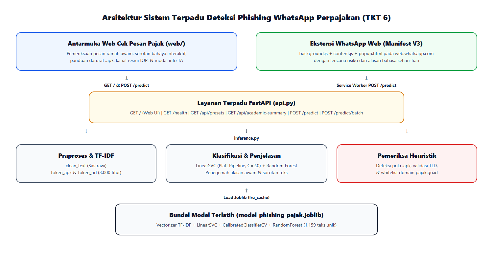

Gambar 3.1 Arsitektur Sistem Terpadu Deteksi *Phishing* WhatsApp Perpajakan.

Rancangan pada Gambar 3.1 memperlihatkan bahwa seluruh logika klasifikasi, ekstraksi kata pemicu *explainable AI*, penerjemah alasan bahasa awam, serta pemeriksaan heuristik keamanan dipusatkan pada `inference.py`. Pendekatan terpusat tersebut menjaga konsistensi aturan praproses dan format respons antara web *Cek Pesan Pajak* (`web/`) dan ekstensi *Manifest V3*. Prasetel contoh pesan dan ringkasan evaluasi model turut disajikan langsung oleh peladen FastAPI yang sama.

Untuk mempermudah penelusuran antara rancangan metodologi pada Bab II dan kode program yang dibangun, setiap tahapan penelitian dipetakan secara eksplisit ke berkas sumber spesifik di dalam repositori. Struktur modular tersebut memastikan proses pengumpulan data, pelatihan model, dan layanan purwarupa dapat diuji serta dipelihara secara terpisah tanpa saling mengganggu. Pemetaan lengkap antara modul kode program, peran fungsionalnya, serta kaitannya dengan tahapan penelitian disajikan pada Tabel 3.1.

Tabel 3.1 Pemetaan Modul Kode Sumber terhadap Tahapan Metodologi Penelitian

| Berkas / Direktori Modul | Tahapan Metodologi | Peran Teknis dalam Sistem |
| :--- | :--- | :--- |
| `src/korpus_pajak.py` | Kurasi Sumber Perpajakan | Menyimpan metadata enam puluh delapan sumber, tiga puluh satu indikator penipuan DJP, dan dua ratus enam puluh teks pajak |
| `src/kurasi_dataset.py` | Konstruksi Korpus & Provenans | Membangun dataset induk 1.164 baris, korpus diperluas 2.521 baris, dan katalog provenans SHA-256 |
| `src/eksperimen_baseline.py` | Praproses & Model Dasar | Menyediakan fungsi `clean_text` Sastrawi dan uji *baseline* 80:20 `LinearSVC` serta `RandomForestClassifier` |
| `src/eksperimen_komparasi.py` | Penalaan, Kalibrasi, & Evaluasi | Menjalankan `StratifiedKFold` 10-lipatan, pencarian *grid* 36 konfigurasi, kalibrasi Platt, studi ablatif, dan ekspor `.joblib` |
| `06 Prototipe Aplikasi/inference.py` | Mesin Inferensi Terpadu | Memuat `model_phishing_pajak.joblib`, menjalankan heuristik `.apk` serta domain `pajak.go.id`, dan menyusun alasan ramah awam serta sorotan teks |
| `06 Prototipe Aplikasi/api.py` & `Jalankan Server.bat` | Layanan *Backend*, Web, & Peluncur | Menyajikan antarmuka web *Cek Pesan Pajak* (`/`) serta *endpoint* API `/health`, `/api/*`, `/predict`, dan `/predict/batch` |
| `06 Prototipe Aplikasi/web/` | Antarmuka Web Pengguna Awam | Menyediakan halaman web responsif (`index.html`, `styles.css`, `app.js`) dengan pratinjau chat WA, sorotan bahaya, panduan darurat `.apk`, dan modal evaluasi TA |
| `06 Prototipe Aplikasi/extension/` | Ekstensi Peramban *WhatsApp Web* | Memindai pesan di `web.whatsapp.com`, meneruskan lewat `background.js`, dan menampilkan lencana risiko berbahasa awam (*Manifest V3*) |
| `tests/` | Verifikasi Otomatis Sistem | Menjalankan dua puluh tiga pengujian `pytest` untuk integritas korpus, deduplikasi, reproduksi metrik, serta pengujian *black-box* API dan web |

Sumber: Dokumentasi Rekayasa Perangkat Lunak Penelitian (2026).

## 3.2 Implementasi Kurasi Korpus dan Praproses Teks

Implementasi tahap data diawali penyusunan korpus domain perpajakan melalui berkas `src/korpus_pajak.py` dan `src/kurasi_dataset.py`. Sebanyak enam puluh delapan halaman web otoritatif dari DJP, media perpajakan, dan kanal pemeriksa fakta diambil, lalu dibersihkan dari teks navigasi berulang memakai `strip_djp_boilerplate` [2], [5]. Dari jumlah itu, tersaring enam puluh lima sumber unik menjadi dua ratus enam puluh pesan dari dua belas modus penipuan dan sepuluh layanan resmi DJP. Jumlah kedua kelas disusun seimbang.

Modul `src/kurasi_dataset.py` menggabungkan dua ratus enam puluh teks pajak tersebut dengan sembilan ratus empat SMS bahasa Indonesia dari korpus Rahmi dan Wibisono [6]. Sebanyak dua ratus tiga puluh sembilan iklan promo disisihkan terlebih dahulu. Penggabungan ini membentuk korpus induk biner sebanyak seribu seratus enam puluh empat baris, terdiri atas empat ratus enam puluh lima pesan penipuan (`1`) dan enam ratus sembilan puluh sembilan pesan normal (`0`). Keutuhan seluruh artefak korpus dijaga memakai sepuluh catatan *hash* SHA-256 pada `Katalog Asal Sumber Data.csv`.

Selain korpus induk, fungsi `build_combined_datasets` merakit korpus perluasan untuk menguji generalisasi model lintas sumber. Korpus tersebut menggabungkan himpunan induk, korpus biner Theodorus (`Label` `0` dan `2` dipetakan ke `0` dan `1`), serta korpus Saragih (`non-spam` dan `penipuan`) menjadi 4.255 baris awal [7]. Penyaringan duplikat pada `clean_text` menyisihkan 1.734 baris duplikat, terdiri atas 5 duplikat internal Rahmi dan 1.729 duplikat internal maupun lintas sumber. Himpunan akhir memuat 2.521 baris unik (822 penipuan dan 1.699 aman).

Pada jalur praproses, setiap teks masukan saat pelatihan maupun inferensi melewati fungsi `clean_text` dalam modul `src/eksperimen_baseline.py`. Kamus kata henti diambil dari `StopWordRemoverFactory`, sedangkan daftar kata dasar `StemmerFactory` diubah dari tipe daftar menjadi himpunan (`set`) berakselerasi `lru_cache` dua puluh ribu kata agar pencarian berjalan dalam waktu konstan $O(1)$ [37]. Urutan transformasi teks mengikuti enam langkah berikut:

a) Seluruh karakter diubah menjadi huruf kecil melalui metode `lower()`. Langkah ini menyeragamkan representasi kata tanpa membedakan huruf kapital di awal kalimat ataupun di tengah pesan.

b) Pola berkas Android berakhiran `.apk` (`r"\.apk\b"`) diganti lebih dahulu menjadi `token_apk` sebelum pendeteksian tautan. Urutan ini mencegah nama berkas seperti `coretax.id.apk` tertelan sebagai alamat situs web.

c) Pola alamat tautan web, baik berawalan `http`, `https`, `www`, penyingkat `bit.ly`, maupun domain umum berakhiran `.go.id`, `.co.id`, serta `.xyz`, dikonversi menjadi token khusus `token_url`.

d) Karakter selain huruf alfabet kecil, angka, spasi, dan garis bawah dihapus dengan ekspresi reguler `r"[^a-z0-9\s_]"` sehingga tanda baca terbuang sementara penanda `token_apk` dan `token_url` tetap utuh.

e) Seluruh token diperiksa terhadap himpunan `SPECIAL_TOKENS` (`token_apk` dan `token_url`) agar langsung dipertahankan, sedangkan token biasa yang tercatat di dalam kamus `STOP_WORDS` Sastrawi dibuang dari rangkaian kata.

f) Setiap kata alfabetis sepanjang lebih dari dua huruf (`tok.isalpha() and len(tok) > 2`) dikembalikan ke bentuk kata dasar memakai algoritma Nazief-Adriani pada Sastrawi 1.0.1 [37]. Token kemudian disatukan kembali menjadi string bersih.

Guna mendukung studi ablatif pada tahap evaluasi, modul `src/eksperimen_komparasi.py` turut menyiapkan dua varian praproses teks pembanding di samping kolom utama `teks_sastrawi`. Kolom `clean_text` dari `src/kurasi_dataset.py` merepresentasikan praproses tanpa penghapusan *stopword* dan tanpa *stemming* Sastrawi untuk skenario `2_Tanpa_Sastrawi`. Sementara itu, fungsi `clean_text_without_entity_tokens` menghasilkan kolom `teks_tanpa_token_entitas` dengan menghapus pola URL serta berkas `.apk` menjadi spasi kosong untuk skenario `1_Tanpa_Token_Entitas`.

## 3.3 Implementasi Pelatihan Model, Penyetelan Hiperparameter, dan Kalibrasi

Tahap pelatihan dan evaluasi komparatif diimplementasikan dalam berkas `src/eksperimen_komparasi.py` dengan menstandarkan `RANDOM_STATE` sebesar empat puluh dua demi keterulangan hasil [40]. Fungsi `load_datasets` mendeduplikasi lima baris `teks_sastrawi` identik pada korpus induk 1.164 baris menjadi 1.159 teks unik (697 aman dan 462 penipuan), lalu memisahkannya terstratifikasi 80:20 menjadi 927 data latih dan 232 data uji. Pada tahap *baseline*, `LinearSVC` bawaan dan `RandomForestClassifier` dua ratus pohon dilatih pada vektor TF-IDF tiga ribu fitur [36].

Untuk mencegah kebocoran informasi pembobotan kata selama validasi silang sepuluh lipatan (`StratifiedKFold` dengan `shuffle=True` dan `random_state=42`), diimplementasikan fungsi `_precompute_tfidf_folds` [38]. Fungsi tersebut membangun objek `TfidfVectorizer(ngram_range=(1, 2), max_features=3000)` yang terpisah di dalam setiap lipatan latih sebelum mengubah data validasi lipatan bersangkutan. Selanjutnya, fungsi `_run_grid_over_folds` mengevaluasi seluruh kombinasi hiperparameter secara menyeluruh di atas sepuluh lipatan yang sudah terisolasi tersebut lalu mengurutkan kandidat berdasarkan nilai rata-rata *F1-Score*, akurasi, dan *ROC-AUC*.

Sebanyak tiga puluh enam konfigurasi parameter diuji dalam pencarian *grid*, terdiri atas dua belas kombinasi untuk `LinearSVC` (`max_iter=5000`) dan dua puluh empat kombinasi untuk `RandomForestClassifier`. Pencarian *grid* tersebut memilih `C=2.0` tanpa pembobotan kelas seimbang pada `LinearSVC`, serta seratus pohon tanpa batas kedalaman maksimum dengan syarat pemecahan simpul minimum dua sampel pada `RandomForestClassifier`. Rincian lengkap ruang pencarian dan parameter terpilih tercantum pada Tabel 3.2.

Tabel 3.2 Konfigurasi Ruang Pencarian Hiperparameter dan Parameter Terpilih

| Algoritma Klasifikasi | Ruang Pencarian Parameter (`_run_grid_over_folds`) | Konfigurasi Terpilih |
| :--- | :--- | :--- |
| `LinearSVC` | `C`: `0.1, 0.25, 0.5, 1.0, 2.0, 5.0`; `class_weight`: `None, balanced`; `max_iter=5000` | `C=2.0`, `class_weight=None` |
| `RandomForestClassifier` | `n_estimators`: `100, 200, 300`; `max_depth`: `None, 30`; `min_samples_split`: `2, 5`; `class_weight`: `None, balanced` | `n_estimators=100`, `max_depth=None`, `min_samples_split=2`, `class_weight=None` |

Sumber: Implementasi Penalaan Parameter pada `src/eksperimen_komparasi.py` (2026).

Oleh karena keluaran fungsi keputusan `LinearSVC` berupa jarak terhadap bidang pemisah dan belum berwujud peluang probabilitas, fungsi `_make_calibrated_svm_pipeline` membungkus `TfidfVectorizer` bersama `LinearSVC` ke dalam `Pipeline` sebelum dikalibrasi memakai `CalibratedClassifierCV(method="sigmoid", cv=5)` [33], [34], [42]. Isolasi `Pipeline` lima lipatan tersebut mencegah bocornya bobot IDF antar-lipatan kalibrasi sekaligus mengubah margin linear menjadi probabilitas kelas penipuan. Mutu kesesuaian peluang selanjutnya dinilai melalui *Brier Score* dan *Log Loss* pada 232 data uji [39].

Setelah penalaan dan kalibrasi selesai, fungsi `_run_stage4_domain_and_cross_corpus` menjalankan tiga uji ketahanan tambahan. Pertama, kinerja model diukur pada empat puluh lima sampel pajak di data uji serta validasi silang sepuluh lipatan atas dua ratus enam puluh teks pajak (`Stage 4A`). Kedua, model produksi pada 1.159 baris unik diuji secara *zero-shot* pada 1.360 pesan eksternal unik dari 3.091 baris biner mentah (`Stage 4B`). Pengujian kemudian diulang pada korpus diperluas 2.519 baris unik (`Stage 4C`) [7].

Pada tahap akhir jalur luring, vektorizer TF-IDF, `LinearSVC` linear murni, `LinearSVC` terkalibrasi Platt berbasis `Pipeline`, dan `RandomForestClassifier` yang telah dilatih penuh pada 1.159 baris unik dikemas ke satu kamus Python lalu disimpan memakai Joblib 1.6.0 (`compress=3`) ke `06 Prototipe Aplikasi/model_phishing_pajak.joblib`. Selanjutnya, fungsi `_build_feature_and_error_tables` dan `_compute_shap_table` mengekstrak koefisien fitur teratas, merangkum sampel salah prediksi, serta menghitung nilai SHAP (`LinearExplainer` dan `TreeExplainer`) terkondisi fitur aktif pada 232 data uji [24], [25].

## 3.4 Implementasi Purwarupa Sistem Terpadu Tingkat Kesiapan Teknologi 6

Seluruh subsistem aplikasi purwarupa ditempatkan pada direktori `06 Prototipe Aplikasi/` guna memenuhi kriteria demonstrasi dalam lingkungan simulasi yang relevan sesuai Tingkat Kesiapan Teknologi enam [41]. Lapisan inti inferensi pada berkas `inference.py` memuat bundel `model_phishing_pajak.joblib` secara efisien ke memori menggunakan mekanisme `lru_cache(maxsize=1)`. Setiap pesan teks yang masuk dibersihkan memakai fungsi `clean_text` yang sama dengan jalur pelatihan, diubah menjadi matriks TF-IDF, lalu dihitung peluang *phishing*-nya oleh model `svm_calibrated` maupun pembanding `random_forest`.

Di samping inferensi pembelajaran mesin, fungsi `analyze_urls_and_apk` dan `predict_message` pada `inference.py` menjalankan dua lapisan aturan heuristik perpajakan. Lapisan pertama memindai teks mentah memakai `APK_PATTERN` (`r"\b[a-z0-9_.-]+\.apk\b"`) guna menangkap lampiran aplikasi berbahaya. Lapisan kedua mengekstrak tautan melalui `URL_PATTERN` bersyarat akhiran *top-level domain* alfabetis pada tautan tanpa awalan `http` atau `www` sehingga angka jam `17.00` maupun nominal `Rp1.500.000` tidak ikut tertandai.

Setiap domain hasil ekstraksi terlebih dahulu diproses oleh fungsi `_extract_domain` memakai `urlparse` agar tautan tanpa awalan `http://` tetap terbaca nama hostnya secara konsisten. Selanjutnya, fungsi `is_official_djp_domain` hanya mengembalikan nilai benar apabila nama host tepat sama dengan `pajak.go.id` atau berakhiran `.pajak.go.id`. Dengan aturan ketat tersebut, teknik pengecohan domain tiruan seperti `pajak.go.id.evil.com` tetap tertandai sebagai domain eksternal mencurigakan di antarmuka pengguna.

Penetapan status akhir dan tingkat risiko pada `predict_message` menggabungkan peluang kalibrasi `svm_prob` dengan temuan heuristik secara deterministik. Pada kondisi dasar, pesan diberi label `1` apabila `svm_prob >= 0.5`. Namun, jika `has_apk` bernilai benar meskipun `svm_prob < 0.75`, sistem melakukan eskalasi otomatis menjadi `label = 1` dan risiko `TINGGI`. Tanpa berkas `.apk`, risiko ditetapkan `TINGGI` jika `svm_prob >= 0.75`, `SEDANG` jika `svm_prob >= 0.50` atau ada `suspicious_domains`, dan `RENDAH` jika aman.

Guna menyajikan penjelasan yang ramah bagi masyarakat umum, fungsi `_extract_top_triggers` menghitung kontribusi tiap kata atau frasa dari hasil kali bobot TF-IDF dan koefisien `svm_linear.coef_` [24]. Kontribusi tersebut lalu dipetakan ke kelompok kata pemicu, yakni desakan waktu, ancaman denda, serta ajakan verifikasi. Dari pemetaan itu, sistem menyusun satu vonis risiko utama, sorotan khusus pada berkas `.apk` atau tautan, serta daftar alasan dan langkah pencegahan berbahasa sehari-hari.

Layanan *backend* dan peladen web pada berkas `api.py` dibangun di atas kerangka kerja FastAPI dengan peladen ASGI Uvicorn, dilengkapi skrip pintas `Jalankan Server.bat` untuk memudahkan pengaktifan lokal. Kebijakan *Cross-Origin Resource Sharing* mengatur `allow_private_network=True` agar permintaan `GET`, `POST`, dan `OPTIONS` dari peramban lokal, halaman publik `https://web.whatsapp.com`, maupun ekstensi `chrome-extension://*` tetap diterima secara aman. Rincian kontrak layanan API tersaji pada Tabel 3.3.

Tabel 3.3 Spesifikasi Titik Akhir Layanan Web dan REST API FastAPI (`api.py`)

| Metode & Jalur | Skema Masukan | Struktur Keluaran Utama | Peran dalam Arsitektur |
| :--- | :--- | :--- | :--- |
| `GET /` | Tanpa badan permintaan | Berkas HTML antarmuka web *Cek Pesan Pajak* | Menyajikan aplikasi web utama bagi masyarakat awam |
| `GET /health` | Tanpa badan permintaan | Status `ok`, `models_loaded`, dan `metadata` korpus latih | Pemeriksaan kesiapan layanan oleh halaman web dan popup ekstensi |
| `GET /api/presets` & `/api/academic-summary` | Tanpa badan permintaan | Daftar prasetel pesan uji, metadata model, dan baris `tabel_komparasi_utama.csv` | Mengisi tombol contoh siap uji serta modal info akademik di footer |
| `POST /predict` | JSON `text` (1 sampai 5.000 karakter) dan `top_k` (1 sampai 20) | Label, `risk_level`, `risk_title`, `plain_reasons`, `highlights`, `trigger_words`, dan `action_steps` | Titik akhir inferensi tunggal bagi web *Cek Pesan Pajak* dan ekstensi |
| `POST /predict/batch` | JSON daftar `texts` (1 sampai 200 pesan) dan `top_k` | Jumlah total dan daftar hasil prediksi terindeks per baris | Titik akhir pemrosesan pesan massal terstruktur |

Sumber: Implementasi Layanan API pada `06 Prototipe Aplikasi/api.py` (2026).

Antarmuka web *Cek Pesan Pajak* pada `06 Prototipe Aplikasi/web/` (`index.html`, `styles.css`, `app.js`) dirancang memakai bahasa Indonesia sehari-hari untuk masyarakat awam. Elemen teknis yang tidak dibutuhkan pengguna umum, meliputi pengaturan URL *endpoint*, metadata model, unggah CSV massal, probabilitas ganda, dan tabel koefisien TF-IDF, dihapus dari layar utama. Sebagai gantinya, ringkasan evaluasi tersebut diletakkan di balik tautan *Info Akademik dan Evaluasi Model* pada bagian *footer* untuk keperluan demo sidang.

Tata letak *Cek Pesan Pajak* memakai navigasi tab ringkas (*Cek Pesan*, *Kanal Resmi dan Ciri Scam*, serta *Darurat .apk*) agar layar utama tetap lega. Setelah pesan dipindai lewat kotak tempel atau tiga contoh cepat, pratinjau chat menyorot berkas `.apk` dan tautan disertai chip kata pemicu di bawahnya. Hasil dilengkapi alasan singkat, saran aman, tombol bagikan ke WhatsApp, panduan darurat `.apk`, daftar situs `pajak.go.id`, serta empat ciri penipuan.

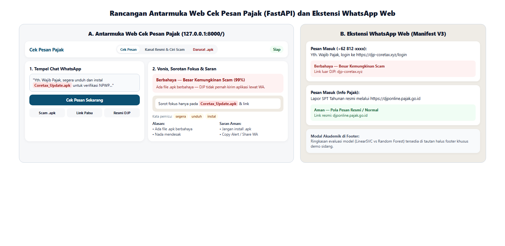

Gambar 3.2 Rancangan Antarmuka Web *Cek Pesan Pajak* dan Ekstensi *WhatsApp Web*.

Integrasi langsung pada peramban diwujudkan melalui ekstensi Chrome berarsitektur *Manifest V3* di folder `extension/` yang tersusun atas enam berkas, yaitu `manifest.json`, `background.js`, `content.js`, `styles.css`, `popup.html`, dan `popup.js` [26]. Skrip `content.js` memakai `MutationObserver` untuk memindai gelembung pesan masuk minimal delapan karakter, kartu lampiran berkas `.apk`, maupun tautan pendek, serta mendukung uji mandiri pada pesan keluar bertema pajak. Saat tombol *Cek Pesan Pajak* ditekan, permintaan dikirim lewat *service worker* `background.js` ke `http://127.0.0.1:8000/predict` agar lencana risiko berbahasa awam tampil seperti pada Gambar 3.2.

## 3.5 Skenario Pengujian Sistem dan Kesiapan Evaluasi

Keandalan seluruh jalur data, eksperimen pemodelan, dan antarmuka purwarupa diverifikasi otomatis memakai kerangka kerja Pytest 9.2.0 lewat dua puluh tiga kasus uji pada empat berkas terpisah guna mencegah regresi kode. Berkas `test_integritas_dataset.py` menguji jumlah baris lima korpus mentah, validitas enam puluh delapan hasil *scraping*, serta keseimbangan dua ratus enam puluh data pajak. Pengujian juga memastikan kecocokan gabungan biner 1.164 maupun 2.521 baris, konsistensi deduplikasi Sastrawi (1.159 dan 2.519 baris unik), serta sepuluh *hash* SHA-256.

Pengujian pipeline pembelajaran mesin diwakili dua kasus uji dalam `test_eksperimen_baseline.py` dan lima kasus uji dalam `test_eksperimen_komparasi.py`. Pengujian itu memvalidasi pelestarian `token_apk` serta `token_url` pada `clean_text`, memastikan isolasi `Pipeline` kalibrasi Platt, dan mengunci reproduksi metrik `LinearSVC` maupun `RandomForestClassifier`. Skrip turut memastikan kelayakan *Brier Score* di bawah `0.05`, konsistensi arah SHAP terkondisi, serta keandalan bundel `model_phishing_pajak.joblib` memprediksi penipuan pajak dengan peluang melebihi delapan puluh persen.

Khusus lapisan purwarupa TKT 6, berkas `tests/test_prototipe_api.py` menjalankan sepuluh pengujian *black-box* memakai `TestClient` FastAPI. Skenario tersebut mencakup uji kesehatan layanan, deteksi `.apk`, identifikasi domain tiruan, validasi domain `pajak.go.id`, serta penolakan domain pengecoh. Pengujian turut memeriksa penjagaan pola angka jam maupun nominal, penolakan masukan kosong, pemrosesan *batch*, ketersediaan antarmuka web, serta *security headers* dan pembatas laju permintaan (*rate limiter*). Matriks pengujian lengkapnya tercantum pada Tabel 3.4.

Tabel 3.4 Matriks Skenario Pengujian Otomatis Purwarupa dan Integritas Sistem

| Kode Uji | Berkas / Subjek Pengujian | Skenario Masukan & Kondisi Uji | Keluaran yang Diharapkan |
| :--- | :--- | :--- | :--- |
| `UJI-01` | `test_prototipe_api.py` (`GET /health`) | Permintaan cek kesiapan peladen API | Status HTTP 200 dengan `LinearSVC+Platt` aktif |
| `UJI-02` | `test_prototipe_api.py` (`POST /predict`) | Pesan memuat berkas `Coretax_DJP_Update.apk` | Label `1`, `has_apk=True`, risiko `TINGGI`, alasan awam & sorotan `.apk` terisi |
| `UJI-03` | `test_prototipe_api.py` (`POST /predict`) | Pesan tautan palsu `pajak-djp-verifikasi.xyz` | Label `1`, domain tercatat di `suspicious_domains` tanpa angka `17.00` |
| `UJI-04` | `test_prototipe_api.py` (`POST /predict`) | Pengumuman resmi `djponline.pajak.go.id` | Label `0`, risiko `RENDAH`, domain di `official_domains` tanpa domain curiga |
| `UJI-05` | `test_prototipe_api.py` (`is_official_djp_domain`) | Uji pengecohan `pajak.go.id.evil.com` vs domain sah | Mengembalikan `False` untuk domain tiruan, `True` untuk sah |
| `UJI-06` | `test_prototipe_api.py` (`POST /predict`) | Pengiriman teks berisi spasi kosong | Ditolak dengan kode status HTTP 422 (*Unprocessable Entity*) |
| `UJI-07` | `test_prototipe_api.py` (`POST /predict/batch`) | Pengiriman dua teks campuran *phishing* dan resmi | Status HTTP 200 dengan `total=2` dan dua objek hasil |
| `UJI-08` | `test_prototipe_api.py` (penjagaan pola angka) | Pesan resmi memuat pukul `16.00` dan `Rp1.500.000` | `suspicious_domains` kosong dan status tetap `RENDAH` |
| `UJI-09` | `test_prototipe_api.py` (`GET /` & `/api/*`) | Permintaan halaman web utama, prasetel, dan ringkasan TA | Status HTTP 200 menyajikan *Cek Pesan Pajak*, 3 prasetel, dan tabel evaluasi |
| `UJI-10` | `test_integritas_dataset.py` & eksperimen | Validasi 5 korpus, SHA-256, deduplikasi, Platt `Pipeline`, dan `.joblib` | Seluruh tiga belas pengujian data dan model lulus tanpa galat |

Sumber: Implementasi Pengujian Otomatis `pytest` pada Direktori `tests/` (2026).

Bersamaan dengan verifikasi fungsional, skrip `eksperimen_komparasi.py` menjalankan enam konfigurasi studi ablatif untuk mengisolasi pengaruh fitur, mencakup `1_Tanpa_Token_Entitas`, `2_Tanpa_Sastrawi`, `3_Unigram_Saja`, `4_Utama_MaxFeatures_1500`, `5_Konfigurasi_Utama_3000`, dan `6_Utama_MaxFeatures_5000`. Seluruh artefak keluaran tersimpan terstruktur pada direktori `05 Hasil Evaluasi/` berupa enam grafik beresolusi tinggi, tujuh berkas tabel CSV, dan laporan JSON lengkap. Analisis hasilnya dibahas pada Bab IV.

---

# BAB IV HASIL DAN ANALISA

## 4.1 Hasil Eksperimen Komparasi Klasifikasi dan Penyetelan Hiperparameter

Seluruh rangkaian eksperimen komparatif dieksekusi secara otomatis oleh skrip `src/eksperimen_komparasi.py` dengan pengacak tetap `random_state=42` selama 193,47 detik. Deduplikasi lima baris identik hasil Sastrawi pada korpus induk 1.164 baris menghasilkan 1.159 teks unik yang dibagi terstratifikasi 80:20 menjadi 927 data latih dan 232 data uji bagi `LinearSVC` serta `RandomForestClassifier` [33], [35]. Penyaringan pra-pembagian ini mencegah kebocoran sampel identik lintas himpunan uji.

Pada uji *baseline* himpunan tetap (`n = 232`), `LinearSVC` bawaan meraih *Accuracy* 96,12%, *Precision* 97,70%, *Recall* 92,39%, dan *F1-Score* 94,97% (`TN = 138`, `FP = 2`, `FN = 7`, `TP = 85`). Pembanding *Random Forest* (`n_estimators=200`) mencatat *Accuracy* 96,12%, *Precision* 96,63%, *Recall* 93,48%, serta *F1-Score* 95,03% (`TN = 137`, `FP = 3`, `FN = 6`, `TP = 86`) [13], [32]. Kedua algoritma memulai evaluasi dengan sembilan kesalahan prediksi.

Evaluasi berlanjut dengan *Stratified 10-Fold Cross-Validation* pada 927 data latih menggunakan kosakata TF-IDF yang terisolasi tiap lipatan guna mencegah kebocoran data [38]. Sebelum penalaan, `LinearSVC` mencatat rata-rata *F1-Score* 97,04% (± 2,71%), *Accuracy* 97,63%, dan *ROC-AUC* 0,9956 dalam waktu latih 0,0026 detik per lipatan. Pada lipatan sama, *Random Forest* meraih *F1-Score* 93,68% (± 3,20%) dan *Accuracy* 94,93% dalam 0,6010 detik.

Proses penalaan melalui `GridSearchCV` mengevaluasi tiga puluh enam kandidat, terdiri atas dua belas konfigurasi `LinearSVC` dan dua puluh empat konfigurasi *Random Forest* [40]. Kandidat terbaik `LinearSVC` terpilih pada `C=2.0` dan `class_weight=None` dengan rata-rata *F1-Score* 97,16% (± 2,41%), *Accuracy* 97,74%, serta *ROC-AUC* 0,9956 dalam 0,0027 detik per lipatan. Nilai `mean_train_f1` mencapai 1,0000 sehingga regularisasi `C=2.0` menjaga keseimbangan margin terhadap kejenuhan data latih.

Pencarian *grid* pada *Random Forest* memilih kombinasi `n_estimators=100`, `max_depth=None`, `min_samples_split=2`, dan `class_weight=None` sebagai setelan terbaik. Konfigurasi tersebut menghasilkan rata-rata *F1-Score* sepuluh lipatan sebesar 94,07% (± 2,92%), *Accuracy* 95,25%, *Recall* 93,78%, serta *ROC-AUC* 0,9901 dalam 0,2841 detik per lipatan. Walaupun jumlah pohon berkurang separuh dibandingkan setelan awal, waktu pelatihannya tetap sekitar 106,6 kali lebih lambat daripada `LinearSVC` per lipatan [33], [35].

Pada himpunan uji tetap (`n = 232`), `LinearSVC` terpenala (`C=2.0`) mempertahankan *Accuracy* 96,12% lalu bergeser ke 95,69% (`FP = 3`, `FN = 7`) sesudah kalibrasi *Platt scaling* berbasis `Pipeline` lima lipatan, sementara *Random Forest* mencatat *Accuracy* 96,55% (`FP = 2`, `FN = 6`) [34], [42]. Selisih satu hingga dua sampel (`0,43%` sampai `0,86%`) pada ambang diskrit `0,5` berada dalam simpangan baku validasi silang (± 2,41%), sedangkan `LinearSVC` Platt tetap unggul pada *ROC-AUC* 0,9957 dan *PR-AUC* 0,9943.

Tabel 4.1 Hasil Komparasi Kinerja Klasifikasi pada Berbagai Tahap Evaluasi

| Tahap Evaluasi dan Himpunan Uji | Model Klasifikasi | *Accuracy* | *Precision* | *Recall* | *F1-Score* | *ROC-AUC* |
| :--- | :--- | :---: | :---: | :---: | :---: | :---: |
| *Baseline Holdout* (`n = 232`) | `LinearSVC` (Default) | 96,12% | 97,70% | 92,39% | 94,97% | 0,9955 |
| *Baseline Holdout* (`n = 232`) | *Random Forest* (Default) | 96,12% | 96,63% | 93,48% | 95,03% | 0,9939 |
| *10-Fold CV* Default (`n = 927`) | `LinearSVC` (Default) | 97,63% | 97,37% | 96,76% | 97,04% | 0,9956 |
| *10-Fold CV* Default (`n = 927`) | *Random Forest* (Default) | 94,93% | 93,69% | 93,78% | 93,68% | 0,9905 |
| *10-Fold CV Tuned* (`n = 927`) | `LinearSVC` (`C=2.0`) | 97,74% | 97,61% | 96,76% | 97,16% | 0,9956 |
| *10-Fold CV Tuned* (`n = 927`) | *Random Forest* (Tuned) | 95,25% | 94,46% | 93,78% | 94,07% | 0,9901 |
| *Holdout Tuned* (`n = 232`) | `LinearSVC` (Tuned) | 96,12% | 97,70% | 92,39% | 94,97% | 0,9950 |
| *Holdout* Final (`n = 232`) | `LinearSVC` (Platt Sigmoid) | 95,69% | 96,59% | 92,39% | 94,44% | 0,9957 |
| *Holdout* Final (`n = 232`) | *Random Forest* (Tuned) | 96,55% | 97,73% | 93,48% | 95,56% | 0,9936 |

Sumber: Pengolahan Hasil Eksperimen `src/eksperimen_komparasi.py` (2026).

Sebagaimana dirangkum pada Tabel 4.1, pengemasan `LinearSVC` bersama `Pipeline` *Platt scaling* unggul konsisten sebesar 3,09 poin *F1-Score* pada validasi silang sepuluh lipatan sekaligus meraih daya pisah peringkat tertinggi. Perbandingan sebaran prediksi empat kuadran *Confusion Matrix* pada himpunan uji `n = 232` tampak jelas pada Gambar 4.1. Selanjutnya, ketajaman kurva diskriminatif *Receiver Operating Characteristic* dan *Precision-Recall* disajikan pada Gambar 4.2 [39].

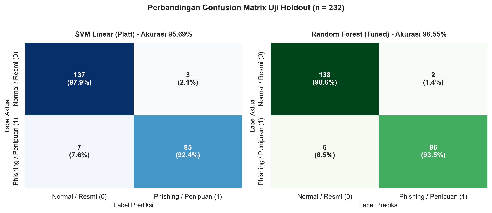

Gambar 4.1 Perbandingan *Confusion Matrix* Uji *Holdout*.

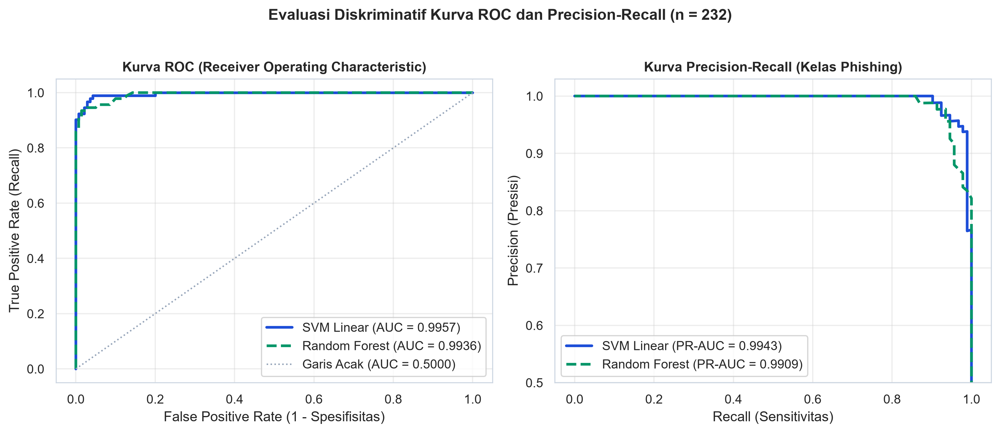

Gambar 4.2 Evaluasi Diskriminatif Kurva ROC dan *Precision-Recall*.

Visualisasi pada Gambar 4.1 menunjukkan bahwa pergeseran satu sampel antara `LinearSVC` murni (`TN = 138`, `FP = 2`) dan `LinearSVC` Platt (`TN = 137`, `FP = 3`) terjadi pada `idx=1082` (`p = 0,5506`) akibat perataan lima submodel `CalibratedClassifierCV` yang masing-masing dilatih pada delapan puluh persen data latih. Sebagai kompensasi, pada Gambar 4.2 kurva `LinearSVC` Platt mencapai *ROC-AUC* 0,9957 dan *PR-AUC* 0,9943, melampaui *Random Forest* (*ROC-AUC* 0,9936; *PR-AUC* 0,9909) di seluruh rentang ambang keputusan.

## 4.2 Analisis Kalibrasi Probabilitas dan Studi Ablatif Fitur

Pemanfaatan skor risiko probabilistik di antarmuka pengguna menuntut kesesuaian antara nilai peluang keluaran model dan frekuensi kejadian aktual di lapangan [34], [42]. Pengujian kalibrasi pada 232 data uji membuktikan bahwa *Platt scaling* lima lipatan terisolasi `Pipeline` atas `LinearSVC` menghasilkan *Brier Score* sebesar 0,02542 dan *Log Loss* sebesar 0,09186. Nilai galat kalibrasi tersebut terpaut jauh di bawah kinerja *Random Forest* yang mencatat *Brier Score* sebesar 0,04214 dan *Log Loss* sebesar 0,15870.

Penerapan kalibrasi sigmoid pada `LinearSVC` menekan galat probabilitas kuadratik *Brier Score* sebesar 39,68% daripada pemungutan suara seratus pohon *Random Forest* sekaligus memangkas *Log Loss* sebesar 42,12%. Perbedaan mutu penyelarasan skor peluang kedua algoritma tampak jelas pada kurva reliabilitas sepuluh interval dan histogram sebaran di Gambar 4.3. Sebaran skor menjadi terpusat.

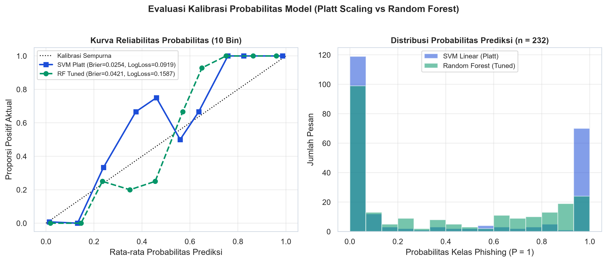

Gambar 4.3 Evaluasi Kalibrasi Probabilitas Model.

Distribusi probabilitas pada Gambar 4.3 memperlihatkan bahwa `LinearSVC` terkalibrasi memisahkan pesan aman dan pesan *phishing* secara tegas menuju dua kutub ekstrem mendekati nol dan satu. Sebaliknya, probabilitas *Random Forest* tersebar lebih banyak di wilayah ketidakpastian antara 0,2 hingga 0,8 karena sifat agregasi pohon keputusan yang merata-ratakan suara cabang pada matriks kata jarang [35]. Keunggulan polarisasi tersebut membuat penetapan kategori risiko `RENDAH`, `SEDANG`, dan `TINGGI` di purwarupa menjadi jauh lebih konsisten.

Untuk mengisolasi pengaruh tiap komponen praproses teks dan batas dimensi fitur, dieksekusi enam skenario studi ablatif menggunakan parameter hasil penalaan terbaik. Pengujian mencakup penghapusan token entitas `token_apk` dan `token_url`, peniadaan *stemming* Sastrawi, pembatasan fitur ke unigram saja, serta variasi batas kosakata maksimum dari 1.500 hingga 5.000 fitur TF-IDF [36], [37]. Seluruh hasil perbandingan lintas enam skenario ablatif disajikan pada Tabel 4.2.

Tabel 4.2 Hasil Studi Ablatif Praproses dan Representasi Fitur TF-IDF

| Skenario Konfigurasi | Model | CV10 *Accuracy* | CV10 *F1-Score* | *Holdout Accuracy* | *Holdout F1-Score* |
| :--- | :--- | :---: | :---: | :---: | :---: |
| `1_Tanpa_Token_Entitas` | `LinearSVC` | 96,66% | 95,81% | 97,84% | 97,27% |
| `1_Tanpa_Token_Entitas` | *Random Forest* | 93,96% | 92,42% | 95,26% | 93,99% |
| `2_Tanpa_Sastrawi` | `LinearSVC` | 97,74% | 97,16% | 96,12% | 95,08% |
| `2_Tanpa_Sastrawi` | *Random Forest* | 95,69% | 94,55% | 96,55% | 95,60% |
| `3_Unigram_Saja` | `LinearSVC` | 96,77% | 95,94% | 96,12% | 95,08% |
| `3_Unigram_Saja` | *Random Forest* | 95,68% | 94,59% | 96,12% | 95,03% |
| `4_Utama_MaxFeatures_1500` | `LinearSVC` | 97,30% | 96,61% | 96,12% | 95,03% |
| `4_Utama_MaxFeatures_1500` | *Random Forest* | 95,58% | 94,52% | 96,55% | 95,56% |
| `5_Konfigurasi_Utama_3000` | `LinearSVC` | 97,74% | 97,16% | 96,12% | 94,97% |
| `5_Konfigurasi_Utama_3000` | *Random Forest* | 95,25% | 94,07% | 96,55% | 95,56% |
| `6_Utama_MaxFeatures_5000` | `LinearSVC` | 97,41% | 96,79% | 96,98% | 96,13% |
| `6_Utama_MaxFeatures_5000` | *Random Forest* | 94,72% | 93,34% | 96,55% | 95,60% |

Sumber: Hasil Studi Ablatif `05 Hasil Evaluasi/studi_ablatif_fitur.csv` (2026).

Data pada Tabel 4.2 menunjukkan bahwa pemilihan `5_Konfigurasi_Utama_3000` didasarkan pada rata-rata *F1-Score* validasi silang sepuluh lipatan tertinggi untuk `LinearSVC` (`97,16%`, *Accuracy* `97,74%`). Penghapusan penyandian `token_apk` dan `token_url` (`1_Tanpa_Token_Entitas`) menurunkan *F1-Score* validasi silang `LinearSVC` sebesar 1,35 poin ke 95,81% serta menjatuhkan *Random Forest* ke 92,42% [16]. Pembatasan kosakata menjadi unigram saja (`3_Unigram_Saja`) turut memangkas *F1-Score* validasi silang `LinearSVC` sebesar 1,22 poin ke 95,94%.

Dua temuan metodologis pada Tabel 4.2 perlu dicermati secara objektif. Pertama, selisih validasi silang `LinearSVC` antara `5_Konfigurasi_Utama_3000` (`97,1596%`) dan `2_Tanpa_Sastrawi` (`97,1589%`) hanya `0,0007%`, sehingga Sastrawi terutama berfungsi menyeragamkan variasi morfologi kata berimbuhan [9], [37]. Kedua, tingginya akurasi *holdout* tunggal `1_Tanpa_Token_Entitas` (`97,84%`) terjadi karena penyamaran seluruh tautan ke satu fitur generik `token_url` pada konfigurasi utama memberi bobot positif pada siaran resmi DJP bertautan `www.pajak.go.id` (`idx=1082`) sebelum lapisan penjaga domain diterapkan.

## 4.3 Analisis Ketahanan Bias Kata Kunci Pajak dan Generalisasi Lintas Korpus

Pengujian khusus ketahanan bias kata kunci pajak dijalankan pada `Tahap 4A` menggunakan irisan 45 pesan bertema pajak di himpunan uji (`21` pesan layanan resmi dan `24` penipuan). Pada ambang diskrit `0,5`, `LinearSVC` terkalibrasi dan *Random Forest* sama-sama mencatat *Accuracy* 95,56%, *Precision* 95,83%, *Recall* 95,83%, dan *F1-Score* 95,83% (`TN = 20`, `FP = 1`, `FN = 1`, `TP = 23`). Sebanyak dua puluh dari dua puluh satu pengumuman resmi DJP lolos tanpa salah blokir [2], [5].

Meskipun hasil prediksi diskrit pada 45 sampel uji seri, kualitas probabilitas dan stabilitas lintas-lipatan `LinearSVC` jauh melampaui *Random Forest*. Pada subset uji pajak tersebut, `LinearSVC` Platt meraih *ROC-AUC* 0,9960, *PR-AUC* 0,9968, dan *Brier Score* 0,03289, mengungguli *Random Forest* yang mencatat *ROC-AUC* 0,9752 serta *Brier Score* 0,10914. Pada validasi silang sepuluh lipatan atas seluruh 260 rekaman pajak, `LinearSVC` mencapai *F1-Score* 98,17% (*Recall* 100,00%; *Accuracy* 98,08%) dibanding *Random Forest* sebesar 93,57% (*Accuracy* 93,46%).

Pengujian `Tahap 4B` mengevaluasi model produksi terhadap 3.091 baris biner mentah eksternal Theodorus dkk. (`2.743`) dan Saragih (`348`), yang menghasilkan 1.360 pesan uji unik pascadeduplikasi 1.483 duplikat internal serta 248 irisan korpus utama [7]. Pada uji *zero-shot*, `LinearSVC` meraih *Accuracy* 64,19%, *Recall* 80,28%, *F1-Score* 54,27%, dan *ROC-AUC* 0,7875, mengungguli *Random Forest* (*Accuracy* 62,35%; *Recall* 60,00%; *F1-Score* 45,76%). Penurunan presisi dipicu 416 positif palsu (*spesifisitas* 58,40%) akibat *domain shift* SMS normal, sedangkan 94 baris sisa Saragih timpang (`90` penipuan berbanding `4` normal).

Guna membuktikan bahwa keterbatasan *zero-shot* bersumber dari pergeseran ragam kosakata korpus dan bukan kelemahan arsitektur model, `Tahap 4C` melatih ulang kedua algoritma pada korpus diperluas 2.519 baris unik pascadeduplikasi Sastrawi. Hasil *holdout* (`n = 504`) memulihkan kinerja `LinearSVC` terkalibrasi secara signifikan hingga *Accuracy* 96,03%, *Precision* 96,75%, *Recall* 90,85%, *F1-Score* 93,71%, *ROC-AUC* 0,9883, dan *Brier Score* 0,03578. Sementara itu, *Random Forest* mencatat *Accuracy* 92,46% (*F1-Score* 87,90%), serta pada validasi silang 2.519 baris kedua model mencapai *F1-Score* 91,81% dan 91,11%. Perbandingan seluruh skenario ketahanan domain ditampilkan pada Gambar 4.5.

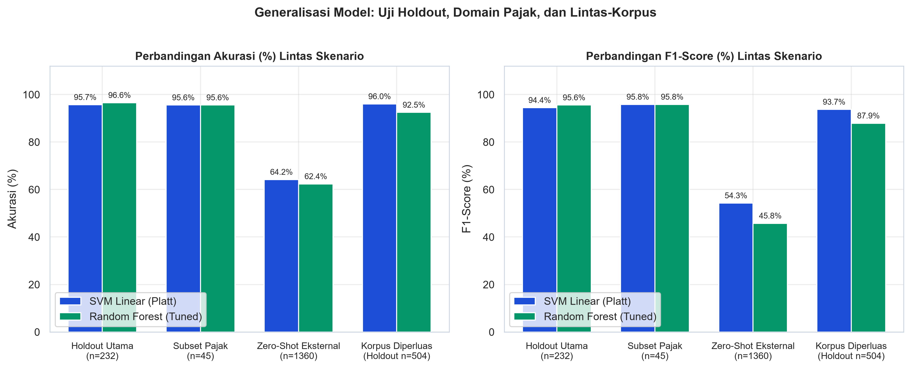

Gambar 4.5 Komparasi Generalisasi Lintas Korpus dan Subset Pajak.

Temuan pada Gambar 4.5 memberi implikasi praktis bagi perancangan sistem deteksi penipuan berbahasa Indonesia. Meski `LinearSVC` tangguh menjaga *Recall* 80,28% di luar distribusi serta *F1-Score* validasi silang 98,17% pada domain pajak, pembaruan korpus latih tetap wajib dijalankan secara berkala agar ragam pesan normal baru tidak keliru terblokir. Adaptasi kosakata mencegah galat presisi.

## 4.4 Analisis Interpretabilitas Fitur dan Kesalahan Prediksi

Transparansi keputusan model merupakan salah satu kontribusi utama purwarupa ini untuk menjawab celah riset pada literatur sebelumnya [24], [25]. Pemeriksaan vektor koefisien *hyperplane* pada `LinearSVC` menunjukkan pemisahan arah polaritas yang sangat intuitif antara token penanda penipuan (koefisien positif) dan token penanda pesan resmi atau percakapan normal (koefisien negatif). Sebaliknya, ukuran *Mean Decrease in Impurity* (*Gini importance*) pada *Random Forest* hanya menilai seberapa kuat suatu token memecah simpul pohon tanpa membedakan arah kelasnya.

Pada sisi positif `LinearSVC`, fitur penanda *phishing* terkuat berturut-turut ditempati `no` (+2,241), `sms` (+1,694), `rekening` (+1,508), `info` (+1,405), `segera` (+1,378), `pin` (+1,373), `token_apk` (+1,358), `token_url` (+1,355), `hub` (+1,322), serta `klik` (+1,292). Masuknya `token_apk` dan `token_url` pada delapan besar fitur positif membuktikan bahwa penyandian khusus ekstensi aplikasi Android dan tautan menjadi sinyal pembeda utama penipuan. Bobot tersebut langsung menaikkan skor risiko.

Pada sisi negatif `LinearSVC`, koefisien penahan kelas normal dan resmi diisi oleh `nama1` (-1,272), pronomina percakapan `aku` (-1,221), `resmi` (-1,071), `maupun` (-0,963), `terimakasih` (-0,913), `yg` (-0,894), `nya` (-0,874), dan `pernah` (-0,842). Token pengaman kelembagaan lain meliputi `laman` (-0,766), `pratama` (-0,759), `kp2kp` (-0,750), `resmi token_url` (-0,676), `kpp pratama` (-0,642), serta `edukasi` (-0,619). Daftar fitur teratas kedua algoritma dibandingkan pada Gambar 4.4 dan dirinci pada Tabel 4.3.

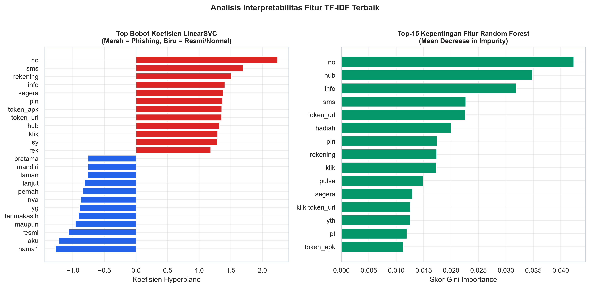

Gambar 4.4 Analisis Interpretabilitas Fitur TF-IDF Terbaik.

Tabel 4.3 Perbandingan Fitur Teratas `LinearSVC` dan *Random Forest*

| Peringkat | Fitur Positif *Phishing* (`LinearSVC`) | Bobot *w* (+) | Fitur Penahan Resmi/Normal (`LinearSVC`) | Bobot *w* (-) | Fitur Terpenting *Random Forest* | Skor Gini |
| :---: | :--- | :---: | :--- | :---: | :--- | :---: |
| 1 | `no` | +2,2405 | `nama1` | -1,2720 | `no` | 0,0424 |
| 2 | `sms` | +1,6940 | `aku` | -1,2206 | `hub` | 0,0349 |
| 3 | `rekening` | +1,5083 | `resmi` | -1,0706 | `info` | 0,0319 |
| 4 | `info` | +1,4054 | `maupun` | -0,9633 | `sms` | 0,0227 |
| 5 | `segera` | +1,3778 | `terimakasih` | -0,9134 | `token_url` | 0,0226 |
| 6 | `pin` | +1,3729 | `yg` | -0,8942 | `hadiah` | 0,0200 |
| 7 | `token_apk` | +1,3582 | `nya` | -0,8738 | `pin` | 0,0175 |
| 8 | `token_url` | +1,3550 | `pernah` | -0,8417 | `rekening` | 0,0174 |

Sumber: Ekstraksi Bobot Model `05 Hasil Evaluasi/fitur_teratas_svm_vs_rf.csv` (2026).

Interpretasi Tabel 4.3 memerlukan pembedaan antara fitur bahasa alami dan artefak korpus dasar. Kemunculan token `nama1` (-1,2720) dan tahun `2016` (-0,6664) pada sisi negatif merupakan artefak anonimisasi nama penerima dari korpus SMS normal Rahmi dan Wibisono yang menyumbang 899 dari 1.159 baris. Oleh sebab itu, pada lapisan penjelas purwarupa (`inference.py`), token netral atau artefak korpus tidak ditampilkan kepada pengguna, melainkan difokuskan pada kata pemicu desakan, ancaman, dan ajakan berisiko.

Untuk memvalidasi dampak fitur pada keputusan aktual himpunan uji *holdout* (`n = 232`), dijalankan analisis *SHapley Additive exPlanations* (SHAP) memakai `LinearExplainer` untuk `LinearSVC` (satuan margin *hyperplane*) dan `TreeExplainer` (*interventional*) untuk *Random Forest* (satuan probabilitas) [25]. Karena perbedaan skala numerik kedua *explainer*, pembandingan lintas model dilakukan berdasarkan peringkat `mean(|SHAP|)` dan arah dorongan rata-rata saat fitur aktif (`x_test > 0`). Ringkasan hasilnya tampak pada Gambar 4.8.

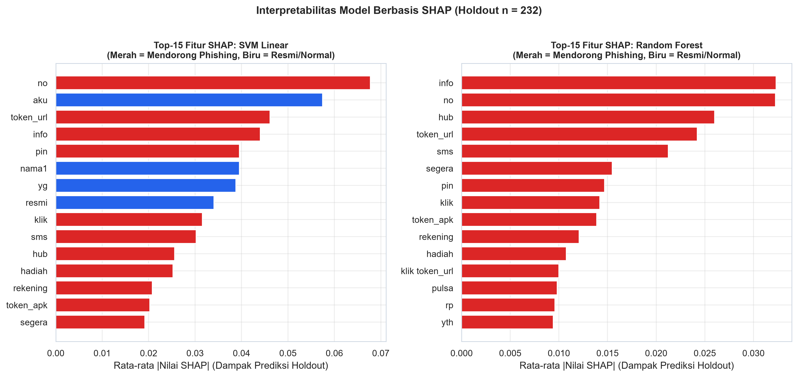

Gambar 4.8 Analisis Interpretabilitas Model Berbasis SHAP (*Holdout* `n = 232`).

Hasil SHAP pada Gambar 4.8 memperlihatkan fitur berimpak absolut terbesar pada `LinearSVC`, mencakup `no` (0,0677; *Phishing*), `aku` (0,0575; *Resmi/Normal*), `token_url` (0,0461; *Phishing*), `info` (0,0440; *Phishing*), `pin` (0,0395; *Phishing*), `nama1` (0,0395; *Resmi/Normal*), `yg` (0,0388; *Resmi/Normal*), dan `resmi` (0,0341; *Resmi/Normal*). Fitur penting berikutnya meliputi `klik` (0,0316; *Phishing*), `sms` (0,0302; *Phishing*), `token_apk` (0,0202; *Phishing*), serta `segera` (0,0192; *Phishing*). Arah dorongan fitur selaras penuh dengan tanda koefisien *hyperplane*.

Pada *Random Forest*, seluruh sepuluh fitur SHAP teratas didominasi penanda kelas positif (*Phishing*), dipimpin `info` (0,0323), `no` (0,0323), `hub` (0,0260), `token_url` (0,0242), `sms` (0,0212), `segera` (0,0155), `pin` (0,0147), `klik` (0,0142), `token_apk` (0,0139), dan `rekening` (0,0121). Kata `wajib` (0,0092) dan `wajib pajak` (0,0069) turut condong ke arah *Phishing* pada korpus gabungan karena mayoritas kelas normal berasal dari SMS umum non-pajak, namun bias ini telah teredam pada evaluasi khusus 260 teks pajak seimbang.

Penelusuran atas seluruh prediksi yang meleset di himpunan uji `n = 232` menemukan tiga belas sampel salah prediksi gabungan (`10` kesalahan pada `LinearSVC` Platt dan `8` kesalahan pada *Random Forest*, dengan `5` sampel beririsan pada kedua model). Lima sampel hanya meleset pada `LinearSVC` (keduanya di *baseline* maupun terkalibrasi), tiga sampel hanya meleset pada *Random Forest*, dan lima sampel sulit meleset bersamaan pada kedua model. Rincian ketigabelas sampel terangkum pada Tabel 4.4.

Tabel 4.4 Ringkasan Analisis Kesalahan Prediksi pada Himpunan Uji *Holdout*

| Indeks | Sumber dan Kategori | Aktual | Probabilitas SVM | Probabilitas RF | Lokasi Galat | Ringkasan Konten dan Penyebab Leksikal |
| :---: | :--- | :---: | :---: | :---: | :--- | :--- |
| 118 | Rahmi (Penipuan) | 1 | 0,566 | 0,420 | RF Saja (FN) | Modus jual rumah di bandara mengajak hubungi nomor seluler tanpa kata `hadiah` |
| 50 | Rahmi (Penipuan) | 1 | 0,218 | 0,750 | SVM Baseline & Platt (FN) | Tawaran gratis telepon dan kuota operator dengan banyak angka satuan |
| 491 | Rahmi (Normal) | 0 | 0,543 | 0,170 | SVM Baseline & Platt (FP) | Teks sangat pendek berbunyi "Dimulai dari angka 0" tanpa konteks normal |
| 898 | Rahmi (Normal) | 0 | 0,608 | 0,640 | Keduanya (FP) | Pertanyaan singkat "No bri atas nama kamu mana" memuat kata pemicu `no` |
| 960 | Pajak (`Phishing_APK_MPajak`) | 1 | 0,424 | 0,730 | SVM Baseline & Platt (FN) | Gaya pengumuman formal DJP mengajak unduh `MPajak_Aktivasi_KSWP.apk` tanpa kata spam umum |
| 293 | Rahmi (Penipuan) | 1 | 0,347 | 0,250 | Keduanya (FN) | Notifikasi isi ulang pulsa palsu menyerupai struk transaksi normal |
| 1003 | Pajak (`Phishing_Link_NIK_NPWP`) | 1 | 0,787 | 0,340 | RF Saja (FN) | Instruksi pembaruan KTP/KK via `form-wajibpajak-djp.com` lolos di RF tapi tertangkap SVM |
| 52 | Rahmi (Penipuan) | 1 | 0,819 | 0,350 | RF Saja (FN) | Iming-iming bonus internet 5MB dengan istilah informal singkat |
| 228 | Rahmi (Penipuan) | 1 | 0,494 | 0,610 | SVM Baseline & Platt (FN) | Pesan undian hadiah *event* bergaya percakapan santai mendekati ambang `0,5` |
| 314 | Rahmi (Penipuan) | 1 | 0,033 | 0,230 | Keduanya (FN) | Instruksi singkat transfer rekening Mandiri tanpa tautan maupun ancaman |
| 102 | Rahmi (Penipuan) | 1 | 0,392 | 0,470 | Keduanya (FN) | Permintaan transfer rekening Mandiri singkat bergaya pesan keluarga |
| 1082 | Pajak (Pemadanan NIK Resmi) | 0 | 0,551 | 0,600 | Keduanya (FP) | Imbauan resmi login ke `www.pajak.go.id` terseret bobot positif `token_url` dan `login` |
| 165 | Rahmi (Penipuan) | 1 | 0,493 | 0,550 | SVM Baseline & Platt (FN) | Tagihan jatuh tempo mengajak lapor ke nomor telepon (`p = 0,493` tepat di bawah `0,5`) |

Sumber: Analisis Kesalahan `05 Hasil Evaluasi/analisis_kesalahan_prediksi.csv` (2026).

Pengamatan atas Tabel 4.4 menyingkap dua kasus kunci pada domain perpajakan yang menjadi landasan arsitektural purwarupa hibrida. Pada `idx=960`, pesan penipuan `MPajak_Aktivasi_KSWP.apk` ditulis dengan kalimat birokratis formal sehingga peluang `LinearSVC` murni tertahan di `0,424` (`FN`), sementara pada `idx=1082` pesan resmi pemadanan NIK yang memuat `www.pajak.go.id` terkena positif palsu di kedua model (`0,551` dan `0,600`) karena penyamaran `token_url` menyamakan domain sah dengan tautan penipu. Kedua kelemahan representasi TF-IDF murni ini teratasi sepenuhnya oleh lapisan heuristik `has_apk` dan `is_official_djp_domain` pada `inference.py`.

## 4.5 Hasil Pengujian Purwarupa Sistem Terpadu dan Evaluasi Kesiapterapan Teknologi

Pengujian fungsional purwarupa TKT Level 6 berjalan otomatis memakai Pytest 9.2.0 terhadap dua puluh tiga kasus uji beserta tolok ukur latensi `src/benchmark_purwarupa.py` pada 232 sampel *holdout*. Seluruh dua puluh tiga pengujian (`UJI-01` sampai `UJI-10`) lulus seratus persen dalam waktu eksekusi total 6,30 detik. Hasil ini membuktikan integritas SHA-256 dataset, deduplikasi Sastrawi, isolasi `Pipeline` kalibrasi Platt, reproduksi `.joblib`, kontrak API, web *Cek Pesan Pajak*, serta penjagaan domain pengecoh dan angka jam.

Pengukuran waktu nyata menunjukkan pemuatan awal bundel `.joblib` ke memori memerlukan 258,167 ms dan selanjutnya ditahan di memori melalui `lru_cache`. Setelah termuat, fungsi `predict_message` pada `inference.py` memproses satu pesan berikut analisis heuristik, sorotan teks, dan alasan awam dalam rata-rata 25,005 ms (*median* 20,638 ms; *P95* 45,643 ms). Melalui antarmuka HTTP `POST /predict` FastAPI, latensi penuh tercatat 27,211 ms/pesan (*median* 25,271 ms; *P95* 37,566 ms), sedangkan pemrosesan massal `POST /predict/batch` lima puluh pesan tuntas dalam 750,066 ms (15,001 ms/pesan). Rekapitulasi pengujian disajikan pada Tabel 4.5.

Tabel 4.5 Hasil Pengujian Fungsional Otomatis dan Latensi Inferensi Purwarupa

| Kode / Metrik | Subjek dan Kondisi Uji | Jumlah Uji / Sampel | Hasil / Waktu Terukur | Status |
| :--- | :--- | :---: | :---: | :---: |
| `UJI-01` | `GET /health` kesiapan peladen FastAPI & bundel model | 1 | HTTP 200 (`LinearSVC+Platt` aktif) | Lulus (140 ms) |
| `UJI-02` | `POST /predict` pesan modus `Coretax_DJP_Update.apk` | 1 | Label `1`, `has_apk=True`, risiko `TINGGI` | Lulus (130 ms) |
| `UJI-03` | `POST /predict` domain palsu `pajak-djp-verifikasi.xyz` | 1 | Label `1`, domain curiga tercatat tanpa `17.00` | Lulus (20 ms) |
| `UJI-04` | `POST /predict` pengumuman resmi `djponline.pajak.go.id` | 1 | Label `0`, risiko `RENDAH`, `official_domains` terisi | Lulus (30 ms) |
| `UJI-05` | `is_official_djp_domain` uji pengecoh `pajak.go.id.evil.com` | 1 | Mengembalikan `False` untuk tiruan | Lulus (<1 ms) |
| `UJI-06` | `POST /predict` pengiriman teks spasi kosong | 1 | Ditolak dengan status HTTP 422 | Lulus (10 ms) |
| `UJI-07` | `POST /predict/batch` dua teks campuran *phishing* dan resmi | 1 | HTTP 200 dengan `total=2` | Lulus (40 ms) |
| `UJI-08` | Penjagaan angka pukul `16.00` dan nominal `Rp1.500.000` | 1 | `suspicious_domains` kosong, status `RENDAH` | Lulus (20 ms) |
| `UJI-09` | `GET /`, `/api/presets`, dan `/api/academic-summary` | 1 | HTTP 200 antarmuka web *Cek Pesan Pajak* | Lulus (290 ms) |
| `UJI-10` | Suite integritas 5 korpus, SHA-256, deduplikasi, Platt, dan `.joblib` | 13 | Seluruh 13 pengujian data/model valid | Lulus (820 ms) |
| `LAT-01` | Latensi lokal `inference.py::predict_message` (*Mean* / *P95*) | 232 | 25,005 ms/pesan (*P95* = 45,643 ms) | Memenuhi (<100 ms) |
| `LAT-02` | Latensi REST API `FastAPI POST /predict` (*Mean* / *P95*) | 232 | 27,211 ms/pesan (*P95* = 37,566 ms) | Memenuhi (<100 ms) |
| `LAT-03` | Latensi massal `FastAPI POST /predict/batch` (50 pesan) | 50 | 750,066 ms total (15,001 ms/pesan) | Memenuhi (<100 ms) |

Sumber: Eksekusi `src/benchmark_purwarupa.py` dan `05 Hasil Evaluasi/tabel_pengujian_purwarupa.csv` (2026).

Demonstrasi antarmuka aplikasi diverifikasi pada tiga prasetel skenario nyata lewat web *Cek Pesan Pajak* (`GET /`), respons JSON FastAPI, serta simulasi ekstensi *WhatsApp Web* berarsitektur *Manifest V3*. Pada prasetel berkas berbahaya `Pembaruan_Coretax_DJP.apk`, sistem menetapkan status berisiko tinggi *BAHAYA / SCAM* dengan indikasi scam 92% (skor internal `LinearSVC` Platt 92,49% dan *Random Forest* 95,00%). Sistem menyoroti langsung berkas `.apk` di gelembung WhatsApp dan menampilkan chip kata pemicu (*segera*, *unduh*, *instal*, *verifikasi*) beserta respons JSON FastAPI pada Gambar 4.6.

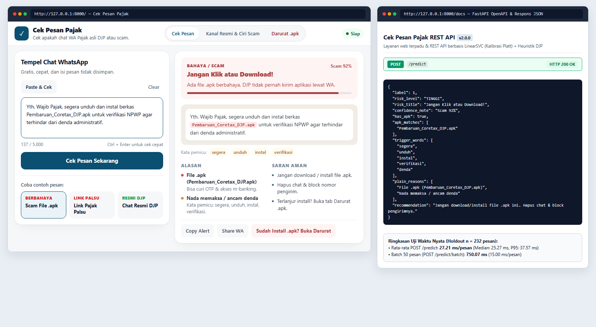

Gambar 4.6 Tangkapan Layar Antarmuka Web *Cek Pesan Pajak* dan Respons API.

Pengujian pada antarmuka ekstensi *Manifest V3* memakai halaman `simulasi_whatsapp_web.html` yang menampilkan tiga gelembung percakapan beserta jendela *popup* ekstensi pada Gambar 4.7. Prasetel domain palsu `djp-coretax-verifikasi.xyz` ditandai berisiko tinggi *BAHAYA / SCAM* (indikasi scam 84%, skor `LinearSVC` 84,28%), sedangkan pengumuman resmi `djponline.pajak.go.id` diloloskan aman (skor penipuan 10,23%, keyakinan aman 90%). Pemindaian `content.js` melalui *service worker* `background.js` serta penyempurnaan `URL_PATTERN` bersyarat *top-level domain* alfabetis terbukti mencegah salah penandaan pukul `17.00` dan nominal `Rp1.500.000`.

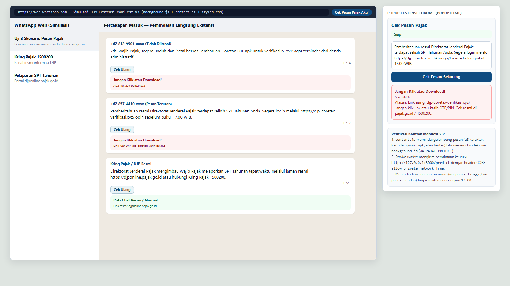

Gambar 4.7 Tangkapan Layar Ekstensi Chrome pada Simulasi *WhatsApp Web*.

Mengacu pada indikator Tingkat Kesiapan Teknologi Peraturan Menteri Riset, Teknologi, dan Pendidikan Tinggi Nomor 42 Tahun 2016 [41], purwarupa telah memenuhi kriteria **TKT Level 6**. Penilaian tersebut didasarkan pada demonstrasi subsistem terintegrasi meliputi bundel `.joblib`, API FastAPI, web *Cek Pesan Pajak*, serta ekstensi *Manifest V3* pada simulasi *WhatsApp Web* dengan dua puluh tiga uji otomatis lulus serta latensi persentil ke-95 di bawah lima puluh milidetik. Purwarupa siap diterapkan.

Sebagai penutup analisis hasil, capaian penelitian ini dibandingkan langsung dengan studi terdahulu yang telah dipetakan pada Bab II [6], [7], [9], [10], [11], [13], [15], [16], [24], [26]. Pembandingan tersebut menyoroti perbedaan karakteristik korpus bahasa Indonesia, jenis fitur teks, pemilihan algoritma, serta keberadaan purwarupa terpakai. Ringkasan kinerja model dan mekanisme mitigasi bias dirinci pada Tabel 4.6.

Tabel 4.6 Komparasi Hasil Penelitian terhadap Studi Terdahulu

| Peneliti (Tahun) | Korpus & Fitur | Model Terbaik & Kinerja | Mitigasi Bias, Kalibrasi, & Purwarupa |
| :--- | :--- | :--- | :--- |
| Rahmi dan Wibisono (2016) [6] | 1.143 SMS Indonesia, *Term Frequency* | *Multinomial Naïve Bayes* (*Acc* 94,12%-94,56%) | Belum melestarikan token entitas, tanpa korpus pajak |
| Theodorus dkk. (2021) [7] | 4.125 SMS Indonesia, *BoW* 1.500 | *Random Forest* (*Acc* 94,62% vs SVM 94,38%) | Belum fokus tema *phishing* pajak dan tanpa purwarupa |
| Al Ghofany dkk. (2022) [9] | Sebanyak 500 SMS privat Indonesia, TF-IDF + Sastrawi | SVM Sigmoid (*Acc* 99,60%) & Linear (99,52%) | Belum membandingkan dengan *Random Forest* maupun XAI |
| Astuti dkk. (2024) [10] | 5.574 SMS Inggris, TF-IDF | SVC Sigmoid (*Acc* 97,93%, *F1* 95%) | Tanpa praproses bahasa Indonesia dan tanpa ekstensi |
| Tampinongkol dkk. (2024) [11] | 59.899 URL *phishing*, 9 fitur leksikal | *Random Forest* (*Acc* 84,95% vs SVM RBF 77,43%) | Fokus leksikal tautan, bukan isi rekayasa sosial teks |
| Ningtias dkk. (2026) [13] | 5.572 SMS Inggris, TF-IDF + `GridSearchCV` | Linear SVM (*Acc* 98,39%, *F1* 93,71%) > RF (95,96%) | Menghapus URL saat praproses, tanpa kalibrasi Platt |
| Saputra dkk. (2026) [15] | 1.320 pesan WA/SMS Indo, Sastrawi + *Hashing* | Linear SVM (*Acc* 95,45%, *Macro F1* 0,95) | `HashingVectorizer` menghilangkan keterjelasan fitur XAI |
| Sembiring dkk. (2026) [16] | 2.320 pesan penipuan Indo, token entitas | XGBoost (*Acc* 96,34%), Linear SVM (*Rec* 98,59%) | Belum menyandikan `.apk`, tanpa domain pajak & ekstensi |
| Mishra dan Yadav (2026) [24]; Suwarno dkk. (2026) [26] | SMS TF-IDF [24]; URL *phishing* [26] | `LinearSVC` terjelaskan [24]; Ekstensi *LogReg* [26] | Belum terpadu untuk WhatsApp Indonesia tema otoritas pajak |
| **Penelitian Ini (2026)** | **1.159 teks unik (dari 1.164 induk) & 2.519 diperluas, TF-IDF `(1, 2)` + Sastrawi** | **`LinearSVC` Platt (*10-Fold CV* 97,74%, *F1* pajak 98,17%, *Holdout* 95,69%, *Brier* 0,02542)** | **Mitigasi *keyword bias* pajak, XAI koefisien & SHAP, *guard* `.apk`/domain sah, purwarupa TKT 6 (27,21 ms)** |

Sumber: Sintesis Perbandingan Eksperimen dan Literatur (2026).

Secara keseluruhan, hasil pada Tabel 4.6 memperlihatkan keunggulan rancangan sistem yang memadukan korpus pajak seimbang 260 baris, penyandian `token_apk` dan `token_url`, kalibrasi Platt terisolasi `Pipeline`, serta heuristik `pajak.go.id`. Kombinasi tersebut melampaui keterbatasan penyaring teks konvensional yang kerap salah memblokir imbauan pajak resmi ataupun meloloskan pesan `.apk` bergaya birokratis. Keunggulan validasi silang, kalibrasi peluang, kejelasan kata pemicu, dan latensi di bawah 50 ms menjadi pijakan empiris perumusan Bab V.

---

# DAFTAR PUSTAKA

[1] Waluyo, *Perpajakan Indonesia*, ed. ke-13. Jakarta: Salemba Empat, 2020.

[2] Direktorat Jenderal Pajak, “Penyebarluasan Informasi Mengenai Coretax (Pengumuman Nomor PENG-32/PJ.09/2024),” *Portal Resmi Direktorat Jenderal Pajak Kementerian Keuangan Republik Indonesia*, Nov. 2024. [Online]. Available: https://pajak.go.id/id/pengumuman/penyebarluasan-informasi-mengenai-coretax

[3] N. B. Prakoso, H. Ayu, and H. Zakaria, “Misuse of taxpayer data for phising scams,” *Journal of International Islamic Law, Human Rights, and Public Policy*, vol. 4, no. 3, pp. 1560-1569, Jul. 2026, doi: 10.5281/zenodo.21853029.

[4] R. Alabdan, “Phishing attacks survey: Types, vectors, and technical approaches,” *Future Internet*, vol. 12, no. 10, p. 168, Oct. 2020, doi: 10.3390/fi12100168.

[5] Direktorat Jenderal Pajak, “Waspada penipuan yang mengatasnamakan Direktorat Jenderal Pajak (Pengumuman Nomor PENG-31/PJ.09/2024 s.d. PENG-18/PJ.09/2026),” *Portal Resmi Direktorat Jenderal Pajak Kementerian Keuangan Republik Indonesia*, 2026. [Online]. Available: https://www.pajak.go.id/id/pengumuman/waspada-penipuan-yang-mengatasnamakan-direktorat-jenderal-pajak

[6] F. Rahmi and Y. Wibisono, “Aplikasi SMS spam filtering pada Android menggunakan algoritma Naïve Bayes,” Skripsi, Dept. Pendidikan Ilmu Komputer, Universitas Pendidikan Indonesia, Bandung, 2016. [Online]. Available: https://repository.upi.edu/26936/

[7] A. Theodorus, T. K. Prasetyo, R. Hartono, and D. Suhartono, “Short Message Service (SMS) spam filtering using machine learning in Bahasa Indonesia,” in *Proc. 3rd East Indonesia Conf. Comput. Inf. Technol. (EIConCIT)*, Apr. 2021, pp. 199-203, doi: 10.1109/EIConCIT50028.2021.9431859.

[8] D. Irawan, Hamidah, E. B. Perkasa, Yurindra, D. Wahyuningsih, and E. Helmud, “Perbandingan klassifikasi SMS berbasis Support Vector Machine, Naive Bayes Classifier, Random Forest dan Bagging Classifier,” *Jurnal Sisfokom (Sistem Informasi dan Komputer)*, vol. 10, no. 3, pp. 432-437, Dec. 2021, doi: 10.32736/sisfokom.v10i3.1302.

[9] M. S. Al Ghofany, R. Dwiyansaputra, F. Bimantoro, and Khairunnas, “Indonesian SMS spam detection using TF-RF feature weighting method and Support Vector Machine classifier,” in *Proc. First Mandalika Int. Multi-Conf. Sci. Eng. (MIMSE-I-C)*, 2022, pp. 117-129, doi: 10.2991/978-94-6463-084-8_12.

[10] E. Z. Astuti, C. A. Sari, E. H. Rachmawanto, and R. R. Ali, “Comparative study of machine learning algorithms for performing ham or spam classification in SMS,” *Scientific Journal of Informatics*, vol. 11, no. 1, pp. 177-186, Feb. 2024, doi: 10.15294/sji.v11i1.47364.

[11] F. F. Tampinongkol, A. R. Kamila, A. C. Wardhana, A. W. C. Kusuma, and D. Revaldo, “Implementation of Random Forest classification and Support Vector Machine algorithms for phishing link detection,” *Journal of Informatics Information System Software Engineering and Applications (INISTA)*, vol. 7, no. 1, pp. 127-137, Nov. 2024, doi: 10.20895/inista.v7i1.1588.

[12] A. Al Tawil, L. H. Almazaydeh, D. Qawasmeh, B. Qawasmeh, M. Alshinwan, and K. Elleithy, “Comparative analysis of machine learning algorithms for email phishing detection using TF-IDF, Word2Vec, and BERT,” *Computers, Materials & Continua*, vol. 81, no. 2, pp. 3395-3412, Nov. 2024, doi: 10.32604/cmc.2024.057279.

[13] A. A. Ningtias, N. Anwar, A. Ichwani, and R. T. Iswahyudi, “Komparasi kinerja Support Vector Machine dan Random Forest untuk deteksi spam email berbasis TF-IDF teks,” *IKRA-ITH Informatika: Jurnal Komputer dan Informatika*, vol. 10, no. 3, pp. 45-51, Nov. 2026.

[14] F. M. Efendi, A. K. Adisusilo, and S. Budiprayitno, “Pengembangan sistem deteksi phishing pada WhatsApp berbasis AI dengan integrasi bahasa lokal Surabaya,” *Melek IT Information Technology Journal*, vol. 11, no. 1, pp. 101-112, Jun. 2025, doi: 10.30742/melekitjournal.v11i1.417.

[15] R. B. Saputra, M. Azwar, L. Widyawati, Husain, and K. A. Latif, “Implementasi algoritma SVM pada bot WhatsApp untuk deteksi pesan spam,” *Jurnal Manajemen Informatika dan Sistem Informasi*, vol. 9, no. 1, pp. 39-51, Jan. 2026, doi: 10.36595/misi.v9i1.1803.

[16] M. A. Sembiring, M. F. L. Sibuea, and Anjani, “Optimasi model klasifikasi pesan penipuan digital berbahasa Indonesia menggunakan XGBoost dengan Bayesian Optimization dan SMOTE,” *Journal of Science and Social Research*, vol. 9, no. 3, pp. 5329-5336, Jun. 2026, doi: 10.54314/jssr.v9i3.7212.

[17] A. Setiyono and H. F. Pardede, “Klasifikasi SMS spam menggunakan Support Vector Machine,” *Jurnal Pilar Nusa Mandiri*, vol. 15, no. 2, pp. 275-280, Sep. 2019, doi: 10.33480/pilar.v15i2.693.

[18] N. J. Saputra, “Analysis of SMS spam detection using TF-IDF: A study on SMS Spam Collection dataset,” *Jurnal Sosial Teknologi*, vol. 4, no. 4, pp. 213-217, Apr. 2024, doi: 10.59188/jurnalsostech.v4i4.1214.

[19] H. Ahammad, M. Samsuzzaman, M. H. Rashid, and M. A. Masud, “Comparative analysis of machine learning algorithms for spam SMS classification using TF-IDF vectorization,” in *Proc. IEEE Int. Conf. Future Mach. Learn. Data Sci. (FMLDS)*, Nov. 2025, pp. 736-741, doi: 10.1109/fmlds67896.2025.00123.

[20] S. K. Birthriya, P. Ahlawat, and A. K. Jain, “Machine learning-based smishing detection using fuzzy logic and TF-IDF feature engineering,” *Franklin Open*, vol. 14, p. 100506, Mar. 2026, doi: 10.1016/j.fraope.2026.100506.

[21] R. Fauzan, A. V. Vitianingsih, D. Cahyono, A. L. Maukar, and Y. A. B. Suprio, “Penerapan algoritma klasifikasi pada machine learning untuk deteksi phishing,” *MALCOM: Indonesian Journal of Machine Learning and Computer Science*, vol. 5, no. 2, pp. 531-540, Mar. 2025, doi: 10.57152/malcom.v5i2.1968.

[22] I. P. Sari, O. K. Sulaiman, D. Apdilah, and P. Simanjuntak, “Analisis komparatif Support Vector Machine dan Random Forest untuk deteksi email phishing,” *Applied Information Technology and Computer Science (AICOMS)*, vol. 4, no. 2, pp. 18-27, Nov. 2025, doi: 10.58466/aicoms.v4i2.1806.

[23] I. K. Izzah, I. Riadi, and A. Fadlil, “Analisis kinerja machine learning untuk deteksi konten penipuan berbahasa Indonesia di Twitter,” *Rabit: Jurnal Teknologi dan Sistem Informasi Univrab*, vol. 11, no. 1, pp. 725-742, Jan. 2026, doi: 10.36341/rabit.v11i1.7124.

[24] P. Mishra and A. Yadav, “An explainable and reproducible lightweight machine learning framework for SMS spam detection using TF-IDF and Linear Support Vector Classification,” *International Journal of Advanced Science and Computer Applications*, vol. 5, no. 2, Sep. 2026, doi: 10.47679/ijasca.v5i2.269.

[25] J. Ismail, R. A. Nasution, and M. N. Gea, “Deteksi phishing URL menggunakan XGBoost dengan Explainable AI pada Web Page Phishing Detection dataset,” *IDEALIS: InDonEsiA journaL Information System*, vol. 9, no. 2, pp. 268-277, Jul. 2026, doi: 10.36080/idealis.v9i2.3810.

[26] Suwarno, V. Capricornness, and Y. Christian, “Implementasi machine learning berbasis browser extension untuk deteksi URL phishing menggunakan Logistic Regression classification,” *Komputa: Jurnal Ilmiah Komputer dan Informatika*, vol. 15, no. 1, May 2026, doi: 10.34010/komputa.v15i1.18882.

[27] C. R. Hassolthine, U. Darusalam, and M. Ikhwani, *Pedoman Teknis Penulisan Tugas Akhir Mahasiswa Universitas Siber Asia (SK Rektor Nomor 01 Tahun 2024)*. Jakarta: Universitas Siber Asia, 2024.

[28] Sugiyono, *Metode Penelitian Kuantitatif, Kualitatif, dan R&D*, ed. ke-2. Bandung: Alfabeta, 2023.

[29] M. Darwin, M. R. Mamondol, S. A. Sormin, and Y. Nurhayati, *Metode Penelitian Pendekatan Kuantitatif*. Bandung: Media Sains Indonesia, 2021.

[30] Sugiyono, *Statistika untuk Penelitian*. Bandung: Alfabeta, 2019.

[31] L. P. Sinambela, *Metodologi Penelitian Kuantitatif: Teoretik dan Praktik*. Depok: Rajawali Pers, 2021.

[32] C. Cortes and V. Vapnik, “Support-vector networks,” *Machine Learning*, vol. 20, no. 3, pp. 273-297, Sep. 1995, doi: 10.1007/BF00994018.

[33] R.-E. Fan, K.-W. Chang, C.-J. Hsieh, X.-R. Wang, and C.-J. Lin, “LIBLINEAR: A library for large linear classification,” *Journal of Machine Learning Research*, vol. 9, pp. 1871-1874, Aug. 2008. [Online]. Available: https://jmlr.org/papers/v9/fan08a.html

[34] J. C. Platt, “Probabilistic outputs for support vector machines and comparisons to regularized likelihood methods,” in *Advances in Large Margin Classifiers*, A. J. Smola, P. Bartlett, B. Schölkopf, and D. Schuurmans, Eds. Cambridge, MA, USA: MIT Press, 2000, pp. 61-74.

[35] L. Breiman, “Random forests,” *Machine Learning*, vol. 45, no. 1, pp. 5-32, Oct. 2001, doi: 10.1023/A:1010933404324.

[36] G. Salton and C. Buckley, “Term-weighting approaches in automatic text retrieval,” *Information Processing & Management*, vol. 24, no. 5, pp. 513-523, 1988, doi: 10.1016/0306-4573(88)90021-0.

[37] M. Adriani, J. Asian, B. A. A. Nazief, S. M. M. Tahaghoghi, and H. E. Williams, “Stemming Indonesian: A confix-stripping approach,” *ACM Transactions on Asian Language Information Processing*, vol. 6, no. 4, pp. 1-33, Dec. 2007, doi: 10.1145/1316457.1316459.

[38] R. Kohavi, “A study of cross-validation and bootstrap for accuracy estimation and model selection,” in *Proc. 14th Int. Joint Conf. Artif. Intell. (IJCAI)*, Montreal, QC, Canada, Aug. 1995, vol. 2, pp. 1137-1143. [Online]. Available: https://www.ijcai.org/Proceedings/95-2/Papers/016.pdf

[39] M. Sokolova and G. Lapalme, “A systematic analysis of performance measures for classification tasks,” *Information Processing & Management*, vol. 45, no. 4, pp. 427-437, Jul. 2009, doi: 10.1016/j.ipm.2009.03.002.

[40] F. Pedregosa *et al.*, “Scikit-learn: Machine Learning in Python,” *Journal of Machine Learning Research*, vol. 12, pp. 2825-2830, Oct. 2011. [Online]. Available: https://jmlr.org/papers/v12/pedregosa11a.html

[41] Menteri Riset, Teknologi, dan Pendidikan Tinggi Republik Indonesia, *Peraturan Menteri Riset, Teknologi, dan Pendidikan Tinggi Nomor 42 Tahun 2016 tentang Pengukuran dan Penetapan Tingkat Kesiapterapan Teknologi* (Berita Negara Republik Indonesia Tahun 2016 Nomor 1010). Jakarta: Kementerian Ristekdikti, Jul. 2016.

[42] H.-T. Lin, C.-J. Lin, and R. C. Weng, “A note on Platt's probabilistic outputs for support vector machines,” *Machine Learning*, vol. 68, no. 3, pp. 267-276, Aug. 2007, doi: 10.1007/s10994-007-5018-6.
