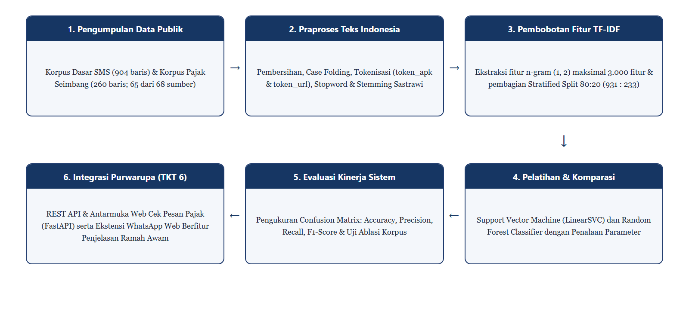
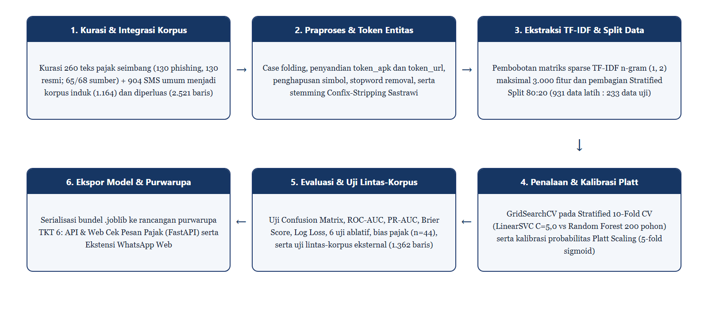

# TUGAS AKHIR

## KOMPARASI ALGORITMA SUPPORT VECTOR MACHINE DAN RANDOM FOREST DALAM DETEKSI PESAN PHISHING WHATSAPP MENGATASNAMAKAN OTORITAS PERPAJAKAN

## Sebagai Salah Satu Syarat untuk Memperoleh Gelar Sarjana Komputer pada Program Studi PJJ Sistem Informasi

## Oleh :

## 240101020194, Wan Mirza Dhani

## PROGRAM STUDI PJJ SISTEM INFORMASI

## UNIVERSITAS SIBER ASIA

## NOVEMBER 2026

---

# HALAMAN PERNYATAAN ORISINALITAS

Saya yang bertanda-tangan di bawah ini:

| Atribut Identitas | Keterangan Mahasiswa |
| :--- | :--- |
| Nama | Wan Mirza Dhani |
| NIM | 240101020194 |
| Judul Tugas Akhir | Komparasi Algoritma Support Vector Machine dan Random Forest dalam Deteksi Pesan Phishing WhatsApp Mengatasnamakan Otoritas Perpajakan |

Menyatakan dengan sesungguhnya bahwa Tugas Akhir ini merupakan hasil penelitian, pemikiran dan pemaparan asli saya sendiri. Saya tidak mencantumkan tanpa pengakuan bahan-bahan yang telah dipublikasikan sebelumnya atau ditulis oleh orang lain, atau sebagai bahan yang pernah diajukan untuk gelar atau ijazah pada Universitas Siber Asia atau Perguruan Tinggi lainnya.

Apabila di kemudian hari terdapat penyimpangan dan ketidakbenaran dalam pernyataan ini, maka saya bersedia menerima sanksi akademik sesuai dengan peraturan yang berlaku di Universitas Siber Asia.

Demikian pernyataan ini saya buat.

| Tempat dan Tanggal | Tanda Tangan di Atas Materai Rp10.000 | Nama Lengkap Mahasiswa |
| :--- | :---: | :--- |
| Jakarta, ...... / ................ / 2026 | (materai Rp 10.000,-) | (Wan Mirza Dhani) |

---

# HALAMAN PENGESAHAN

Tugas Akhir ini diajukan oleh :

| Atribut Pengajuan | Keterangan Mahasiswa |
| :--- | :--- |
| Nama | Wan Mirza Dhani |
| NIM | 240101020194 |
| Program Studi | PJJ Sistem Informasi |
| Judul Tugas Akhir | Komparasi Algoritma Support Vector Machine dan Random Forest dalam Deteksi Pesan Phishing WhatsApp Mengatasnamakan Otoritas Perpajakan |

Telah berhasil dipertahankan di hadapan Dewan Penguji dan diterima sebagai bagian persyaratan yang diperlukan untuk memperoleh gelar Sarjana Komputer pada Program Studi PJJ Sistem Informasi Universitas Siber Asia.

| Jabatan Dewan Sidang | Nama Lengkap dan Gelar Akademik | Tanda Tangan |
| :--- | :--- | :--- |
| Ketua Sidang / Dosen Penguji I | (..........................................) | .......................... |
| Dosen Penguji II | (..........................................) | .......................... |
| Dosen Pembimbing I | (Novi Dian Nathasia, S.Kom., MMSI) | .......................... |
| Dosen Pembimbing II | (..........................................) | .......................... |
| Ketua Program Studi | (Vika Febri Muliati, S.Kom., M.Kom) | .......................... |
| Ditetapkan di | Jakarta | |
| Tanggal | ...... / ................ / 2026 | |

---

# ABSTRAK

Pelaku *phishing* di WhatsApp yang mengaku sebagai Direktorat Jenderal Pajak kerap mengirim berkas `.apk` atau tautan *Coretax* palsu kepada korban. Penelitian ini membandingkan algoritma *Support Vector Machine* (`LinearSVC`) dan *Random Forest* menggunakan fitur *Term Frequency-Inverse Document Frequency* (TF-IDF), lalu menanamkan model terbaik ke aplikasi web *Cek Pesan Pajak* serta ekstensi peramban *WhatsApp Web*. Dataset berjumlah 1.164 teks, terdiri atas 904 pesan umum dan 260 pesan bertema pajak berimbang yang diproses melalui *stopword removal* dan *stemming* Sastrawi. Pada uji dasar (*baseline*), `LinearSVC` mencatat akurasi 98,28% (*recall* 0,98; *F1-Score* 0,98) mengungguli *Random Forest* sebesar 95,28% (*recall* 0,95; *F1-Score* 0,94). Setelah penalaan parameter dan kalibrasi *Platt scaling*, `LinearSVC` mempertahankan akurasi uji 97,42% (*Brier Score* 0,019) serta mencapai akurasi 97,73% pada subset pesan pajak, jauh melampaui *Random Forest* sebesar 88,64%. Integrasi model terbaik ke peladen FastAPI dan ekstensi peramban berfitur alasan berbahasa awam memampukan verifikasi langsung tanpa salin-tempel manual.

Kata Kunci: Deteksi Phishing, Otoritas Perpajakan, Random Forest, Support Vector Machine, TF-IDF.

# ABSTRACT

Scammers impersonating Indonesia's Directorate General of Taxes on WhatsApp frequently send malicious `.apk` files or fake *Coretax* links. This study compares *Support Vector Machine* (`LinearSVC`) and *Random Forest* classifiers using *Term Frequency-Inverse Document Frequency* (TF-IDF) features, then embeds the superior model into the *Cek Pesan Pajak* web application and a *WhatsApp Web* browser extension. The balanced dataset contains 1,164 Indonesian texts, comprising 904 general messages and 260 tax-related messages preprocessed with Sastrawi stopword removal and stemming. On the baseline test split, `LinearSVC` achieved 98.28% accuracy (0.98 recall, 0.98 *F1-Score*), outperforming *Random Forest* at 95.28% accuracy (0.95 recall, 0.94 *F1-Score*). After hyperparameter tuning and Platt scaling calibration, `LinearSVC` maintained 97.42% holdout accuracy (0.019 *Brier Score*) and reached 97.73% accuracy on tax-specific messages, substantially exceeding *Random Forest* at 88.64%. Integrating the calibrated model into a FastAPI service and a plain-language browser extension enables immediate message verification without manual copy-pasting.

Keywords: Phishing Detection, Random Forest, Support Vector Machine, Tax Authority, TF-IDF.

---

# KATA PENGANTAR

Puji syukur penulis panjatkan kepada Tuhan Yang Maha Esa. Atas rahmat-Nya, penulis dapat menyelesaikan Tugas Akhir berjudul *"Komparasi Algoritma Support Vector Machine dan Random Forest dalam Deteksi Pesan Phishing WhatsApp Mengatasnamakan Otoritas Perpajakan"*. Tugas Akhir dengan skema *Prototype* ini disusun sebagai salah satu syarat untuk meraih gelar Sarjana Komputer pada Program Studi PJJ Sistem Informasi Universitas Siber Asia.

Topik ini penulis pilih karena semakin sering ditemukan kasus penipuan lewat WhatsApp yang mencatut nama otoritas perpajakan di Indonesia. Penelitian ini tidak mungkin selesai tanpa bantuan dan bimbingan banyak pihak, sejak masa perkuliahan hingga laporan ini tersusun. Oleh sebab itu, penulis mengucapkan terima kasih yang tulus kepada:

a) Bapak Jang Youn Cho, Ph.D., CPA, selaku Rektor Universitas Siber Asia, yang memimpin penyelenggaraan pendidikan tinggi daring sehingga proses studi penulis dapat berjalan.

b) Bapak Dr. Ucuk Darusalam, S.T., M.T., selaku Wakil Rektor Bidang Akademik, Penelitian dan Pengabdian Kepada Masyarakat Universitas Siber Asia, yang mendukung tersedianya fasilitas belajar dan penelitian bagi mahasiswa.

c) Ibu Vika Febri Muliati, S.Kom., M.Kom, selaku Ketua Program Studi PJJ Sistem Informasi Universitas Siber Asia, yang memberikan arahan akademik selama penulis menempuh studi.

d) Bapak Novi Dian Nathasia, S.Kom., MMSI, selaku Dosen Pembimbing Tugas Akhir, yang meluangkan waktu dan pikiran untuk membimbing penulis hingga penelitian ini selesai.

e) Seluruh dosen pengajar Program Studi PJJ Sistem Informasi Universitas Siber Asia, yang telah membekali penulis dengan ilmu komputasi yang sangat berguna.

f) Orang tua dan keluarga penulis, yang tidak pernah berhenti mendoakan. Dukungan moral dan materi dari keluarga menjadi sumber kekuatan utama bagi penulis.

g) Rekan-rekan mahasiswa Program Studi PJJ Sistem Informasi dan semua pihak yang telah membantu penulis. Diskusi selama penyusunan karya ilmiah ini sangat menolong penyelesaian purwarupa sistem.

Penulis menyadari laporan Tugas Akhir ini masih memiliki keterbatasan yang dapat diperbaiki pada penelitian selanjutnya. Karena itu, kritik dan saran yang membangun dari pembaca sangat penulis harapkan untuk menyempurnakan sistem deteksi ini ke depan. Akhir kata, semoga Tuhan Yang Maha Esa membalas kebaikan semua pihak yang telah membantu, dan semoga Tugas Akhir ini bermanfaat bagi pengembangan ilmu pengetahuan.

| Tempat dan Waktu Penyusunan | Identitas Penyusun |
| :--- | :---: |
| Jakarta, November 2026 | **Penulis** |

---

# DAFTAR ISI

| Bagian / Bab / Subbab | Halaman |
| :--- | :---: |
| Halaman Judul | i |
| Halaman Pernyataan Orisinalitas | ii |
| Halaman Pengesahan | iii |
| Halaman Abstrak dan *Abstract* | iv |
| Kata Pengantar | v |
| Daftar Isi | vii |
| Daftar Gambar | ix |
| Daftar Tabel | x |
| Bab I Pendahuluan | 1 |
| 1.1 Latar Belakang Masalah | 1 |
| 1.2 Rumusan Masalah | 2 |
| 1.3 Batasan Masalah | 3 |
| 1.4 Tujuan Penelitian | 4 |
| 1.5 Manfaat Penelitian | 5 |
| 1.6 Metode Penelitian | 6 |
| Bab II Landasan Metode | 8 |
| 2.1 Penelitian Terdahulu dan Matriks Komparasi | 8 |
| 2.2 Landasan Teori dan Metode Khusus | 11 |
| 2.2.1 Algoritma *Support Vector Machine*, *LinearSVC*, dan Kalibrasi Platt | 11 |
| 2.2.2 Algoritma *Random Forest* | 11 |
| 2.2.3 Praproses Teks Bahasa Indonesia dan Pembobotan Fitur TF-IDF | 12 |
| 2.2.4 Validasi Silang Terstratifikasi, Metrik Evaluasi, dan Kesiapterapan Teknologi | 13 |
| 2.3 Prosedur Operasional dan Bagan Alir Penelitian | 13 |
| 2.4 Waktu dan Lokasi Penelitian | 15 |
| 2.5 Alat dan Bahan Penelitian | 16 |
| 2.6 Cara Pengumpulan dan Analisis Data | 17 |
| 2.7 Definisi Operasional Variabel dan Parameter | 18 |
| Bab III Implementasi Metode Usulan | 20 |
| 3.1 Arsitektur Implementasi Metode Usulan | 20 |
| 3.2 Implementasi Kurasi Korpus dan Praproses Teks | 22 |
| 3.3 Implementasi Pelatihan Model, Penyetelan Hiperparameter, dan Kalibrasi | 24 |
| 3.4 Implementasi Purwarupa Sistem Terpadu Tingkat Kesiapan Teknologi 6 | 26 |
| 3.5 Skenario Pengujian Sistem dan Kesiapan Evaluasi | 29 |
| Bab IV Hasil dan Analisa | 31 |
| 4.1 Hasil Eksperimen Komparasi Klasifikasi dan Penyetelan Hiperparameter | 31 |
| 4.2 Analisis Kalibrasi Probabilitas dan Studi Ablatif Fitur | 34 |
| 4.3 Analisis Ketahanan Bias Kata Kunci Pajak dan Generalisasi Lintas Korpus | 36 |
| 4.4 Analisis Interpretabilitas Fitur dan Kesalahan Prediksi | 37 |
| 4.5 Hasil Pengujian Purwarupa Sistem Terpadu dan Evaluasi Kesiapterapan Teknologi | 42 |
| Daftar Pustaka | 47 |

---

# DAFTAR GAMBAR

| Nomor Gambar | Judul Gambar | Halaman |
| :--- | :--- | :---: |
| Gambar 1.1 | Tahapan Metode Penelitian | 7 |
| Gambar 2.1 | Bagan Alir Prosedur Eksperimen | 15 |
| Gambar 3.1 | Arsitektur Sistem Terpadu Deteksi *Phishing* WhatsApp Perpajakan | 20 |
| Gambar 3.2 | Rancangan Antarmuka Web *Cek Pesan Pajak* dan Ekstensi *WhatsApp Web* | 28 |
| Gambar 4.1 | Perbandingan *Confusion Matrix* Uji *Holdout* | 33 |
| Gambar 4.2 | Evaluasi Diskriminatif Kurva ROC dan *Precision-Recall* | 33 |
| Gambar 4.3 | Evaluasi Kalibrasi Probabilitas Model | 34 |
| Gambar 4.4 | Analisis Interpretabilitas Fitur TF-IDF Terbaik | 38 |
| Gambar 4.5 | Komparasi Generalisasi Lintas Korpus dan Subset Pajak | 37 |
| Gambar 4.6 | Tangkapan Layar Antarmuka Web *Cek Pesan Pajak* dan Respons API | 44 |
| Gambar 4.7 | Tangkapan Layar Ekstensi Chrome pada Simulasi *WhatsApp Web* | 45 |
| Gambar 4.8 | Analisis Interpretabilitas Model Berbasis SHAP | 40 |

---

# DAFTAR TABEL

| Nomor Tabel | Judul Tabel | Halaman |
| :--- | :--- | :---: |
| Tabel 1.1 | Komposisi Korpus Dataset Penelitian | 6 |
| Tabel 2.1 | Matriks Penelitian Terdahulu | 9 |
| Tabel 2.2 | Jadwal Pelaksanaan Penelitian | 15 |
| Tabel 2.3 | Spesifikasi Alat dan Bahan Penelitian | 16 |
| Tabel 2.4 | Definisi Operasional Variabel dan Parameter Penelitian | 19 |
| Tabel 3.1 | Pemetaan Modul Kode Sumber terhadap Tahapan Metodologi Penelitian | 21 |
| Tabel 3.2 | Konfigurasi Ruang Pencarian Hiperparameter dan Parameter Terpilih | 25 |
| Tabel 3.3 | Spesifikasi Titik Akhir Layanan Web dan REST API FastAPI (`api.py`) | 27 |
| Tabel 3.4 | Matriks Skenario Pengujian Otomatis Purwarupa dan Integritas Sistem | 29 |
| Tabel 4.1 | Hasil Komparasi Kinerja Klasifikasi pada Berbagai Tahap Evaluasi | 32 |
| Tabel 4.2 | Hasil Studi Ablatif Praproses dan Representasi Fitur TF-IDF | 35 |
| Tabel 4.3 | Perbandingan Fitur Teratas `LinearSVC` dan *Random Forest* | 38 |
| Tabel 4.4 | Ringkasan Analisis Kesalahan Prediksi pada Himpunan Uji *Holdout* | 41 |
| Tabel 4.5 | Hasil Pengujian Fungsional Otomatis dan Latensi Inferensi Purwarupa | 42 |
| Tabel 4.6 | Komparasi Hasil Penelitian terhadap Studi Terdahulu | 45 |

---

# BAB I PENDAHULUAN

## 1.1 Latar Belakang Masalah

Seiring modernisasi layanan publik, Direktorat Jenderal Pajak (DJP) semakin memperluas komunikasi elektronik dengan pembayar pajak [1]. Langkah ini terlihat dari penerapan Coretax melalui portal daring terpadu `coretaxdjp` dan aplikasi seluler *M-Pajak*. Selain menjadikan NIK berfungsi sebagai NPWP, DJP memakai siaran *WhatsApp* resmi untuk menyampaikan pemberitahuan [2]. Kanal ini mempercepat penyebaran imbauan pelaporan pajak tahunan kepada masyarakat. Namun, kemudahan itu ikut disalahgunakan penipu.

Kepercayaan masyarakat kepada institusi negara kerap dimanfaatkan untuk penipuan melalui aplikasi pesan singkat [3], [4]. Penelitian ini menelaah 68 arsip publik terverifikasi yang mayoritas terbit pada 2024 sampai 2026. Sumber arsip mencakup pengumuman resmi otoritas pajak, berita kasus KPP serta KP2KP, media perpajakan, dan situs pemeriksa fakta. Dari arsip tersebut, penulis memetakan dua belas modus penipuan pajak [5]. Pelaku mengirim berkas `.apk` pembaruan palsu, tautan tiruan seperti `coretax-online`, atau tagihan fiktif.

Masyarakat umum dan pegawai administrasi keuangan di perusahaan sering kesulitan membedakan siaran asli otoritas pajak dari pesan penipuan [1], [5]. Penipu meniru format surat dinas lengkap dengan nomor regulasinya sehingga pesan tampak meyakinkan. Mereka menyisipkan istilah teknis petugas, seperti kode *billing* atau nomor EFIN. Jika filter spam hanya dilatih memakai korpus pesan umum, kata kunci perpajakan itu rentan memicu salah prediksi. Pengumuman sah instansi pun ikut terblokir.

Beberapa penelitian terdahulu telah membandingkan algoritma pembelajaran mesin untuk mendeteksi pesan teks berbahaya. Untuk bahasa Indonesia, tersedia korpus SMS berlabel normal, penipuan, dan promo [6]. Pengujian pada kumpulan SMS tersebut membuktikan bahwa *Support Vector Machine* dan *Random Forest* meraih akurasi tinggi saat dipadukan dengan *bag of words*, TF-IDF, maupun pembobotan TF-RF [7], [8], [9], [10]. Penelitian lain mengkaji deteksi tautan palsu berbasis ciri URL [11], surel *phishing* [12], serta klasifikasi spam berbasis TF-IDF [13].

Studi penipuan berbahasa Indonesia pada platform digital baru menyoroti dialek Surabaya di WhatsApp [14], peladen *bot* [15], serta pesan penipuan lintas topik menggunakan XGBoost [16]. Sejumlah kajian lain turut menguji klasifikasi *SMS* dan *smishing* berbasis TF-IDF [17], [18], [19], [20], perbandingan *Support Vector Machine* dengan *Random Forest* untuk deteksi *phishing* [21], [22], serta penyaringan konten penipuan berbahasa Indonesia di media sosial X [23].

Kajian empiris yang secara khusus menyaring penipuan berkedok lembaga pajak masih sangat jarang. Literatur yang tersedia lebih banyak membahas aspek hukum kebocoran data pembayar pajak tanpa membangun sistem klasifikasi otomatis [3]. Celah inilah yang mendasari perbandingan ketepatan *LinearSVC* dan *Random Forest* pada teks penipuan WhatsApp bertema pajak. Penelitian ini menyusun 260 pesan pajak berimbang yang dipadukan dengan 904 pesan umum beserta penyandian `token_apk` dan `token_url` untuk meredam bias kata kunci (*keyword bias*). Sistem juga menyajikan keterjelasan prediksi berbasis bobot `LinearSVC` serta pemeriksaan domain resmi `pajak.go.id` agar pengguna mengetahui alasan suatu pesan ditandai berbahaya [24], [25].

Menyalin pesan secara manual ke situs terpisah kerap merepotkan pengguna. Karena itu, penelitian ini mewujudkan purwarupa TKT 6 yang memadukan layanan *backend* REST API berbasis FastAPI, antarmuka web *Cek Pesan Pajak* ramah awam, dan ekstensi peramban *WhatsApp Web* [26], [27]. Ekstensi tersebut menyuntikkan tombol *Cek Pesan Pajak* langsung pada gelembung percakapan untuk menampilkan status risiko, alasan dalam bahasa sehari-hari, serta saran tindakan aman secara instan. Arsitektur mesin klasifikasinya dirancang modular agar mudah diterapkan lebih luas.

## 1.2 Rumusan Masalah

Modus penipuan digital bertema perpajakan terus berubah, sementara masyarakat memerlukan cara verifikasi awal yang cepat dan dapat diandalkan. Latar belakang di atas memperlihatkan adanya jarak antara kemiripan taktik penipuan dan keterbatasan alat saring konvensional yang tersedia bagi pengguna. Agar perancangan dan pengujian model nantinya terarah, masalah utama penelitian ini dirumuskan menjadi tiga poin berikut:

a) Pesan *phishing* meniru gaya surat dinas dan memakai istilah perpajakan resmi, sehingga warga sulit memverifikasinya secara manual. Jika penerima telanjur memasang berkas berbahaya berekstensi `.apk`, akun dapat dicuri atau korban menderita kerugian finansial.

b) Penyaring spam konvensional yang hanya bertumpu pada korpus SMS umum mudah mengalami bias bobot kata. Ketimpangan data latih itu dapat menyebabkan pengumuman sah otoritas terblokir (*false positive*) atau membuat pesan penipuan baru lolos (*false negative*).

c) *Support Vector Machine* memisahkan kelas pada ruang fitur berdimensi tinggi secara linear, sedangkan *Random Forest* menggabungkan banyak pohon keputusan. Kedua algoritma perlu diuji langsung pada fitur TF-IDF unigram-bigram agar pemilihan model terbaik memiliki dasar yang terukur. Hasilnya menjadi landasan perancangan REST API, antarmuka web *Cek Pesan Pajak*, dan ekstensi *WhatsApp Web* berpenjelasan indikator pemicu.

## 1.3 Batasan Masalah

Ruang lingkup penelitian perlu dibatasi dengan jelas agar eksperimen klasifikasi tetap terarah dan tidak melebar ke luar pemrosesan teks. Batasan ini mengatur jenis masukan, sumber korpus, alur praproses, algoritma yang dibandingkan, dan bentuk produk perangkat lunaknya. Enam batasan yang menjadi koridor penelitian Tugas Akhir *Prototype* ini adalah sebagai berikut:

a) Analisis difokuskan pada klasifikasi biner teks pesan instan berbahasa Indonesia, tanpa lampiran gambar atau suara. Kelas `1` menandai pesan terindikasi penipuan, sedangkan kelas `0` menandai pesan normal atau informasi resmi layanan pajak.

b) Bahan penelitian hanya berupa data terbuka tanpa informasi rahasia instansi mana pun. Dataset induk berisi 1.164 teks, yaitu 904 SMS publik berbahasa Indonesia [6] dan 260 kutipan bertema pajak. Sebanyak 239 pesan promo pada korpus asli (1.143 pesan) disisihkan demi fokus klasifikasi biner. Teks pajak dikurasi dari 65 di antara 68 sumber publik yang dihimpun pada periode 2024 sampai 2026 [2], [5].

c) Pembersihan awal meliputi penghapusan simbol nonalfanumerik, pengubahan huruf kecil, konversi pola `.apk` menjadi `token_apk`, dan penggantian tautan menjadi `token_url`. Teks lalu melewati penyaringan kata henti, pemotongan imbuhan Sastrawi, serta ekstraksi TF-IDF hingga 3.000 token unigram dan bigram.

d) Eksperimen hanya membandingkan *LinearSVC* dengan *Random Forest Classifier*. Data dibagi secara terstratifikasi (*stratified split*) pada rasio 80:20, sehingga diperoleh 931 data latih dan 233 data uji.

e) Kualitas prediksi dinilai dengan empat indikator dari tabel *Confusion Matrix*, yaitu *Accuracy*, *Precision*, *Recall*, dan *F1-Score*. Pengamatan difokuskan pada algoritma yang lebih konsisten menekan salah prediksi negatif maupun salah blokir terhadap pesan sah.

f) Produk akhir dikemas sebagai purwarupa TKT 6 berbahasa Python. Sistemnya memadukan *backend* REST API FastAPI, antarmuka web *Cek Pesan Pajak* ramah pengguna awam, serta ekstensi peramban *WhatsApp Web* (Manifest V3). Sistem juga menyajikan penjelasan indikator risiko berbasis bobot `LinearSVC` dalam bahasa awam, deteksi berkas `.apk`, serta pemeriksaan domain resmi `pajak.go.id` tanpa salin-tempel manual.

## 1.4 Tujuan Penelitian

Tujuan penelitian ini disusun untuk menjawab ketiga rumusan masalah secara terarah sehingga eksperimen menghasilkan purwarupa sistem yang teruji secara empiris. Setiap sasaran dirumuskan sebagai tahapan teknis yang capaian kinerjanya dapat diukur menggunakan parameter evaluasi kuantitatif pada himpunan data uji maupun pengujian fungsional sistem. Adapun tiga tujuan utama penelitian ini adalah sebagai berikut:

a) Menyusun dataset teks perpajakan berbahasa Indonesia berimbang antara contoh pesan penipuan dan pengumuman resmi. Dataset itu lalu diproses melalui tahapan praproses khusus serta ekstraksi bobot fitur TF-IDF untuk menangkap pola bahasa penipu.

b) Menguji dan membandingkan kinerja klasifikasi *LinearSVC* dan *Random Forest* berdasarkan akurasi, presisi, *recall*, dan *F1-Score*. Eksperimen ini membuktikan keandalan model mengenali penipuan pajak tanpa salah memblokir pesan resmi.

c) Merancang purwarupa deteksi penipuan terpadu berbasis REST API FastAPI, web *Cek Pesan Pajak*, dan ekstensi *WhatsApp Web*. Sistem ini memuat model terbaik berfitur penjelasan indikator risiko agar masyarakat dapat memeriksa pesan langsung tanpa menyalin manual.

## 1.5 Manfaat Penelitian

Model klasifikasi dan purwarupa sistem deteksi pesan ini diharapkan memberi manfaat nyata bagi dunia akademik dan Universitas Siber Asia (UNSIA), institusi publik terkait, serta masyarakat pembayar pajak. Dataset yang seimbang, arsitektur layanan API terpadu, dan antarmuka uji langsung dirancang untuk menjawab kebutuhan literasi keamanan digital pada tingkat pengguna akhir. Manfaat penelitian ini dibagi ke dalam tiga aspek berikut:

a) Kontribusi Akademik dan Manfaat bagi Universitas Siber Asia: Menyajikan bukti empiris kelebihan dan kelemahan *Support Vector Machine* dibanding *Random Forest* beserta pembuktian mitigasi *keyword bias* pada teks pendek. Bagi Universitas Siber Asia, korpus perpajakan terbuka dan modul purwarupa ini dapat menjadi bahan praktikum *Natural Language Processing* di Program Studi PJJ Sistem Informasi, sekaligus memperkuat literasi keamanan siber bagi sivitas akademika.

b) Dukungan Teknis bagi Institusi Publik: Menghasilkan temuan pola kalimat dan purwarupa perangkat lunak yang dapat dipertimbangkan DJP maupun pengelola keamanan informasi sebagai pelengkap. Pemetaan dua belas modus penipuan perpajakan ini juga berguna untuk menyusun materi penyuluhan kepada masyarakat yang berbasis bukti lapangan.

c) Kemudahan Proteksi bagi Pembayar Pajak: Menyediakan sarana verifikasi daring lewat aplikasi web *Cek Pesan Pajak* dan tombol periksa pada ekstensi *WhatsApp Web*. Sebelum mengeklik pranala palsu atau mengunduh berkas `.apk`, masyarakat dapat menilai risiko pesan beserta alasan indikator pemicunya secara instan.

## 1.6 Metode Penelitian

Penelitian ini menggabungkan metode eksperimen kuantitatif dengan alur *Research and Development* (R&D) sesuai ketentuan Tugas Akhir *Prototype* di Universitas Siber Asia [27], [28]. Bahan teks dikumpulkan melalui studi kepustakaan dan pengambilan data terstruktur dari 68 laman otoritatif [29]. Laman-laman tersebut memuat siaran resmi otoritas pajak Indonesia, keterangan pers unit layanan, situs pemeriksa fakta, portal berita perpajakan, dan media nasional [2], [5]. Seluruh sumber berasal dari domain publik.

Sebanyak 260 catatan teks perpajakan dikurasi dari 65 sumber publik tersebut. Jumlahnya dibagi rata menjadi 130 contoh penipuan dari dua belas modus dan 130 pesan sah dari sepuluh kategori layanan maupun percakapan wajar. Proporsi setara ini menjaga agar model tidak bias terhadap istilah pajak. Korpus pajak itu digabung dengan 904 pesan SMS publik Indonesia menjadi dataset induk berisi 1.164 baris teks [6]. Rinciannya disajikan pada Tabel 1.1.

Tabel 1.1 Komposisi Korpus Dataset Penelitian

| Sumber Korpus | Asal Pengumpulan | Kategori Phishing | Kategori Aman | Jumlah Total |
| :--- | :--- | :---: | :---: | :---: |
| Kumpulan SMS Publik Indonesia | Repositori Akademik UPI (Rahmi & Wibisono) [6] | 335 | 569 | 904 |
| Kumpulan Teks Khusus Perpajakan | Kurasi 65 dari 68 sumber publik (DJP, media, pemeriksa fakta) [2], [5] | 130 | 130 | 260 |
| Himpunan Data Gabungan Induk | Integrasi Korpus SMS Umum serta Teks Pajak | 465 | 699 | 1.164 |

Sumber: Olahan Data Penelitian (2026).

Praproses teks bahasa Indonesia mencakup penghapusan karakter asing, pengecilan huruf, penyandian `token_apk`, dan penyandian `token_url`. Teks lalu melewati pembuangan kata henti, pengembalian ke kata dasar dengan Sastrawi, dan transformasi menjadi matriks TF-IDF unigram-bigram sebanyak 3.000 kolom [9], [10], [13], [18], [19], sebelum dibagi 80:20 secara terstratifikasi [11], [22]. Pelatihan dan penalaan parameter dijalankan pada *LinearSVC* serta *Random Forest*. Model terbaik diintegrasikan ke layanan REST API FastAPI, web *Cek Pesan Pajak*, dan ekstensi *WhatsApp Web* untuk mencapai TKT 6 [24], [26]. Urutannya ditunjukkan pada Gambar 1.1.

Gambar 1.1 Tahapan Metode Penelitian.

Matriks bobot TF-IDF memiliki ribuan dimensi dengan sebagian besar nilainya nol (*sparse*), sedangkan SVM dikenal mampu menangani data berdimensi tinggi dengan baik [11], [24]. Berdasarkan hal itu, disusun hipotesis kerja [30], [31] bahwa *LinearSVC* menghasilkan *Recall* dan *F1-Score* lebih baik daripada *Random Forest*. Uji *ablation* pada 44 pesan pajak membuktikan pentingnya penyeimbangan korpus.

Pelatihan memakai korpus SMS umum saja hanya meraih akurasi 40,91% pada subset pajak. Tanpa penyeimbangan pesan resmi, akurasinya mencapai 52,27% karena seluruh 21 pengumuman sah terkena *false positive*. Setelah penyeimbangan 1.164 baris, `LinearSVC` mencatat akurasi *baseline* 98,28% (*F1-Score* 0,98) mengungguli *Random Forest* sebesar 95,28% (*F1-Score* 0,94). Pascapenalaan serta kalibrasi *Platt scaling*, `LinearSVC` mempertahankan akurasi uji 97,42% (*Brier Score* 0,019) dan melonjak ke 97,73% pada pesan pajak, melampaui *Random Forest* sebesar 88,64%.

---

# BAB II LANDASAN METODE

## 2.1 Penelitian Terdahulu dan Matriks Komparasi

Transformasi administrasi perpajakan elektronik mendorong Direktorat Jenderal Pajak memperluas kanal komunikasi digital dengan masyarakat [1]. Pemanfaatan siaran resmi *WhatsApp Blast* untuk sosialisasi sistem inti administrasi perpajakan Coretax mempercepat penyebaran informasi layanan kepada wajib pajak [2]. Namun, celah penyalahgunaan data dan keterbatasan literasi keamanan digital kerap dimanfaatkan pelaku kejahatan siber melalui pesan penipuan [3]. Serangan rekayasa sosial berbasis pesan singkat atau *smishing* memicu kepanikan penerima lewat peniruan identitas resmi [4]. Pelaku umumnya menyebarkan berkas berbahaya berekstensi `.apk` atau tautan tiruan yang menyerupai pengumuman otoritas perpajakan [5].

Sejumlah studi terdahulu telah menguji pembelajaran mesin untuk penyaringan pesan berbahaya di Indonesia maupun internasional. Penelitian rintisan merilis korpus SMS berbahasa Indonesia memakai *Multinomial Naïve Bayes* dan *Term Frequency* [6]. Kajian selanjutnya menguji beberapa algoritma berbasis *Bag of Words* [7], serta membandingkan *Bagging*, *Random Forest*, dan *Support Vector Machine* [8]. Penerapan *stemming* morfologi Indonesia bersama TF-IDF meningkatkan ketepatan *Support Vector Machine* pada teks pendek [9]. Kajian lain membandingkan *Support Vector Machine*, *Random Forest*, XGBoost, dan *Logistic Regression* [10].

Kajian komparatif *Random Forest* dan *Support Vector Machine* turut dilakukan pada deteksi tautan *phishing* [11]. Studi lain membandingkan TF-IDF, *Word2Vec*, dan BERT pada surel berbahasa Inggris [12], serta penyetelan `GridSearchCV` pada data SMS [13]. Pada ekosistem pesan instan Indonesia, peneliti mengembangkan bot WhatsApp berbasis logika *fuzzy* [14]. Peneliti lain merancang peladen bot *Support Vector Machine* berimbuhan Sastrawi [15], serta menyandikan token entitas pada pesan penipuan digital [16].

Kajian pendukung menelaah klasifikasi SMS berbahasa Indonesia memakai *Support Vector Machine* [17], pembobotan TF-IDF pada teks pendek [18], [19], serta rekayasa fitur *smishing* [20]. Peneliti lain membandingkan deteksi *phishing* pada surel [21], [22] dan menyaring penipuan berbahasa Indonesia di media sosial [23]. Kajian mutakhir lainnya merancang kerangka *LinearSVC* ringan yang dapat dijelaskan [24], menerapkan *Explainable AI* [25], serta membangun ekstensi peramban [26].

Tabel 2.1 Matriks Penelitian Terdahulu

| Peneliti dan Tahun | Objek dan Fitur | Algoritma dan Kinerja | Keunggulan serta Kelemahan |
| :--- | :--- | :--- | :--- |
| Prakoso dkk. (2026) [3] | Kajian yuridis-empiris penipuan data wajib pajak Coretax, NPWP, dan PKP di Indonesia | Analisis kualitatif normatif tanpa eksperimen model klasifikasi ataupun metrik uji kuantitatif | Unggul memetakan rantai eksploitasi data pajak dan regulasi terkait, tetapi belum membangun detektor teks otomatis |
| Rahmi dan Wibisono (2016) [6] | Korpus SMS bahasa Indonesia (1.143 baris rilis) dengan fitur *Term Frequency* dan validasi sepuluh lipatan | Algoritma *Multinomial Naïve Bayes* meraih rata-rata *Accuracy* 94,12% untuk spam dan 94,56% untuk penipuan | Merintis korpus publik SMS Indonesia, namun menghapus URL atau `.apk` dan tidak menguji domain pajak |
| Theodorus dkk. (2021) [7] | Korpus 4.125 SMS berbahasa Indonesia tiga kelas memakai fitur *Bag of Words* sebanyak 1.500 kata | *Random Forest* mencapai *Accuracy* 94,62%, diikuti *Logistic Regression* 94,57%, XGBoost 94,52%, dan SVM 94,38% | Memperluas korpus pesan Indonesia, tetapi masih memakai *Bag of Words* polos tanpa fokus *phishing* perpajakan |
| Al Ghofany dkk. (2022) [9] | Sebanyak 500 SMS privat Indonesia memakai *stemming* Nazief-Adriani serta fitur TF-IDF dan TF-RF | Pada TF-IDF, SVM Sigmoid mencatat *Accuracy* 99,60% dan SVM Linear mencapai 99,52% (10-*fold* CV) | Membuktikan efektivitas *stemming* bahasa Indonesia pada SVM, tetapi belum membandingkan dengan *Random Forest* |
| Astuti dkk. (2024) [10] | Dataset publik 5.574 SMS berbahasa Inggris menggunakan pembobotan TF-IDF dan pembagian 70:30 | SVC Sigmoid meraih *Accuracy* 97,93% dan *F1-Score* 95%, mengungguli *Random Forest* (*F1-Score* 94%) | Menyajikan komparasi multi-algoritma dengan metrik lengkap, namun belum memakai praproses bahasa Indonesia |
| Tampinongkol dkk. (2024) [11] | Dataset 59.899 URL *phishing* dengan ekstraksi sembilan fitur leksikal tautan dan pembagian 80:20 | *Random Forest* mencatat *Accuracy* 84,95% (*F1-Score* 0,8405), sedangkan SVM RBF mencapai 77,43% (*F1-Score* 0,7469) | Membandingkan RF dan SVM pada kasus *phishing* besar, tetapi tidak menganalisis teks rekayasa sosial |
| Al Tawil dkk. (2024) [12] | Sebanyak 18.650 surel *phishing* berbahasa Inggris membandingkan fitur TF-IDF, *Word2Vec*, dan BERT | Fitur TF-IDF pada RF mencatat *F1-Score* 0,98 dalam 40,39 detik, sedangkan BERT meraih 0,99 dengan waktu 1.012,66 detik | Mengukur akurasi sekaligus efisiensi waktu komputasi TF-IDF, namun tidak menguji SVM pada eksperimennya |
| Ningtias dkk. (2026) [13] | Sebanyak 5.572 pesan SMS berbahasa Inggris memakai TF-IDF dan optimasi `GridSearchCV` | Linear SVM mencapai *Accuracy* 98,39% (*F1-Score* 0,9371) mengungguli *Random Forest* (*Accuracy* 95,96%; *F1-Score* 0,8421) | Membuktikan keunggulan Linear SVM atas RF pascapenalaan, tetapi masih menghapus tautan URL saat praproses |
| Efendi dkk. (2025) [14] | Lima sampel pesan uji WhatsApp berbahasa Indonesia serta dialek lokal memakai tiga fitur heuristik | Logika *fuzzy* Mamdani dan TSK menghasilkan skor keyakinan 0,55 hingga 0,83 untuk tiga pesan *phishing* | Merintis integrasi pesan WhatsApp beserta dialek daerah, namun belum memakai pembelajaran terawasi terukur |
| Saputra dkk. (2026) [15] | Sebanyak 1.320 pesan WA dan SMS Indonesia memakai *stemming* Sastrawi serta `HashingVectorizer` 5.000 fitur | Linear SVM meraih *Accuracy* 95,45% dan *Macro F1* 0,95 pada pembagian uji 80:20 melalui peladen bot | Menerapkan praproses Sastrawi pada pesan WhatsApp Indonesia, tetapi `HashingVectorizer` menghilangkan keterjelasan fitur |
| Sembiring dkk. (2026) [16] | Sebanyak 2.320 pesan penipuan Indonesia dengan penyandian token entitas serta TF-IDF kata dan karakter | *Recall* kelas penipuan tertinggi dicapai Linear SVM (0,9859), sedangkan model optimasi XGBoost meraih *Accuracy* 96,34% | Mempertahankan jejak entitas URL dan nominal uang, namun belum menyandikan `.apk` ataupun tema perpajakan |
| Mishra dan Yadav (2026) [24] serta Suwarno dkk. (2026) [26] | Korpus SMS spam berbasis TF-IDF [24] serta deteksi URL *phishing* pada ekstensi peramban [26] | Kerangka `LinearSVC` menghasilkan bobot fitur yang mudah dijelaskan [24], sementara ekstensi peramban mempercepat verifikasi [26] | Menunjukkan kelayakan `LinearSVC` yang *explainable* dan akses langsung di peramban, namun belum terpadu untuk WhatsApp |
| Penelitian Ini (2026) | Dataset induk 1.164 pesan (904 SMS umum ditambah 260 pesan pajak seimbang) dan korpus diperluas 2.521 baris | Komparasi `LinearSVC` berkalibrasi *Platt scaling* dan *Random Forest* pada TF-IDF `(1, 2)` dengan penyandian `token_apk` dan `token_url` | Mengatasi *keyword bias* pajak, menguji ablatif serta lintas-korpus, dan menghasilkan purwarupa ekstensi *WhatsApp Web* TKT 6 |

Sumber: Hasil Kajian Pustaka (2026).

Pemetaan literatur tersebut menyingkap empat celah riset utama. Pertama, belum tersedia korpus *phishing* WhatsApp perpajakan yang seimbang. Kedua, sinyal `.apk` atau URL kerap terbuang saat pembersihan teks, sementara kalibrasi `LinearSVC` melawan *Random Forest* dan ekstensi penjelas kata pemicu masih minim. Rancangan penelitian ini mengikuti pedoman Tugas Akhir *Prototype* Universitas Siber Asia lewat eksperimen kuantitatif dan *Research and Development* [27], [28]. Penelitian juga menerapkan penataan sumber publik [29], uji statistik komparatif [30], serta pengawasan validitas eksperimen [31].

## 2.2 Landasan Teori dan Metode Khusus

### 2.2.1 Algoritma Support Vector Machine, LinearSVC, dan Kalibrasi Platt

Algoritma *Support Vector Machine* mencari bidang pemisah (*hyperplane*) optimal yang memaksimalkan jarak *margin* antara dua kelas data pada ruang vektor berdimensi tinggi [32]. Untuk teks dengan ribuan fitur *sparse* TF-IDF, implementasi `LinearSVC` memakai pustaka optimasi LIBLINEAR guna menyelesaikan fungsi objektif *soft-margin* L2-*loss* melalui metode *dual coordinate descent* [33]. Kelas target dipetakan ke nilai *y*ᵢ bernilai -1 atau +1, sementara parameter `C` mengatur keseimbangan lebar *margin* dan penalti galat.

**Persamaan (2.1)** *LinearSVC*: min (1/2)||w||² + C ∑ᵢ max(0, 1-yᵢ(wᵀxᵢ+b))²

Keluaran mentah fungsi keputusan `LinearSVC` berupa jarak bertanda *f*(*x*) = *w*ᵀ*x* + *b* terhadap *hyperplane*, bukan peluang nol hingga satu. Nilai bobot koefisien *w*ⱼ setiap token menyediakan transparansi kontribusi kata pemicu penipuan maupun pesan resmi. Agar setara dengan model berbasis pohon, skor jarak itu dipetakan menjadi probabilitas posterior memakai fungsi sigmoid *Platt scaling* berparameter *A* dan *B* [34].

**Persamaan (2.2)** *Platt Scaling*: P(y=1|f(x)) = 1 / (1 + exp(A·f(x)+B))

### 2.2.2 Algoritma Random Forest

Algoritma *Random Forest* merupakan ansambel banyak pohon keputusan independen untuk meningkatkan stabilitas prediksi dan menekan varians model tunggal [35]. Setiap pohon di dalam hutan dibentuk menggunakan mekanisme *bootstrap aggregating* (*bagging*), yaitu pengambilan sampel acak berulang dengan pengembalian dari himpunan data latih. Pada setiap titik pemecahan simpul, algoritma hanya mengevaluasi subset acak dari keseluruhan fitur guna mengurangi korelasi antar-pohon di dalam ansambel.

**Persamaan (2.3)** Impuritas Gini: Gini(t) = 1 - ∑ₖ p(k|t)²

Pembangunan tiap pohon keputusan mengacu pada penurunan impuritas Gini untuk memilih fitur dan ambang pemecah terbaik pada tiap cabang simpul [35]. Pada matriks teks TF-IDF berdimensi tiga ribu kolom yang bernilai jarang (*sparse*), pemecahan fitur tunggal sering kurang optimal menangkap kombinasi istilah tersebar. Kelas akhir ditentukan melalui suara mayoritas atau rata-rata peluang seluruh *B* pohon penyusun hutan secara agregat.

**Persamaan (2.4)** *Random Forest*: P(y=1|x) = (1/B) ∑ᵦ Pᵦ(y=1|x)

### 2.2.3 Praproses Teks Bahasa Indonesia dan Pembobotan Fitur TF-IDF

Representasi teks mentah menjadi vektor numerik terstruktur memerlukan pembobotan istilah *Term Frequency-Inverse Document Frequency* (TF-IDF) yang menggabungkan frekuensi kemunculan lokal token dan kelangkaannya di seluruh korpus [36]. Token yang sering muncul pada sebuah pesan penipuan tetapi jarang ditemukan di pesan normal memperoleh bobot lebih tinggi dibandingkan kosakata umum. Setiap vektor dokumen dinormalisasi dengan norma Euclidean L2 agar panjang pesan WhatsApp yang beragam tidak memengaruhi besaran magnitudo vektor fitur secara berlebihan.

**Persamaan (2.5)** w(t,d) = [tf(t,d)·(ln((1+N)/(1+df(t)))+1)]/||v(d)||₂

Sebelum masuk ke tahap ekstraksi *unigram* dan *bigram*, pesan berbahasa Indonesia melewati rangkaian praproses agar variasi penulisan maupun imbuhan dapat diseragamkan [37]. Tahapan ini meliputi penyeragaman huruf kecil, penyandian pola ekstensi `.apk` menjadi `token_apk` dan tautan web menjadi `token_url` sebelum simbol nonalfanumerik dihapus, serta pembuangan kata henti. Pemotongan imbuhan memakai Sastrawi berbasis algoritma *Confix-Stripping* diterapkan khusus pada kata alfabetik lebih dari dua huruf, sedangkan token khusus dan angka tetap dipertahankan utuh.

### 2.2.4 Validasi Silang Terstratifikasi, Metrik Evaluasi, dan Kesiapterapan Teknologi

Evaluasi keandalan model klasifikasi pada komposisi kelas yang tidak persis seimbang membutuhkan *Stratified K-Fold Cross-Validation* untuk menekan bias sekaligus varians estimasi akurasi [38]. Setiap lipatan membagi data latih dengan proporsi kelas identik sehingga model diuji secara bergantian pada seluruh partisi. Pengukuran mutu prediksi memakai matriks konfusi empat kuadran (*True Positive*, *True Negative*, *False Positive*, dan *False Negative*) untuk menghitung *Accuracy*, *Precision*, *Recall*, serta *F1-Score* secara komprehensif [39].

**Persamaan (2.6a)** *Accuracy*: Acc = (TP + TN) / (TP + TN + FP + FN)

**Persamaan (2.6b)** *Precision*: Prec = TP / (TP + FP)

**Persamaan (2.7a)** *Recall*: Rec = TP / (TP + FN)

**Persamaan (2.7b)** *F1-Score*: F1 = 2·(Prec·Rec) / (Prec + Rec)

Seluruh alur komputasi dari ekstraksi fitur hingga pelatihan dijalankan memakai pustaka Scikit-learn berbasis estimator terpadu [40]. Purwarupa sistem ditargetkan mencapai Tingkat Kesiapan Teknologi (TKT) Level 6 yang mensyaratkan demonstrasi subsistem terintegrasi pada lingkungan relevan [41]. Ketajaman peringkat probabilitas dinilai lewat *ROC-AUC*, *PR-AUC*, *Brier Score*, dan *Log Loss*. Optimasi *Platt scaling* juga menerapkan metode Newton untuk mencegah ketidakstabilan numerik [42].

**Persamaan (2.8a)** *Brier Score*: BS = (1/N) ∑ᵢ (pᵢ - yᵢ)²

**Persamaan (2.8b)** *Log Loss*: LL = -(1/N) ∑ᵢ [yᵢlog(pᵢ) + (1-yᵢ)log(1-pᵢ)]

## 2.3 Prosedur Operasional dan Bagan Alir Penelitian

Penelitian ini memadukan eksperimen kuantitatif komparatif dengan pengembangan purwarupa perangkat lunak berbasis *Research and Development* [27], [28]. Setiap pesan diperlakukan sebagai pengamatan independen dalam pembagian data terstratifikasi. Informasi klasifikasi direpresentasikan oleh bobot *unigram* dan *bigram* TF-IDF tanpa pemrosesan gambar atau biner `.apk`. Nilai pengacak tetap (`random_state=42`) mengunci replikabilitas eksperimen [40]. Prosedur operasionalnya terbagi menjadi enam tahap berikut:

a) Tahap kurasi korpus menghimpun teks pajak publik dari enam puluh lima sumber otoritatif berimbang, masing-masing seratus tiga puluh pesan *phishing* dan resmi. Data lalu digabung dengan korpus SMS publik Indonesia menjadi himpunan induk 1.164 baris serta korpus perluasan 2.521 baris berverifikasi SHA-256 [2], [5], [6].

b) Tahap praproses menyeragamkan huruf kecil, menyandikan ekstensi `.apk` ke `token_apk`, serta mengubah tautan web ke `token_url`. Teks kemudian dibersihkan dari karakter nonalfanumerik, kata henti, lalu dipotong imbuhannya memakai Sastrawi [37].

c) Tahap ekstraksi fitur membagi data induk secara terstratifikasi dengan rasio 80:20 menjadi 931 data latih dan 233 data uji. Vektor bobot TF-IDF *unigram* dan *bigram* maksimal tiga ribu fitur kemudian dihitung hanya di atas data latih [36].

d) Tahap penalaan dan kalibrasi menjalankan *GridSearchCV* dengan *Stratified 10-Fold Cross-Validation* terisolasi guna mencari parameter optimal `LinearSVC` serta *Random Forest*. Skor `LinearSVC` selanjutnya dikalibrasi memakai *Platt scaling* lima lipatan [33], [38], [42].

e) Tahap evaluasi lanjutan membandingkan kedua model memakai *Confusion Matrix*, kurva ROC-PR, *Brier Score*, dan *Log Loss*. Analisis turut mencakup enam studi ablatif, uji bias kata kunci pada 44 pesan pajak, serta uji lintas-korpus 1.362 pesan eksternal [39].

f) Tahap pengemasan menyimpan bundel *vectorizer* TF-IDF dan model terkalibrasi ke format `.joblib`. Bundel itu diintegrasikan ke REST API FastAPI, antarmuka web *Cek Pesan Pajak*, serta ekstensi *WhatsApp Web* berfitur *Explainable AI* guna mencapai TKT 6 [24], [26], [41].

Kriteria desain purwarupa menuntut respons klasifikasi waktu nyata dan penyajian probabilitas terkalibrasi. Sistem wajib menyorot kata pemicu berbasis bobot `LinearSVC`, mendeteksi pola `.apk`, dan memeriksa domain resmi `pajak.go.id` tanpa salin-tempel manual [24], [26]. Kesiapan rancangan tersebut diuji memakai skenario *black-box* terhadap pesan resmi DJP, penipuan pendek, dan tautan tiruan [41]. Keterkaitan enam tahapannya terlihat pada Gambar 2.1.

Gambar 2.1 Bagan Alir Prosedur Eksperimen.

## 2.4 Waktu dan Lokasi Penelitian

Penelitian Tugas Akhir ini berlangsung selama empat bulan, terhitung sejak Agustus hingga November 2026, mengikuti kalender akademik Program Studi PJJ Sistem Informasi Universitas Siber Asia [27]. Seluruh kegiatan kajian literatur, pengambilan sumber otoritatif publik, eksperimen pemodelan di komputer lokal, hingga penyusunan draf naskah dilaksanakan secara bertahap dan terukur. Pembagian jadwal kerja empat bulan tersebut dirancang untuk memastikan setiap luaran dari kurasi korpus hingga validasi eksperimen dapat diselesaikan tepat waktu sebelum tahap implementasi purwarupa.

Pelaksanaan riset bertempat di Jakarta Selatan sebagai lokasi peneliti dengan koordinasi bimbingan dan pelaporan progres secara daring di lingkungan Universitas Siber Asia. Pengambilan bahan teks perpajakan dilakukan sepenuhnya secara daring terhadap arsip pengumuman publik yang dapat diakses bebas tanpa memasuki jaringan internal instansi mana pun [2], [5]. Rincian alokasi waktu per tahapan kegiatan penelitian selama empat bulan disajikan pada Tabel 2.2.

Tabel 2.2 Jadwal Pelaksanaan Penelitian

| Tahap Kegiatan Penelitian | Agustus 2026 | September 2026 | Oktober 2026 | November 2026 |
| :--- | :---: | :---: | :---: | :---: |
| Studi literatur, cek kebaruan, dan perumusan proposal | Berjalan | Selesai | | |
| Pengumpulan sumber DJP serta kurasi dataset terverifikasi | | Berjalan | Selesai | |
| Implementasi skrip praproses, TF-IDF, dan eksperimen model | | | Berjalan | Selesai |
| Penalaan *GridSearchCV*, kalibrasi Platt, dan uji ablatif | | | Berjalan | Selesai |
| Perancangan arsitektur purwarupa TKT 6 dan pengujian sistem | | | | Berjalan |
| Penyusunan laporan lengkap Bab I hingga Bab V | | | Berjalan | Berjalan |

Sumber: Rencana Kerja Penelitian (2026).

## 2.5 Alat dan Bahan Penelitian

Eksperimen pemodelan dan evaluasi komparatif dijalankan pada komputer jinjing lokal bersistem operasi Microsoft Windows 11 Pro 64-bit. Perangkat tersebut memakai prosesor Intel Core i5-12450H dan memori utama 16 GB. Spesifikasi itu memadai untuk mengeksekusi tiga puluh enam kombinasi pencarian *grid*, validasi silang sepuluh lipatan, studi ablatif, serta uji lintas-korpus. Seluruh alur komputasi tuntas dalam waktu terukur 297,57 detik.

Lingkungan perangkat lunak dibangun di atas bahasa pemrograman Python versi 3.11.9 dalam pengelola paket terpisah agar pustaka komputasi konsisten [40]. Pustaka inti mencakup Scikit-learn 1.9.1 untuk algoritma klasifikasi serta Sastrawi 1.0.1 untuk *stemming* bahasa Indonesia [37]. Pengolahan data, analisis SHAP (*LinearExplainer* serta *TreeExplainer*), dan pengujian memakai Pandas, NumPy, Matplotlib, Joblib, serta Pytest. Rincian spesifikasi perangkat tercantum pada Tabel 2.3.

Tabel 2.3 Spesifikasi Alat dan Bahan Penelitian

| Kategori Komponen | Nama Komponen / Berkas | Spesifikasi dan Peran dalam Penelitian |
| :--- | :--- | :--- |
| Perangkat Keras | Komputer Jinjing Komputasi | Prosesor Intel Core i5-12450H, RAM 16 GB, sistem operasi Microsoft Windows 11 Pro 64-bit untuk eksperimen lokal |
| Perangkat Lunak Inti | Python, Scikit-learn, Sastrawi | Python 3.11.9, Scikit-learn 1.9.1 (`LinearSVC`, `RandomForestClassifier`, `TfidfVectorizer`, `CalibratedClassifierCV`), Sastrawi 1.0.1 [37], [40] |
| Perangkat Lunak Pendukung | Pandas, NumPy, Matplotlib, SHAP, Joblib, Pytest | Pandas 3.1.1, NumPy 2.4.6, Matplotlib 3.11.2, SHAP (`LinearExplainer` dan `TreeExplainer`), Joblib 1.6.0 untuk serialisasi model, serta Pytest 9.2.0 untuk uji integritas |
| Rancangan Purwarupa | FastAPI, Web Kustom, Ekstensi Manifest V3 | Rancangan REST API dan antarmuka web *Cek Pesan Pajak* berbasis FastAPI (`HTML`/`CSS`/`JS`), serta ekstensi *WhatsApp Web* TKT 6 [26], [41] |
| Bahan Korpus SMS Publik | `Rahmi 2016 Korpus SMS Spam Utama v1.csv` | Berisi 904 SMS Indonesia (335 penipuan, 569 normal); 239 promo dieksklusi dari 1.143 baris [6] |
| Bahan Korpus Pajak | `Dataset Pajak Terkurasi 260 Baris.csv` | Berisi 260 teks pajak seimbang (130 *phishing*, 130 resmi) dari 65/68 sumber publik [2], [5] |
| Bahan Gabungan Induk | `Dataset Gabungan Utama Biner 1164 Baris.csv` | Gabungan 904 SMS umum dan 260 teks pajak (465 kelas `1`, 699 kelas `0`) berverifikasi SHA-256 |
| Bahan Diperluas dan Uji Eksternal | `Dataset Gabungan Diperluas Biner 2521 Baris.csv` | Korpus 2.521 baris (822 kelas `1`, 1.699 kelas `0`), memuat 1.362 pesan eksternal Theodorus [7] dan Saragih |

Sumber: Dokumentasi Lingkungan Penelitian (2026).

## 2.6 Cara Pengumpulan dan Analisis Data

Pengumpulan bahan penelitian menerapkan studi dokumentasi dan seleksi data publik terverifikasi tanpa melibatkan data rahasia wajib pajak [29]. Sebanyak enam puluh lima dari enam puluh delapan arsip resmi DJP, media pajak, dan pemeriksa fakta dipilih. Seleksi itu menghasilkan 130 contoh *phishing* dari dua belas modus serta 130 teks resmi dari sepuluh layanan [2], [5]. Tiga sumber berulang dan 239 promo Rahmi disisihkan demi fokus biner pada 1.164 baris [6].

Analisis data komparatif dimulai dari pembagian data induk terstratifikasi 80:20 (`random_state=42`) menjadi 931 data latih dan 233 data uji [30], [31]. Matriks TF-IDF dibangun ulang secara terisolasi di tiap lipatan *Stratified 10-Fold Cross-Validation* (`shuffle=True`, `random_state=42`) [38]. Pencarian *grid* (`GridSearchCV`) selanjutnya mengevaluasi 12 konfigurasi `LinearSVC` (`C` 0,1 sampai 5,0; `class_weight`) serta 24 konfigurasi `RandomForestClassifier` [40].

Tahap lanjutan menguji kalibrasi *Platt scaling* lima lipatan, enam skenario studi ablatif, dan ketahanan bias kata kunci pada 44 sampel pajak. Uji *zero-shot* dijalankan pada 1.362 pesan eksternal Theodorus dkk. serta Saragih, sedangkan uji korpus diperluas memakai 2.521 baris unik. Angka tersebut merupakan hasil penyaringan duplikat `clean_text` atas 4.255 baris biner awal yang menyisihkan 1.734 duplikat, meliputi 5 duplikat internal Rahmi dan 1.729 duplikat internal maupun lintas sumber [7]. Keterjelasan model turut dievaluasi melalui bobot `LinearSVC`, nilai *SHapley Additive exPlanations* (SHAP), dan analisis kesalahan prediksi [24], [25], [39].

## 2.7 Definisi Operasional Variabel dan Parameter

Operasionalisasi variabel dan parameter penelitian menetapkan batasan terukur bagi masukan teks, target biner, penyetelan algoritma, dan tolok ukur evaluasi [29], [30]. Variabel bebas berupa string pesan instan berbahasa Indonesia yang dipetakan ke fitur TF-IDF hingga tiga ribu kolom. Sementara itu, variabel terikat berupa label biner kelas `1` untuk indikasi *phishing* dan kelas `0` untuk pesan aman atau resmi.

Parameter algoritma meliputi besaran penalti `C` dan pembobotan kelas pada `LinearSVC`. Parameter *Random Forest* mencakup jumlah pohon, kedalaman maksimum, serta batas pemecahan simpul, ditambah metode kalibrasi sigmoid lima lipatan pada *Platt scaling* [33], [35], [42]. Tolok ukur capaian sistem menilai metrik diskrit, peringkat probabilitas, galat kalibrasi, serta demonstrasi purwarupa TKT Level 6 [39], [41]. Ringkasan lengkap definisi operasionalnya tersaji pada Tabel 2.4.

Tabel 2.4 Definisi Operasional Variabel dan Parameter Penelitian

| Nama Variabel / Parameter | Jenis / Kategori | Definisi Operasional dan Nilai dalam Eksperimen |
| :--- | :--- | :--- |
| Teks Pesan Instan (`Teks` / `teks_sastrawi`) | Variabel Bebas (Masukan) | String pesan teks berbahasa Indonesia yang dipraproses menjadi huruf kecil, `token_apk`, `token_url`, serta bentuk dasar Sastrawi [37] |
| Label Klasifikasi (`label`) | Variabel Terikat (Target Biner) | Kategori biner bernilai `1` untuk indikasi *phishing* dan bernilai `0` untuk pesan aman atau resmi |
| Parameter Ekstraksi TF-IDF | Parameter Representasi Fitur | Pembobotan TF-IDF berrentang `ngram_range` `(1, 2)` dengan batas `max_features` utama `3.000` (diuji ablatif pada `1.500` dan `5.000`) [36] |
| Parameter `LinearSVC` | *Hyperparameter* SVM Linear | Ruang pencarian `C` dalam `{0,1; 0,25; 0,5; 1,0; 2,0; 5,0}`, `class_weight` dalam `{None, "balanced"}`, dan `max_iter=5000` [33], [40] |
| Parameter *Random Forest* | *Hyperparameter* Ansambel Pohon | Ruang pencarian `n_estimators` dalam `{100, 200, 300}`, `max_depth` dalam `{None, 30}`, `min_samples_split` dalam `{2, 5}`, dan `class_weight` [35] |
| Parameter Kalibrasi *Platt* | Parameter Kalibrasi Probabilitas | Wrapper `CalibratedClassifierCV` memakai `method="sigmoid"` dengan `cv=5` untuk mengonversi skor keputusan `LinearSVC` ke probabilitas [34], [42] |
| Metrik Evaluasi Klasifikasi | Variabel Kinerja Utama | Pengukuran *Accuracy*, *Precision*, *Recall*, *F1-Score*, *ROC-AUC*, *PR-AUC*, *Brier Score*, dan *Log Loss* [38], [39] |
| Indikator Kesiapan Teknologi (TKT) | Variabel Kelayakan Purwarupa | Capaian TKT 6 melalui bundel `.joblib` pada REST API, antarmuka web *Cek Pesan Pajak*, dan ekstensi *WhatsApp Web* [41] |

Sumber: Sintesis Metodologi Penelitian (2026).

---

# DAFTAR PUSTAKA

[1] Waluyo, *Perpajakan Indonesia*, ed. ke-13. Jakarta: Salemba Empat, 2020.

[2] Direktorat Jenderal Pajak, “Penyebarluasan Informasi Mengenai Coretax (Pengumuman Nomor PENG-32/PJ.09/2024),” *Portal Resmi Direktorat Jenderal Pajak Kementerian Keuangan Republik Indonesia*, Nov. 2024. [Online]. Available: https://pajak.go.id/id/pengumuman/penyebarluasan-informasi-mengenai-coretax

[3] N. B. Prakoso, H. Ayu, and H. Zakaria, “Misuse of taxpayer data for phising scams,” *Journal of International Islamic Law, Human Rights, and Public Policy*, vol. 4, no. 3, pp. 1560-1569, Jul. 2026, doi: 10.5281/zenodo.21853029.

[4] R. Alabdan, “Phishing attacks survey: Types, vectors, and technical approaches,” *Future Internet*, vol. 12, no. 10, p. 168, Oct. 2020, doi: 10.3390/fi12100168.

[5] Direktorat Jenderal Pajak, “Waspada penipuan yang mengatasnamakan Direktorat Jenderal Pajak (Pengumuman Nomor PENG-31/PJ.09/2024 s.d. PENG-18/PJ.09/2026),” *Portal Resmi Direktorat Jenderal Pajak Kementerian Keuangan Republik Indonesia*, 2026. [Online]. Available: https://www.pajak.go.id/id/pengumuman/waspada-penipuan-yang-mengatasnamakan-direktorat-jenderal-pajak

[6] F. Rahmi and Y. Wibisono, “Aplikasi SMS spam filtering pada Android menggunakan algoritma Naïve Bayes,” Skripsi, Dept. Pendidikan Ilmu Komputer, Universitas Pendidikan Indonesia, Bandung, 2016. [Online]. Available: https://repository.upi.edu/26936/

[7] A. Theodorus, T. K. Prasetyo, R. Hartono, and D. Suhartono, “Short Message Service (SMS) spam filtering using machine learning in Bahasa Indonesia,” in *Proc. 3rd East Indonesia Conf. Comput. Inf. Technol. (EIConCIT)*, Apr. 2021, pp. 199-203, doi: 10.1109/EIConCIT50028.2021.9431859.

[8] D. Irawan, Hamidah, E. B. Perkasa, Yurindra, D. Wahyuningsih, and E. Helmud, “Perbandingan klassifikasi SMS berbasis Support Vector Machine, Naive Bayes Classifier, Random Forest dan Bagging Classifier,” *Jurnal Sisfokom (Sistem Informasi dan Komputer)*, vol. 10, no. 3, pp. 432-437, Dec. 2021, doi: 10.32736/sisfokom.v10i3.1302.

[9] M. S. Al Ghofany, R. Dwiyansaputra, F. Bimantoro, and Khairunnas, “Indonesian SMS spam detection using TF-RF feature weighting method and Support Vector Machine classifier,” in *Proc. First Mandalika Int. Multi-Conf. Sci. Eng. (MIMSE-I-C)*, 2022, pp. 117-129, doi: 10.2991/978-94-6463-084-8_12.

[10] E. Z. Astuti, C. A. Sari, E. H. Rachmawanto, and R. R. Ali, “Comparative study of machine learning algorithms for performing ham or spam classification in SMS,” *Scientific Journal of Informatics*, vol. 11, no. 1, pp. 177-186, Feb. 2024, doi: 10.15294/sji.v11i1.47364.

[11] F. F. Tampinongkol, A. R. Kamila, A. C. Wardhana, A. W. C. Kusuma, and D. Revaldo, “Implementation of Random Forest classification and Support Vector Machine algorithms for phishing link detection,” *Journal of Informatics Information System Software Engineering and Applications (INISTA)*, vol. 7, no. 1, pp. 127-137, Nov. 2024, doi: 10.20895/inista.v7i1.1588.

[12] A. Al Tawil, L. H. Almazaydeh, D. Qawasmeh, B. Qawasmeh, M. Alshinwan, and K. Elleithy, “Comparative analysis of machine learning algorithms for email phishing detection using TF-IDF, Word2Vec, and BERT,” *Computers, Materials & Continua*, vol. 81, no. 2, pp. 3395-3412, Nov. 2024, doi: 10.32604/cmc.2024.057279.

[13] A. A. Ningtias, N. Anwar, A. Ichwani, and R. T. Iswahyudi, “Komparasi kinerja Support Vector Machine dan Random Forest untuk deteksi spam email berbasis TF-IDF teks,” *IKRA-ITH Informatika: Jurnal Komputer dan Informatika*, vol. 10, no. 3, pp. 45-51, Nov. 2026.

[14] F. M. Efendi, A. K. Adisusilo, and S. Budiprayitno, “Pengembangan sistem deteksi phishing pada WhatsApp berbasis AI dengan integrasi bahasa lokal Surabaya,” *Melek IT Information Technology Journal*, vol. 11, no. 1, pp. 101-112, Jun. 2025, doi: 10.30742/melekitjournal.v11i1.417.

[15] R. B. Saputra, M. Azwar, L. Widyawati, Husain, and K. A. Latif, “Implementasi algoritma SVM pada bot WhatsApp untuk deteksi pesan spam,” *Jurnal Manajemen Informatika dan Sistem Informasi*, vol. 9, no. 1, pp. 39-51, Jan. 2026, doi: 10.36595/misi.v9i1.1803.

[16] M. A. Sembiring, M. F. L. Sibuea, and Anjani, “Optimasi model klasifikasi pesan penipuan digital berbahasa Indonesia menggunakan XGBoost dengan Bayesian Optimization dan SMOTE,” *Journal of Science and Social Research*, vol. 9, no. 3, pp. 5329-5336, Jun. 2026, doi: 10.54314/jssr.v9i3.7212.

[17] A. Setiyono and H. F. Pardede, “Klasifikasi SMS spam menggunakan Support Vector Machine,” *Jurnal Pilar Nusa Mandiri*, vol. 15, no. 2, pp. 275-280, Sep. 2019, doi: 10.33480/pilar.v15i2.693.

[18] N. J. Saputra, “Analysis of SMS spam detection using TF-IDF: A study on SMS Spam Collection dataset,” *Jurnal Sosial Teknologi*, vol. 4, no. 4, pp. 213-217, Apr. 2024, doi: 10.59188/jurnalsostech.v4i4.1214.

[19] H. Ahammad, M. Samsuzzaman, M. H. Rashid, and M. A. Masud, “Comparative analysis of machine learning algorithms for spam SMS classification using TF-IDF vectorization,” in *Proc. IEEE Int. Conf. Future Mach. Learn. Data Sci. (FMLDS)*, Nov. 2025, pp. 736-741, doi: 10.1109/fmlds67896.2025.00123.

[20] S. K. Birthriya, P. Ahlawat, and A. K. Jain, “Machine learning-based smishing detection using fuzzy logic and TF-IDF feature engineering,” *Franklin Open*, vol. 14, p. 100506, Mar. 2026, doi: 10.1016/j.fraope.2026.100506.

[21] R. Fauzan, A. V. Vitianingsih, D. Cahyono, A. L. Maukar, and Y. A. B. Suprio, “Penerapan algoritma klasifikasi pada machine learning untuk deteksi phishing,” *MALCOM: Indonesian Journal of Machine Learning and Computer Science*, vol. 5, no. 2, pp. 531-540, Mar. 2025, doi: 10.57152/malcom.v5i2.1968.

[22] I. P. Sari, O. K. Sulaiman, D. Apdilah, and P. Simanjuntak, “Analisis komparatif Support Vector Machine dan Random Forest untuk deteksi email phishing,” *Applied Information Technology and Computer Science (AICOMS)*, vol. 4, no. 2, pp. 18-27, Nov. 2025, doi: 10.58466/aicoms.v4i2.1806.

[23] I. K. Izzah, I. Riadi, and A. Fadlil, “Analisis kinerja machine learning untuk deteksi konten penipuan berbahasa Indonesia di Twitter,” *Rabit: Jurnal Teknologi dan Sistem Informasi Univrab*, vol. 11, no. 1, pp. 725-742, Jan. 2026, doi: 10.36341/rabit.v11i1.7124.

[24] P. Mishra and A. Yadav, “An explainable and reproducible lightweight machine learning framework for SMS spam detection using TF-IDF and Linear Support Vector Classification,” *International Journal of Advanced Science and Computer Applications*, vol. 5, no. 2, Sep. 2026, doi: 10.47679/ijasca.v5i2.269.

[25] J. Ismail, R. A. Nasution, and M. N. Gea, “Deteksi phishing URL menggunakan XGBoost dengan Explainable AI pada Web Page Phishing Detection dataset,” *IDEALIS: InDonEsiA journaL Information System*, vol. 9, no. 2, pp. 268-277, Jul. 2026, doi: 10.36080/idealis.v9i2.3810.

[26] Suwarno, V. Capricornness, and Y. Christian, “Implementasi machine learning berbasis browser extension untuk deteksi URL phishing menggunakan Logistic Regression classification,” *Komputa: Jurnal Ilmiah Komputer dan Informatika*, vol. 15, no. 1, May 2026, doi: 10.34010/komputa.v15i1.18882.

[27] C. R. Hassolthine, U. Darusalam, and M. Ikhwani, *Pedoman Teknis Penulisan Tugas Akhir Mahasiswa Universitas Siber Asia (SK Rektor Nomor 01 Tahun 2024)*. Jakarta: Universitas Siber Asia, 2024.

[28] Sugiyono, *Metode Penelitian Kuantitatif, Kualitatif, dan R&D*, ed. ke-2. Bandung: Alfabeta, 2023.

[29] M. Darwin, M. R. Mamondol, S. A. Sormin, and Y. Nurhayati, *Metode Penelitian Pendekatan Kuantitatif*. Bandung: Media Sains Indonesia, 2021.

[30] Sugiyono, *Statistika untuk Penelitian*. Bandung: Alfabeta, 2019.

[31] L. P. Sinambela, *Metodologi Penelitian Kuantitatif: Teoretik dan Praktik*. Depok: Rajawali Pers, 2021.

[32] C. Cortes and V. Vapnik, “Support-vector networks,” *Machine Learning*, vol. 20, no. 3, pp. 273-297, Sep. 1995, doi: 10.1007/BF00994018.

[33] R.-E. Fan, K.-W. Chang, C.-J. Hsieh, X.-R. Wang, and C.-J. Lin, “LIBLINEAR: A library for large linear classification,” *Journal of Machine Learning Research*, vol. 9, pp. 1871-1874, Aug. 2008. [Online]. Available: https://jmlr.org/papers/v9/fan08a.html

[34] J. C. Platt, “Probabilistic outputs for support vector machines and comparisons to regularized likelihood methods,” in *Advances in Large Margin Classifiers*, A. J. Smola, P. Bartlett, B. Schölkopf, and D. Schuurmans, Eds. Cambridge, MA, USA: MIT Press, 2000, pp. 61-74.

[35] L. Breiman, “Random forests,” *Machine Learning*, vol. 45, no. 1, pp. 5-32, Oct. 2001, doi: 10.1023/A:1010933404324.

[36] G. Salton and C. Buckley, “Term-weighting approaches in automatic text retrieval,” *Information Processing & Management*, vol. 24, no. 5, pp. 513-523, 1988, doi: 10.1016/0306-4573(88)90021-0.

[37] M. Adriani, J. Asian, B. A. A. Nazief, S. M. M. Tahaghoghi, and H. E. Williams, “Stemming Indonesian: A confix-stripping approach,” *ACM Transactions on Asian Language Information Processing*, vol. 6, no. 4, pp. 1-33, Dec. 2007, doi: 10.1145/1316457.1316459.

[38] R. Kohavi, “A study of cross-validation and bootstrap for accuracy estimation and model selection,” in *Proc. 14th Int. Joint Conf. Artif. Intell. (IJCAI)*, Montreal, QC, Canada, Aug. 1995, vol. 2, pp. 1137-1143. [Online]. Available: https://www.ijcai.org/Proceedings/95-2/Papers/016.pdf

[39] M. Sokolova and G. Lapalme, “A systematic analysis of performance measures for classification tasks,” *Information Processing & Management*, vol. 45, no. 4, pp. 427-437, Jul. 2009, doi: 10.1016/j.ipm.2009.03.002.

[40] F. Pedregosa *et al.*, “Scikit-learn: Machine Learning in Python,” *Journal of Machine Learning Research*, vol. 12, pp. 2825-2830, Oct. 2011. [Online]. Available: https://jmlr.org/papers/v12/pedregosa11a.html

[41] Menteri Riset, Teknologi, dan Pendidikan Tinggi Republik Indonesia, *Peraturan Menteri Riset, Teknologi, dan Pendidikan Tinggi Nomor 42 Tahun 2016 tentang Pengukuran dan Penetapan Tingkat Kesiapterapan Teknologi* (Berita Negara Republik Indonesia Tahun 2016 Nomor 1010). Jakarta: Kementerian Ristekdikti, Jul. 2016.

[42] H.-T. Lin, C.-J. Lin, and R. C. Weng, “A note on Platt's probabilistic outputs for support vector machines,” *Machine Learning*, vol. 68, no. 3, pp. 267-276, Aug. 2007, doi: 10.1007/s10994-007-5018-6.
