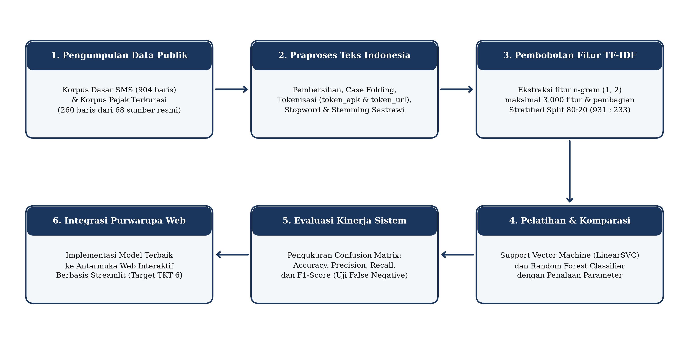

# TUGAS AKHIR

## KOMPARASI ALGORITMA SUPPORT VECTOR MACHINE DAN RANDOM FOREST DALAM DETEKSI PESAN PHISHING WHATSAPP MENGATASNAMAKAN OTORITAS PERPAJAKAN

## Sebagai Salah Satu Syarat untuk Memperoleh Gelar Sarjana Komputer pada Program Studi PJJ Informatika

## Oleh :

## 240101020194, Wan Mirza Dhani

## PROGRAM STUDI PJJ INFORMATIKA

## UNIVERSITAS SIBER ASIA

## NOVEMBER 2026

---

# HALAMAN PERNYATAAN ORISINALITAS

Saya yang bertanda-tangan di bawah ini:

| Atribut Identitas | Keterangan Mahasiswa |
| :--- | :--- |
| Nama | Wan Mirza Dhani |
| NIM | 240101020194 |
| Judul Tugas Akhir | Komparasi Algoritma Support Vector Machine dan Random Forest dalam Deteksi Pesan Phishing WhatsApp Mengatasnamakan Otoritas Perpajakan |

Menyatakan dengan sesungguhnya bahwa Tugas Akhir ini merupakan hasil penelitian, pemikiran dan pemaparan asli saya sendiri. Saya tidak mencantumkan tanpa pengakuan bahan-bahan yang telah dipublikasikan sebelumnya atau ditulis oleh orang lain, atau sebagai bahan yang pernah diajukan untuk gelar atau ijazah pada Universitas Siber Asia atau Perguruan Tinggi lainnya.

Apabila di kemudian hari terdapat penyimpangan dan ketidakbenaran dalam pernyataan ini, maka saya bersedia menerima sanksi akademik sesuai dengan peraturan yang berlaku di Universitas Siber Asia.

Demikian pernyataan ini saya buat.

| Tempat dan Tanggal | Tanda Tangan di Atas Materai Rp10.000 | Nama Lengkap Mahasiswa |
| :--- | :---: | :--- |
| Jakarta, ...... / ................ / 2026 | (materai Rp 10.000,-) | (Wan Mirza Dhani) |

---

# HALAMAN PENGESAHAN

Tugas Akhir ini diajukan oleh :

| Atribut Pengajuan | Keterangan Mahasiswa |
| :--- | :--- |
| Nama | Wan Mirza Dhani |
| NIM | 240101020194 |
| Program Studi | PJJ Informatika |
| Judul Tugas Akhir | Komparasi Algoritma Support Vector Machine dan Random Forest dalam Deteksi Pesan Phishing WhatsApp Mengatasnamakan Otoritas Perpajakan |

Telah berhasil dipertahankan di hadapan Dewan Penguji dan diterima sebagai bagian persyaratan yang diperlukan untuk memperoleh gelar Sarjana Komputer pada Program Studi PJJ Informatika Universitas Siber Asia.

| Jabatan Dewan Sidang | Nama Lengkap dan Gelar Akademik | Tanda Tangan |
| :--- | :--- | :--- |
| Ketua Sidang / Dosen Penguji I | (..........................................) | .......................... |
| Dosen Penguji II | (..........................................) | .......................... |
| Dosen Pembimbing I | (Novi Dian Nathasia, S.Kom., MMSI) | .......................... |
| Dosen Pembimbing II | (..........................................) | .......................... |
| Ketua Program Studi | (Syahid Abdullah, S.Si, M.Kom) | .......................... |
| Ditetapkan di | Jakarta | |
| Tanggal | ...... / ................ / 2026 | |

---

# ABSTRAK

Penipuan *phishing* pada WhatsApp berkedok Direktorat Jenderal Pajak kerap memanfaatkan berkas `.apk` serta tautan *Coretax* palsu. Penelitian ini membandingkan *Support Vector Machine* dan *Random Forest* berbasis pembobotan *Term Frequency-Inverse Document Frequency* (TF-IDF) sekaligus membangun *prototype* web verifikasi mandiri. Uji eksperimental memadukan 904 pesan umum dan 260 pesan pajak seimbang melalui *stopword removal* serta *stemming* Sastrawi menjadi 1.164 data teks. Hasil membuktikan *Support Vector Machine* meraih akurasi 98,28%, *recall* 0,98, dan *F1-Score* 0,98, mengungguli *Random Forest* berakurasi 95,28% (*recall* 0,95; *F1-Score* 0,94). Integrasi model terbaik pada Streamlit memudahkan verifikasi pesan secara cepat.

Kata Kunci: Deteksi Phishing, Otoritas Perpajakan, Random Forest, Support Vector Machine, TF-IDF.

# ABSTRACT

WhatsApp *phishing* scams impersonating the Directorate General of Taxes frequently distribute malicious `.apk` files and fake *Coretax* links. This study compares *Support Vector Machine* and *Random Forest* with *Term Frequency-Inverse Document Frequency* (TF-IDF) weighting while building a self-verification web prototype. Experimental testing combines 904 general texts and 260 balanced tax messages processed via Sastrawi stopword removal and stemming into 1,164 records. Results prove *Support Vector Machine* achieves 98.28% accuracy, 0.98 recall, and 0.98 *F1-Score*, outperforming *Random Forest* at 95.28% accuracy (0.95 recall; 0.94 *F1-Score*). Integrating the best model into Streamlit enables rapid message verification.

Keywords: Phishing Detection, Random Forest, Support Vector Machine, Tax Authority, TF-IDF.

---

# KATA PENGANTAR

Puji syukur penulis panjatkan ke hadirat Tuhan Yang Maha Esa karena atas rahmat-Nya, penulis dapat menyelesaikan Tugas Akhir ini dengan baik. Tugas Akhir ini berjudul *"Komparasi Algoritma Support Vector Machine dan Random Forest dalam Deteksi Pesan Phishing WhatsApp Mengatasnamakan Otoritas Perpajakan"*. Penulisan karya ilmiah dengan skema *Prototype* ini disusun untuk memenuhi salah satu syarat memperoleh gelar Sarjana Komputer pada Program Studi PJJ Informatika Universitas Siber Asia.

Ketertarikan penulis terhadap permasalahan dalam Tugas Akhir ini berangkat dari maraknya kasus penipuan digital melalui WhatsApp yang mencatut identitas otoritas perpajakan di Indonesia. Penulis menyadari bahwa tanpa bantuan dan bimbingan dari berbagai pihak, dari masa perkuliahan sampai pada penyusunan laporan ini, sangatlah sulit bagi penulis untuk menyelesaikan penelitian ini. Karena itu, penulis menyampaikan ucapan terima kasih yang tulus kepada:

a) Bapak Jang Youn Cho, Ph.D., CPA, selaku Rektor Universitas Siber Asia. Beliau telah memimpin penyelenggaraan pendidikan tinggi berbasis pembelajaran daring yang mendukung proses studi penulis.

b) Bapak Dr. Ucuk Darusalam, S.T., M.T., selaku Wakil Rektor Bidang Akademik, Penelitian dan Pengabdian Kepada Masyarakat Universitas Siber Asia. Beliau telah mendukung penyediaan fasilitas pembelajaran dan penelitian yang memadai bagi mahasiswa.

c) Bapak Syahid Abdullah, S.Si, M.Kom, selaku Ketua Program Studi PJJ Informatika Universitas Siber Asia. Beliau telah memberikan arahan kebijakan akademik selama masa studi penulis.

d) Bapak Novi Dian Nathasia, S.Kom., MMSI, selaku Dosen Pembimbing Tugas Akhir. Beliau telah menyediakan waktu dan pikiran untuk membimbing penulis dalam menyelesaikan penelitian ini.

e) Seluruh dosen pengajar Program Studi PJJ Informatika Universitas Siber Asia. Para pengajar telah membekali penulis dengan ilmu pengetahuan komputasi yang sangat bermanfaat.

f) Orang tua dan keluarga penulis yang selalu memberikan doa setiap waktu. Dukungan moral serta material dari keluarga menjadi penguat utama bagi penulis.

g) Rekan-rekan mahasiswa Program Studi PJJ Informatika beserta semua pihak yang telah membantu penulis. Diskusi selama penyusunan karya ilmiah ini sangat membantu penyelesaian purwarupa sistem.

Penulis menyadari bahwa laporan Tugas Akhir ini masih memiliki keterbatasan yang dapat dikembangkan lebih lanjut pada penelitian berikutnya. Karena itu, penulis mengharapkan saran dan kritik yang membangun dari para pembaca demi penyempurnaan sistem deteksi ini di masa mendatang. Akhir kata, penulis berharap Tuhan Yang Maha Esa berkenan membalas segala kebaikan semua pihak yang telah membantu. Semoga Tugas Akhir ini membawa manfaat nyata bagi pengembangan ilmu pengetahuan.

| Tempat dan Waktu Penyusunan | Identitas Penyusun |
| :--- | :---: |
| Jakarta, November 2026 | **Penulis** |

---

# DAFTAR ISI

| Bagian / Bab / Subbab | Halaman |
| :--- | :---: |
| Halaman Judul | i |
| Halaman Pernyataan Orisinalitas | ii |
| Halaman Pengesahan | iii |
| Halaman Abstrak dan *Abstract* | iv |
| Kata Pengantar | v |
| Daftar Isi | vii |
| Daftar Gambar | viii |
| Daftar Tabel | ix |
| Bab I Pendahuluan | 1 |
| 1.1 Latar Belakang Masalah | 1 |
| 1.2 Rumusan Masalah | 2 |
| 1.3 Batasan Masalah | 3 |
| 1.4 Tujuan Penelitian | 4 |
| 1.5 Manfaat Penelitian | 5 |
| 1.6 Metode Penelitian | 6 |
| Daftar Pustaka | 8 |

---

# DAFTAR GAMBAR

| Nomor Gambar | Judul Gambar | Halaman |
| :--- | :--- | :---: |
| Gambar 1.1 | Tahapan Metode Penelitian | 7 |

---

# DAFTAR TABEL

| Nomor Tabel | Judul Tabel | Halaman |
| :--- | :--- | :---: |
| Tabel 1.1 | Komposisi Korpus Dataset Penelitian | 6 |

---

# BAB I PENDAHULUAN

## 1.1 Latar Belakang Masalah

Transformasi digital pada administrasi perpajakan di Indonesia memperluas pemanfaatan saluran komunikasi elektronik oleh Direktorat Jenderal Pajak (DJP) [1]. Pembaruan itu mencakup peluncuran sistem inti administrasi perpajakan (*Coretax Administration System*) pada laman `coretaxdjp.pajak.go.id` serta aplikasi bergerak *M-Pajak*. Di samping pemadanan Nomor Induk Kependudukan (NIK) sebagai Nomor Pokok Wajib Pajak (NPWP), layanan tersebut juga memanfaatkan *WhatsApp Blast* resmi [2]. Saluran pesan instan ini sukses mempercepat penyampaian pengingat Surat Pemberitahuan (SPT) Tahunan kepada wajib pajak. Namun, keterbukaan kanal itu ikut membuka celah penipuan digital yang berbahaya.

Kepercayaan wajib pajak terhadap kanal resmi instansi memicu maraknya serangan rekayasa sosial (*social engineering*) melalui aplikasi WhatsApp [3], [4]. Kompilasi terhadap 68 dokumen pengumuman resmi DJP (`PENG-31/PJ.09/2024` hingga `PENG-50/PJ.09/2025`) dan laporan kasus Kantor Pelayanan Pajak (KPP) mengungkap dua belas kategori modus penipuan perpajakan [5]. Penyerang menyebarkan berkas berbahaya berformat *Android Package Kit* (`.apk`) dengan menyamar sebagai pembaruan aplikasi *Coretax* maupun *M-Pajak*. Pelaku juga menyisipkan tautan tiruan seperti `coretax-online.com` dan `djp.linepajak-go.com` atau tagihan pajak palsu berformat PDF untuk memicu kepanikan korban.

Wajib pajak awam maupun staf administrasi perusahaan kerap kesulitan membedakan *WhatsApp Blast* resmi DJP dari pesan penipuan [1], [5]. Kemiripan itu sengaja dirancang pelaku dengan meniru struktur surat dinas lengkap beserta pencantuman nomor peraturan perpajakan. Pesan tiruan tersebut juga menyelipkan istilah sahih seperti kode *billing* dan *Electronic Filing Identification Number* (EFIN). Model deteksi yang semata dilatih pada korpus spam umum rentan terkena bias kata kunci. Pesan resmi DJP pun rentan terblokir keliru.

Berbagai studi terdahulu menguji algoritma pembelajaran mesin untuk menyaring pesan berbahaya lintas bahasa. Eksperimen pada pesan singkat (SMS) Indonesia membuktikan *Support Vector Machine* (SVM) dan *Random Forest* meraih akurasi tinggi ketika dipadukan bersama pembobotan *Term Frequency-Inverse Document Frequency* (TF-IDF) maupun *Term Frequency-Relevance Frequency* (TF-RF) [6], [7], [8], [9], [10]. Kajian serupa menyasar identifikasi tautan *phishing* berbasis fitur *Uniform Resource Locator* (URL) [11] serta penyaringan spam surel [12], [13]. Riset WhatsApp sebelumnya baru menjangkau dialek Surabaya [14], *bot* umum [15], dan penipuan umum [16].

Kajian khusus deteksi penipuan bertema otoritas perpajakan masih tergolong langka. Riset terdahulu soal penyalahgunaan data wajib pajak baru menelaah sisi regulasi tanpa merancang model otomatis [3]. Celah riset (*research gap*) inilah yang memotivasi komparasi SVM terhadap *Random Forest* pada teks *phishing* WhatsApp bertema pajak. Kebaruan penelitian hadir lewat penyusunan 260 pesan pajak seimbang bersama 904 pesan umum, disertai tokenisasi khusus pola berkas `.apk` (`token_apk`) serta tautan (`token_url`).

Luaran penelitian berwujud *prototype* aplikasi web interaktif berbasis Python dan *framework* Streamlit [17], [18]. Aplikasi ini ditargetkan mencapai Tingkat Kesiapan Teknologi (TKT) level 6 melalui demonstrasi kasus nyata yang relevan. Pengguna dapat menempelkan teks WhatsApp mencurigakan guna memperoleh status klasifikasi beserta skor kemungkinannya. Mesin klasifikasi itu juga mudah diperluas menjadi layanan *Application Programming Interface* (API) demi memperkuat pelindungan wajib pajak.

## 1.2 Rumusan Masalah

Berdasarkan uraian latar belakang masalah dan hasil identifikasi terhadap pola kasus penipuan perpajakan di masyarakat, rumusan masalah penelitian ini disusun dalam bentuk hubungan sebab-akibat. Pernyataan tersebut mengungkapkan kelemahan cara kerja mekanisme verifikasi manual serta keterbatasan penyaringan spam umum saat ini. Adapun tiga rumusan masalah utama yang dikaji dalam penelitian ini diuraikan sebagai berikut:

a) Kemiripan gaya bahasa kedinasan dan pemakaian istilah resmi perpajakan pada pesan penipuan (*phishing*) WhatsApp menyulitkan verifikasi manual oleh wajib pajak. Kondisi tersebut meningkatkan risiko pencurian data kredensial maupun kerugian finansial akibat pemasangan berkas `.apk` berbahaya.

b) Ketergantungan model penyaringan spam konvensional pada korpus pesan singkat umum tanpa penyeimbangan teks resmi perpajakan menyebabkan timbulnya bias kata kunci (*keyword bias*). Kelemahan ini mengakibatkan pengumuman resmi DJP berpotensi salah diklasifikasikan sebagai penipuan (*false positive*) atau pesan rekayasa sosial baru lolos dari deteksi (*false negative*).

c) Perbedaan cara kerja pemisahan ruang fitur berdimensi tinggi pada *Support Vector Machine* dan penggabungan pohon keputusan pada *Random Forest* menuntut pengujian komparatif secara empiris pada fitur TF-IDF *n-gram*. Tanpa pengujian tersebut, belum tersedia dasar terukur untuk memilih model paling optimal pada purwarupa aplikasi deteksi mandiri.

## 1.3 Batasan Masalah

Agar pembahasan dalam penelitian ini tetap terarah dan fokus pada pokok persoalan yang dikaji, diperlukan pembatasan ruang lingkup secara tegas. Batasan tersebut mengatur objek teks, sumber korpus data, metode praproses, algoritma yang diuji, hingga bentuk luaran aplikasi. Enam batasan masalah yang ditetapkan pada penelitian Tugas Akhir *Prototype* ini adalah sebagai berikut:

a) Objek penelitian dibatasi pada analisis klasifikasi biner terhadap teks pesan singkat berbahasa Indonesia. Kelas pertama adalah pesan penipuan atau rekayasa sosial (*phishing/fraud* berlabel `1`), sedangkan kelas kedua adalah pesan aman atau layanan resmi perpajakan (berlabel `0`).

b) Sumber data penelitian menggunakan korpus publik terbuka tanpa memakai data rahasia internal wajib pajak. Total dataset gabungan utama memuat 1.164 baris pesan singkat. Korpus itu memadukan 904 baris SMS berbahasa Indonesia [6] dan 260 baris teks spesifik perpajakan dari 68 publikasi resmi periode 2024 sampai 2026 [2], [5].

c) Tahapan praproses teks (*text preprocessing*) meliputi pembersihan karakter nonalfanumerik, penyeragaman huruf kecil (*case folding*), pengubahan pola berkas `.apk` menjadi `token_apk`, serta transformasi tautan menjadi `token_url` sebelum melewati penghapusan kata henti (*stopword removal*), *stemming* Sastrawi, dan pembobotan TF-IDF *n-gram* (1, 2) maksimal 3.000 fitur.

d) Algoritma klasifikasi pembelajaran mesin yang dibandingkan dalam eksperimen ini dibatasi pada metode *Support Vector Machine* (*LinearSVC*) dan *Random Forest Classifier*. Pembagian himpunan data latih terhadap data uji dilakukan secara terstratifikasi (*stratified train-test split*) dengan proporsi 80:20, yaitu 931 data latih dan 233 data uji.

e) Evaluasi kinerja model diukur memakai matriks evaluasi *Confusion Matrix* yang mencakup nilai *Accuracy*, *Precision*, *Recall*, dan *F1-Score*. Analisis kesalahan difokuskan pada kemampuan kedua algoritma dalam menekan jumlah *False Negative* maupun *False Positive* pada pesan perpajakan.

f) Luaran (*outcome*) penelitian berupa purwarupa (*prototype*) aplikasi web interaktif berbasis bahasa pemrograman Python dengan *framework* Streamlit pada Tingkat Kesiapan Teknologi (TKT) level 6. Aplikasi ini menerima masukan teks pesan WhatsApp dari pengguna dan menampilkan hasil klasifikasi beserta indikator risikonya.

## 1.4 Tujuan Penelitian

Sejalan dengan rumusan dan batasan masalah yang telah ditetapkan sebelumnya, penelitian ini dirancang untuk mencapai peningkatan akurasi deteksi sekaligus menghasilkan purwarupa sistem yang terukur. Setiap capaian dirumuskan memakai kata kerja operasional yang dapat diuji secara empiris pada tahap eksperimen. Adapun tiga tujuan utama yang hendak dicapai dalam penelitian ini adalah sebagai berikut:

a) Menyusun korpus teks berbahasa Indonesia bertema perpajakan yang seimbang antara kelas penipuan dan kelas layanan resmi. Tahap ini juga menerapkan konsep praproses teks serta pembobotan fitur *Term Frequency-Inverse Document Frequency* (TF-IDF) untuk mengenali karakteristik pesan *phishing* WhatsApp mengatasnamakan otoritas perpajakan.

b) Menguji, menghitung, dan menganalisis perbandingan kinerja algoritma *Support Vector Machine* terhadap *Random Forest* berdasarkan metrik *Accuracy*, *Precision*, *Recall*, serta *F1-Score*. Pengujian ini bertujuan membuktikan ketangguhan model dalam mendeteksi pesan *phishing* perpajakan tanpa menimbulkan bias kata kunci pada pesan resmi.

c) Membuat *prototype* aplikasi web deteksi pesan *phishing* yang interaktif menggunakan *framework* Streamlit dengan mengintegrasikan model klasifikasi terbaik. Purwarupa ini disiapkan sebagai sarana verifikasi mandiri yang praktis bagi masyarakat dan wajib pajak.

## 1.5 Manfaat Penelitian

Hasil pelaksanaan penelitian dan pengembangan purwarupa sistem deteksi pesan *phishing* ini diharapkan dapat memberikan dampak positif yang nyata bagi berbagai pemangku kepentingan. Manfaat utama dari karya ilmiah Tugas Akhir ini meliputi kontribusi pada pengembangan ilmu pengetahuan, dukungan bagi instansi terkait, serta pelindungan masyarakat umum. Rincian manfaat penelitian tersebut diuraikan sebagai berikut:

a) Manfaat bagi Bidang Ilmu Pengetahuan dan Teknologi (IPTEKS): Menyumbangkan rujukan ilmiah dan bukti empiris mengenai perbandingan kinerja algoritma *Support Vector Machine* terhadap *Random Forest* berbasis TF-IDF *n-gram*. Korpus terkurasi yang disusun dalam penelitian ini juga dapat dipakai kembali untuk pengembangan pemrosesan bahasa alami (*Natural Language Processing*) bahasa Indonesia.

b) Manfaat bagi Instansi dan Pengambil Kebijakan: Memberikan masukan teknis beserta model purwarupa yang dapat dijadikan bahan pertimbangan oleh otoritas perpajakan maupun pengelola keamanan siber. Hasil analisis terhadap dua belas kategori modus penipuan pajak ini dapat mendukung penyusunan strategi edukasi pelindungan wajib pajak yang berbasis data.

c) Manfaat bagi Masyarakat dan Wajib Pajak: Menyediakan alat bantu verifikasi mandiri berbasis web yang mudah diakses kapan saja melalui perangkat pengguna. Masyarakat dapat memeriksa keaslian teks pesan WhatsApp yang mengatasnamakan Direktorat Jenderal Pajak sebelum mengakses tautan mencurigakan atau mengunduh lampiran `.apk`.

## 1.6 Metode Penelitian

Penelitian ini menerapkan pendekatan kuantitatif eksperimental yang dipadukan bersama *Research and Development* (R&D) sesuai skema Tugas Akhir *Prototype* di Universitas Siber Asia [17], [18]. Pengumpulan data ditempuh lewat studi dokumentasi dan ekstraksi otomatis pada 68 sumber informasi publik otoritatif [19]. Sumber tersebut mencakup pengumuman resmi Direktorat Jenderal Pajak (`pajak.go.id`), siaran pers KPP, portal cek fakta, serta berita pajak terverifikasi [2], [5]. Seluruh data bersifat publik terbuka.

Data spesifik perpajakan sebanyak 260 baris tersebut dikurasi seimbang menjadi 130 pesan *phishing* dari 12 kategori modus dan 130 pesan resmi dari 10 kategori layanan. Penyeimbangan kelas itu mencegah bias kata kunci perpajakan. Korpus pajak lalu digabung bersama 904 baris korpus dasar SMS berbahasa Indonesia hingga membentuk dataset utama sebanyak 1.164 baris [6]. Rincian komposisi datanya tersaji pada Tabel 1.1.

Tabel 1.1 Komposisi Korpus Dataset Penelitian

| Nama Korpus Data | Sumber Rujukan Utama | Kelas Phishing (Baris) | Kelas Aman (Baris) | Total Rekaman (Baris) |
| :--- | :--- | :---: | :---: | :---: |
| Korpus Dasar SMS Indonesia | Repositori Publik UPI (Rahmi & Wibisono) [6] | 335 | 569 | 904 |
| Korpus Spesifik Perpajakan | Kurasi 68 Sumber Resmi DJP & Cek Fakta [2], [5] | 130 | 130 | 260 |
| Dataset Gabungan Utama | Penggabungan Korpus Dasar dan Perpajakan | 465 | 699 | 1.164 |

Sumber: Olahan Data Penelitian (2026).

Tahap analisis data diawali praproses teks bahasa Indonesia yang meliputi pembersihan karakter, *case folding*, tokenisasi `token_apk` serta `token_url`, penghapusan kata henti (*stopword removal*), dan *stemming* Sastrawi. Teks bersih itu diubah menjadi matriks numerik lewat pembobotan TF-IDF *n-gram* (1, 2) maksimal 3.000 fitur, lalu dibagi terstratifikasi sebesar 80:20 [20], [21]. Selanjutnya, proses pelatihan dan penalaan parameter dijalankan pada *Support Vector Machine* (*LinearSVC*) maupun *Random Forest Classifier*. Kinerja kedua model diukur memakai *Confusion Matrix* dan diintegrasikan ke aplikasi Streamlit pada TKT level 6. Urutan tahapan tersebut tergambar pada Gambar 1.1.

Gambar 1.1 Tahapan Metode Penelitian.

Berdasarkan sifat matriks fitur TF-IDF yang berdimensi tinggi dan renggang (*sparse matrix*), riset ini menetapkan hipotesis kerja untuk diuji pada tahap eksperimen [20], [21]. Hipotesis menyatakan adanya perbedaan kinerja terukur, dengan *Support Vector Machine* (*LinearSVC*) meraih *Recall* dan *F1-Score* lebih tinggi daripada *Random Forest*. Uji pendahuluan pada 233 data uji membuktikan *Support Vector Machine* mencapai akurasi 98,28%, *Recall* 0,98, serta *F1-Score* 0,98 dengan hanya dua galat negatif palsu dan dua positif palsu. *Random Forest* tertinggal pada akurasi 95,28%, *Recall* 0,95, dan *F1-Score* 0,94.

---

# DAFTAR PUSTAKA

[1] Waluyo, *Perpajakan Indonesia*, ed. ke-13. Jakarta: Salemba Empat, 2020.

[2] Direktorat Jenderal Pajak, “Pengiriman WhatsApp Blast dalam rangka edukasi Coretax DJP,” *Portal Resmi Direktorat Jenderal Pajak Kementerian Keuangan Republik Indonesia*, 2024. [Online]. Available: https://www.pajak.go.id/id/pengumuman/pengiriman-whatsapp-blast-dalam-rangka-edukasi-coretax-djp

[3] N. B. Prakoso, H. Ayu, and H. Zakaria, “Misuse of taxpayer data for phising scams,” *Journal of International Islamic Law, Human Rights, and Public Policy*, vol. 4, no. 3, pp. 1560-1569, Jul. 2026, doi: 10.5281/zenodo.21853029.

[4] R. Alabdan, “Phishing attacks survey: Types, vectors, and technical approaches,” *Future Internet*, vol. 12, no. 10, p. 168, Oct. 2020, doi: 10.3390/fi12100168.

[5] Direktorat Jenderal Pajak, “Waspada penipuan yang mengatasnamakan Direktorat Jenderal Pajak (Pengumuman Nomor PENG-31/PJ.09/2024 s.d. PENG-50/PJ.09/2025),” *Portal Resmi Direktorat Jenderal Pajak Kementerian Keuangan Republik Indonesia*, 2025. [Online]. Available: https://www.pajak.go.id/id/pengumuman/waspada-penipuan-yang-mengatasnamakan-direktorat-jenderal-pajak

[6] F. Rahmi and Y. Wibisono, “Dataset klasifikasi bahasa Indonesia SMS spam,” *Repositori Universitas Pendidikan Indonesia*, Bandung, 2016. [Online]. Available: https://repository.upi.edu/26936/

[7] A. Theodorus, T. K. Prasetyo, R. Hartono, and D. Suhartono, “Short Message Service (SMS) spam filtering using machine learning in Bahasa Indonesia,” in *Proc. 3rd East Indonesia Conf. Comput. Inf. Technol. (EIConCIT)*, Apr. 2021, pp. 199-203, doi: 10.1109/EIConCIT50028.2021.9431859.

[8] D. Irawan, E. B. Perkasa, Yurindra, D. Wahyuningsih, and E. Helmud, “Perbandingan klassifikasi SMS berbasis Support Vector Machine, Naive Bayes Classifier, Random Forest dan Bagging Classifier,” *Jurnal Sisfokom (Sistem Informasi dan Komputer)*, vol. 10, no. 3, pp. 432-437, Dec. 2021, doi: 10.32736/sisfokom.v10i3.1302.

[9] M. S. Al Ghofany, R. Dwiyansaputra, F. Bimantoro, and A. Aranta, “Indonesian SMS spam detection using TF-RF feature weighting method and Support Vector Machine classifier,” in *Proc. First Mandalika Int. Multi-Conf. Sci. Eng. (MIMSE-I-C)*, 2022, pp. 117-129, doi: 10.2991/978-94-6463-084-8_12.

[10] E. Z. Astuti, C. A. Sari, E. H. Rachmawanto, and R. R. Ali, “Comparative study of machine learning algorithms for performing ham or spam classification in SMS,” *Scientific Journal of Informatics*, vol. 11, no. 1, pp. 177-186, Feb. 2024, doi: 10.15294/sji.v11i1.47364.

[11] F. F. Tampinongkol, A. R. Kamila, and A. C. Wardhana, “Implementation of Random Forest classification and Support Vector Machine algorithms for phishing link detection,” *Journal of Informatics Information System Software Engineering and Applications (INISTA)*, vol. 7, no. 1, pp. 127-137, Nov. 2024, doi: 10.20895/inista.v7i1.1588.

[12] A. Al Tawil, L. H. Almazaydeh, D. Qawasmeh, B. Qawasmeh, M. Alshinwan, and K. Elleithy, “Comparative analysis of machine learning algorithms for email phishing detection using TF-IDF, Word2Vec, and BERT,” *Computers, Materials & Continua*, vol. 81, no. 2, pp. 3395-3412, Nov. 2024, doi: 10.32604/cmc.2024.057279.

[13] A. A. Ningtias, N. Anwar, A. Ichwani, and R. T. Iswahyudi, “Komparasi kinerja Support Vector Machine dan Random Forest untuk deteksi spam email berbasis TF-IDF teks,” *IKRA-ITH Informatika: Jurnal Komputer dan Informatika*, vol. 10, no. 3, pp. 45-51, Nov. 2026.

[14] F. M. Efendi, A. K. Adisusilo, and S. Budiprayitno, “Pengembangan sistem deteksi phishing pada WhatsApp berbasis AI dengan integrasi bahasa lokal Surabaya,” *Melek IT Information Technology Journal*, vol. 11, no. 1, pp. 101-112, Jun. 2025, doi: 10.30742/melekitjournal.v11i1.417.

[15] R. B. Saputra, M. Azwar, L. Widyawati, Husain, and K. A. Latif, “Implementasi algoritma SVM pada bot WhatsApp untuk deteksi pesan spam,” *Jurnal Manajemen Informatika dan Sistem Informasi*, vol. 9, no. 1, pp. 39-51, Jan. 2026, doi: 10.36595/misi.v9i1.1803.

[16] M. A. Sembiring, M. F. L. Sibuea, and Anjani, “Optimasi model klasifikasi pesan penipuan digital berbahasa Indonesia menggunakan XGBoost dengan Bayesian Optimization dan SMOTE,” *Journal of Science and Social Research*, vol. 9, no. 3, pp. 5329-5336, Jun. 2026, doi: 10.54314/jssr.v9i3.7212.

[17] C. R. Hassolthine, U. Darusalam, and M. Ikhwani, *Pedoman Teknis Penulisan Tugas Akhir Mahasiswa Universitas Siber Asia (SK Rektor Nomor 01 Tahun 2024)*. Jakarta: Universitas Siber Asia, 2024.

[18] Sugiyono, *Metode Penelitian Kuantitatif, Kualitatif, dan R&D*, ed. ke-2. Bandung: Alfabeta, 2023.

[19] M. Darwin, M. R. Mamondol, S. A. Sormin, and Y. Nurhayati, *Metode Penelitian Pendekatan Kuantitatif*. Bandung: Media Sains Indonesia, 2021.

[20] Sugiyono, *Statistika untuk Penelitian*. Bandung: Alfabeta, 2019.

[21] L. P. Sinambela, *Metodologi Penelitian Kuantitatif: Teoretik dan Praktik*. Depok: Rajawali Pers, 2021.
